# Computer Vision for Robotics

**Hands-on, tested tutorials covering modern computer vision for robot perception, from pinhole geometry to text-queried 3D grasp poses.** Every project is a set of executed Jupyter notebooks with real measurements on a single 8 GB laptop GPU, a README with the theory and results, and exercises with solutions.

[](https://www.python.org/)
[](https://pytorch.org/)
[](https://opencv.org/)
[](LICENSE)
[](https://github.com/JaisalJain/computer-vision/actions/workflows/ci.yml)

<p align="center">
  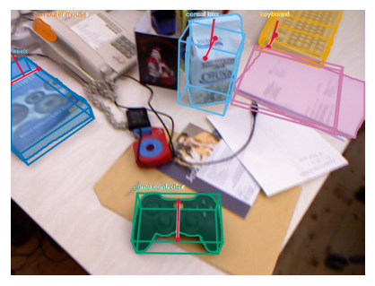
  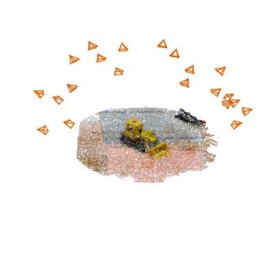
  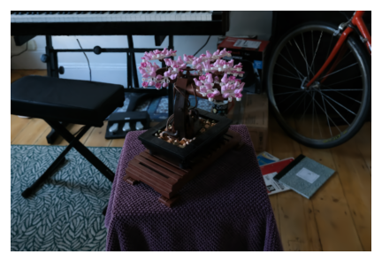
  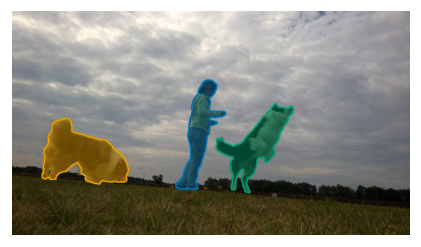
</p>

## Why this repository

- **Robotics first.** The projects build towards a perception stack a robot can use: calibrated cameras, 6-DoF fiducial poses, metric depth, multi-view geometry, odometry, and an end-to-end pipeline that turns a text query into an object point cloud, a 3D box and a grasp pose.
- **Current models, run locally.** SAM 3, DINOv3, Depth Anything 3, VGGT, YOLO26/YOLOE-26, Grounding DINO, LLMDet, OWLv2, SigLIP 2, Florence-2, CoTracker3, gsplat and COLMAP. Every model was chosen and configured to fit in 8 GB of VRAM.
- **Measured, not claimed.** Every number in the READMEs comes from a run in this repository on the hardware below, including latency and peak VRAM. Fallbacks and failure cases are documented.
- **Written to teach.** Each notebook starts with an overview. A markdown cell with the concept, intuition and key equations comes before every code cell, and every code cell starts with a comment block. Notebooks end with **Results** (figures, a summary table, takeaways) and **Exercises** with solutions in `solutions/`.
- **Engineered like a library.** Shared, unit-tested code lives in the `cvlab` package: camera models, SE(3) transforms, point clouds, metrics and plotting. CI runs ruff, the CPU test suite and a static verification of every notebook and README.

## Projects

| # | Project | Preview | What you'll build | Key models / tools |
|---|---|---|---|---|
| 01 | [Classical CV](projects/01_classical_cv/) | 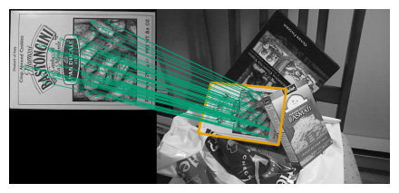 | Filtering and edges, SIFT/ORB matching with RANSAC homographies and panoramas, checkerboard camera calibration and undistortion | OpenCV 5.0 (SIFT, ORB, MAGSAC++, Canny, calibrateCamera, Stitcher) |
| 02 | [Representation learning](projects/02_representation_learning/) | 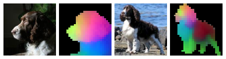 | Linear probe vs fine-tuning of timm CNNs, frozen DINOv3/DINOv2 k-NN and few-shot features, Grad-CAM from scratch | ResNet-18, EfficientNet-B0, ConvNeXt-Nano (timm), DINOv3 ViT-S/16, DINOv2 ViT-S/14 |
| 03 | [Object detection](projects/03_object_detection/) | 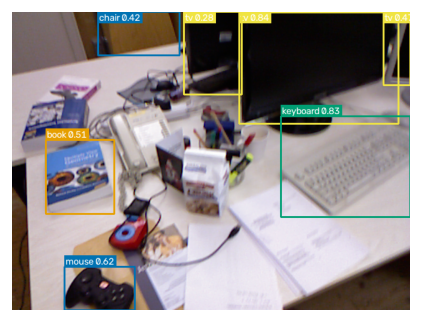 | YOLO26 inference, NMS vs NMS-free head, fine-tuning with mAP, ONNX Runtime export, RF-DETR comparison | YOLO26n/s, RF-DETR Nano/Small, ONNX Runtime |
| 04 | [Open-vocabulary detection](projects/04_open_vocab_detection/) | 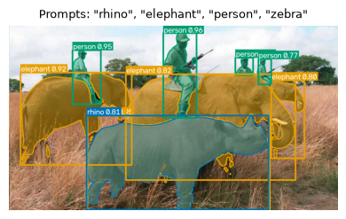 | Text-prompted detectors (YOLOE-26, Grounding DINO, LLMDet, OWLv2, OmDet-Turbo, SAM 3) benchmarked vs closed-set YOLO26, plus a 3D object map | YOLOE-26, Grounding DINO, LLMDet, OWLv2, OmDet-Turbo, SAM 3, YOLO26 |
| 05 | [Segmentation](projects/05_segmentation/) |  | SAM 3 vs SAM 2.1 click/box/text segmentation, DAVIS video propagation with J&F, and YOLO26-seg real-time masks | SAM 3, SAM 2.1, Grounding DINO-T, YOLO26-seg |
| 06 | [Tracking](projects/06_tracking/) | 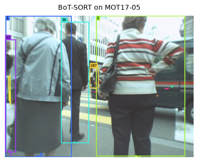 | Multi-object tracking on MOT17 (SORT, ByteTrack, BoT-SORT), CoTracker3 point tracking and SAM 3 text-prompted video tracking | YOLO26n/s, ByteTrack, BoT-SORT, OC-SORT, CoTracker3, SAM 3, DINOv3 |
| 07 | [Pose estimation](projects/07_pose_estimation/) | 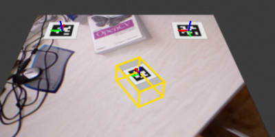 | YOLO26 human keypoints with OKS/mAP, an AprilTag/ArUco 6-DoF PnP accuracy benchmark, and robot frame chains | YOLO26n/s-pose, cv2.aruco (AprilTag 36h11, ChArUco), AprilTag 3, solvePnP IPPE |
| 08 | [Monocular depth](projects/08_monocular_depth/) | 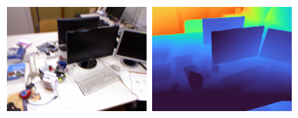 | Depth Anything 3 vs V2 on TUM RGB-D: relative vs metric depth, alignment, benchmark, point clouds | DA3-Small/Base, DA3Metric-Large, Depth Anything V2 (Small, Metric-Indoor) |
| 09 | [Multi-view geometry](projects/09_multiview_geometry/) | 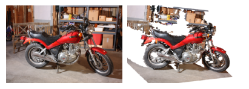 | Epipolar geometry, stereo rectification + SGBM, DISK+LightGlue matching and COLMAP SfM checked against reference models | OpenCV 5 (5-pt/MAGSAC++, SGBM), DISK + LightGlue (kornia), COLMAP/pycolmap 4.2 |
| 10 | [Feed-forward 3D reconstruction](projects/10_feedforward_3d/) |  | Unposed photos to cameras, depth and point clouds with VGGT and Depth Anything 3, scored against COLMAP and mocap | VGGT-1B, DA3-Base, DA3-Large-1.1, pycolmap |
| 11 | [Gaussian splatting](projects/11_gaussian_splatting/) |  | gsplat 3DGS trainer on Mip-NeRF 360 bonsai comparing COLMAP, random and Depth Anything 3 initialisation | gsplat 1.5.3, pycolmap 4.2.1, Depth Anything 3 (DA3-BASE) |
| 12 | [Visual odometry](projects/12_visual_odometry/) | 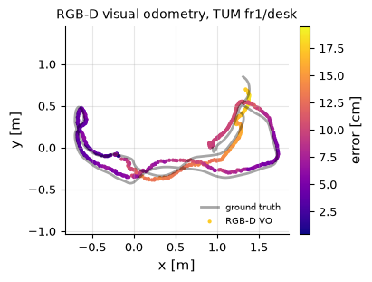 | Monocular and RGB-D feature-based VO on TUM fr1, scored with ATE/RPE, with drift and failure analysis | ORB, SIFT, 5-point E + MAGSAC++, EPnP-RANSAC, evo |
| 13 | [Vision-language models](projects/13_vision_language/) | 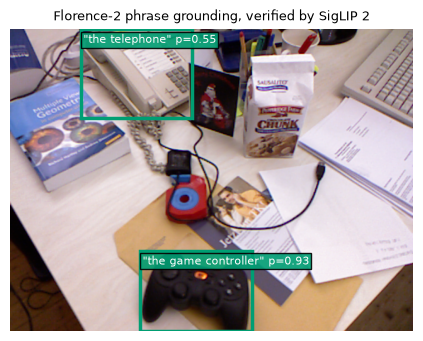 | Zero-shot SigLIP 2/CLIP classification, Florence-2 captions and grounding, and a benchmarked small VLM for robot-desk VQA | SigLIP 2, CLIP ViT-B/32, Florence-2-base, Qwen3.5-0.8B |
| 14 | Deployment *(in progress)* | | ONNX Runtime, TensorRT fp16/int8 and `torch.compile` latency/accuracy benchmarks | ONNX Runtime, TensorRT 10, torch.compile |
| 15 | [Robotics capstone](projects/15_robotics_capstone/) |  | Text-queried RGB-D perception: open-vocab detection, SAM masks, object clouds, 3D boxes, grasp poses, world object map | Grounding DINO-T, OWLv2, SAM 3, SAM 2.1-S, Depth Anything V2 Metric |

### Highlights (measured on the hardware below)

| Project | Result |
|---|---|
| 01 Classical CV | Checkerboard calibration with 0.1832 px RMS over 13 views. Undistortion straightens lines from 0.522 px to 0.083 px mean RMS deviation. |
| 03 Object detection | Fine-tuning lifts YOLO26n from mAP50-95 0.463 (COCO weights) to 0.822 on African-wildlife val. The ONNX Runtime export matches PyTorch to within 0.0004 mAP (0.8000 vs 0.8004, square-640 protocol). |
| 04 Open-vocab detection | On classes absent from COCO (buffalo, rhino), text-prompted SAM 3 reaches AP 0.847 and OWLv2 0.759, against 0.000 for closed-set YOLO26. |
| 05 Segmentation | DAVIS mask-prompted video J&F of 0.9829 (SAM 3) vs 0.9788 (SAM 2.1-S) on car-roundabout. |
| 06 Tracking | YOLO26s + BoT-SORT with camera-motion compensation scores HOTA 38.34 / IDF1 48.06 on MOT17-02+05. GMC cuts ID switches from 103 to 82 on MOT17-05. |
| 07 Pose estimation | 10 cm AprilTag at 1 m (synthetic renders with known pose): median translation error 6.1 mm with OpenCV sub-pixel corners vs 0.33 mm with AprilTag 3 corners. |
| 08 Monocular depth | DA3Metric-Large with no ground truth used: AbsRel 0.094, δ1 0.974 on 96 TUM RGB-D frames. |
| 09 Multi-view geometry | Relative-pose AUC@10 on South Building improves from 66.81 % (SIFT) to 83.87 % (DISK + LightGlue). |
| 10 Feed-forward 3D | TUM trajectory ATE after Sim(3): 1.00 cm (DA3-Large-1.1), 1.32 cm (COLMAP), 1.51 cm (VGGT-1B). |
| 11 Gaussian splatting | Test PSNR after 7k steps: 30.73 dB (COLMAP init), 29.45 dB (Depth Anything 3 init), 27.13 dB (random init). |
| 12 Visual odometry | RGB-D keyframe VO on TUM fr1_xyz: ATE 3.79 cm. |
| 13 Vision-language | CLIP ViT-B/32 zero-shot top-1 of 99.11 % on Imagenette val. Qwen3.5-0.8B answers 11 of 14 hand-labelled desk questions. |
| 15 Capstone | The same objects re-localised across frames in the world frame vary by 2.1 cm median (6.2 cm p90). The full GDINO-T + SAM 3 pipeline takes 1.08 s per frame. |

See each project README for the full tables, the evaluation protocol and the limitations.

### Suggested study order

1. **Geometry foundations:** 01 Classical CV, 07 Pose estimation (frames and PnP), 09 Multi-view geometry, 12 Visual odometry.
2. **Learned perception:** 02 Representation learning, 03 Object detection, 04 Open-vocabulary detection, 05 Segmentation, 06 Tracking.
3. **3D from learning:** 08 Monocular depth, 10 Feed-forward 3D, 11 Gaussian splatting.
4. **Language and systems:** 13 Vision-language, 15 Robotics capstone.

## Tested on

| Component | Version |
|---|---|
| OS | Ubuntu 24.04 |
| CPU / RAM | Intel Core Ultra 9 275HX, 32 GB |
| GPU | NVIDIA RTX 5060 Laptop GPU, 8 GB VRAM (Blackwell, sm_120) |
| Python | 3.12 |
| PyTorch | 2.11.0 + CUDA 12.8, torchvision 0.26.0 |
| NumPy / OpenCV | 2.5 / 5.0 |

All numbers in this repository were measured on this machine. The exact package versions of the verified environment are in [requirements/lock-cv.txt](requirements/lock-cv.txt), and the install method and source of every package and model are in [docs/stack.md](docs/stack.md).

## Installation

A CUDA 12.8+ PyTorch build is required for Blackwell (sm_120) GPUs. Every install goes through [requirements/constraints.txt](requirements/constraints.txt), which pins `torch`/`torchvision` (and keeps NumPy 2.5 and OpenCV 5), so no package can silently replace them.

### Option A: conda

```bash
PYTHONNOUSERSITE=1 conda env create -f environment.yml
conda activate cv
python scripts/check_env.py
```

`PYTHONNOUSERSITE=1` stops pip from treating packages in your user site (`~/.local`) as already installed while it builds the env. The env sets the same variable on activation.

### Option B: venv

```bash
python3.12 -m venv .venv
source .venv/bin/activate
make setup            # core stack + editable cvlab package + environment check
```

Both routes were tested from a fresh clone. `scripts/check_env.py` checks that torch is the pinned CUDA build with `sm_120` kernels, runs a real CUDA matmul, runs `pip check` and checks the key imports.

### Jupyter kernel

The notebooks run on a kernel named `cv`. Register the active environment as that kernel:

```bash
python -m ipykernel install --sys-prefix --name cv --display-name "Python (cv)"
```

### Project extras, data and third-party code

```bash
make setup-<project>              # extra packages of one project, e.g. make setup-08_monocular_depth
make data-<project>               # idempotent dataset / weight download into data/ and weights/
bash scripts/setup_third_party.sh # pinned clones of Depth Anything 3, VGGT and CoTracker (projects 06, 08, 10, 11)
```

Depth Anything 3, VGGT and CoTracker declare `numpy<2` in their packaging metadata, although the code paths used here run on NumPy 2.5. They are therefore cloned at pinned commits into `third_party/` and imported from source, which keeps `pip check` clean. Project 11 JIT-compiles the gsplat CUDA kernels for sm_120 on first use. Its README has the exact compiler setup.

## Quickstart

```bash
make check-env        # torch sees the GPU, sm_120 kernels, pip check is clean
make test             # CPU unit tests of the shared cvlab package and project code
make verify           # lint + tests + notebook / README / size / link / hygiene checks
make nb-<project>     # re-execute a project's notebooks headless, e.g. make nb-01_classical_cv
```

`make verify` runs `scripts/verify_repo.py`. It checks the notebook standard (an explanatory cell before every code cell, commented code, executed top to bottom, a Results section with figures and a table, and exercises), the required README sections, file sizes, relative links, and that no absolute paths or weights are committed.

## Repository structure

```
computer-vision/
├── src/cvlab/            # shared, tested library: device, io, viz, geometry, pointcloud, metrics, tum, download, bench
├── tests/                # CPU-only pytest suite (cvlab + project modules)
├── scripts/              # check_env.py, verify_repo.py, nb_clean.py, setup_third_party.sh, download_<project>.py
├── projects/<NN>_<name>/ # README, notebooks/, scripts/, configs/, results/, solutions/
├── assets/<NN>_<name>/   # small figures used by the READMEs
├── requirements/         # constraints.txt, base.txt, <project>.txt, lock-cv.txt
├── docs/stack.md         # verified versions, install methods and sources
├── environment.yml       # conda route
├── Makefile              # setup, check-env, lint, test, verify, setup-/data-/nb-<project>
└── data/ weights/ runs/ outputs/ third_party/   # created on demand, gitignored
```

## Datasets

Only small public datasets (or small subsets) are used, downloaded on demand by `make data-<project>` and never committed:

| Dataset | Used in | License / terms |
|---|---|---|
| OpenCV sample images (chessboard, graf, stitching) | 01, 07 | Apache-2.0 repository; graf images from the Oxford affine set, stitching images without a stated license |
| Imagenette-160 | 02, 13 | Apache-2.0 (fast.ai); images are an ImageNet subset (non-commercial research terms) |
| Ultralytics African-wildlife, medical-pills, COCO8 / COCO8-seg / COCO8-pose / COCO128 / COCO128-seg | 03, 04, 05, 07, 13 | Ultralytics packaging (AGPL-3.0); COCO annotations CC BY 4.0 |
| COCO val2017 subset | 04 | CC BY 4.0 annotations, Flickr image terms |
| DAVIS 2017 (two sequences) | 05 | CC BY 4.0 annotations |
| MOT17 (two training sequences) | 06 | CC BY-NC-SA 3.0 (non-commercial) |
| TUM RGB-D fr1_xyz, fr1_desk | 03, 04, 05, 07, 08, 09, 10, 12, 13, 15 | CC BY 4.0 |
| Middlebury MiddEval3 (quarter resolution) | 09 | Free to use and publish with citation (Scharstein et al. 2014) |
| COLMAP South Building | 09, 10 | No license stated (research use) |
| Mip-NeRF 360 *bonsai* | 11 | No license stated on the original release (research use) |

Each project README lists its exact sources, and [THIRD_PARTY_LICENSES.md](THIRD_PARTY_LICENSES.md) lists every model, dataset and library with non-commercial and copyleft terms flagged.

## Status

Projects 01–13 and 15 are complete. Project 14 (deployment) is in progress. A final review pass of every project is under way, and refinements will land as follow-up commits.

## License

The code in this repository is released under the [MIT License](LICENSE). Models, datasets and libraries keep their own licenses. Some are copyleft (e.g. Ultralytics, AGPL-3.0) or non-commercial (e.g. VGGT-1B, CoTracker3, MOT17); see [THIRD_PARTY_LICENSES.md](THIRD_PARTY_LICENSES.md).

## Citation

If this repository is useful for your work, please cite the original papers listed in each project README, and optionally this repository:

```bibtex
@misc{jain2026cvrobotics,
  author       = {Jaisal Jain},
  title        = {Computer Vision for Robotics: tested tutorials and benchmarks},
  year         = {2026},
  howpublished = {\url{https://github.com/JaisalJain/computer-vision}}
}
```
