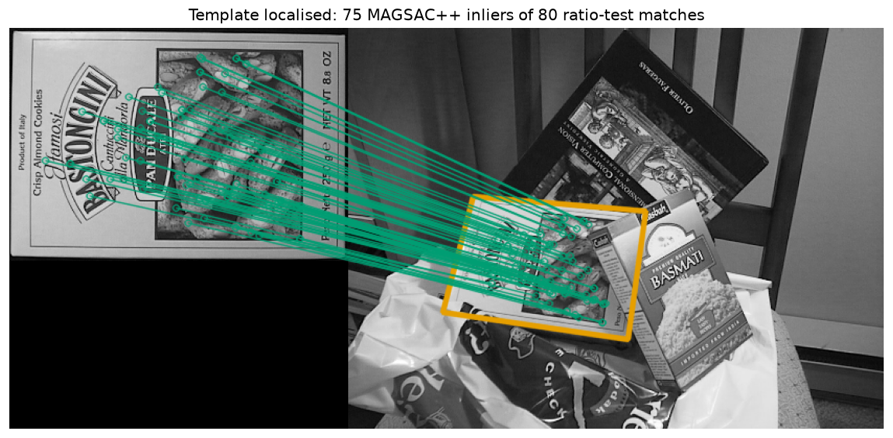
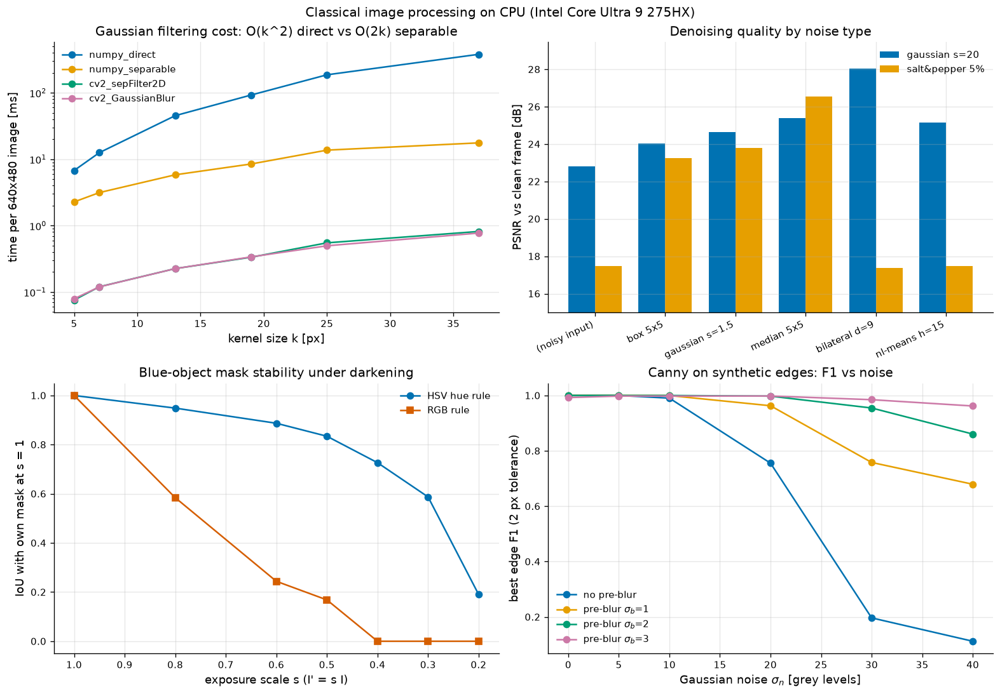
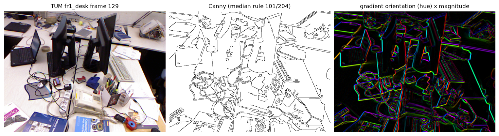
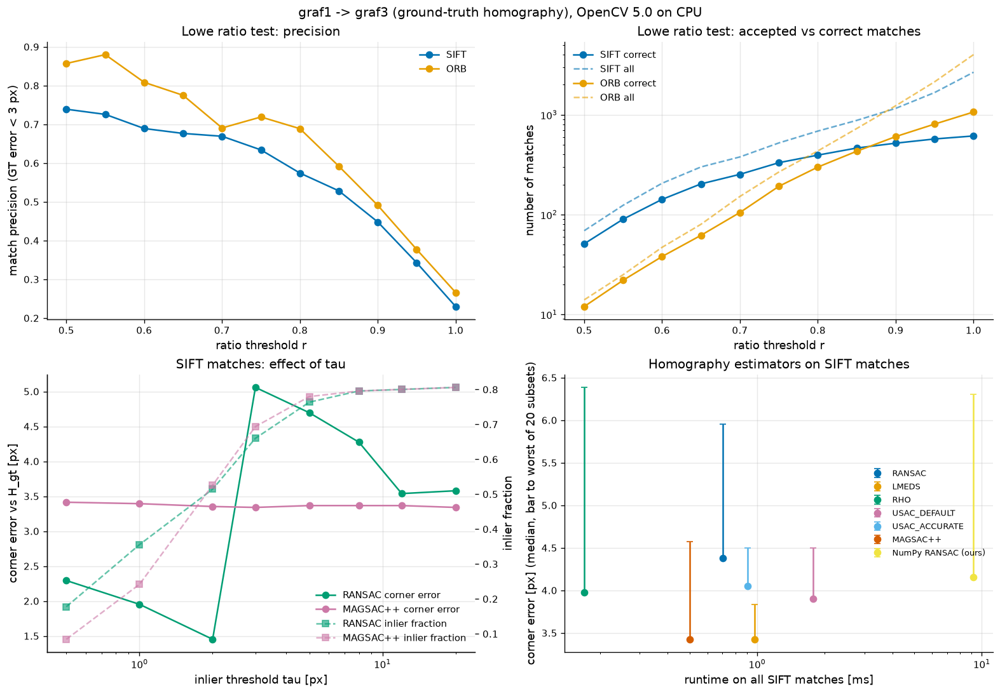
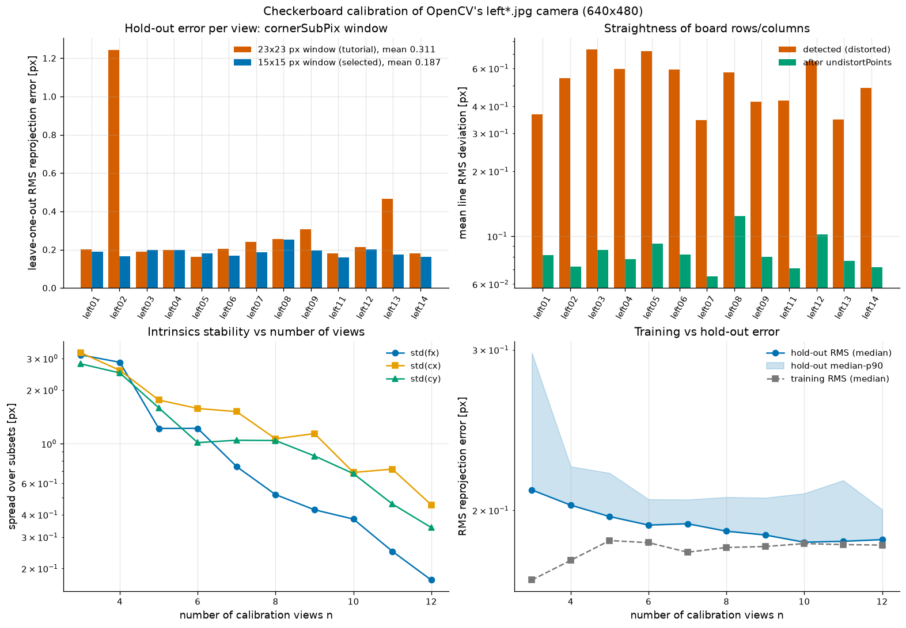
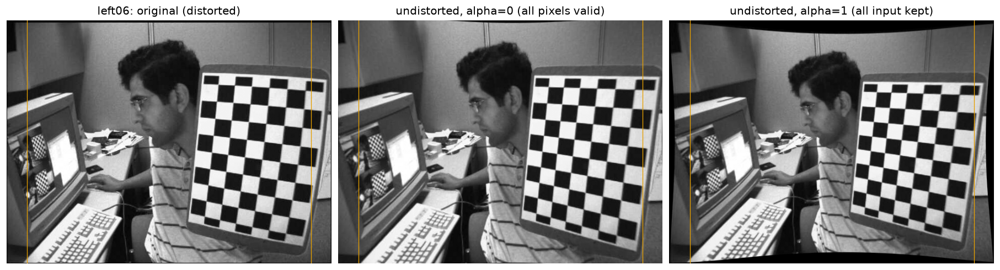

# 01 · Classical computer vision: image formation, local features and camera calibration

The geometric and signal-processing foundations every robot vision stack still runs on: how a camera forms an image, how
to filter it, how to find and match the same physical points across views, how to fit geometry robustly to noisy matches,
and how to calibrate the camera so that pixels can be turned into metric rays. OpenCV 5.0 only, real data, every claim measured.

<p align="center"></p>

| Notebook | Topics |
|---|---|
| [`01_image_formation_filtering_edges.ipynb`](notebooks/01_image_formation_filtering_edges.ipynb) | pinhole projection, focal length vs perspective, lens distortion, blur detection, colour spaces, aliasing, convolution from scratch, denoising filters, Sobel/Canny with a ground-truth edge benchmark |
| [`02_features_homography_panorama.ipynb`](notebooks/02_features_homography_panorama.ipynb) | SIFT vs ORB, repeatability, ratio test, normalised DLT + RANSAC from scratch, OpenCV's robust estimators (RANSAC, LMedS, RHO, USAC, MAGSAC++), object localisation, manual and `cv2.Stitcher` panoramas |
| [`03_camera_calibration.ipynb`](notebooks/03_camera_calibration.ipynb) | Zhang's method, corner detection (classic vs SB), reprojection residuals, leave-one-out hold-out error, corner-refinement window selection, extrinsics, undistortion, number-of-views study |

## What you'll learn

- The full camera model: $\lambda\tilde{\mathbf u} = K[R\,|\,\mathbf t]\tilde{\mathbf X}$ plus Brown-Conrady distortion, OpenCV's frame conventions, and why focal length and distance are not interchangeable.
- Low-level image processing with measured trade-offs: separable vs direct convolution, which denoiser for which noise, why Canny needs a pre-blur, why you low-pass before downsampling, and why hue thresholds survive exposure changes.
- Local features end to end: SIFT vs ORB detection/description, Lowe's ratio test, and how to *evaluate* matches against a ground-truth homography instead of eyeballing them.
- Robust estimation: the DLT with Hartley normalisation, RANSAC and its iteration formula, the effect of the inlier threshold, and how OpenCV's estimators compare in accuracy and speed.
- Camera calibration you can trust: per-view residuals, leave-one-out hold-out error, independent cross-checks, undistortion maps, and how many views you need. A reusable CLI writes a ROS `camera_info` YAML.
- OpenCV 5 Python API changes that silently break OpenCV 4 code (see Limitations).

## Theory primer

**Projection.** A world point $\mathbf X_w$ maps to the camera frame by $\mathbf X_c = R\mathbf X_w + \mathbf t$ (OpenCV: x right, y down,
z forward), then to pixels by $u = f_x X_c/Z_c + c_x$, $v = f_y Y_c/Z_c + c_y$. Lens distortion is applied on the normalised plane,
$x_d = x(1 + k_1r^2 + k_2r^4 + k_3r^6) + 2p_1xy + p_2(r^2 + 2x^2)$ (similarly for $y$); $k_1 < 0$ is barrel distortion.

**Filtering.** Convolution with a $k\times k$ kernel costs $k^2$ operations per pixel; a separable kernel $h(i,j) = g(i)g(j)$ (e.g. a
Gaussian) costs $2k$. Canny = Gaussian smoothing, Sobel gradient, non-maximum suppression along the gradient, hysteresis thresholds.

**Features and matching.** SIFT finds extrema of the difference-of-Gaussians scale space and describes them with 128-D gradient
histograms (L2 distance); ORB uses FAST corners and 256-bit rotated BRIEF descriptors (Hamming distance). Lowe's ratio test keeps a
match if $d_1/d_2 < r$.

**Homography and RANSAC.** Points on a plane, or seen by a purely rotating camera ($H = KRK^{-1}$), map by $\tilde{\mathbf x}' \sim H\tilde{\mathbf x}$.
Each correspondence gives two linear equations in the 9 entries of $H$ (DLT, solved by SVD after Hartley normalisation). RANSAC fits
minimal 4-point samples and needs $N = \log(1-p)/\log(1-w^4)$ iterations for inlier ratio $w$ and success probability $p$.

**Calibration (Zhang 2000).** Each view of a planar board gives $H_i = \lambda K[\mathbf r_1\ \mathbf r_2\ \mathbf t]$; orthonormality of
$\mathbf r_1, \mathbf r_2$ gives two linear constraints on $B = K^{-\top}K^{-1}$ per view, then Levenberg-Marquardt minimises the reprojection
error $\sum_{ij}\lVert \mathbf u_{ij} - \pi(K, \mathbf d, R_i, \mathbf t_i, \mathbf X_j)\rVert^2$. Report the RMS, but judge a calibration by its
**hold-out** error.

## How to run

All commands run from the repository root in the `cv` environment. Everything here is CPU-only; the notebooks still execute under the
GPU lock because the kernel imports PyTorch.

```bash
make setup-01_classical_cv      # no extra packages (requirements/01_classical_cv.txt only has comments), runs check_env
make data-01_classical_cv       # ~9 MB of OpenCV sample/panorama images + the shared TUM RGB-D fr1_desk (~350 MB)
make nb-01_classical_cv         # executes the three notebooks headless (CPU work: 13 s, 5 s and 6 s)

# calibrate a camera from checkerboard photos and write a ROS camera_info YAML (works for your own camera too)
python projects/01_classical_cv/scripts/calibrate_camera.py --images "data/01_classical_cv/calib/left*.jpg" --config projects/01_classical_cv/configs/checkerboard_9x6.yaml --camera-name left --loo --out projects/01_classical_cv/results/left_camera_info.yaml

# exercise solutions
python projects/01_classical_cv/solutions/nb01_solutions.py
python projects/01_classical_cv/solutions/nb02_solutions.py
python projects/01_classical_cv/solutions/nb03_solutions.py

# unit tests of the calibration CLI (synthetic views with known intrinsics)
python -m pytest -q tests/test_p01_calibrate_camera.py
```

To calibrate your own camera: print a checkerboard, take 10-20 sharp photos covering the whole image (including the corners) with
varied tilts, set `pattern` (inner corners) and `square_size` (metres) in a copy of `configs/checkerboard_9x6.yaml`, and run the CLI.
Views flagged as inconsistent by the leave-one-out column deserve a closer look before you trust the result.

### Exercises

Each notebook ends with three exercises (TODO cells); the scripts in [`solutions/`](solutions/) solve them and print their results:

| Notebook | Exercises |
|---|---|
| 01 | bilateral filter from scratch (matches `cv2.bilateralFilter`), unsharp masking vs the blur score, Harris response from the structure tensor |
| 02 | FLANN vs brute-force matching, affine vs projective model, RANSAC success rate vs $1-(1-w^4)^N$ |
| 03 | calibrating the stereo partner camera, distortion-model selection by hold-out error, SB vs classic sub-pixel corners |

## Results

Measured on Intel Core Ultra 9 275HX (CPU) with OpenCV 5.0.0, NumPy 2.5.4. The machine's GPU (RTX 5060 Laptop GPU, 8 GB) is not used
by this project: there are no learned models, so there is no peak-VRAM figure to report. Runtimes are wall-clock means from single
notebook runs on a machine shared with other jobs, so treat them as indicative (they can change by a factor of several between runs when other jobs load the CPU); all other
numbers are deterministic unless noted. The three notebooks take 13 s, 5 s and 6 s from setup to summary
(measured inside each notebook).

### Image formation, filtering and edges (notebook 01)





| Experiment | Result |
|---|---|
| Our pinhole projection vs `cv2.projectPoints` | max difference 1.1e-13 px |
| Dolly zoom (same cube size), near/far edge ratio | 1.331 at 90° FOV -> 1.038 at 15° FOV |
| Variance-of-Laplacian sharpness along `fr1_desk` (191 frames) | 58 (frame 252) to 692 (frame 129) |
| Blue-object mask IoU after darkening to 40% | HSV rule 0.727, RGB rule 0.000 |
| Zone plate /4, aliased contrast (ideal 0) | naive 0.353, INTER_AREA 0.049, Gaussian σ=2 0.004 |
| Gaussian blur, k=25, 640x480 float32 | NumPy direct 186.4 ms, NumPy separable 13.7 ms, `cv2.GaussianBlur` 0.50 ms |
| Canny best F1 (2 px tolerance), noise σ=20 | no pre-blur 0.756, pre-blur σ=2 0.998 |
| Canny best F1, noise σ=40 | no pre-blur 0.112, pre-blur σ=3 0.962 |

Denoising the sharp `fr1_desk` frame (PSNR dB / SSIM vs the clean frame):

| Filter | Gaussian noise σ=20 | Salt & pepper 5% | Time [ms] |
|---|---|---|---|
| (noisy input) | 22.81 / 0.491 | 17.46 / 0.447 | - |
| box 5x5 | 24.02 / 0.764 | 23.25 / 0.683 | 0.1 |
| gaussian s=1.5 | 24.64 / 0.798 | 23.80 / 0.727 | 0.2 |
| median 5x5 | 25.40 / 0.774 | 26.54 / 0.884 | 0.9 |
| bilateral d=9 | 28.06 / 0.793 | 17.39 / 0.414 | 14.0 |
| nl-means h=15 | 25.17 / 0.756 | 17.48 / 0.430 | 147.6 |

### Local features, RANSAC and panoramas (notebook 02)



`graf1` -> `graf3` (about 40° viewpoint change, ground-truth homography; a match is correct if it lands within 3 px):

| Detector | Keypoints | Descriptor | Detect+describe [ms] | Repeatability @3 px (chance) | Ratio-test matches r=0.8 | Correct | Precision |
|---|---|---|---|---|---|---|---|
| SIFT | 2665 | 512 B | 21.3 | 0.486 (0.148) | 686 | 394 | 0.574 |
| ORB | 4000 | 32 B | 7.1 | 0.780 (0.126) | 434 | 299 | 0.689 |

Homography estimators on the 686 SIFT ratio-test matches (corner error = mean distance of the 4 image corners
mapped by the estimate vs the ground truth; median and worst over 20 random 80% subsets):

| Estimator | Inliers (τ=3 px) | Corner error median [px] | Worst [px] | Time [ms] |
|---|---|---|---|---|
| RANSAC | 453 | 4.38 | 5.95 | 0.70 |
| LMEDS | 418 | 3.43 | 3.83 | 0.97 |
| RHO | 417 | 3.98 | 6.39 | 0.17 |
| USAC_DEFAULT | 472 | 3.91 | 4.50 | 1.77 |
| USAC_ACCURATE | 473 | 4.06 | 4.50 | 0.91 |
| MAGSAC++ | 476 | 3.43 | 4.57 | 0.50 |
| NumPy RANSAC (ours) | 396 | 4.15 | 6.31 | 9.19 |

- Fitting a homography to only the 394 ground-truth-correct matches gives a corner error of 0.69 px: `cv2.RANSAC`
  accepts 453 inliers but ends at 5.06 px, our NumPy RANSAC keeps 396 and reaches 1.35 px
  (near-miss matches inside the 3 px threshold bias the refit). On ORB matches the medians range from
  1.67 to 2.52 px.
- SIFT keypoints smaller than 4 px are correct within 3 px only 44% of the time, vs 76% for 4-8 px keypoints.
- Known-object localisation (`box` in `box_in_scene`): 75 MAGSAC++ inliers out of 80 ratio-test matches.
- Panorama of six `boat` frames: a planar canvas would need 1.9 MP for 3 frames and 71.8 MP for all 6; `cv2.Stitcher`
  used 6/6 frames, took 0.90 s and estimated a 143° span (single-frame HFOV 48.7°). The Stitcher's
  estimates vary slightly between runs. The panorama itself is shown in the notebook only (see licenses).

### Camera calibration (notebook 03)





OpenCV's `left*.jpg` set: 13 views of a 9x6-inner-corner board, 640x480. Final calibration with a 15x15 px `cornerSubPix`
window (half-size 7, chosen by leave-one-out error); uncertainties are OpenCV's formal 1σ:

| Parameter | Final | Tutorial window (23x23 px) |
|---|---|---|
| $f_x$ [px] | 533.00 ± 0.41 | 536.07 ± 0.93 |
| $f_y$ [px] | 533.12 ± 0.43 | 536.02 ± 0.97 |
| $c_x$ [px] | 342.31 ± 0.43 | 342.37 ± 0.97 |
| $c_y$ [px] | 233.93 ± 0.48 | 235.54 ± 1.07 |
| $k_1, k_2, p_1, p_2, k_3$ | -0.2854, 0.0639, 0.0011, -0.0001, 0.0817 | -0.2651, -0.0467, 0.0018, -0.0003, 0.2523 |
| training RMS [px] | 0.1832 | 0.4087 |
| mean leave-one-out RMS [px] | 0.1873 | 0.3109 |
| worst leave-one-out RMS [px] | 0.2517 | 1.2433 (`left02`) |

- The tutorial's `winSize=(11, 11)` (23x23 px search window) is too large for squares of 32-46 px: corners next to the board border
  are dragged towards it, `left02` and `left13` become unpredictable from the other views (LOO 1.24 and 0.46 px) and $f_x$
  shifts by 3.07 px. The independent SB detector (12/13 views) gives $f_x$ = 532.35 px.
- Board rows/columns deviate from straight lines by 0.522 px RMS on average (worst line 1.86 px) in the raw images and by 0.083 px
  (worst 0.21 px) after `undistortPoints`.
- With 3 views, $f_x$ varies by 3.14 px (std over 40 subsets) and the median hold-out RMS is 0.211 px; with 12 views
  0.17 px and 0.186 px.
- Undistorting a 640x480 frame: `cv2.undistort` 1.04 ms vs `cv2.remap` with precomputed maps 0.20 ms.
- The CLI reproduces the final calibration and writes [`results/left_camera_info.yaml`](results/left_camera_info.yaml).

## Limitations

- **OpenCV 5 API changes** that break OpenCV 4 tutorials, all verified here: detected chessboard corners are `(N, 2)` instead of
  `(N, 1, 2)`; `cv2.perspectiveTransform` still requires `(N, 1, 2)` and raises an assertion for `(N, 2)`; `projectPoints` /
  `undistortPoints` still return `(N, 1, 2)`; `cv2.Laplacian` rejects float32 input with a `CV_64F` output; `findChessboardCornersSB`
  may enumerate the grid from the opposite corner. AKAZE, BRISK, `xfeatures2d` (SURF etc.) and `cv2.ml` are not in the
  `opencv-python` 5.0 wheel, so they are not covered. In OpenCV 5.0 `findHomography` gave identical results for different
  `cv2.setRNGSeed` values, so robustness is measured with perturbed inputs instead of seeds.
- The calibration board's physical square size is not documented, so extrinsics are in units of squares; intrinsics are unaffected.
- Edge F1 and RANSAC accuracy use the best threshold in hindsight ("oracle") in places; real systems must fix thresholds in advance.
- Denoising filter parameters are textbook defaults, not tuned per noise type, so the ranking reflects these settings.
- The NumPy implementations (convolution, RANSAC, bilateral filter) are for teaching; their runtimes are not a fair language comparison
  with OpenCV's multi-threaded SIMD code.
- `cv2.Stitcher` estimates (focal length, span, runtime) vary slightly between runs; the panorama is not deterministic to the pixel.

## Model & dataset licenses

No learned models are used in this project.

| Component | License | Notes |
|---|---|---|
| [OpenCV](https://github.com/opencv/opencv) 5.0 (`opencv-python` 5.0.0.93) | Apache-2.0 | library |
| OpenCV sample images (`left*/right*.jpg`, `box*.png`) from [opencv/opencv `samples/data`](https://github.com/opencv/opencv/tree/5.0.0/samples/data) | Apache-2.0 (repository license; per-image provenance not documented) | downloaded at runtime |
| `graf1.png`, `graf3.png`, `H1to3p.xml` (same folder) | originally from the [Oxford affine-covariant regions dataset](https://www.robots.ox.ac.uk/~vgg/data/affine/) | research dataset, terms not stated explicitly; downloaded at runtime, not committed; not used in README figures |
| `boat1-6.jpg` from [opencv_extra `testdata/stitching`](https://github.com/opencv/opencv_extra/tree/5.0.0/testdata/stitching) | **unclear** (repository declares no license) | downloaded at runtime only, never committed; derived panoramas appear only as downscaled notebook outputs |
| [TUM RGB-D](https://cvg.cit.tum.de/data/datasets/rgbd-dataset) `fr1_desk` | CC BY 4.0 | Sturm et al., IROS 2012 |

## References

- R. Szeliski, *Computer Vision: Algorithms and Applications*, 2nd ed. [szeliski.org/Book](https://szeliski.org/Book/)
- R. Hartley, A. Zisserman, *Multiple View Geometry in Computer Vision*. [robots.ox.ac.uk/~vgg/hzbook](https://www.robots.ox.ac.uk/~vgg/hzbook/)
- J. Canny, "A Computational Approach to Edge Detection", TPAMI 1986. [doi:10.1109/TPAMI.1986.4767851](https://doi.org/10.1109/TPAMI.1986.4767851)
- C. Tomasi, R. Manduchi, "Bilateral Filtering for Gray and Color Images", ICCV 1998. [doi:10.1109/ICCV.1998.710815](https://doi.org/10.1109/ICCV.1998.710815)
- A. Buades, B. Coll, J.-M. Morel, "A non-local algorithm for image denoising", CVPR 2005. [doi:10.1109/CVPR.2005.38](https://doi.org/10.1109/CVPR.2005.38)
- C. Harris, M. Stephens, "A Combined Corner and Edge Detector", AVC 1988. [doi:10.5244/C.2.23](https://doi.org/10.5244/C.2.23)
- D. Lowe, "Distinctive Image Features from Scale-Invariant Keypoints", IJCV 2004. [PDF](https://www.cs.ubc.ca/~lowe/papers/ijcv04.pdf)
- E. Rublee et al., "ORB: an efficient alternative to SIFT or SURF", ICCV 2011. [doi:10.1109/ICCV.2011.6126544](https://doi.org/10.1109/ICCV.2011.6126544)
- K. Mikolajczyk et al., "A Comparison of Affine Region Detectors", IJCV 2005. [doi:10.1007/s11263-005-3848-x](https://doi.org/10.1007/s11263-005-3848-x)
- M. Fischler, R. Bolles, "Random Sample Consensus", CACM 1981. [doi:10.1145/358669.358692](https://doi.org/10.1145/358669.358692)
- R. Hartley, "In Defense of the Eight-Point Algorithm", TPAMI 1997. [doi:10.1109/34.601246](https://doi.org/10.1109/34.601246)
- D. Barath, J. Noskova, M. Ivashechkin, J. Matas, "MAGSAC++, a fast, reliable and accurate robust estimator", CVPR 2020. [arXiv:1912.05909](https://arxiv.org/abs/1912.05909)
- M. Brown, D. Lowe, "Automatic Panoramic Image Stitching using Invariant Features", IJCV 2007. [doi:10.1007/s11263-006-0002-3](https://doi.org/10.1007/s11263-006-0002-3)
- Z. Zhang, "A Flexible New Technique for Camera Calibration", TPAMI 2000. [doi:10.1109/34.888718](https://doi.org/10.1109/34.888718)
- A. Duda, U. Frese, "Accurate Detection and Localization of Checkerboard Corners for Calibration", BMVC 2018. [PDF](http://bmvc2018.org/contents/papers/0508.pdf)
- J. Sturm et al., "A Benchmark for the Evaluation of RGB-D SLAM Systems", IROS 2012. [dataset](https://cvg.cit.tum.de/data/datasets/rgbd-dataset)
- OpenCV: [opencv/opencv](https://github.com/opencv/opencv), [OpenCV 4 to 5 migration guide](https://github.com/opencv/opencv/wiki/OpenCV-4-to-5-migration), [camera calibration tutorial](https://docs.opencv.org/4.x/dc/dbb/tutorial_py_calibration.html)
