# 02 · Representation learning: transfer learning, DINOv3 / DINOv2 features, Grad-CAM

A robot's perception stack is almost never trained from scratch. It reuses a **pretrained backbone** and adapts it
with a few hundred or thousand labelled images, or uses its features frozen for retrieval, few-shot recognition and dense correspondence.
This project measures these options on [Imagenette-160](https://github.com/fastai/imagenette), a 10-class ImageNet subset:

| notebook | content |
|---|---|
| [`01_transfer_learning.ipynb`](notebooks/01_transfer_learning.ipynb) | timm ResNet-18 / EfficientNet-B0 / ConvNeXt-Nano: zero-shot ImageNet-head baseline, **linear probe vs. full fine-tuning**, learning curves, confusion matrix, failure cases, latency / throughput / VRAM |
| [`02_self_supervised_features.ipynb`](notebooks/02_self_supervised_features.ipynb) | **DINOv3 ViT-S/16 vs. DINOv2 ViT-S/14** (plus a supervised CNN reference), all frozen: weighted k-NN, logistic-regression probe, few-shot prototypes, PCA-of-patch-tokens visualisation, t-SNE, throughput / VRAM |
| [`03_grad_cam.ipynb`](notebooks/03_grad_cam.ipynb) | **Grad-CAM from scratch** with forward/backward hooks: gallery, class-discriminative composites, model-randomisation sanity check, deletion / insertion faithfulness vs. baselines |

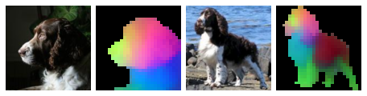

## What you'll learn

- How to build, freeze and fine-tune [timm](https://github.com/huggingface/pytorch-image-models) backbones with a modern recipe: AdamW, a 10x smaller trunk learning rate, warm-up + cosine schedule, label smoothing, bf16 autocast, `channels_last`.
- Why a **zero-shot baseline** is mandatory when the target data overlaps the pretraining data, and how much a linear probe saves in time and memory compared with fine-tuning.
- How self-supervised **DINO** models are trained, how to read CLS, register and patch tokens from Hugging Face `transformers`, and how to evaluate frozen features with **k-NN**, **logistic regression** and **few-shot prototypes**.
- How the **PCA of patch tokens** reveals object parts, and why the quality of dense features and of global features can differ.
- How to implement **Grad-CAM** with PyTorch hooks and how to test whether a saliency map can be trusted (randomisation test, deletion / insertion).
- How to measure latency, throughput and peak VRAM properly, with CUDA synchronisation, after warm-up.

## Theory primer

**Transfer learning.** A classifier is a feature extractor $f_\theta$ followed by a linear head:
$p(y\mid x)=\mathrm{softmax}(W f_\theta(x)+b)$. A *linear probe* freezes $\theta$ and learns only $(W,b)$. This is convex
for fixed features, needs no backprop through the trunk, and keeps BatchNorm statistics frozen. *Fine-tuning* learns $\theta$ as well, with a
smaller learning rate so that the randomly initialised head does not destroy the pretrained features. Label smoothing trains against
$q_c=(1-\epsilon)\mathbb{1}[c=y]+\epsilon/C$ instead of a one-hot target.

**Self-distillation (DINO).** A student $g_{\theta_s}$ matches a teacher $g_{\theta_t}$ on different crops of the same image,
$\mathcal{L}=-\sum_k P_t(x_1)_k\log P_s(x_2)_k$. The teacher is an exponential moving average of the student,
$\theta_t\leftarrow\lambda\theta_t+(1-\lambda)\theta_s$, and centring plus sharpening prevent collapse. No labels are used. DINOv2 adds a masked-patch (iBOT) loss, the KoLeo
regulariser and curated data (LVD-142M). DINOv3 scales the teacher to 7B parameters on LVD-1689M and adds *Gram anchoring*, which keeps
the patch-similarity matrix $XX^\top$ close to an earlier checkpoint so that dense features stay clean. It also adds 4 *register tokens*.
The ViT-S/16 used here is distilled from that 7B teacher.

**Weighted k-NN.** With L2-normalised features and cosine similarities $s_i$ to the $k=20$ nearest training images,
$\hat y=\arg\max_c\sum_{i\in\mathcal N_k}\mathbb 1[y_i=c]\,e^{s_i/T}$ with $T=0.07$. Nothing is trained, and a new class is added by
adding examples. The *prototype* classifier uses class means $\mu_c$ and predicts $\arg\max_c\cos(\hat f(x),\mu_c)$.

**Grad-CAM.** For the activations $A^k$ of the last convolutional stage and the class score $y^c$,
$\alpha_k^c=\frac{1}{hw}\sum_{ij}\partial y^c/\partial A^k_{ij}$ and $L^c=\mathrm{ReLU}(\sum_k\alpha_k^cA^k)$, upsampled to the input size.
*Deletion* (and *insertion*) progressively replace (or restore) the most salient pixels with a blurred image and track
$p(c\mid x)$. A faithful map gives a low deletion AUC and a high insertion AUC.

## How to run

All commands are run from the repository root inside the `cv` environment. GPU commands hold the shared GPU lock.

```bash
make setup-02_representation_learning        # timm, transformers (installed with requirements/constraints.txt)
make data-02_representation_learning         # Imagenette-160 (99 MB download) + 5 checkpoints into the HF cache (~294 MiB), idempotent

# 6 training runs (3 backbones x {linear probe, fine-tune}, 10 epochs each): 533 s of training on an RTX 5060 Laptop GPU.
# Writes runs/02_representation_learning/transfer/*.pt (gitignored) and projects/02_representation_learning/results/.
flock /tmp/cv-gpu.lock python projects/02_representation_learning/scripts/train_transfer.py

make nb-02_representation_learning           # execute the three notebooks headless (needs the checkpoints above)

# exercise solutions (01 and 03 need the checkpoints, 02 reuses the features cached by notebook 02)
flock /tmp/cv-gpu.lock python projects/02_representation_learning/solutions/01_transfer_learning_solutions.py
flock /tmp/cv-gpu.lock python projects/02_representation_learning/solutions/02_self_supervised_features_solutions.py
flock /tmp/cv-gpu.lock python projects/02_representation_learning/solutions/03_grad_cam_solutions.py

python -m pytest -q tests/test_p02_replearn.py   # CPU unit tests (k-NN, PCA colouring, Grad-CAM, deletion/insertion, freezing)
```

**DINOv3 access.** `facebook/dinov3-vits16-pretrain-lvd1689m` is gated. Accept the DINOv3 license on its
[model page](https://huggingface.co/facebook/dinov3-vits16-pretrain-lvd1689m) and run `hf auth login`. Without access,
the download script and `replearn.load_encoder` fall back to the ungated timm mirror
[`timm/vit_small_patch16_dinov3.lvd1689m`](https://huggingface.co/timm/vit_small_patch16_dinov3.lvd1689m) (83 MiB extra download), which carries the same weights.
On 8 validation images at 224 and 448 px (fp32) we measured a cosine similarity of 1.000000 and a maximum absolute difference below 1e-5
between the two implementations, for both the CLS and the patch tokens. The committed notebook outputs use the official gated repository.

Shared code lives in [`scripts/replearn.py`](scripts/replearn.py): data pipeline, model builders, train/eval loop, k-NN, PCA colouring, Grad-CAM and deletion / insertion.

## Results

All numbers come from the committed notebook outputs and `results/`, measured on an **NVIDIA RTX 5060 Laptop GPU (8 GB, sm_120)**
with torch 2.11.0+cu128, timm 1.0.31 and transformers 5.22.2. The validation split has 3,925 images, so 0.1 pp is about 4 images.

### 1. Transfer learning (notebook 01)

Ten epochs, batch 128, 160 px, bf16 autocast, AdamW, label smoothing 0.1, seed 0. "Zero-shot" is the untouched ImageNet-1k
classifier restricted to the 10 Imagenette logits, with no training.

| backbone | zero-shot IN-1k head | linear probe | fine-tune | train time LP / FT [s] | peak train VRAM LP / FT [MiB] | latency bs1 [ms] | throughput bs128 [img/s] |
|---|---|---|---|---|---|---|---|
| `resnet18.a1_in1k` | 97.04 % | 97.07 % | **97.43 %** | 41.9 / 62.5 | 451 / 1003 | 1.4 | 6046 |
| `efficientnet_b0.ra_in1k` | **98.93 %** | 95.90 % | 96.59 % | 76.6 / 117.6 | 1084 / 2909 | 4.9 | 5154 |
| `convnext_nano.in12k_ft_in1k` | **99.57 %** | 99.41 % | 98.90 % | 87.1 / 147.7 | 845 / 2817 | 2.7 | 2245 |

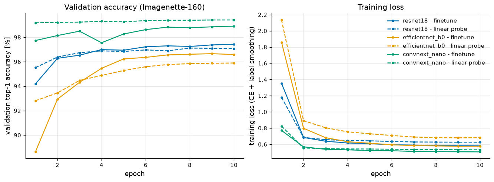
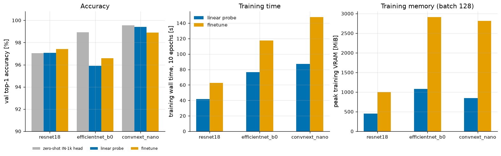
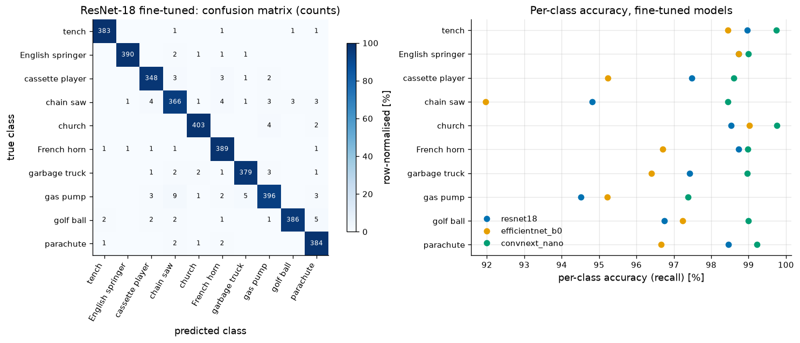
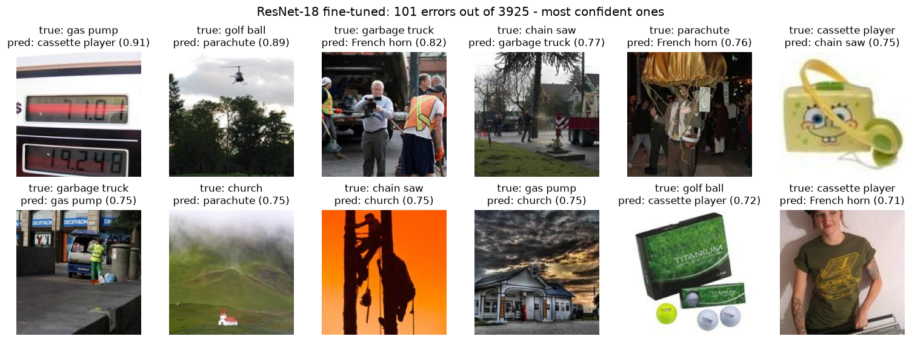

- Imagenette is an ImageNet subset, so the zero-shot head beats **both** trained heads for EfficientNet-B0 and ConvNeXt-Nano.
  These numbers measure re-learning known classes, not transfer to new objects.
- Fine-tuning helped ResNet-18 (+0.36 pp) and EfficientNet-B0 (+0.69 pp) but hurt ConvNeXt-Nano (-0.51 pp).
- The linear probe needed 2.2-3.3x less peak training VRAM but only 1.5-1.7x less wall time, because the frozen trunk still runs
  forward on augmented images every epoch.
- EfficientNet-B0 has the fewest parameters (4.0 M) but the highest batch-1 latency.

### 2. Frozen self-supervised features (notebook 02)

Frozen encoders at 224 px (fp16 autocast; cosine similarity to fp32 features at least 0.99998). k-NN: cosine, k = 20, T = 0.07.
Logistic regression: C chosen on a held-out 20 % of the training split. Few-shot values are means over 5 random draws.

| encoder | k-NN | logistic regression | 1-shot prototypes | 5-shot prototypes | 10-shot log. reg. | img/s @224 / @448 (bs 64) | peak VRAM @224 / @448 [MiB] |
|---|---|---|---|---|---|---|---|
| DINOv3 ViT-S/16 (`facebook/dinov3-vits16-pretrain-lvd1689m`) | 99.08 % | 98.78 % | 77.89 % | 91.67 % | 95.36 % | 806 / 187 | 540 / 1119 |
| DINOv2 ViT-S/14 (`facebook/dinov2-small`) | 99.29 % | 99.36 % | 87.51 % | 96.32 % | 97.41 % | 895 / 195 | 573 / 1260 |
| ConvNeXt-Nano, *supervised* reference | 99.54 % | 99.69 % | 97.84 % | 99.38 % | 99.46 % | 1072 / 255 | 809 / 2208 |

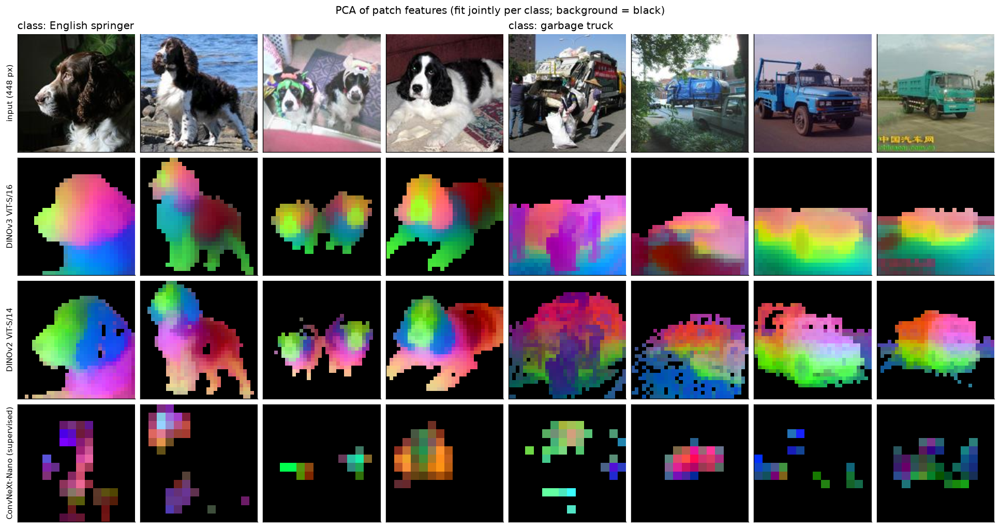
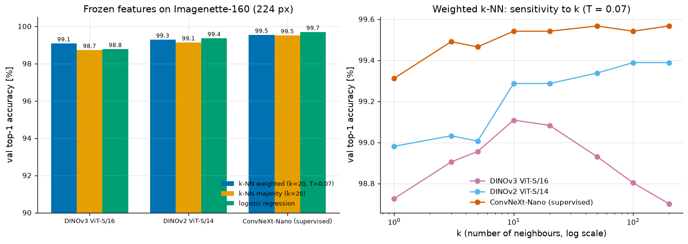
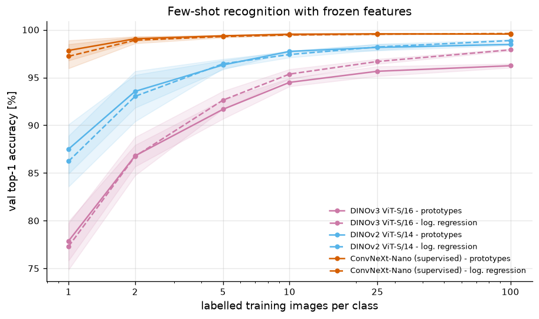
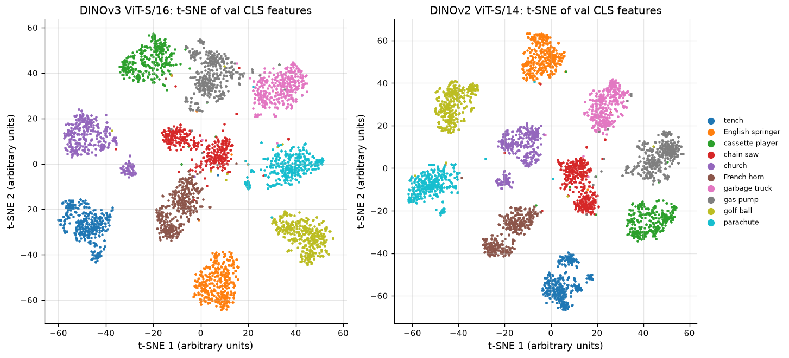

- On this dataset **DINOv3 ViT-S/16 does not beat DINOv2 ViT-S/14 on global (CLS) features**, and it is clearly behind with few
  labels (77.89 % vs. 87.51 % at one image per class). Its k-NN accuracy peaks at k = 10 (99.11 %) and falls to 98.70 % at k = 200.
  We did not isolate the cause (candidates: upsampled 160 px images, the coarser 14x14 patch grid at 224 px, the training focus on dense features).
- For **dense features** the order flips: DINOv3's PCA maps are smooth and part-consistent across images, while DINOv2's are speckled.
  This comparison is qualitative (8 images).
- The supervised ConvNeXt-Nano scores highest everywhere because it was trained with labels for exactly these classes.
- Feature extraction for all 13,394 images took 20-21 s per encoder (634-663 img/s), limited by JPEG decoding.

### 3. Grad-CAM (notebook 03)

Fine-tuned ResNet-18, `layer4`, fp32, 160 px, 300 validation images (30 per class). Deletion / insertion replace (restore) the most
salient pixels with a blurred image in 16 steps; mean ± standard deviation over images.

| saliency (model) | deletion AUC (lower is better) | insertion AUC (higher is better) |
|---|---|---|
| Grad-CAM (fine-tuned) | **0.389 ± 0.198** | **0.738 ± 0.149** |
| random coarse 5x5 map (fine-tuned) | 0.564 ± 0.184 | 0.567 ± 0.194 |
| centre prior (fine-tuned) | 0.451 ± 0.208 | 0.659 ± 0.185 |
| Grad-CAM (linear probe) | 0.412 ± 0.191 | 0.738 ± 0.154 |

| model-randomisation sanity check | median Spearman ρ vs. fine-tuned maps |
|---|---|
| linear probe (untouched ImageNet trunk) | 0.926 |
| `layer4` + head re-initialised | 0.034 |
| fully random network | 0.000 |

One Grad-CAM call (forward + backward) costs 1.114 ms per image at batch 100 in fp32, with a peak of 1990 MiB.

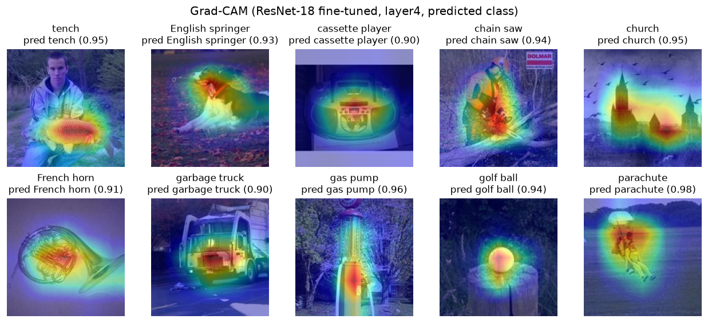
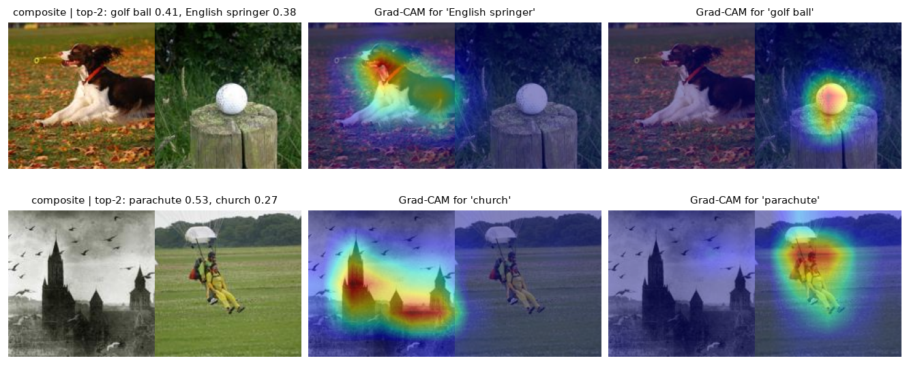
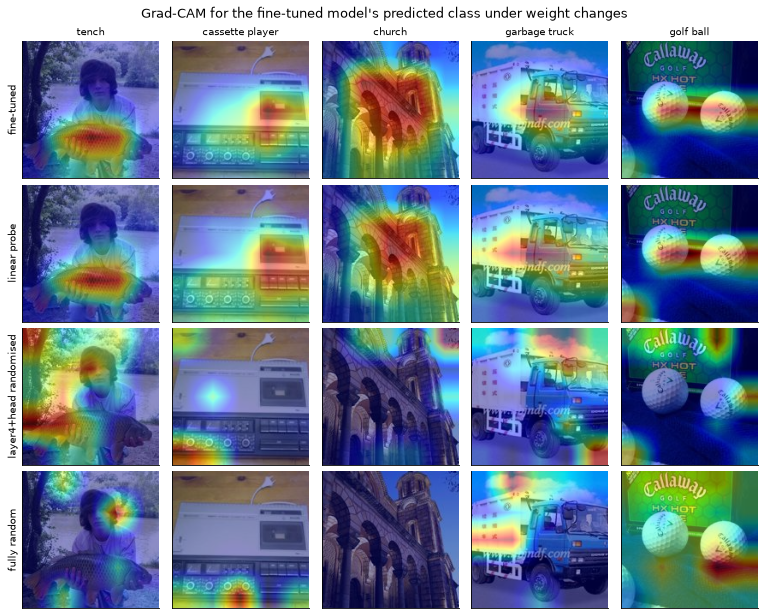
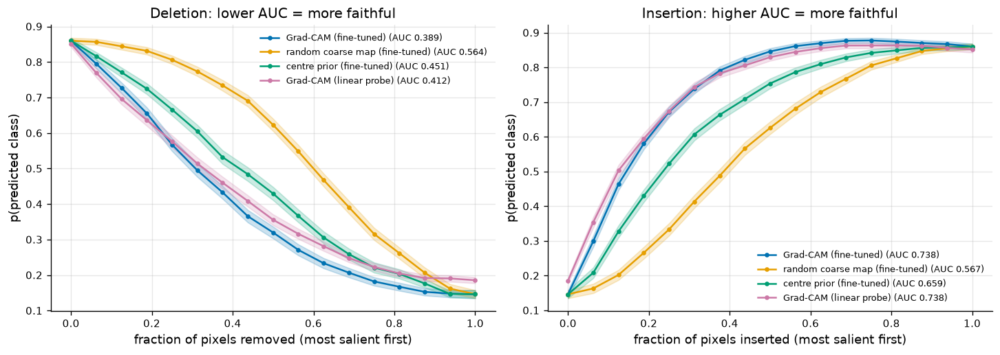
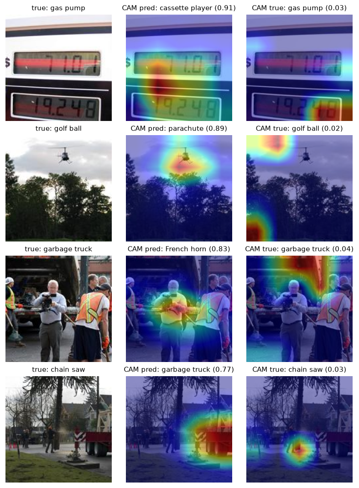

- Grad-CAM passes the randomisation test and beats both baselines, but a plain centre prior closes 54-65 % of the gap between the
  random map and Grad-CAM, because Imagenette photos are object-centred.
- Several of the most confident "errors" are questionable images, for example a "golf ball" photo that shows a helicopter.

### Exercise solutions (measured)

Printed by the scripts in [`solutions/`](solutions/). Their figures go to `outputs/02_representation_learning/solutions/` (gitignored).

| exercise | measured result |
|---|---|
| 01-1 partial fine-tuning (`layer4` + head, 3 epochs) | 96.25 % with 75.1 % of the weights trainable, 11 s, 721 MiB peak VRAM |
| 01-2 top-k and confusions | top-3 accuracy at least 99.26 % for all six runs; most confused ResNet-18 pairs: gas pump → chain saw (9 images), gas pump → garbage truck (5), golf ball → parachute (5) |
| 01-3 test resolution (FixRes) | 128 / 160 / 192 / 224 px: 96.41 / 97.43 / 97.66 / 97.55 %, best at 192 px although training used 160 px crops |
| 02-1 CLS + mean patch | DINOv3 98.78 → 98.80 %, DINOv2 99.36 → 99.34 %: no gain on this dataset |
| 02-2 dense correspondences | 6 nearest-neighbour patch matches (DINOv3, 448 px) between two springer images, cosine similarity 0.485-0.668 |
| 02-3 retrieval | 14 of 15 top-5 neighbours share the query's label (one wrong neighbour for the chain-saw query) |
| 03-1 layer choice | deletion / insertion AUC: `layer2` 0.493 / 0.581, `layer3` 0.534 / 0.603, `layer4` 0.389 / 0.738; the finer grids are *less* faithful |
| 03-2 HiResCAM | identical to Grad-CAM on `layer4` (max difference 2.38e-07, because only pooling and a linear layer follow it); on `layer3` 0.481 / 0.613 vs. Grad-CAM's 0.534 / 0.603, median ρ between the maps 0.196 |
| 03-3 ConvNeXt-Nano | agrees with ResNet-18 on 98.0 % of the 300 predictions; median Spearman ρ between the two models' maps 0.650; deletion / insertion AUC 0.482 / 0.814 |

## Limitations

- **Pretraining overlap.** Imagenette is an ImageNet subset, and every supervised backbone (and the ConvNeXt reference in notebook 02)
  was trained with labels for these 10 classes. Absolute accuracies overstate what to expect on a robot's own objects.
- **One seed, one recipe.** Each training configuration ran once (seed 0) with the same 10-epoch schedule and no per-backbone tuning.
  We did not measure seed-to-seed variance, so differences of a few tenths of a percent should not be over-interpreted. bf16
  kernels are not bit-exact: re-evaluating the same checkpoints elsewhere changed 1-2 predictions (for example 97.48 % in fp32
  vs. 97.43 % under bf16 for ResNet-18; 96.61 % vs. 96.59 % for EfficientNet-B0 in the exercise solutions).
- **Low resolution.** The images are 160 px on the short side. The DINO models are evaluated at 224 px and the PCA maps at 448 px,
  both upsampled, which may handicap models trained at higher resolution. Only the ViT-S size of each DINO model was tested.
- **Grad-CAM scope.** Grad-CAM is applied to CNNs only (ResNet-18; ConvNeXt-Nano in an exercise), not to the ViTs. At 160 px `layer4`
  is a 5x5 grid, so maps are coarse. Faithfulness uses one baseline (blur) and 300 images.
- **Timing.** Latency, throughput and VRAM come from one laptop GPU whose power and thermal state were not controlled. Feature-extraction
  throughput includes JPEG decoding on 8 CPU workers.
- **DINOv3 access.** The official checkpoint is gated. The ungated timm mirror is a verified drop-in replacement, but it is a third-party
  re-upload and could disappear.

## Model & dataset licenses

| component | license | notes |
|---|---|---|
| Imagenette-160 ([fastai/imagenette](https://github.com/fastai/imagenette)) | repository Apache-2.0; images from ImageNet | **ImageNet terms of access apply (non-commercial research / education)** |
| `timm/resnet18.a1_in1k`, `timm/efficientnet_b0.ra_in1k`, `timm/convnext_nano.in12k_ft_in1k` | Apache-2.0 (model cards) | trained on ImageNet-1k / -12k |
| `facebook/dinov3-vits16-pretrain-lvd1689m` (and the timm mirror `timm/vit_small_patch16_dinov3.lvd1689m`) | **DINOv3 License** (custom, Meta) | gated; check the license text for attribution and acceptable-use terms before redistributing or using it in a product |
| `facebook/dinov2-small` | Apache-2.0 | |
| timm 1.0.31, transformers 5.22.2, safetensors 0.8.0 | Apache-2.0 | |
| scikit-learn 1.9.1, Jinja2 3.1.6 (pandas table styling) | BSD-3-Clause | |

The Grad-CAM implementation is this repository's own code. The `grad-cam` PyPI package is not used because it hard-depends on `opencv-python-headless`.

## References

- Kornblith, Shlens, Le. *Do Better ImageNet Models Transfer Better?* CVPR 2019. [arXiv:1805.08974](https://arxiv.org/abs/1805.08974)
- Kumar et al. *Fine-Tuning can Distort Pretrained Features and Underperform Out-of-Distribution* (LP-FT). ICLR 2022. [arXiv:2202.10054](https://arxiv.org/abs/2202.10054)
- Touvron et al. *Fixing the train-test resolution discrepancy* (FixRes). NeurIPS 2019. [arXiv:1906.06423](https://arxiv.org/abs/1906.06423)
- Wightman, Touvron, Jégou. *ResNet strikes back* (timm `a1` recipe). [arXiv:2110.00476](https://arxiv.org/abs/2110.00476)
- Caron et al. *Emerging Properties in Self-Supervised Vision Transformers* (DINO). ICCV 2021. [arXiv:2104.14294](https://arxiv.org/abs/2104.14294)
- Oquab et al. *DINOv2: Learning Robust Visual Features without Supervision*. TMLR 2024. [arXiv:2304.07193](https://arxiv.org/abs/2304.07193)
- Siméoni et al. *DINOv3*. 2025. [arXiv:2508.10104](https://arxiv.org/abs/2508.10104)
- Darcet et al. *Vision Transformers Need Registers*. ICLR 2024. [arXiv:2309.16588](https://arxiv.org/abs/2309.16588)
- Selvaraju et al. *Grad-CAM: Visual Explanations from Deep Networks via Gradient-based Localization*. ICCV 2017. [arXiv:1610.02391](https://arxiv.org/abs/1610.02391)
- Adebayo et al. *Sanity Checks for Saliency Maps*. NeurIPS 2018. [arXiv:1810.03292](https://arxiv.org/abs/1810.03292)
- Petsiuk, Das, Saenko. *RISE: Randomized Input Sampling for Explanation of Black-box Models* (deletion / insertion). BMVC 2018. [arXiv:1806.07421](https://arxiv.org/abs/1806.07421)
- Draelos, Carin. *Use HiResCAM instead of Grad-CAM for faithful explanations*. [arXiv:2011.08891](https://arxiv.org/abs/2011.08891)
- Repositories: [huggingface/pytorch-image-models](https://github.com/huggingface/pytorch-image-models), [facebookresearch/dinov3](https://github.com/facebookresearch/dinov3), [facebookresearch/dinov2](https://github.com/facebookresearch/dinov2), [huggingface/transformers](https://github.com/huggingface/transformers), [fastai/imagenette](https://github.com/fastai/imagenette)
