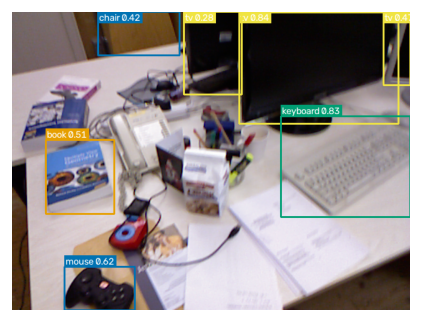
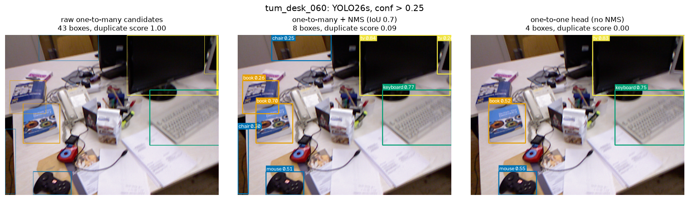
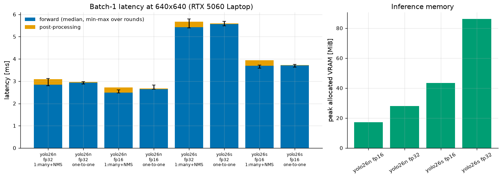
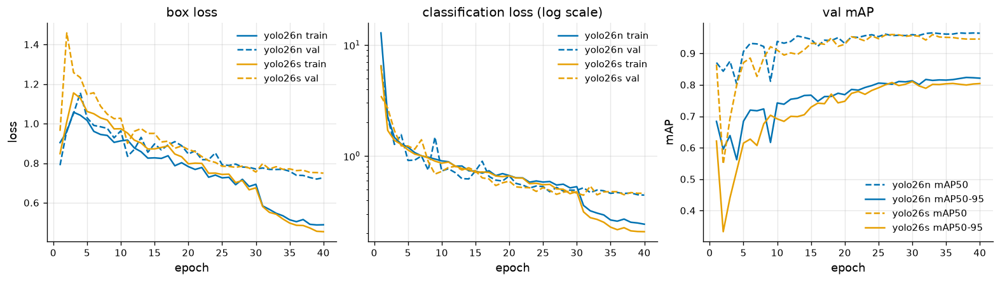
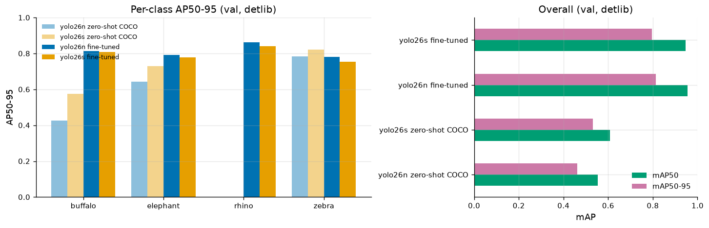
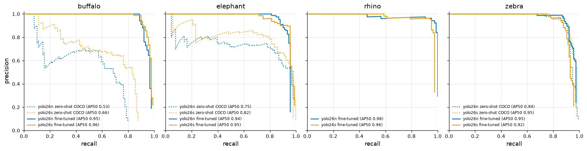
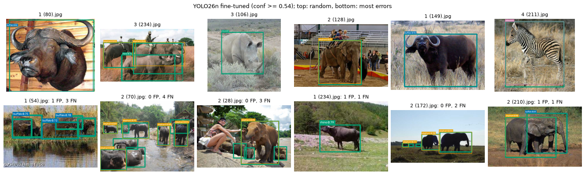
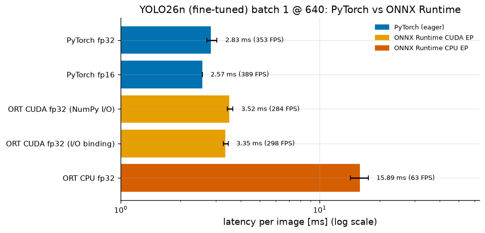
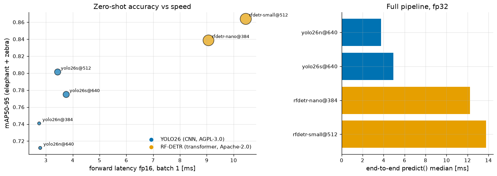
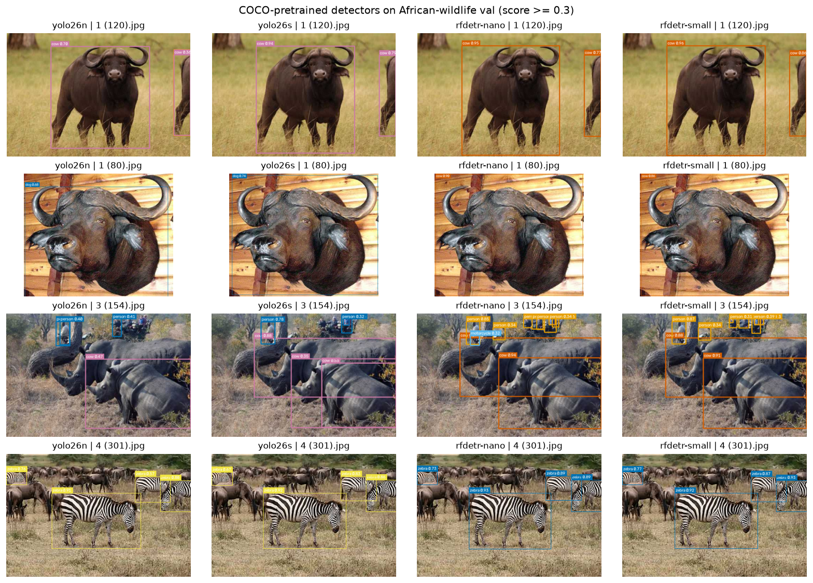

# 03 · Object detection: YOLO26, NMS-free heads, mAP, ONNX Runtime and RF-DETR



Before a robot can grasp, avoid or follow anything, it has to answer "what is where?" in every
camera frame. This project opens up a current real-time detector, **Ultralytics YOLO26** (the newest
*released* YOLO family; YOLO27 has been announced without weights, and the model name is a plain
variable everywhere so it is a one-line swap), and covers the full engineering loop: what the
network outputs, why NMS exists and how YOLO26's **one-to-one head** removes it, how to fine-tune on
a new domain and measure **mAP** correctly, how to **export to ONNX** and benchmark runtimes, and how
a transformer detector (**RF-DETR**, Apache-2.0) compares on accuracy, latency and licence.

> **Licence notice.** Ultralytics YOLO26 code, pretrained weights *and models fine-tuned from them*
> are **AGPL-3.0** (or a paid Ultralytics Enterprise licence). This repository only imports
> `ultralytics` as a dependency and commits no weights, but any software you build on these
> notebooks inherits AGPL-3.0 obligations (including network use). RF-DETR Nano/Small are
> Apache-2.0. See [Model & dataset licenses](#model--dataset-licenses).

| Notebook | What it covers | Runs on |
|---|---|---|
| [`01_yolo26_inference_nms.ipynb`](notebooks/01_yolo26_inference_nms.ipynb) | box formats and IoU, YOLO26n/s on COCO8 and TUM desk frames, the raw one-to-many output (8400 cells), greedy NMS from scratch vs `torchvision`, the NMS-free one-to-one head, threshold sweeps, latency / VRAM per size, precision and head | GPU |
| [`02_finetune_and_map.ipynb`](notebooks/02_finetune_and_map.ipynb) | dataset statistics, precision / recall / AP / mAP derived and implemented, zero-shot COCO baseline, training curves, Ultralytics val (both heads) vs our evaluator, PR curves, confusion matrix, operating point, failure gallery | GPU |
| [`03_onnx_export_latency.ipynb`](notebooks/03_onnx_export_latency.ipynb) | ONNX export of both heads, graph inspection, ONNX Runtime CUDA EP on Blackwell, numerical parity, PyTorch fp32/fp16 vs ORT CUDA (NumPy I/O and I/O binding) vs ORT CPU, mAP after export | GPU |
| [`04_yolo26_vs_rfdetr.ipynb`](notebooks/04_yolo26_vs_rfdetr.ipynb) | set prediction and Hungarian matching, YOLO26n/s vs RF-DETR Nano/Small zero-shot on elephant + zebra at native and matched resolutions, forward and end-to-end latency, memory, licence | GPU |

## What you'll learn

- Box conventions (`xyxy`, `xywh`, normalised YOLO labels), **letterboxing** and mapping boxes back
  to the original image.
- **IoU** and why the same pixel error destroys small-object accuracy.
- How an anchor-free dense detector produces thousands of candidates, how **greedy NMS** cleans them
  up (and its failure modes), and how a **one-to-one assignment** lets the network do it itself.
- **Precision, recall, the PR curve, AP, mAP50 and mAP50-95**, implemented from scratch and checked
  against Ultralytics' validator; choosing an **operating point** with F1.
- **Transfer learning** of a COCO detector to a new domain: what it buys, what it can break, and
  how to read training curves.
- **ONNX export**, execution providers, **I/O binding**, and how to time GPU code honestly
  (synchronisation, warm-up, interleaved rounds on a shared machine).
- Dense CNN detectors vs **DETR-style set prediction**, and why input resolution and licence belong
  in any detector comparison.

## Theory primer

**Boxes and IoU.** A detection is a box $\mathbf b = (x_1, y_1, x_2, y_2)$, a class $c$ and a score
$s$. Overlap with a ground-truth box is
$\mathrm{IoU}(A, B) = |A \cap B| / (|A| + |B| - |A \cap B|)$. IoU is scale-invariant, so a fixed
pixel error costs a 16 px box far more IoU than a 256 px box.

**Dense anchor-free prediction.** YOLO26's backbone/neck produce feature maps at strides
$s \in \{8, 16, 32\}$ ($80^2 + 40^2 + 20^2 = 8400$ cells at 640 px). Each cell centre $(x_c, y_c)$
predicts distances $(l, t, r, b)$ to the box sides, giving
$(x_1, y_1, x_2, y_2) = (x_c - l s, \; y_c - t s, \; x_c + r s, \; y_c + b s)$ (distances in units of the stride), and one sigmoid score per class.
YOLO26 drops Distribution Focal Loss (`reg_max = 1`: one number per side), which simplifies export.

**NMS vs the one-to-one head.** The *one-to-many* head is trained with several positive cells per
object, so neighbours fire together and greedy NMS is needed: keep the best box, drop every
same-class box with IoU $> \tau$ ($\tau = 0.7$ in Ultralytics), repeat. The *one-to-one* head is
trained with exactly one positive cell per object (the idea of DETR's set loss and YOLOv10's
consistent dual assignment), so it learns to suppress duplicates itself; inference is a top-300
selection plus a score threshold, which keeps the exported graph free of data-dependent NMS.

**Precision, recall and AP.** Sorting all predictions of a class by score and matching greedily
at IoU $\ge t$, after $k$ predictions $P_k = TP_k / k$ and $R_k = TP_k / N_\text{GT}$. COCO AP samples
the upper envelope of the PR curve at 101 recall points,
$\mathrm{AP}_t = \frac{1}{101}\sum_{r \in \{0, 0.01, \dots, 1\}} \max_{R_k \ge r} P_k$.
mAP50 averages $\mathrm{AP}_{0.5}$ over classes; mAP50-95 also averages over
$t \in \{0.50, 0.55, \dots, 0.95\}$ and therefore rewards tight boxes.

**Set prediction (DETR / RF-DETR).** A transformer decoder refines $N$ learned object queries; each
outputs one box and class. Training uses the Hungarian (minimum-cost one-to-one) matching
$\hat\sigma = \arg\min_\sigma \sum_i \big[-\hat p_{\sigma(i)}(c_i) + \lambda_1 \lVert b_i - \hat b_{\sigma(i)} \rVert_1 + \lambda_\text{giou}(1 - \mathrm{GIoU}(b_i, \hat b_{\sigma(i)}))\big]$,
so duplicates are penalised and no NMS is needed. RF-DETR uses a DINOv2 ViT backbone with a light
deformable-attention decoder (LW-DETR lineage).

**Timing GPU code.** CUDA kernels run asynchronously: synchronise before reading the clock, discard
warm-up iterations, and report medians. On a shared laptop, interleave the configurations over
several rounds so clock and load changes hit all of them equally.

## How to run

All commands run from the repository root inside the `cv` environment. Every command that touches
the GPU takes `/tmp/cv-gpu.lock` so that only one job uses the 8 GB card at a time.

```bash
# 1. Extras on top of the core stack (ultralytics, onnx, onnxslim, onnxruntime-gpu 1.26, rfdetr 1.12
#    inference-only, supervision), installed against requirements/constraints.txt so torch stays put.
make setup-03_object_detection

# 2. Data and weights (idempotent): YOLO26n/s COCO checkpoints -> weights/ultralytics/,
#    african-wildlife, medical-pills and coco8 -> data/ultralytics/, TUM RGB-D fr1_desk -> data/tum/,
#    RF-DETR Nano/Small checkpoints (about 0.7 GB) -> weights/rfdetr/
make data-03_object_detection

# 3. Fine-tuning (writes runs/03_object_detection/<name>/ and results/<name>_summary.json + _results.csv)
flock /tmp/cv-gpu.lock python projects/03_object_detection/scripts/train_yolo.py \
    --model yolo26n.pt --data african-wildlife.yaml --epochs 40 --name yolo26n_wildlife   # 5.5 min
flock /tmp/cv-gpu.lock python projects/03_object_detection/scripts/train_yolo.py \
    --model yolo26s.pt --data african-wildlife.yaml --epochs 40 --name yolo26s_wildlife   # 10.7 min
flock /tmp/cv-gpu.lock python projects/03_object_detection/scripts/train_yolo.py \
    --model yolo26n.pt --data medical-pills.yaml --epochs 30 --name yolo26n_pills         # 0.9 min (exercise)

# 4. Execute the four notebooks headless, in place (each takes the GPU lock itself)
make nb-03_object_detection

# 5. Exercise solutions (print their tables; figures and exported graphs go to outputs/03_object_detection/)
flock /tmp/cv-gpu.lock python projects/03_object_detection/solutions/sol_01_inference_nms.py
flock /tmp/cv-gpu.lock python projects/03_object_detection/solutions/sol_02_finetune_map.py
flock /tmp/cv-gpu.lock python projects/03_object_detection/solutions/sol_03_onnx.py
flock /tmp/cv-gpu.lock python projects/03_object_detection/solutions/sol_04_rfdetr.py

# 6. CPU unit tests of the project helpers (letterbox, NMS, matching, AP)
python -m pytest -q tests/test_p03_detlib.py
```

`scripts/detlib.py` holds the small, tested helpers the notebooks share (YOLO-format label loading,
letterboxing, greedy NMS, detection matching, COCO-style AP). Notebooks 02-04 need the fine-tuned
wildlife checkpoints from step 3. Set `YOLO_AUTOINSTALL=false` (the notebooks and scripts do) so
that Ultralytics never pip-installs anything; its ONNX exporter would otherwise try to pull an
unpinned CUDA 13 `onnxruntime-gpu`.

## Results

All numbers were measured in this repository on an **NVIDIA RTX 5060 Laptop GPU (8 GB, Blackwell
sm_120)** with an Intel Core Ultra 9 275HX, torch 2.11.0+cu128, ultralytics 8.4.204,
onnxruntime-gpu 1.26.0 and rfdetr 1.12.0. Latencies are batch-1 medians on a shared laptop and vary
by a few tenths of a millisecond between runs (compare the PyTorch rows of the tables below).

### 1. Inference, NMS and the NMS-free head (notebook 01)



On the TUM desk frame, 43 of the 8400 one-to-many cells score above 0.25. Greedy NMS in a dozen lines of
NumPy keeps the same 8 boxes as `torchvision.ops.batched_nms`; the one-to-one head outputs 4 boxes, each with an
NMS twin at IoU > 0.9, and is more conservative at the same 0.25 threshold (26 vs 31 detections over
six images).



| model | params [M] | GFLOPs @640 | precision | head | forward [ms] | post [ms] | total [ms] | FPS | peak VRAM [MiB] |
|---|---|---|---|---|---|---|---|---|---|
| YOLO26n | 2.57 | 6.24 | fp32 | one-to-many + NMS | 2.85 | 0.24 | 3.09 | 323.86 | 11.14 |
| YOLO26n | 2.57 | 6.24 | fp32 | one-to-one | 2.94 | 0.03 | 2.97 | 336.45 | 27.97 |
| YOLO26n | 2.57 | 6.24 | fp16 | one-to-many + NMS | 2.48 | 0.24 | 2.73 | 366.85 | 17.14 |
| YOLO26n | 2.57 | 6.24 | fp16 | one-to-one | 2.64 | 0.03 | 2.67 | 374.46 | 17.14 |
| YOLO26s | 10.01 | 23.08 | fp32 | one-to-many + NMS | 5.42 | 0.24 | 5.67 | 176.51 | 85.33 |
| YOLO26s | 10.01 | 23.08 | fp32 | one-to-one | 5.56 | 0.03 | 5.59 | 178.93 | 86.16 |
| YOLO26s | 10.01 | 23.08 | fp16 | one-to-many + NMS | 3.69 | 0.25 | 3.94 | 253.79 | 43.16 |
| YOLO26s | 10.01 | 23.08 | fp16 | one-to-one | 3.70 | 0.03 | 3.73 | 268.00 | 43.44 |

Batch 1, 640x640 input already on the GPU, fused model (Conv+BN folded); peak VRAM is
`torch.cuda.max_memory_allocated()` while building and running that configuration (its weights plus
activations, without the CUDA context). The full fp32 `predict()` call on a 640x480 TUM frame (pre-processing,
forward, post-processing) took 2.96-3.23 ms for YOLO26n and 4.62-4.88 ms for YOLO26s, depending on
the head.

### 2. Fine-tuning and mAP on African wildlife (notebook 02)







Validation split: 225 images, 379 boxes, 4 classes. "Zero-shot COCO" maps the COCO `elephant` and
`zebra` outputs onto the dataset classes; COCO has no buffalo or rhino class.

| model | weights / evaluation | mAP50 | mAP50-95 | AP50-95 buffalo | elephant | rhino | zebra |
|---|---|---|---|---|---|---|---|
| YOLO26n | zero-shot COCO | 0.554 | 0.463 | 0.426 | 0.642 | 0.000 | 0.783 |
| YOLO26s | zero-shot COCO | 0.608 | 0.531 | 0.575 | 0.729 | 0.000 | 0.822 |
| YOLO26n | fine-tuned, one-to-many + NMS (Ultralytics val) | 0.963 | 0.822 | 0.842 | 0.787 | 0.869 | 0.792 |
| YOLO26n | fine-tuned, one-to-one (Ultralytics val) | 0.955 | 0.807 | 0.817 | 0.785 | 0.836 | 0.789 |
| YOLO26n | fine-tuned, one-to-many + NMS (our `detlib` evaluator) | 0.955 | 0.813 | 0.814 | 0.792 | 0.863 | 0.781 |
| YOLO26s | fine-tuned, one-to-many + NMS (Ultralytics val) | 0.957 | 0.813 | 0.827 | 0.818 | 0.847 | 0.759 |
| YOLO26s | fine-tuned, one-to-one (Ultralytics val) | 0.956 | 0.801 | 0.816 | 0.808 | 0.823 | 0.757 |
| YOLO26s | fine-tuned, one-to-many + NMS (our `detlib` evaluator) | 0.946 | 0.795 | 0.808 | 0.779 | 0.841 | 0.753 |

| training run | epochs | batch | imgsz | train time [min] | peak train VRAM [MiB] | final val mAP50 / mAP50-95 |
|---|---|---|---|---|---|---|
| YOLO26n, african-wildlife (1052 train images) | 40 | 16 | 640 | 5.48 | 2465.6 | 0.964 / 0.823 |
| YOLO26s, african-wildlife | 40 | 16 | 640 | 10.70 | 4500.0 | 0.957 / 0.810 |
| YOLO26n, medical-pills (92 train images, exercise) | 30 | 16 | 640 | 0.91 | 2536.3 | 0.992 / 0.774 |

The last column is Ultralytics' validation at the end of training (from `results/*_summary.json`).
At the best-F1 threshold (0.54) the fine-tuned YOLO26n reaches precision 0.971 and recall 0.894;
190 of 225 validation images have no error, with 40 missed objects and 10 false positives.



### 3. ONNX export and runtimes (notebook 03)



Fine-tuned YOLO26n, one-to-one head exported with `nms=False` (opset 18, static 1x3x640x640 input,
`(1, 300, 6)` output, 9.87 MB). Parity on a validation image: ORT-CUDA boxes within 0.002 px and
scores within 1.5e-4 of PyTorch (ORT-CPU: 0.03 px, 4.5e-4), same classes.

| backend | latency [ms] | FPS | GPU memory [MiB] | mAP50-95 (val, square 640) |
|---|---|---|---|---|
| PyTorch fp32 (fused, eager) | 2.83 | 353.5 | 19.8 (torch peak allocated) | 0.8004 |
| PyTorch fp16 (fused, eager) | 2.57 | 389.2 | 17.1 (torch peak allocated) | |
| ORT CUDA EP fp32, NumPy I/O | 3.52 | 284.1 | 144.0 (NVML process increase) | 0.8000 |
| ORT CUDA EP fp32, I/O binding | 3.35 | 298.4 | 144.0 (NVML process increase) | 0.8000 |
| ORT CPU EP fp32 (Core Ultra 9 275HX) | 15.89 | 62.9 | 0 | |

With Ultralytics' default rectangular validation batches the PyTorch checkpoint scores 0.8068
mAP50-95 (0.9549 mAP50); the static ONNX graph forces square letterboxing, and the PyTorch model
validated the same way scores 0.8004, so the export itself costs 0.0004 mAP50-95. ONNX Runtime's CUDA
EP works on sm_120 with the CUDA 12 build of onnxruntime-gpu 1.26, but at batch 1 it was slower
than eager PyTorch on this GPU (ORT logs a cuDNN "Fallback mode" warning for every `Conv`; see
Limitations). In the exercise solutions, a dynamic-batch export reached 304 images/s at batch 1 and
427 images/s at batch 8 with ORT-CUDA, and exporting at 320 px cut ORT-CUDA latency from 3.15 to 2.39
ms at a cost of 0.054 mAP50-95 (0.800 to 0.746).

### 4. YOLO26 vs RF-DETR, zero-shot (notebook 04)





COCO-pretrained models evaluated zero-shot on the elephant and zebra boxes of the wildlife
validation split (205 boxes), batch 1.

| model | input [px] | mAP50 | mAP50-95 | forward fp32 [ms] | forward fp16 [ms] | `predict()` [ms] | peak VRAM fp32 [MiB] | params [M] | license |
|---|---|---|---|---|---|---|---|---|---|
| YOLO26n | 640 | 0.841 | 0.712 | 2.939 | 2.778 | 3.775 | 32.723 | 2.572 | AGPL-3.0 |
| YOLO26s | 640 | 0.885 | 0.775 | 5.757 | 3.756 | 4.944 | 90.862 | 10.010 | AGPL-3.0 |
| YOLO26n | 384 | 0.887 | 0.741 | 2.749 | 2.743 | | 20.342 | 2.572 | AGPL-3.0 |
| YOLO26s | 512 | 0.915 | 0.801 | 3.926 | 3.431 | | 71.419 | 10.010 | AGPL-3.0 |
| RF-DETR Nano | 384 | 0.957 | 0.839 | 8.985 | 9.064 | 12.229 | 141.690 | 30.467 | Apache-2.0 |
| RF-DETR Small | 512 | 0.969 | 0.864 | 12.676 | 10.454 | 13.766 | 163.761 | 32.111 | Apache-2.0 |

For reference, the YOLO26 models fine-tuned on this dataset in notebook 02 reach 0.787 (n) and 0.766
(s) mAP50-95 on the same two classes: RF-DETR transfers better zero-shot, while YOLO26 is about 3x faster
at batch 1 (fp16 forward and full `predict()`).

## Limitations

- **RF-DETR is compared zero-shot only.** `rfdetr==1.12.0` is installed for inference, but its
  `[train]` extra would downgrade the shared `torchmetrics` (1.9.0 to 1.8.2) and add 16 packages,
  including the release candidate `torch-hungarian==0.1.0rc0`, so it was not installed and RF-DETR
  is not fine-tuned here. The comparison covers the two wildlife classes that exist in COCO
  (elephant, zebra; 205 boxes), and we cannot rule out that similar web images were part of any
  model's pretraining data.
- **ONNX Runtime CUDA EP on Blackwell:** onnxruntime-gpu 1.26.0 is the last PyPI build for CUDA 12 /
  cuDNN 9 and runs correctly on sm_120, but logs "running in Fallback mode. May be extremely slow"
  for every `Conv` node and was 0.5-0.7 ms slower than eager PyTorch at batch 1. We did not isolate
  the cause; newer ORT releases target CUDA 13 and cannot share this env's cu128 torch. TensorRT (and
  ORT's TensorRT EP) is covered in project 14.
- **Small validation sets.** 225 validation images (wildlife) and 23 (medical pills): differences
  of about 0.01 mAP50-95 between models are within noise (bootstrap 95 % interval for the pills
  model: 0.766-0.787). Only 4 validation boxes are "small" (< 32x32 px), so small-object AP (0.119)
  is not meaningful on this dataset.
- **Latency is batch-1 on a shared laptop** (other jobs ran on the CPU during the measurements): the
  same configuration varies by a few tenths of a millisecond between notebooks, and the CPU EP row
  is the noisiest.
- **YOLO27** was announced by Ultralytics but has no released weights as of 2026-11-08; YOLO26 is the
  newest released family. The model name is a plain argument everywhere.
- **No weights are committed.** The fine-tuned checkpoints live in `runs/03_object_detection/`
  (gitignored); re-create them with step 3 above (seed 0; training on GPU is not bit-exact, so
  expect small differences).

## Model & dataset licenses

| component | kind | license | notes |
|---|---|---|---|
| [Ultralytics](https://github.com/ultralytics/ultralytics) 8.4.204 | library | **AGPL-3.0** | copyleft, also applies over a network; Enterprise license available |
| YOLO26n / YOLO26s COCO weights ([assets v8.4.0](https://github.com/ultralytics/assets/releases/tag/v8.4.0)) | model | **AGPL-3.0** | models fine-tuned from them are AGPL-3.0 too; not redistributed here |
| [RF-DETR](https://github.com/roboflow/rf-detr) 1.12.0, Nano / Small COCO weights | library + model | Apache-2.0 | other RF-DETR sizes in `rfdetr[plus]` use a different license and are not used |
| [supervision](https://github.com/roboflow/supervision) 0.31.5 | library | MIT | installed with rfdetr |
| [ONNX](https://github.com/onnx/onnx) 1.23.2 / [onnxslim](https://github.com/inisis/OnnxSlim) 0.1.99 | library | Apache-2.0 / MIT | |
| [ONNX Runtime GPU](https://github.com/microsoft/onnxruntime) 1.26.0 | library | MIT | |
| [nvidia-ml-py](https://pypi.org/project/nvidia-ml-py/) 13.615.71 | library | BSD | NVML bindings for GPU memory |
| [african-wildlife](https://docs.ultralytics.com/datasets/detect/african-wildlife/) | dataset | **unclear** | the docs list no license for the source images; Ultralytics' packaging is AGPL-3.0 |
| [medical-pills](https://docs.ultralytics.com/datasets/detect/medical-pills/) | dataset | AGPL-3.0 | Ultralytics dataset |
| [coco8](https://docs.ultralytics.com/datasets/detect/coco8/) | dataset | COCO annotations CC BY 4.0; images under their Flickr licenses | Ultralytics packaging AGPL-3.0 |
| [TUM RGB-D fr1_desk](https://cvg.cit.tum.de/data/datasets/rgbd-dataset) | dataset | CC BY 4.0 | Sturm et al., IROS 2012 |

## References

- Ultralytics YOLO26 documentation: https://docs.ultralytics.com/models/yolo26/ and repository
  https://github.com/ultralytics/ultralytics
- A. Wang et al., *YOLOv10: Real-Time End-to-End Object Detection* (consistent dual assignments,
  NMS-free training), NeurIPS 2024. https://arxiv.org/abs/2405.14458
- Z. Tian et al., *FCOS: Fully Convolutional One-Stage Object Detection*, ICCV 2019.
  https://arxiv.org/abs/1904.01355
- N. Bodla et al., *Soft-NMS: Improving Object Detection With One Line of Code*, ICCV 2017.
  https://arxiv.org/abs/1704.04503
- T.-Y. Lin et al., *Microsoft COCO: Common Objects in Context*, ECCV 2014.
  https://arxiv.org/abs/1405.0312 (evaluation protocol: https://cocodataset.org/#detection-eval)
- N. Carion et al., *End-to-End Object Detection with Transformers* (DETR), ECCV 2020.
  https://arxiv.org/abs/2005.12872
- Q. Chen et al., *LW-DETR: A Transformer Replacement to YOLO for Real-Time Detection*, 2024.
  https://arxiv.org/abs/2406.03459
- I. Robinson et al., *RF-DETR: Neural Architecture Search for Real-Time Detection Transformers*,
  2025. https://arxiv.org/abs/2511.09554 and https://github.com/roboflow/rf-detr
- M. Oquab et al., *DINOv2: Learning Robust Visual Features without Supervision*, TMLR 2024.
  https://arxiv.org/abs/2304.07193
- ONNX Runtime CUDA Execution Provider:
  https://onnxruntime.ai/docs/execution-providers/CUDA-ExecutionProvider.html
- J. Sturm et al., *A Benchmark for the Evaluation of RGB-D SLAM Systems*, IROS 2012.
  https://cvg.cit.tum.de/data/datasets/rgbd-dataset
