# 04 · Open-vocabulary detection

A closed-set detector answers with one of the classes it was trained on. A robot is asked for
*"the stapler"*, *"the game controller"* or *"the rhino"*, so this project replaces the fixed label
set with **text prompts chosen at run time**. It compares six open-vocabulary detectors
(YOLOE-26, Grounding DINO, LLMDet, OWLv2, OmDet-Turbo and SAM 3) with a closed-set YOLO26
baseline on real images, measures them with COCO-style AP on a COCO val2017 subset and on a
dataset with classes COCO does not have, and ends with a 3D object map built from detections on
a moving RGB-D camera.

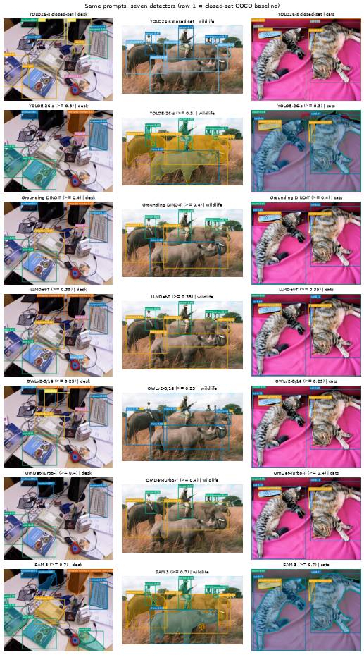

## What you'll learn

- Why a closed-set detector cannot be prompted, and how **text embeddings replace the classification
  layer** of a detector.
- The two design families: **late fusion** (dual encoder, text embeddings cached: OWLv2, YOLOE) and
  **early fusion** (text and image features cross-attend: Grounding DINO, LLMDet, OmDet-Turbo, SAM 3),
  and what each costs as the vocabulary grows.
- How Grounding DINO scores **caption tokens** rather than classes (the positive map), and why
  this makes it sensitive to prompt templates.
- How SAM 3 separates *"is the concept in the image?"* (presence head) from *"where is it?"*.
- How to evaluate a text-prompted detector with **pycocotools** (AP, AP50, per-class AP, PR curves),
  why "zero-shot" does not mean "never seen", and why every model needs **its own score threshold**.
- How to lift detections to 3D with depth and camera poses, cluster them into an **object map**, and
  use multi-view consistency as a label-free check of a detector.

## Theory primer

**Closed-set head.** For a region feature $\mathbf{f}_r \in \mathbb{R}^D$, a COCO detector computes
$p(c \mid r) = \sigma(\mathbf{w}_c^\top \mathbf{f}_r + b_c)$ with a learned matrix
$\mathbf{W} \in \mathbb{R}^{80 \times D}$. Nothing outside those 80 rows can be asked for.

**Open-vocabulary head.** Replace $\mathbf{w}_c$ with the embedding of a text prompt,
$\mathbf{t}_c = \mathrm{TextEncoder}(\text{prompt}_c)$, and score by scaled cosine similarity:

$$s(r, c) = \sigma\left(\alpha\,\frac{\mathbf{f}_r^\top \mathbf{t}_c}{\lVert\mathbf{f}_r\rVert\,\lVert\mathbf{t}_c\rVert} + \beta\right).$$

Region features are aligned with text by training on large grounding/detection corpora
(Objects365, GoldG, V3Det, GRIT, SA-Co, ...).

- **OWLv2** (late fusion): a CLIP ViT-B/16 at 960x960 px gives $60 \times 60 = 3600$ patch tokens; every
  patch predicts a box and an embedding that is matched against the cached text embeddings.
- **YOLOE-26**: MobileCLIP2 text embeddings are refined by a small network and then *folded into the
  last 1x1 convolution* of a YOLO26 head, so inference costs about as much as a closed-set YOLO.
- **Grounding DINO / LLMDet** (early fusion): the prompts become one caption `"cat. remote control."`;
  BERT text features and Swin image features cross-attend, and each of 900 queries predicts a
  logit per caption *token*. A class score averages the token probabilities of that class
  ($\mathcal{T}_c$ = its tokens, the "positive map"):
  $s_{q,c} = \frac{1}{|\mathcal{T}_c|}\sum_{t \in \mathcal{T}_c} \sigma(L_{q,t})$. Captions are capped at 256 tokens,
  so long vocabularies are split into chunks (one forward pass each).
- **OmDet-Turbo**: class and task prompts are encoded separately and cached; an RT-DETR-style
  fusion head scores queries against classes; NMS at the end.
- **SAM 3** (promptable concept segmentation): one noun phrase per pass; 200 DETR queries plus a
  presence token, $s_q = \sigma(\ell_q)\,\sigma(\ell_{\text{presence}})$, and an instance mask per query.

**COCO AP.** Per class, detections are ranked by score and matched greedily to ground truth at
IoU $\ge \tau$; the monotone precision envelope $\tilde p(r)$ is averaged over 101 recall points, then
over $\tau \in \{0.50, 0.55, \dots, 0.95\}$ and over classes:
$\mathrm{AP} = \frac{1}{10}\sum_\tau \frac{1}{101}\sum_{r} \tilde p_\tau(r)$.

**Back-projection (notebook 03).** A box centre $(u, v)$ with robust depth $d$ (median of the central
30 % of the box) maps to the camera frame as $\mathbf{X}_c = d\,\mathbf{K}^{-1}[u, v, 1]^\top$ and to the
world frame as $\mathbf{X}_w = \mathbf{R}_{wc}\mathbf{X}_c + \mathbf{t}_{wc}$.

## How to run

All commands are run from the repository root in the `cv` conda environment.

```bash
# 1. Extra packages (ultralytics + its pinned CLIP tokenizer fork, transformers, pycocotools)
make setup-04_open_vocab_detection

# 2. Data and weights (idempotent): COCO val2017 annotations + a fixed-seed 200-image subset,
#    Ultralytics african-wildlife, TUM RGB-D fr1_desk, YOLO26-s / YOLOE-26-s + MobileCLIP2 text
#    encoder (weights/ultralytics/), and Grounding DINO-T, LLMDet-T, OWLv2-B/16, OmDet-Turbo-T,
#    SAM 3 in the Hugging Face cache. SAM 3 is gated: request access on
#    https://huggingface.co/facebook/sam3 and run `hf auth login` first (or add --no-sam3).
make data-04_open_vocab_detection

# 3. Benchmark (GPU; writes projects/04_open_vocab_detection/results/*.json).
#    Quick check of all 7 models on 5 images (results go to runs/, nothing is overwritten):
python projects/04_open_vocab_detection/scripts/eval_detectors.py --dataset wildlife --max-images 5
#    Full runs (one model at a time is fine: --models yolo26s yoloe26s gdino_t llmdet_t owlv2_b omdet_t sam3)
python projects/04_open_vocab_detection/scripts/eval_detectors.py --dataset coco
python projects/04_open_vocab_detection/scripts/eval_detectors.py --dataset wildlife
python projects/04_open_vocab_detection/scripts/eval_detectors.py --prompt-study

# 4. Notebooks (executed headless under the GPU lock)
make nb-04_open_vocab_detection

# 5. Exercise solutions
python projects/04_open_vocab_detection/solutions/solutions_01.py
python projects/04_open_vocab_detection/solutions/solutions_02.py
python projects/04_open_vocab_detection/solutions/solutions_03.py
```

| Notebook | Content |
|---|---|
| [`01_text_prompted_detection.ipynb`](notebooks/01_text_prompted_detection.ipynb) | Closed-set baseline vs six open-vocabulary detectors on a robot-eye desk frame, a wildlife photo and a COCO image; Grounding DINO token heatmap; prompt sensitivity (synonyms, absent objects); latency and VRAM |
| [`02_closed_vs_open_set_benchmark.ipynb`](notebooks/02_closed_vs_open_set_benchmark.ipynb) | Live pycocotools walk-through, COCO AP / PR curves / per-class AP, speed vs accuracy, novel classes (buffalo, rhino), what the closed-set model calls them, prompt-wording study, F1 vs threshold |
| [`03_open_vocab_object_map.ipynb`](notebooks/03_open_vocab_object_map.ipynb) | Detections on 144 frames of TUM fr1_desk lifted to 3D with depth and motion-capture poses, clustered into an object map; per-object recall, spurious rate and 3D spread |

The detector wrappers (one `set_vocabulary()` / `predict()` interface for all seven models) and the
COCO evaluation helpers are in [`scripts/ovd.py`](scripts/ovd.py); evaluation settings are in
[`configs/eval.yaml`](configs/eval.yaml).

## Results

All numbers come from single runs in this repository on an **NVIDIA RTX 5060 Laptop GPU (8 GB,
sm_120)** with torch 2.11.0+cu128, batch size 1, fp16 weights (bf16 for SAM 3). The benchmark
numbers are copied from `results/*.json` (written by `scripts/eval_detectors.py`); the desk and
object-map numbers are outputs of notebooks 01 and 03.

### Closed-set vs open-vocabulary benchmark (notebook 02)

COCO: fixed-seed 200-image subset of val2017 (1399 annotations, 80 class names as prompts).
Wildlife: Ultralytics african-wildlife validation split (225 images); *buffalo* and *rhino* are
not COCO classes. AP = COCO AP@[0.50:0.95]. Latency is the end-to-end `predict()` call at the
evaluation setting (score >= 0.01, top 100 boxes) on one image; peak VRAM is
`torch.cuda.max_memory_allocated()` including the weights.

| Model | Type | COCO AP | COCO AP50 | Wildlife AP | AP base (elephant, zebra) | AP novel (buffalo, rhino) | Latency, 80 classes [ms] | Latency, 4 classes [ms] | Peak VRAM [MiB] | F1-best threshold | Best F1 (COCO) |
|---|---|---|---|---|---|---|---|---|---|---|---|
| YOLO26-s (closed-set) | closed | 0.519 | 0.683 | 0.383 | 0.765 | 0.000 | 5.05 | 4.78 | 71.3 | 0.35 | 0.675 |
| YOLOE-26-s | open | 0.404 | 0.560 | 0.399 | 0.634 | 0.164 | 29.07 | 10.91 | 497.4 | 0.30 | 0.600 |
| Grounding DINO-T | open | 0.517 | 0.668 | 0.592 | 0.786 | 0.397 | 188.28 | 183.09 | 1160.7 | 0.40 | 0.667 |
| LLMDet-T | open | **0.592** | 0.748 | 0.687 | 0.807 | 0.567 | 184.64 | 180.11 | 1162.9 | 0.35 | 0.705 |
| OWLv2-B/16 | open | 0.540 | 0.736 | 0.755 | 0.751 | 0.759 | 73.74 | 65.45 | 406.8 | 0.25 | 0.467 |
| OmDet-Turbo-T | open | 0.461 | 0.615 | 0.570 | 0.648 | 0.492 | 34.15 | 26.77 | 342.3 | 0.40 | 0.607 |
| SAM 3 | open | 0.586 | **0.776** | **0.849** | **0.851** | **0.847** | 2189.44 | 439.56 | 2231.2 | 0.70 | **0.717** |

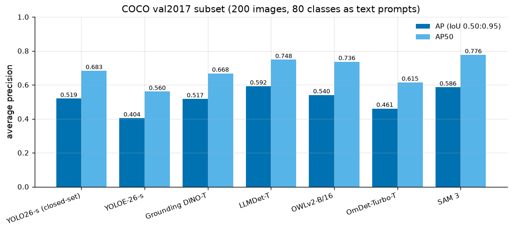

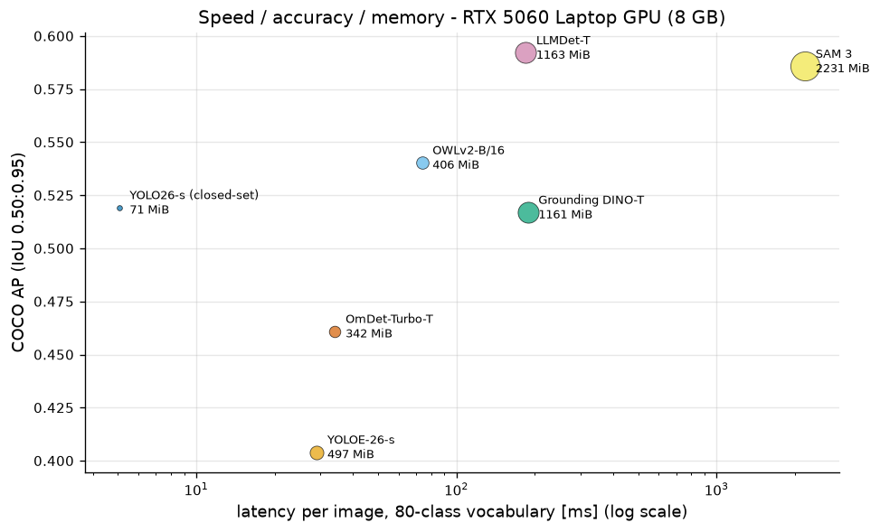

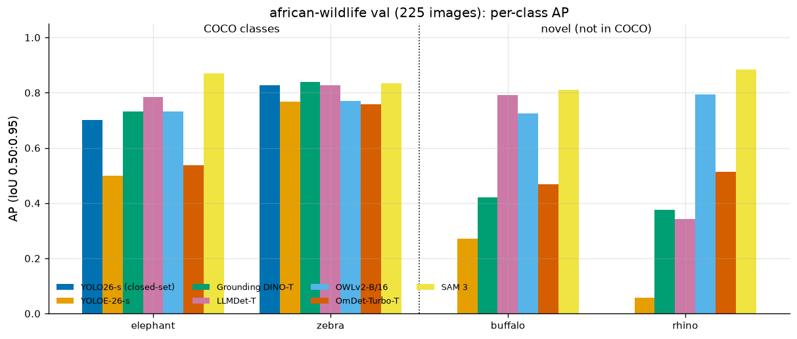

The closed-set model cannot name the novel animals. It reports 66 of the 89 buffalo boxes as
*cow* and 36 of the 85 rhino boxes as *elephant* (32 as *cow*):

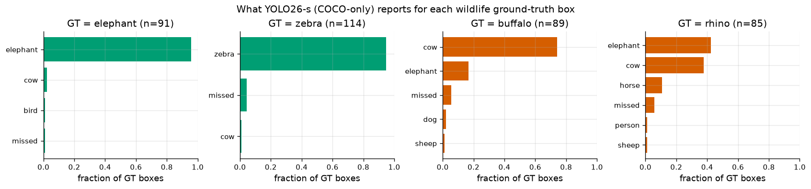

**Prompt wording** (african-wildlife AP; the four classes written four ways, sent verbatim):

| Model | plain (`rhino`) | specific (`rhinoceros`) | template (`a photo of a rhino`) | plural (`rhinos`) |
|---|---|---|---|---|
| YOLOE-26-s | 0.399 | 0.502 | 0.487 | 0.486 |
| Grounding DINO-T | 0.592 | 0.192 | 0.290 | 0.487 |
| LLMDet-T | 0.687 | 0.803 | 0.202 | 0.711 |
| OWLv2-B/16 | 0.775 | 0.744 | 0.755 | 0.773 |
| OmDet-Turbo-T | 0.570 | 0.641 | 0.592 | 0.525 |
| SAM 3 | 0.849 | 0.834 | 0.804 | 0.584 |

The main benchmark uses the plain names for every model except OWLv2, which uses its
`"a photo of a {}"` template (0.755).

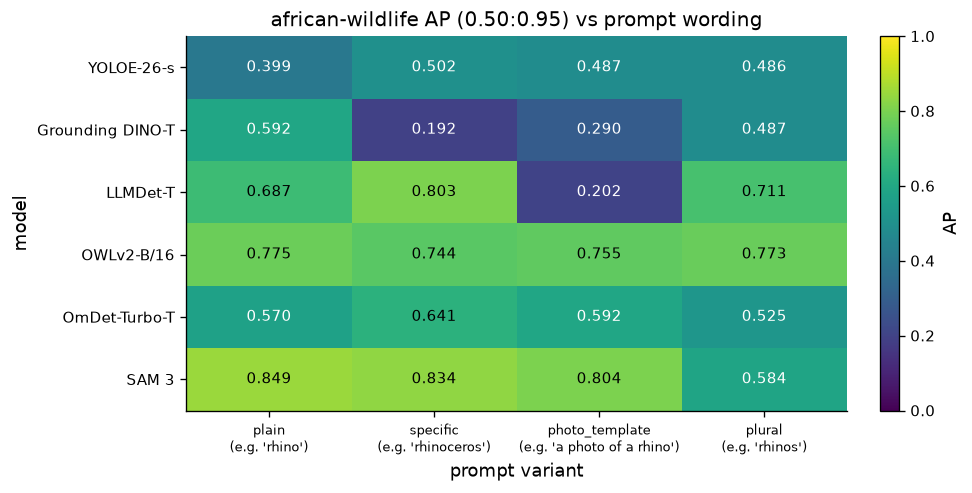

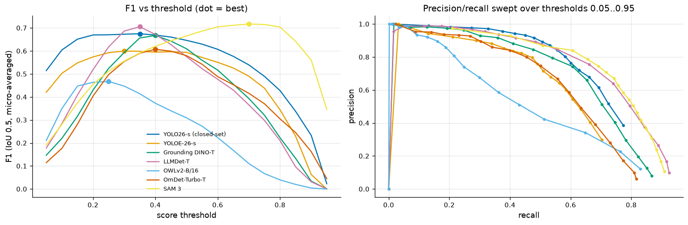

### Robot-eye desk frame (notebook 01)

TUM fr1_desk frame (640x480), 7 prompts, each model at its F1-optimal COCO threshold, CUDA-synchronised
mean over 10 runs. "Absent-object score" is the mean of the highest score each model gives to six
objects that are *not* in a COCO cats image (dog, laptop, giraffe, ...); high values mean hallucinations.

| Model | Family | Latency [ms] | FPS | Peak VRAM [MiB] | 1st `set_vocabulary` [ms] | later `set_vocabulary` [ms] | Threshold | Present-object score | Absent-object score |
|---|---|---|---|---|---|---|---|---|---|
| YOLO26-s (closed-set) | closed-set | 4.4 | 225.0 | 244 | 0.0 | 0.0 | 0.25 | - | - |
| YOLOE-26-s | late fusion | 8.2 | 121.8 | 145 | 398.7 | 774.4 | 0.30 | 0.605 | 0.040 |
| Grounding DINO-T | early fusion | 191.1 | 5.2 | 1017 | 0.9 | 0.2 | 0.40 | 0.445 | 0.126 |
| LLMDet-T | early fusion | 201.5 | 5.0 | 1065 | 0.3 | 0.2 | 0.35 | 0.697 | 0.421 |
| OWLv2-B/16 | late fusion | 72.5 | 13.8 | 478 | 2.3 | 0.9 | 0.25 | 0.450 | 0.019 |
| OmDet-Turbo-T | early fusion | 52.0 | 19.2 | 370 | 0.0 | 0.0 | 0.40 | 0.489 | 0.295 |
| SAM 3 | early fusion | 516.5 | 1.9 | 3440 | 101.2 | 11.2 | 0.70 | 0.800 | 0.000 |

YOLOE's `set_vocabulary` is slow because Ultralytics 8.4.204 rebuilds the MobileCLIP2 text
encoder on every `set_classes` call (`get_text_pe(..., cache_clip_model=False)`). Notebook 01
shows how to cache the embeddings instead.

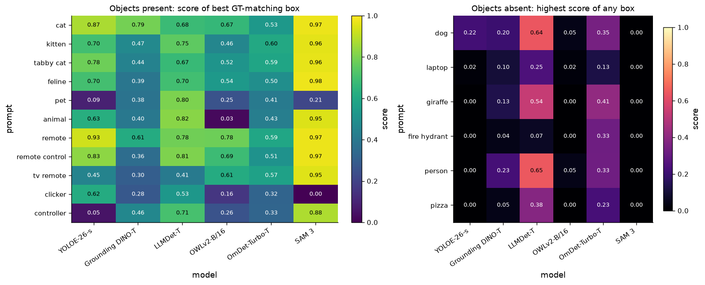

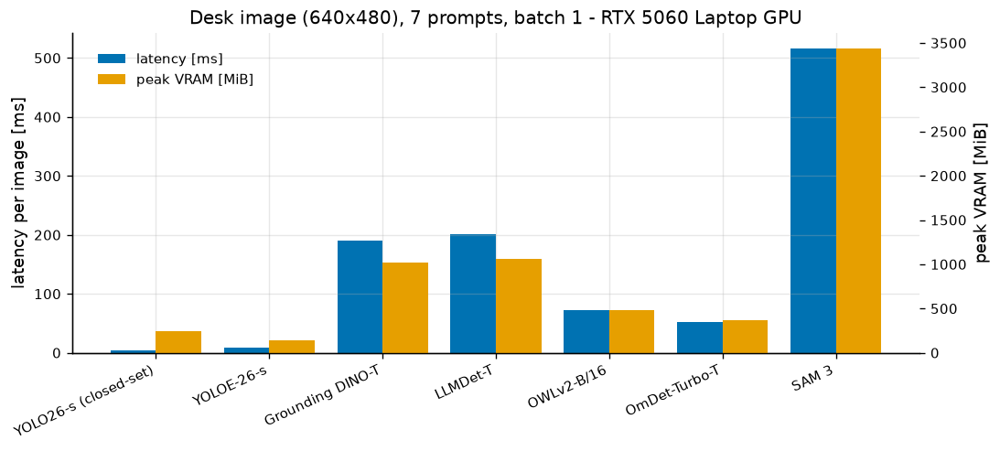

### 3D object map from a moving RGB-D camera (notebook 03)

144 frames (every 4th) of TUM fr1_desk, 7 prompts. Each detection is lifted to the world frame
with the median depth in the box centre and the motion-capture pose, then clustered (0.15 m)
into map objects with at least 5 supporting frames. Recall = detected / visible frames of the
best-supported object per class; spurious = observations that agree with no map object. These
are self-consistency measures, not agreement with human labels.

| Model | Threshold | ms / frame | Detections (with depth) | Map objects | Classes mapped (of 7) | Mean recall | Median spread [cm] | Spurious [%] |
|---|---|---|---|---|---|---|---|---|
| YOLOE-26-s | 0.30 | 8.7 | 325 | 17 | 5 | 0.415 | 1.7 | 14.8 |
| LLMDet-T | 0.35 | 181.6 | 980 | 34 | 7 | 0.634 | 2.5 | 10.5 |
| SAM 3 | 0.70 | 520.6 | 558 | 16 | 7 | 0.543 | 3.7 | 3.9 |

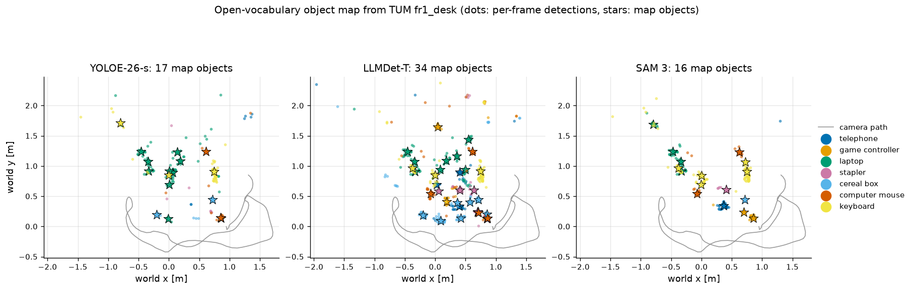

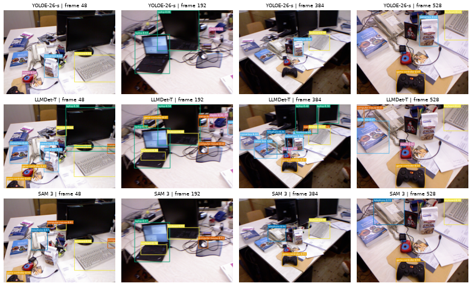

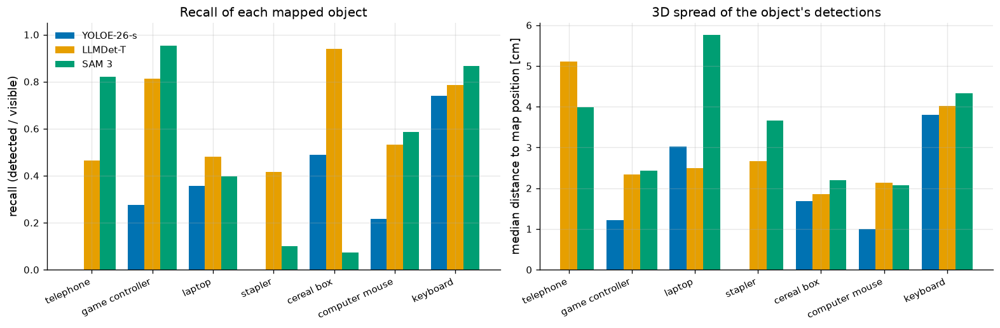

**Takeaways**

- Zero-shot, LLMDet-T (AP 0.592) and SAM 3 (0.586) beat the closed-set YOLO26-s (0.519) on its
  own COCO classes. "Zero-shot" refers to the class list: the grounding corpora behind these models
  cover every COCO category and partly overlap with COCO images.
- On classes outside COCO the closed-set model scores 0 by construction, while SAM 3 reaches
  0.847 and OWLv2 0.759 novel-class AP.
- The models differ most in how they behave when the object is **absent**. SAM 3 (presence
  head) scores 0.000 and OWLv2 0.019 on average, while LLMDet-T (0.421) and OmDet-Turbo-T
  (0.295) can exceed their own thresholds and report objects that are not there.
- Caption-based models are sensitive to wording: Grounding DINO-T drops from 0.592 to 0.192 AP
  with specific names, and LLMDet-T from 0.803 to 0.202 with a "a photo of a ..." template.
- Cost: YOLOE-26-s runs a 640x480 frame in 8.2 ms; SAM 3 needs 516.5 ms with 7 prompts and
  2189.44 ms with 80, because it decodes once per prompt. Every model fits in 8 GB (peak 3440 MiB).
- In the 3D map, multi-view consistency flags random errors (SAM 3: 3.9 % spurious) but not
  systematic ones: LLMDet-T labels books as *cereal box* from every viewpoint, so they become
  stable map objects.

Exercise solutions (`solutions/`) add MM-Grounding-DINO-T (african-wildlife AP 0.760 in the
latest run), latency against vocabulary size, temporal voting for the object map and an
oriented 3D box from a SAM 3 mask.

## Limitations

- **Small evaluation sets, single runs.** COCO AP is measured on a fixed-seed 200-image subset of
  val2017 (1399 annotations), not the full 5000 images, and every number comes from one run with
  no confidence intervals. Differences of a few AP points, and per-class AP for rare classes,
  are within sampling noise. The F1-optimal thresholds are chosen on the same subset that
  reports the best F1, so those F1 values are optimistic.
- **"Zero-shot" is not "unseen".** The open-vocabulary models were trained on grounding corpora
  (Objects365, GoldG, V3Det, GRIT, SA-Co, ...) that cover every COCO category and partly overlap
  with COCO images. The african-wildlife novel classes (buffalo, rhino) are a fairer test, but
  they are common in web data too.
- **Latency varies between runs** on a laptop GPU (clocks, thermals). For example, YOLOE-26-s
  with an 80-class vocabulary took 29.07 ms in the benchmark (score >= 0.01, top 100, one COCO
  image) but 8.0 ms and 18.7 ms in two runs of the vocabulary-size exercise (another image, score >=
  0.05).
  The benchmark latencies include post-processing of many low-score boxes; at deployment
  thresholds (notebook 01) they are lower.
- **Small variants only.** Grounding DINO-T, LLMDet-T, OWLv2-B/16, OmDet-Turbo-T and YOLOE-26-s
  were chosen for speed and the 8 GB budget. Larger variants (Grounding DINO-B, OWLv2-L/14,
  larger YOLOE-26 sizes) were not evaluated. None of the models is fine-tuned here (no prompt tuning or
  YOLOE linear probing).
- **Boxes only.** YOLOE-26-s uses its `-seg` checkpoint and SAM 3 predicts masks, but only box AP
  is measured. Mask quality is covered in project 05.
- **SAM 3 is gated and large.** The checkpoint is about 3.3 GB (above the repo's 2 GB
  single-download default; kept because it is the reference concept-segmentation model and is
  shared with project 05). Without access to `facebook/sam3`, run the download with `--no-sam3`;
  the SAM 3 cells of the notebooks then fail and have to be skipped.
- **YOLOE vocabulary changes are slow through the Ultralytics API** (0.4-0.8 s per
  `set_classes` call here) because the text encoder is rebuilt on every call. Caching the
  embeddings avoids this (notebook 01).
- **The object map is evaluated by self-consistency**, not against labels: there are no object
  annotations for TUM fr1_desk. A detector that makes the same mistake from every viewpoint (books
  called *cereal box*) still forms a map object and counts towards recall. Objects are points
  (box centre plus median depth), not 3D boxes. Exercise 2 of notebook 03 fits one oriented box
  from a SAM 3 mask; it measures 36.0 x 25.3 x 18.3 cm for the telephone, larger than a typical
  desk phone (about 20 x 20 x 10 cm), so mask-based 3D boxes need further cleaning before grasping.
- **Licenses.** Ultralytics code, weights and the african-wildlife release are AGPL-3.0, and the
  YOLOE text encoder (MobileCLIP2) has research-only terms. See the table below.

## Model & dataset licenses

| Component | License | Notes |
|---|---|---|
| Ultralytics YOLO26-s, YOLOE-26-s-seg weights and `ultralytics` package | AGPL-3.0 | Copyleft; an Ultralytics Enterprise license is needed for closed-source commercial use |
| `mobileclip2_b.ts` (YOLOE-26 text encoder, from Apple MobileCLIP2-B) | Apple AMLR (`apple-amlr` on the HF model card) | Research-only terms: non-commercial |
| `clip` (Ultralytics fork of OpenAI CLIP, tokenizer) | MIT | Installed from GitHub at a pinned commit |
| Grounding DINO-T (`IDEA-Research/grounding-dino-tiny`) | Apache-2.0 | |
| LLMDet-T (`iSEE-Laboratory/llmdet_tiny`) | Apache-2.0 | |
| MM-Grounding-DINO-T (`openmmlab-community/mm_grounding_dino_tiny_o365v1_goldg_v3det`, solutions only) | Apache-2.0 | |
| OWLv2-B/16 (`google/owlv2-base-patch16-ensemble`) | Apache-2.0 | |
| OmDet-Turbo-T (`omlab/omdet-turbo-swin-tiny-hf`) | Apache-2.0 | |
| SAM 3 (`facebook/sam3`) | SAM License (Meta, custom) | Gated on Hugging Face; royalty-free use and redistribution under Meta's terms (trade-control restrictions apply); not an OSI license |
| `transformers` | Apache-2.0 | |
| `pycocotools` | BSD-2-Clause | |
| COCO val2017 (200-image subset + annotations) | Annotations CC BY 4.0; images under Flickr terms | Images fetched one by one from images.cocodataset.org |
| Ultralytics african-wildlife | AGPL-3.0 (Ultralytics dataset release) | Original image sources not documented by the release |
| TUM RGB-D `freiburg1_desk` | CC BY 4.0 | |

## References

Papers
- A. Wang et al., *YOLOE: Real-Time Seeing Anything*, 2025. [arXiv:2503.07465](https://arxiv.org/abs/2503.07465)
- S. Liu et al., *Grounding DINO: Marrying DINO with Grounded Pre-Training for Open-Set Object Detection*, ECCV 2024. [arXiv:2303.05499](https://arxiv.org/abs/2303.05499)
- X. Zhao et al., *An Open and Comprehensive Pipeline for Unified Object Grounding and Detection* (MM-Grounding-DINO), 2024. [arXiv:2401.02361](https://arxiv.org/abs/2401.02361)
- S. Fu et al., *LLMDet: Learning Strong Open-Vocabulary Object Detectors under the Supervision of Large Language Models*, CVPR 2025. [arXiv:2501.18954](https://arxiv.org/abs/2501.18954)
- M. Minderer et al., *Simple Open-Vocabulary Object Detection with Vision Transformers* (OWL-ViT), ECCV 2022. [arXiv:2205.06230](https://arxiv.org/abs/2205.06230)
- M. Minderer, A. Gritsenko, N. Houlsby, *Scaling Open-Vocabulary Object Detection* (OWLv2), NeurIPS 2023. [arXiv:2306.09683](https://arxiv.org/abs/2306.09683)
- T. Zhao et al., *Real-time Transformer-based Open-Vocabulary Detection with Efficient Fusion Head* (OmDet-Turbo), 2024. [arXiv:2403.06892](https://arxiv.org/abs/2403.06892)
- N. Carion et al., *SAM 3: Segment Anything with Concepts*, 2025. [arXiv:2511.16719](https://arxiv.org/abs/2511.16719)
- L. H. Li et al., *Grounded Language-Image Pre-training* (GLIP), CVPR 2022. [arXiv:2112.03857](https://arxiv.org/abs/2112.03857)
- A. Radford et al., *Learning Transferable Visual Models From Natural Language Supervision* (CLIP), ICML 2021. [arXiv:2103.00020](https://arxiv.org/abs/2103.00020)
- F. Faghri et al., *MobileCLIP2: Improving Multi-Modal Reinforced Training*, 2025. [arXiv:2508.20691](https://arxiv.org/abs/2508.20691)
- T.-Y. Lin et al., *Microsoft COCO: Common Objects in Context*, ECCV 2014. [arXiv:1405.0312](https://arxiv.org/abs/1405.0312)
- J. Sturm et al., *A Benchmark for the Evaluation of RGB-D SLAM Systems*, IROS 2012. [dataset page](https://cvg.cit.tum.de/data/datasets/rgbd-dataset)

Code and model cards
- Ultralytics YOLOE docs: <https://docs.ultralytics.com/models/yoloe/> · YOLO26 docs: <https://docs.ultralytics.com/models/yolo26/>
- Grounding DINO: <https://github.com/IDEA-Research/GroundingDINO> · LLMDet: <https://github.com/iSEE-Laboratory/LLMDet>
- OWL-ViT / OWLv2 (scenic): <https://github.com/google-research/scenic/tree/main/scenic/projects/owl_vit>
- OmDet: <https://github.com/om-ai-lab/OmDet> · SAM 3: <https://github.com/facebookresearch/sam3>
- Hugging Face transformers model docs: [Grounding DINO](https://huggingface.co/docs/transformers/model_doc/grounding-dino), [MM-Grounding-DINO / LLMDet](https://huggingface.co/docs/transformers/model_doc/mm-grounding-dino), [OWLv2](https://huggingface.co/docs/transformers/model_doc/owlv2), [OmDet-Turbo](https://huggingface.co/docs/transformers/model_doc/omdet-turbo), [SAM 3](https://huggingface.co/docs/transformers/model_doc/sam3)
- pycocotools: <https://pypi.org/project/pycocotools/>
