# 05 · Segmentation: SAM 3 vs SAM 2.1, text prompts, video propagation and YOLO26-seg

A grasp planner, a free-space estimator or an object-level map needs **pixel masks**, not only boxes. This project covers the three
ways a robot gets them today: *promptable* segmentation ("segment the object I click on"), *concept* segmentation from text
("segment every mug"), and *closed-set* real-time instance segmentation. It also covers keeping a mask on an object through a video.
Everything runs on real data (COCO images with instance masks, DAVIS 2017 video with per-frame ground truth, a TUM RGB-D desk scene)
on one 8 GB laptop GPU.

| notebook | content |
|---|---|
| [`01_promptable_segmentation.ipynb`](notebooks/01_promptable_segmentation.ipynb) | **SAM 3** (tracker head) vs **SAM 2.1** tiny / small / base-plus: click and box prompts, multimask ambiguity, simulated interactive refinement (mIoU after *k* clicks, NoC@85/90), encoder vs decoder latency, peak VRAM; 128-image coco128-seg benchmark |
| [`02_text_prompts_concepts.ipynb`](notebooks/02_text_prompts_concepts.ipynb) | **SAM 3 concept prompts** vs **Grounded-SAM** (Grounding DINO tiny boxes → SAM 2.1-S): robot desk scene, box exemplars, prompts for absent objects (hallucination), mask AP on coco128-seg with an oracle vocabulary |
| [`03_video_segmentation_davis.ipynb`](notebooks/03_video_segmentation_davis.ipynb) | **video propagation** with the SAM 3 and SAM 2.1-S trackers on DAVIS 2017 (mask / box / click prompt on frame 0), **J** and **F** per frame, J&F mean / recall / decay, and **text-prompted video tracking** with `Sam3VideoModel` |
| [`04_yolo26_seg_and_comparison.ipynb`](notebooks/04_yolo26_seg_and_comparison.ipynb) | **YOLO26n/s-seg** instance segmentation, Ultralytics mask mAP, latency, *YOLO box → SAM 3 mask* refinement (J and boundary F by object size), and a speed / VRAM table of every model in the project |

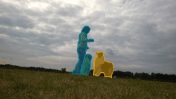

## What you'll learn

- How SAM-style models split the work into a heavy **image encoder** (once per image) and a light **prompt encoder + mask decoder**
  (once per click), and why that makes interactive "click-to-segment" robot interfaces responsive.
- Why one click is **ambiguous**, how **multimask output** with a predicted IoU resolves it, and how interactive segmentation is
  evaluated with a simulated annotator (error-driven positive / negative clicks, mIoU@k, NoC@90).
- The difference between **visual prompts** (segment *this* object) and **concept prompts** (segment *all* objects of this kind),
  how SAM 3's **presence head** separates recognition from localisation, and how to build the two-stage **Grounded-SAM** baseline.
- How SAM 2 / SAM 3 propagate a prompt through a video with a **memory bank**, and how to compute the **DAVIS J and F** metrics
  (region IoU and boundary F-measure with a tolerance band) and their mean / recall / decay summaries.
- How **YOLO-seg** builds masks from prototypes and per-instance coefficients, how to read Ultralytics' mask mAP, and when to
  hand a YOLO box to SAM for a sharper mask.
- How to time GPU models properly (CUDA synchronisation, warm-up) and record peak VRAM, so model choices for an 8 GB robot computer
  rest on measurements.

## Theory primer

**Promptable segmentation (SAM 1/2/3).** An image encoder $E$ maps the image to a dense embedding $F=E(I)$ (SAM 2.1: Hiera at
$1024\times1024$; SAM 3: the Perception Encoder ViT at $1008\times1008$). Prompts become tokens: a click $(x,y)$ is a Fourier
positional encoding plus a learned positive / negative embedding, a box is two corner tokens, and a previous mask is a dense prompt
added to $F$. A two-way transformer decoder lets the prompt tokens and $F$ attend to each other and outputs $K=3$ low-resolution
mask logits $\{M_k\}$ plus a predicted IoU $\hat s_k$ for each. With an ambiguous single click the answer is
$\hat M=M_{\arg\max_k \hat s_k}$. Masks are scored with

$$J(P,G)=\mathrm{IoU}(P,G)=\frac{|P\cap G|}{|P\cup G|}.$$

**Concept segmentation (SAM 3).** For a noun phrase or exemplar boxes, a DETR-style detector (200 object queries conditioned on the
prompt tokens) predicts a box, a mask and a match score per query. A global **presence token** estimates whether the concept occurs
anywhere in the image, and the final score factorises as
$s_i = p(\text{present}\mid I)\cdot p(\text{query } i \text{ matches}\mid \text{present})$. **Grounded-SAM** instead chains an
open-vocabulary detector (Grounding DINO: text-image fusion, 900 queries, a box is kept if its best token similarity exceeds
`box_threshold`) with box-prompted SAM. It has no presence head, so a single phrase tends to land on the most similar-looking object.

**Video propagation.** Each frame is encoded once. The tracker keeps a **memory bank** of the prompted frame plus the 6 most recent
frames (memory features fused with the predicted masks, plus object-pointer tokens). **Memory attention** conditions the current
frame on that bank before the mask decoder runs, and an occlusion head predicts whether the object is visible. SAM 3's
`Sam3VideoModel` adds the detector on every frame: detections that match no existing masklet start new tracks, so a text prompt
alone finds and tracks all instances.

**DAVIS metrics.** Per object and frame, $J$ is the IoU and $F=\frac{2P_cR_c}{P_c+R_c}$ is the boundary F-measure, where contour
precision $P_c$ and recall $R_c$ count boundary pixels within a disk of radius $\lceil 0.008\cdot\text{diagonal}\rceil$ (8 px at
$854\times480$) of the other mask's boundary. Each per-frame series is summarised by its **mean**, its **recall** (fraction of frames
$>0.5$) and its **decay** (first-quarter mean minus last-quarter mean). The headline is $J\&F=(\bar J+\bar F)/2$; the prompted
first frame and the last frame are excluded.

**YOLO-seg.** A prototype branch predicts $k=32$ prototype masks $\mathbf P\in\mathbb R^{k\times H/4\times W/4}$ shared by all
instances, and each detection carries $k$ coefficients $\mathbf c$:
$M=\operatorname{crop}_{\text{box}}(\sigma(\mathbf c^\top\mathbf P))>0.5$ (YOLACT). This is almost free on top of detection, but
the masks are limited by quarter-resolution prototypes. YOLO26 is trained with a one-to-one assignment head and needs **no NMS**.

**Mask AP.** Per class and IoU threshold $\tau$, predictions sorted by score are greedily matched to unmatched ground-truth masks with
mask IoU $\ge\tau$. AP is the 101-point interpolated area under the resulting precision-recall curve, averaged over
$\tau\in\{0.50,0.55,\dots,0.95\}$ and over classes (COCO protocol).

## How to run

All commands run from the repository root inside the `cv` environment. GPU commands hold the shared GPU lock
(`flock /tmp/cv-gpu.lock`); `make nb-*` takes the lock itself, once per notebook.

```bash
make setup-05_segmentation    # transformers, tokenizers, safetensors, ultralytics (pinned, with requirements/constraints.txt)
make data-05_segmentation     # coco8-seg, coco128-seg, YOLO26n/s-seg weights, 2 DAVIS sequences, TUM fr1_desk,
                              # SAM 3 + SAM 2.1 (tiny/small/base-plus) + Grounding DINO tiny into the HF cache; idempotent

# coco128-seg benchmarks (results -> projects/05_segmentation/results/*.json|csv, loaded by notebooks 01, 02 and 04)
flock /tmp/cv-gpu.lock python projects/05_segmentation/scripts/benchmark_coco.py --task prompts   # SAM 3 + 3 SAM 2.1 sizes
flock /tmp/cv-gpu.lock python projects/05_segmentation/scripts/benchmark_coco.py --task text      # SAM 3 vs Grounded-SAM vs YOLO26

make nb-05_segmentation       # execute the four notebooks headless (04 reads CSVs written by 01 and 03)

# exercise solutions (print their results; figures go to outputs/05_segmentation/solutions/, gitignored)
flock /tmp/cv-gpu.lock python projects/05_segmentation/solutions/solutions_01.py
flock /tmp/cv-gpu.lock python projects/05_segmentation/solutions/solutions_02.py
flock /tmp/cv-gpu.lock python projects/05_segmentation/solutions/solutions_03.py
flock /tmp/cv-gpu.lock python projects/05_segmentation/solutions/solutions_04.py

python -m pytest -q tests/test_p05_segkit.py   # CPU unit tests: J, boundary F, J&F statistics, mask AP, prompts, polygons
```

**SAM 3 access.** `facebook/sam3` is gated. Accept the SAM License on the [model page](https://huggingface.co/facebook/sam3), then run
`hf auth login`. The download script fetches only `model.safetensors` and the configs (3.3 GiB), not the duplicate `sam3.pt`. This
is the one download above the repository's 2 GB guideline, because no smaller SAM 3 exists. Without access, every SAM 3 cell fails at
load time. In that case, set the model id to an `sk.SAM2_IDS` entry: `PromptableSegmenter` and `VideoTracker` take either family.
The concept-prompt parts (notebook 02, the text section of 03) have no SAM 2.1 equivalent; use `sk.GroundedSam` there.

**DAVIS download.** The DAVIS 2017 TrainVal 480p archive is 833 MB, but only two sequences (17 MB) are needed. The download script
reads the zip's central directory and the wanted members with **HTTP range requests**, so the full archive is never stored.
`python scripts/download_05_segmentation.py --full-zip` is the fallback if the server stops honouring range requests: it
downloads the zip once, extracts the two sequences and deletes the archive.

Shared code lives in [`scripts/segkit.py`](scripts/segkit.py): data loaders (YOLO polygons → masks, DAVIS palette PNGs),
metrics (J, boundary F, J&F statistics, COCO-style mask AP), prompt simulation (interior point, error-driven clicks) and thin
adapters around the `transformers` SAM 3 / SAM 2.1 / Grounding DINO APIs.

## Results

All numbers were measured in this repository on an **NVIDIA RTX 5060 Laptop GPU (8 GB, sm_120)** with PyTorch 2.11.0+cu128,
`transformers` 5.22.2 and Ultralytics 8.4.204: SAM-family models in bfloat16, YOLO26 in fp32, batch 1. They are copied from the
executed notebooks and from [`results/`](results/). Latencies are CUDA-synchronised means after warm-up on a shared laptop GPU, so
repeated runs differ by a few milliseconds. For example, the encoder of SAM 2.1-T took 33.4 ms in notebook 01 and 27.4 ms in the
benchmark script.

### Promptable segmentation: clicks, boxes, ambiguity (notebook 01)

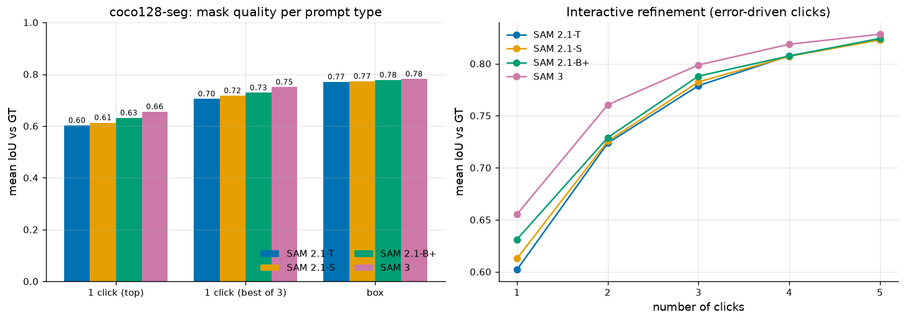

coco128-seg, 128 images and 861 instances (area ≥ 100 px). Prompts are derived from the GT masks. The "best of 3" column lets an oracle
pick among the three multimask outputs. NoC@90 is the mean number of simulated clicks needed to reach IoU 0.9, with an instance that
never gets there in 5 clicks counted as 6. Latency and peak VRAM were measured on one 640x480 image.

| model | params (M) | encoder (ms) | decoder (ms) | peak VRAM (MiB) | mIoU 1 click | mIoU 1 click, best of 3 | mIoU box | mIoU 5 clicks | NoC@90 |
|---|---:|---:|---:|---:|---:|---:|---:|---:|---:|
| SAM 2.1-T | 31.4 | 33.4 | 3.92 | 331 | 0.6021 | 0.7047 | 0.7705 | 0.8229 | 4.93 |
| SAM 2.1-S | 38.5 | 39.7 | 3.28 | 346 | 0.6128 | 0.7169 | 0.7725 | 0.8230 | 4.86 |
| SAM 2.1-B+ | 73.3 | 65.7 | 3.21 | 440 | 0.6312 | 0.7284 | 0.7776 | 0.8243 | 4.82 |
| SAM 3 (tracker head) | 458.3 | 343.4 | 3.26 | 1163 | 0.6553 | 0.7502 | 0.7815 | 0.8283 | 4.90 |

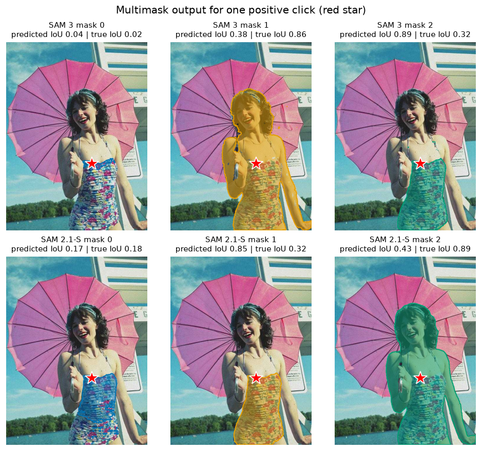

- A **box** removes almost all differences between the models: box mIoU ranges from 0.7705 to 0.7815. Given detector boxes, SAM 2.1-T/S
  produce nearly the same masks as SAM 3 for about a tenth of its encoder time.
- A **single click** is ambiguous. Keeping the mask with the highest *predicted* IoU loses about 0.1 IoU against the best of the three
  candidates (0.6553 vs 0.7502 for SAM 3). In the example above both models keep the swimsuit mask (true IoU 0.32) while the person mask
  is among their candidates. SAM 3 has the best 1-click mIoU, and its largest gain is on small objects
  ([size breakdown](../../assets/05_segmentation/prompt_by_size.png)).
- The **decoder** costs about 3-4 ms for every model, so once an image is encoded, interactive clicking runs at more than 250
  clicks/s. The model choice mostly changes the time to the first mask: 33.4 ms for SAM 2.1-T, 343.4 ms for SAM 3.

### Text prompts: SAM 3 concepts vs Grounded-SAM (notebook 02)

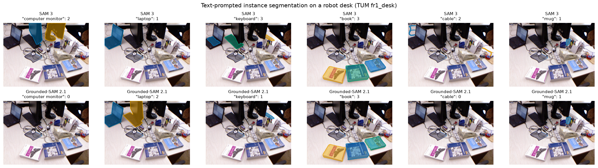

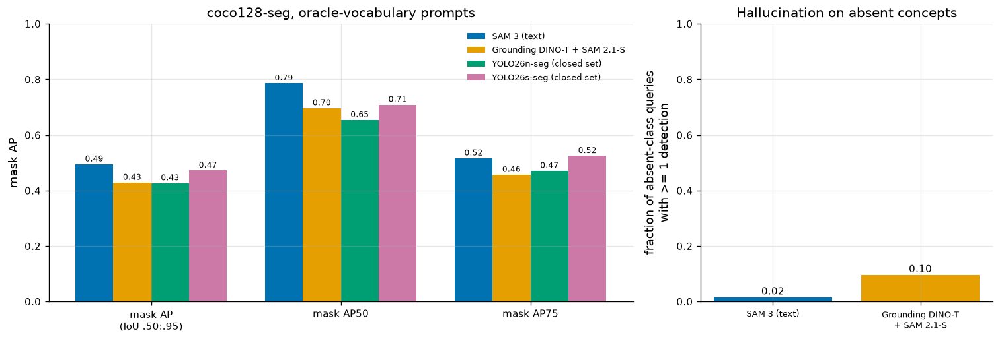

coco128-seg with oracle-vocabulary prompts: each image is prompted with the names of the COCO classes present in it, one phrase at a
time (929 GT instances, 71 classes). The YOLO26-seg predictions are filtered to the same class names. "Absent hit rate" is the fraction of 384
queries for classes *not* in the image that returned at least one instance. ms / prompt is the median over images 2-128. For SAM 3
it excludes the once-per-image vision backbone (366.7 ms), and for YOLO26-seg it is one pass per image covering all 80 classes.

| method | mask AP | mask AP50 | mask AP75 | ms / prompt | peak VRAM (MiB) | params (M) | absent hit rate |
|---|---:|---:|---:|---:|---:|---:|---:|
| SAM 3 (text) | 0.4949 | 0.7864 | 0.5163 | 52.3 | 2424 | 840.4 | 0.016 |
| Grounding DINO-T + SAM 2.1-S | 0.4285 | 0.6972 | 0.4573 | 366.0 | 2365 | 210.8 | 0.096 |
| YOLO26n-seg (closed set) | 0.4268 | 0.6538 | 0.4715 | 8.2 | 389 | 3.1 | n/a |
| YOLO26s-seg (closed set) | 0.4724 | 0.7093 | 0.5247 | 8.5 | 418 | 11.5 | n/a |

- SAM 3 is the most accurate text-to-mask pipeline here, and the gap is largest at AP50. It mainly finds the right instances more
  often; its masks are not the main difference.
- The presence head cuts hallucinations: 1.6% of absent-concept queries return something with SAM 3, against 9.6% for Grounded-SAM.
  On the desk frame, Grounding DINO found no monitor and no cable at its 0.35 threshold and labelled the external keyboard as a second
  "laptop".
- One more phrase on an already-encoded desk frame costs 42.9 ms with SAM 3, against 323.8 ms with Grounded-SAM. Through the `transformers`
  API, Grounding DINO re-runs its image backbone for every phrase.

### Video object segmentation on DAVIS 2017 (notebook 03)

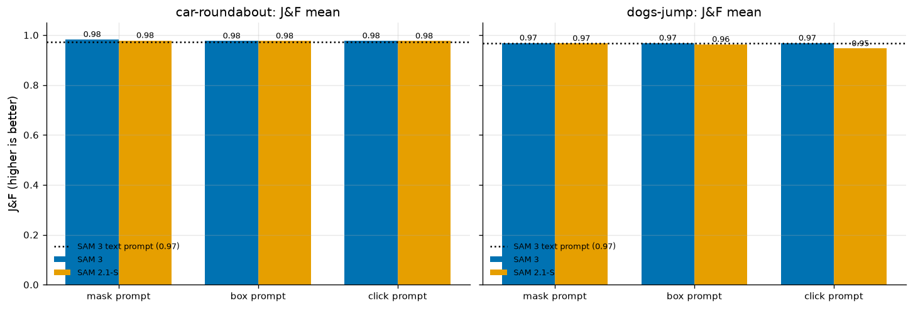

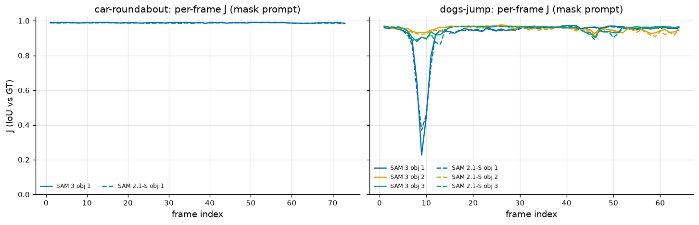

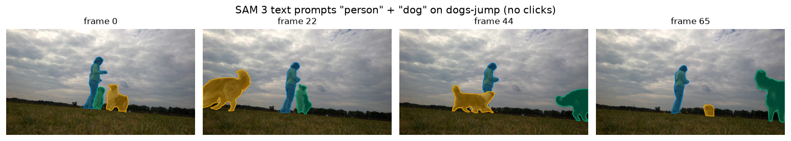

Two DAVIS 2017 *val* sequences at 854x480: `car-roundabout` (1 object, 75 frames) and `dogs-jump` (3 objects, 66 frames). The prompt is
given on frame 0 only. J&F is the mean over objects, with the first and last frames excluded as in the official evaluation. Text runs use
`Sam3VideoModel` with the phrases "car" and "person" + "dog", and the predicted tracks are matched to GT objects by the Hungarian
algorithm.

| model | prompt | J&F car-roundabout | J&F dogs-jump | J decay dogs-jump | ms/frame (car / dogs) | peak VRAM (MiB) |
|---|---|---:|---:|---:|---:|---:|
| SAM 3 | mask | 0.9829 | 0.9688 | -0.0416 | 415.1 / 543.8 | 1943 |
| SAM 3 | box | 0.9769 | 0.9685 | -0.0421 | 411.8 / 544.4 | 1943 |
| SAM 3 | click | 0.9774 | 0.9682 | -0.0435 | 411.8 / 545.1 | 1943 |
| SAM 2.1-S | mask | 0.9788 | 0.9670 | -0.0403 | 81.3 / 168.4 | 1014 |
| SAM 2.1-S | box | 0.9768 | 0.9630 | -0.0468 | 81.2 / 168.5 | 1014 |
| SAM 2.1-S | click | 0.9766 | 0.9465 | -0.0761 | 81.2 / 168.3 | 1014 |
| SAM 3 (`Sam3VideoModel`) | text | 0.9715 | 0.9678 | n/a | 1588.7 / 520.1 | 6325 |

- With a mask or box prompt, both trackers are close to the ceiling on these two clips. The weakest prompt (one click) hurts the smaller
  model more: on dogs-jump, SAM 2.1-S drops to 0.9465 while SAM 3 holds 0.9682.
- Both models lose dog 1 around frame 9 of dogs-jump, while it is almost completely hidden behind the other dog, and both recover within a few
  frames thanks to the memory of the prompted frame. The negative J decay reflects this early failure. It is not drift.
- Text-only tracking reaches mask-prompt quality without any click, but it created 19 tracks for "car" on car-roundabout,
  took 1588.7 ms/frame there and peaked at 6325 MiB, close to the 8 GB budget.

### YOLO26-seg and "detect with YOLO, segment with SAM 3" (notebook 04)

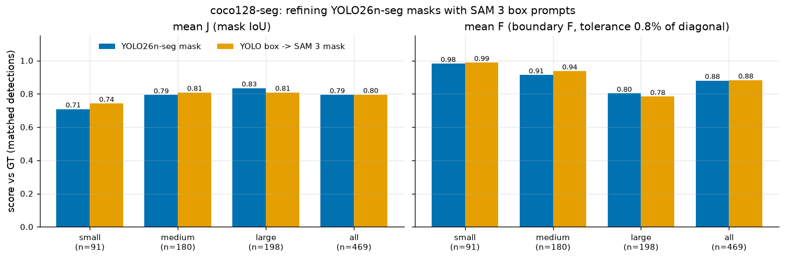

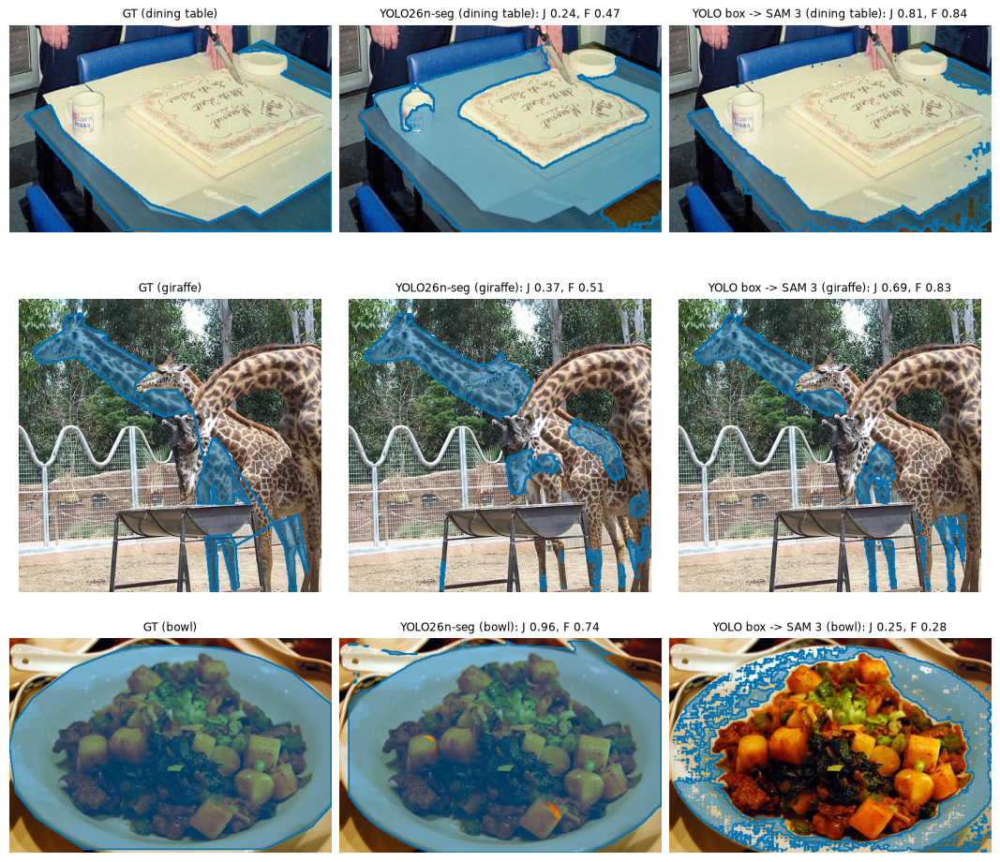

The Ultralytics validator on coco8-seg (4 val images, 13 instances, a smoke test only) gives the numbers below. Latency is
`model.predict` on one 640x480 image at `imgsz=640` and conf ≥ 0.25, including pre- and post-processing. The coco128-seg
benchmark of notebook 02 measured 8.2 / 8.5 ms per image because it predicts at conf ≥ 0.001 with up to 300 detections (the mAP
protocol), which means many more masks to assemble at full resolution. `retina_masks=True` cost nothing measurable in this run: the
differences of a few tenths of a millisecond in either direction are run-to-run noise.

| model | mask mAP50-95 | mask mAP50 | box mAP50-95 | box mAP50 | ms/image | FPS | ms/image (retina masks) | peak VRAM (MiB) |
|---|---:|---:|---:|---:|---:|---:|---:|---:|
| YOLO26n-seg | 0.5344 | 0.8253 | 0.6288 | 0.8678 | 4.9 | 203 | 4.6 | 176 |
| YOLO26s-seg | 0.6079 | 0.9019 | 0.7205 | 0.9705 | 7.4 | 136 | 7.6 | 197 |

The refinement study runs YOLO26n-seg (conf ≥ 0.25) on all 128 coco128-seg images and matches each detection to a GT instance of the same
class by box IoU ≥ 0.5. That gives 469 detections on 123 images. On that matched set it compares YOLO's own (retina) mask with the mask
the SAM 3 tracker produces from YOLO's box. The peak VRAM of YOLO26n plus the SAM 3 tracker was 1461 MiB.

| object size | n | J YOLO | J SAM 3 | F YOLO | F SAM 3 |
|---|---:|---:|---:|---:|---:|
| small | 91 | 0.709 | 0.742 | 0.982 | 0.988 |
| medium | 180 | 0.793 | 0.808 | 0.913 | 0.937 |
| large | 198 | 0.835 | 0.808 | 0.803 | 0.784 |
| all | 469 | 0.7943 | 0.7955 | 0.8800 | 0.8823 |

On average, SAM 3 refinement barely changes mask quality (J 0.7943 → 0.7955, F 0.8800 → 0.8823). It helps small and medium
objects, where YOLO's quarter-resolution prototypes are coarsest, but hurts large ones. SAM 3 recovers shapes that the 32 prototypes
cannot express (the cluttered dining table: J 0.24 → 0.81; the occluded giraffe split into two parts: J 0.37 → 0.69). On the bowl
it keeps only the ceramic rim and leaves out the food, while COCO, and YOLO trained on COCO, count the contents as part of the bowl
(J 0.96 → 0.25): a box prompt does not carry the dataset's labelling convention. Refining adds SAM 3's image encoder (343.4 ms in
notebook 01) to every image, so refine selectively (small objects, or the one object a grasp planner is about to touch), not by default.

### Speed and memory of every model in the project

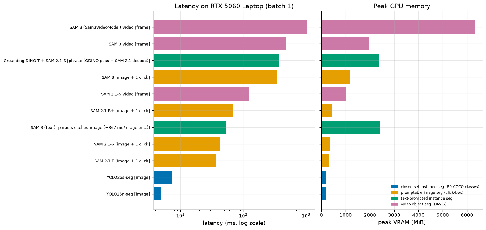

| model / pipeline | task | params (M) | latency (ms) | latency unit | peak VRAM (MiB) | quality |
|---|---|---:|---:|---|---:|---|
| SAM 2.1-T | promptable image seg (click/box) | 31.4 | 37.3 | image + 1 click | 331 | box mIoU 0.770 (coco128) |
| SAM 2.1-S | promptable image seg (click/box) | 38.5 | 43.0 | image + 1 click | 346 | box mIoU 0.772 (coco128) |
| SAM 2.1-B+ | promptable image seg (click/box) | 73.3 | 68.9 | image + 1 click | 440 | box mIoU 0.778 (coco128) |
| SAM 3 | promptable image seg (click/box) | 458.3 | 346.7 | image + 1 click | 1163 | box mIoU 0.781 (coco128) |
| SAM 3 (text) | text-prompted instance seg | 840.4 | 52.3 | phrase, cached image (+367 ms/image enc.) | 2424 | mask AP 0.495 (coco128) |
| Grounding DINO-T + SAM 2.1-S | text-prompted instance seg | 210.8 | 366.0 | phrase (GDINO pass + SAM 2.1 decode) | 2365 | mask AP 0.428 (coco128) |
| YOLO26n-seg | closed-set instance seg (80 COCO classes) | 3.1 | 4.9 | image | 176 | mask AP 0.427 (coco128, oracle classes) |
| YOLO26s-seg | closed-set instance seg (80 COCO classes) | 11.5 | 7.4 | image | 197 | mask AP 0.472 (coco128, oracle classes) |
| SAM 2.1-S video | video object seg (DAVIS) | n/a | 124.8 | frame | 1014 | J&F 0.973 (2 DAVIS seqs) |
| SAM 3 video | video object seg (DAVIS) | n/a | 479.4 | frame | 1943 | J&F 0.976 (2 DAVIS seqs) |
| SAM 3 (`Sam3VideoModel`) video | video object seg (DAVIS) | n/a | 1054.4 | frame | 6325 | J&F 0.970 (2 DAVIS seqs) |

Video quality is the mean J&F over both DAVIS sequences (mask prompt, or text for `Sam3VideoModel`).
The video latencies average the two sequences.

### Exercise solutions (measured)

| solution | result |
|---|---|
| 01 / ex 1: automatic mask generation, SAM 2.1-S | 13 masks on sample 009; 2 of 8 GT objects covered with IoU > 0.5 |
| 01 / ex 2: boundary F of click vs box masks (30 coco8-seg instances) | box F 0.906 (SAM 3) / 0.908 (SAM 2.1-S) vs click F 0.743 / 0.723 |
| 01 / ex 3: how often the top-scored mask is not the best of 3 (coco128-seg) | 27-46% of 1-click prompts depending on model and object size, losing 0.17-0.41 IoU on average when it happens |
| 02 / ex 1: attribute phrases on the desk frame (instances found) | SAM 3: book 3, blue book 2, white book 1, closed laptop 0; Grounded-SAM: book 3, blue book 1, white book 1, closed laptop 1 |
| 02 / ex 2: SAM 3 operating point on coco8-seg (IoU ≥ 0.5) | threshold 0.5: precision 0.750, recall 0.800; threshold 0.7: precision 0.857, recall 0.600 |
| 02 / ex 3: Grounding DINO-T boxes into SAM 2.1-S vs the SAM 3 tracker (coco8-seg) | mask AP 0.642 vs 0.646: a better mask head does not fix the detector |
| 03 / ex 1: one correction click on the worst frame (SAM 2.1-S, click prompt, dogs-jump) | J&F 0.946 → 0.942: the simulated correction did **not** help |
| 03 / ex 2: SAM 3 tracker on every k-th frame (dogs-jump, mask prompt) | J&F 0.969 / 0.969 / 0.966 for k = 1 / 2 / 3 at 543.5 / 534.1 / 524.0 ms/frame |
| 03 / ex 3: SAM 2.1 sizes on video (mask prompt, mean of both sequences) | J&F 0.971 / 0.973 / 0.972 (T / S / B+) at 119.7 / 125.1 / 150.9 ms/frame; SAM 3 0.976 at 478.3 ms/frame |
| 04 / ex 1: 20-epoch fine-tune of YOLO26n-seg on coco8-seg | mask mAP50-95 0.5344 → 0.5514 (not an accuracy estimate: tiny, already-seen images) |
| 04 / ex 2: `retina_masks=False` vs `True` (469 matched coco128-seg detections) | J 0.7941 vs 0.7943, F 0.8799 vs 0.8800, median 4.49 vs 4.46 ms/image: no measurable difference |
| 04 / ex 3: SAM 2.1-T instead of SAM 3 as the refiner | J 0.7848 / F 0.8692 (below YOLO's own 0.7943 / 0.8800); encoder 30.9 vs 343.0 ms |

## Limitations

- **Small, partly seen evaluation sets.** coco128-seg has 128 images and coco8-seg's val split 4 images / 13 instances. All of them
  are COCO train2017 images, which YOLO26 was trained on and SAM 3 / Grounding DINO very likely saw, so absolute AP and mIoU values
  are optimistic. Only the ranking under identical prompts is informative. The video results use two DAVIS sequences, too few to
  resolve J&F differences of a few thousandths.
- **Coarse ground truth.** COCO polygons cap the attainable IoU: NoC@90 is 4.82-4.93 for every model because most instances never
  reach IoU 0.9 within 5 clicks. Part of the remaining "error" is annotation noise.
- **Simulated users.** Clicks and boxes are derived from the GT masks (interior point, tight box, error-driven clicks). Real
  operators click less precisely. In video exercise 1 the simulated correction click did not improve J&F (0.946 → 0.942).
- **SAM 3 video post-processing is skipped.** `transformers` runs SAM 3's video post-processing (NMS between detections, hole
  filling, removal of small components) only with the optional `kernels` package, which downloads compiled CUDA kernels from the
  Hub at runtime. It is not installed here, so `Sam3VideoModel` masks are raw tracker outputs, and the phrase "car" produced 19
  tracks on car-roundabout (every car entering the roundabout).
- **Memory headroom for text-prompted video.** `Sam3VideoModel` peaked at 6325 MiB on 854x480 clips of 66-75 frames, close to the
  8 GB budget. Longer or higher-resolution clips were not tested and may not fit on this GPU.
- **Speed numbers are eager PyTorch, batch 1, on a shared laptop GPU.** SAM models run in bfloat16 and YOLO26 in fp32, without
  `torch.compile`, TensorRT or batching (project 14 covers deployment). Repeated runs differ by a few milliseconds.
- **Implementation.** SAM 3 and SAM 2.1 run through the Hugging Face `transformers` 5.22.2 ports, not the official
  `facebookresearch/sam3` and `sam2` repositories. The promptable SAM 3 results use `Sam3TrackerModel` (the tracker head of the
  `facebook/sam3` checkpoint), not the full concept model.
- **Download size.** The SAM 3 checkpoint (3.3 GiB, gated) is the one download above the repository's 2 GB guideline, because no
  smaller SAM 3 variant exists. Without access, notebooks 01, 03 and 04 can switch to SAM 2.1 (see *SAM 3 access* above), but the
  concept-prompt parts have no SAM 2.1 equivalent.
- **No domain fine-tuning.** YOLO26-seg is used COCO-pretrained. The only training run is the 20-epoch coco8-seg exercise, which is a
  pipeline check, not an accuracy estimate.

## Model & dataset licenses

| component | license | notes |
|---|---|---|
| SAM 3 (`facebook/sam3`) | SAM License (custom, Meta, Nov 2025) | **Gated**. A royalty-free licence that permits commercial use, but bans military / ITAR / weapons end uses, requires shipping the licence with any redistribution, and requires acknowledging SAM in publications. Read it before shipping. |
| SAM 2.1 hiera tiny / small / base-plus (`facebook/sam2.1-hiera-*`) | Apache-2.0 | |
| Grounding DINO tiny (`IDEA-Research/grounding-dino-tiny`) | Apache-2.0 | |
| YOLO26n/s-seg weights, `ultralytics` | **AGPL-3.0** | Copyleft: networked or distributed use requires releasing source, or an Ultralytics enterprise licence. |
| Hugging Face `transformers` | Apache-2.0 | |
| coco8-seg / coco128-seg | COCO annotations CC BY 4.0; images under their Flickr licences; Ultralytics packaging ships a GPL-3.0 `LICENSE` | Not redistributed here; downloaded into `data/` (gitignored). |
| DAVIS 2017 | annotations described as CC BY 4.0 on the DAVIS challenge pages; frames come from the original videos (research use); evaluation code BSD-3-Clause | **Terms not fully confirmed**: the current site states no explicit licence. Not redistributed; the README GIF and figures show a few downscaled frames for illustration. Cite the papers below. |
| TUM RGB-D `fr1_desk` | CC BY 4.0 | Shared dataset (projects 08, 12, 15). |

## References

- N. Carion et al., *SAM 3: Segment Anything with Concepts*, 2025. [arXiv:2511.16719](https://arxiv.org/abs/2511.16719) · [code](https://github.com/facebookresearch/sam3) · [model](https://huggingface.co/facebook/sam3)
- N. Ravi et al., *SAM 2: Segment Anything in Images and Videos*, 2024. [arXiv:2408.00714](https://arxiv.org/abs/2408.00714) · [code](https://github.com/facebookresearch/sam2)
- A. Kirillov et al., *Segment Anything*, ICCV 2023. [arXiv:2304.02643](https://arxiv.org/abs/2304.02643)
- S. Liu et al., *Grounding DINO: Marrying DINO with Grounded Pre-Training for Open-Set Object Detection*, ECCV 2024. [arXiv:2303.05499](https://arxiv.org/abs/2303.05499) · [Grounded-SAM-2](https://github.com/IDEA-Research/Grounded-SAM-2)
- D. Bolya et al., *YOLACT: Real-time Instance Segmentation*, ICCV 2019. [arXiv:1904.02689](https://arxiv.org/abs/1904.02689)
- Ultralytics YOLO26 [docs](https://docs.ultralytics.com/models/yolo26/) · [code](https://github.com/ultralytics/ultralytics)
- F. Perazzi et al., *A Benchmark Dataset and Evaluation Methodology for Video Object Segmentation*, CVPR 2016. [paper](https://openaccess.thecvf.com/content_cvpr_2016/html/Perazzi_A_Benchmark_Dataset_CVPR_2016_paper.html)
- J. Pont-Tuset et al., *The 2017 DAVIS Challenge on Video Object Segmentation*, 2017. [arXiv:1704.00675](https://arxiv.org/abs/1704.00675) · [evaluation code](https://github.com/davisvideochallenge/davis2017-evaluation)
- J. Sturm et al., *A Benchmark for the Evaluation of RGB-D SLAM Systems*, IROS 2012. [dataset](https://cvg.cit.tum.de/data/datasets/rgbd-dataset)
- Hugging Face `transformers` docs: [SAM 3](https://huggingface.co/docs/transformers/model_doc/sam3) · [SAM 3 tracker](https://huggingface.co/docs/transformers/model_doc/sam3_tracker) · [SAM 3 video](https://huggingface.co/docs/transformers/model_doc/sam3_video) · [SAM 2](https://huggingface.co/docs/transformers/model_doc/sam2) · [SAM 2 video](https://huggingface.co/docs/transformers/model_doc/sam2_video) · [Grounding DINO](https://huggingface.co/docs/transformers/model_doc/grounding-dino)
