# 06 · Tracking: multi-object tracking, point tracking and promptable video tracking

A robot moving among people and objects needs *persistent identities*, not just per-frame detections: which pedestrian is which over time, where a specific pixel on an object moves, and which parts of the image move because the camera moves. This project builds three kinds of tracking on real footage and measures all of them:

1. **Multi-object tracking (MOT)** on two MOT17 sequences (static and hand-held camera): YOLO26 detections + a from-scratch SORT, ByteTrack, OC-SORT and BoT-SORT (with/without camera-motion compensation, with a trained ReID model or **DINOv3** features as appearance), scored with MOTA / IDF1 / HOTA by a NumPy implementation that matches the reference TrackEval code exactly.
2. **Point tracking** with **CoTracker3**: dense grids, mask-conditioned grids, a ground-truth-free quality check, and point tracks used to separate camera ego-motion from independently moving people.
3. **Text-prompted video tracking** with **SAM 3** ("person"), compared with the detector + tracker pipeline on the same frames.

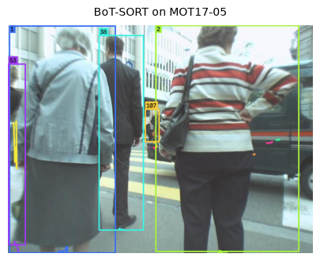

## What you'll learn

- The **tracking-by-detection** loop: Kalman prediction, IoU cost, Hungarian assignment, track birth and death, and what each popular tracker changes (ByteTrack's low-score association, OC-SORT's observation-centric re-update, BoT-SORT's global motion compensation and appearance fusion).
- How the official **MOT17 protocol** works (distractor removal, zero-marked GT) and how **MOTA**, **IDF1** and **HOTA** trade detection errors against identity errors, implemented from scratch and cross-checked against TrackEval.
- How to compare trackers **fairly** (identical cached detections for every tracker) and the `model.track()` gotchas (always pass `tracker=`, `persist=True` for image folders, boxes clipped to the image).
- Whether a general-purpose foundation model (**DINOv3**) can replace a trained **person-ReID** network as the appearance model, and why the matching threshold must be calibrated per embedding.
- The **track-any-point** problem: CoTracker3's joint transformer over tracks and time, visibility, offline vs online mode, memory scaling, and forward-backward consistency as a label-free quality check.
- How point tracks plus a RANSAC **homography** separate the camera's own motion from moving objects (the idea behind GMC and dynamic-object filtering in VO/SLAM).
- What a promptable foundation model (**SAM 3**) gives you for tracking (open vocabulary, masks) and what it costs in speed and memory on an 8 GB GPU.

## Theory primer

**Tracking by detection.** Each track carries a constant-velocity Kalman state $\mathbf x = [c_x, c_y, w, h, \dot c_x, \dot c_y, \dot w, \dot h]^\top$. Per frame: predict $\hat{\mathbf x} = F\mathbf x$, $\hat P = FPF^\top + Q$; build the cost $C_{ij} = 1 - \mathrm{IoU}(\hat b_i, d_j)$; solve the assignment with the Hungarian algorithm and reject pairs above a gate; update matched tracks with $K = \hat P H^\top (H\hat P H^\top + R)^{-1}$, $\mathbf x = \hat{\mathbf x} + K(\mathbf z - H\hat{\mathbf x})$; start tracks from unmatched confident detections; delete tracks unmatched for longer than a buffer.

| Tracker | Idea on top of SORT |
|---|---|
| ByteTrack | second association of the *remaining* tracks with low-score boxes ($0.1 < s < 0.25$): they may extend tracks but never start new ones |
| OC-SORT | re-update the Kalman state from the observations before and after an occlusion; velocity-direction consistency in the cost |
| BoT-SORT | **GMC**: estimate the camera's 2D affine warp $[M\,|\,\mathbf b]$ between frames (sparse optical flow + RANSAC) and apply it to the predicted states; optional appearance cost $C = \min(C_\mathrm{IoU}, \tfrac12 d_\mathrm{cos})$, allowed only for IoU $\ge 0.5$ and $\tfrac12 d_\mathrm{cos} \le 1 - \texttt{appearance\_thresh}$ |

**Metrics** (per-frame matching at IoU $\ge 0.5$ for CLEAR / Identity):

$$\mathrm{MOTA} = 1 - \frac{\mathrm{FN} + \mathrm{FP} + \mathrm{IDSW}}{\mathrm{GT}}, \qquad \mathrm{IDF1} = \frac{2\,\mathrm{IDTP}}{2\,\mathrm{IDTP} + \mathrm{IDFP} + \mathrm{IDFN}}, \qquad \mathrm{HOTA}_\alpha = \sqrt{\mathrm{DetA}_\alpha \cdot \mathrm{AssA}_\alpha}$$

MOTA is dominated by detection errors (an ID switch costs as much as one missed box); IDF1 uses one global GT-to-track assignment for the whole video and so measures how long identities survive; HOTA averages $\sqrt{\mathrm{DetA}\cdot\mathrm{AssA}}$ over $\alpha = 0.05, \dots, 0.95$, where $\mathrm{DetA} = |TP|/(|TP|+|FN|+|FP|)$ and AssA averages, over matches, the Jaccard overlap of the two whole trajectories.

**Point tracking.** Given query points $(t_n, x_n, y_n)$, predict positions $\mathbf p_{t,n}$ and visibility $v_{t,n}$ in every frame. CoTracker3 samples multi-scale correlation features around each current estimate and refines all tracks jointly with a transformer that attends across time and across tracks, $\mathbf p^{(k+1)} = \mathbf p^{(k)} + \Delta\mathbf p^{(k)}$. For a distant or planar scene (or a rotating camera), static points obey $\tilde{\mathbf x}_t \sim H_t \tilde{\mathbf x}_0$, so points with a large homography residual move independently of the camera.

**SAM 3 video.** A text-conditioned DETR-style detector (with a presence head) finds every instance of a noun phrase in each frame; a SAM 2 style memory tracker propagates each object's mask; detections and propagated masklets are matched by mask IoU, unmatched confident detections start new objects.

## How to run

All commands below were run in this repository (conda env `cv`, RTX 5060 Laptop GPU 8 GB). GPU commands hold the shared lock `/tmp/cv-gpu.lock`.

```bash
# 1. extras (ultralytics, lap, onnxruntime-gpu, trackeval, transformers) + the pinned CoTracker clone
make setup-06_tracking
bash scripts/setup_third_party.sh co-tracker

# 2. data + weights: MOT17-02/05 (ranged reads of MOT17.zip, ~135 MB on disk), YOLO26 n/s,
#    yolo26n-reid.onnx, CoTracker3, DINOv3 ViT-S/16 and SAM 3 (both gated, see below)
make data-06_tracking

# 3. MOT benchmark: detections, 8 tracker variants x 2 detectors x 2 sequences, TrackEval
#    cross-check -> projects/06_tracking/results/*.json|csv (about 7 minutes)
flock /tmp/cv-gpu.lock python projects/06_tracking/scripts/run_mot_benchmark.py

# 4. execute the three notebooks headless
make nb-06_tracking

# 5. exercise solutions (CPU ones first, then the GPU ones) and unit tests
python projects/06_tracking/solutions/nb01_ex1_bytetrack_tuning.py
python projects/06_tracking/solutions/nb01_ex2_sort_low_score.py
python projects/06_tracking/solutions/nb01_ex3_protocol.py
flock /tmp/cv-gpu.lock python projects/06_tracking/solutions/nb01_ex4_dinov3_gate.py
flock /tmp/cv-gpu.lock python projects/06_tracking/solutions/nb02_ex1_occlusion_visibility.py
flock /tmp/cv-gpu.lock python projects/06_tracking/solutions/nb02_ex2_online_fb.py
flock /tmp/cv-gpu.lock python projects/06_tracking/solutions/nb02_ex3_gmc_vs_cotracker.py
flock /tmp/cv-gpu.lock python projects/06_tracking/solutions/nb03_ex1_sam3_prompts.py
flock /tmp/cv-gpu.lock python projects/06_tracking/solutions/nb03_ex2_sam3_new_det_thresh.py
python -m pytest -q tests/test_p06_mot_metrics.py tests/test_p06_sam3_postproc.py
```

**Gated models.** DINOv3 (`facebook/dinov3-vits16-pretrain-lvd1689m`) and SAM 3 (`facebook/sam3`) require accepting Meta's licence on their Hugging Face pages and `hf auth login`. Without access, `make data-06_tracking` prints a note and skips them; the BoT-SORT + DINOv3 variant (benchmark and notebook 01, section 5) and notebook 03 then cannot run, everything else does.

| Notebook | Content |
|---|---|
| [01_multi_object_tracking](notebooks/01_multi_object_tracking.ipynb) | MOT17 data and protocol, YOLO26s detections, Kalman filter, SORT from scratch, ByteTrack / OC-SORT / BoT-SORT on cached detections, `model.track()`, metrics and identity timelines, DINOv3 vs ReID embeddings, benchmark results |
| [02_point_tracking_cotracker3](notebooks/02_point_tracking_cotracker3.ipynb) | CoTracker3 grids and mask queries, visibility, forward-backward error, ego-motion vs moving people on MOT17-05, offline vs online speed and VRAM |
| [03_sam3_video_tracking](notebooks/03_sam3_video_tracking.ipynb) | SAM 3 text-prompted video tracking ("person") vs YOLO26s + ByteTrack / BoT-SORT on the same 100 frames, modal vs amodal boxes |

Project code lives in `scripts/`: `motlib.py` (MOT I/O, MOT17 protocol, CLEAR / Identity / HOTA, SORT, tracker runner), `run_mot_benchmark.py`, `dinoreid.py` (DINOv3 appearance encoder), `pointtrack.py` (CoTracker3 helpers), `sam3video.py` (SAM 3 video wrapper), `trackviz.py` (figures). Tracker configs (copies of the Ultralytics 8.4.204 defaults plus ablations) are in `configs/`.

## Results

All numbers below were measured in this repository on an **NVIDIA RTX 5060 Laptop GPU (8 GB, sm_120)** with an Intel Core Ultra 9 275HX, torch 2.11.0+cu128, ultralytics 8.4.204 and transformers 5.22.2. MOT numbers come from `results/mot_benchmark.csv` / `results/mot_gpu_runs.json` (written by `run_mot_benchmark.py`); point-tracking and SAM 3 numbers come from the executed notebooks 02 and 03.

### 1. Multi-object tracking on MOT17-02 (static camera) + MOT17-05 (hand-held camera)

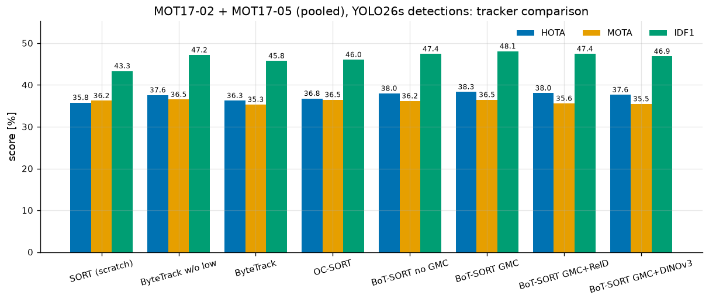

Pooled over both sequences (25 498 scored GT boxes), every tracker fed the **same cached YOLO26s detections** (`conf >= 0.1`, imgsz 1280 for MOT17-02 / 640 for MOT17-05), official MOT17 protocol. Tracker FPS is the association step alone on the CPU.

| Tracker (YOLO26s detections) | HOTA | MOTA | IDF1 | ID switches | FP | FN | tracker FPS (CPU) |
|---|---:|---:|---:|---:|---:|---:|---:|
| SORT (from scratch, `motlib.py`) | 35.78 | 36.23 | 43.34 | 330 | 2319 | 13610 | 2119.3 |
| ByteTrack without low-score stage | 37.57 | 36.51 | 47.17 | 233 | 2054 | 13902 | 2368.3 |
| ByteTrack | 36.26 | 35.32 | 45.75 | 243 | 2921 | 13327 | 2129.1 |
| OC-SORT | 36.76 | 36.46 | 46.05 | 234 | 2122 | 13845 | 1181.8 |
| BoT-SORT, no GMC | 37.98 | 36.16 | 47.41 | 221 | 2880 | 13177 | 2160.0 |
| **BoT-SORT, GMC** | **38.34** | 36.45 | **48.06** | **198** | 2937 | 13069 | 240.9 |
| BoT-SORT, GMC + yolo26n-reid | 38.05 | 35.57 | 47.43 | 215 | 3439 | 12775 | 13.7 |
| BoT-SORT, GMC + DINOv3 ViT-S/16 | 37.64 | 35.46 | 46.85 | 232 | 3490 | 12735 | 32.3 |

With YOLO26n detections every tracker scores 0.6 to 2.0 HOTA points lower (BoT-SORT GMC: 36.34; the best YOLO26n pipeline is BoT-SORT GMC + DINOv3 at 36.69). Camera-motion compensation matters on the hand-held sequence: on MOT17-05 (YOLO26s) BoT-SORT with GMC vs without has **82 vs 103 ID switches**, HOTA 45.45 vs 44.43 and IDF1 61.19 vs 59.16; on the static MOT17-02 it changes little (116 vs 118 switches).

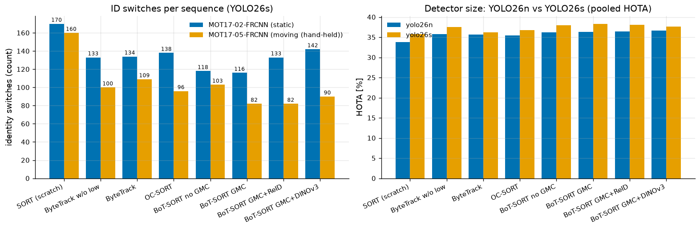

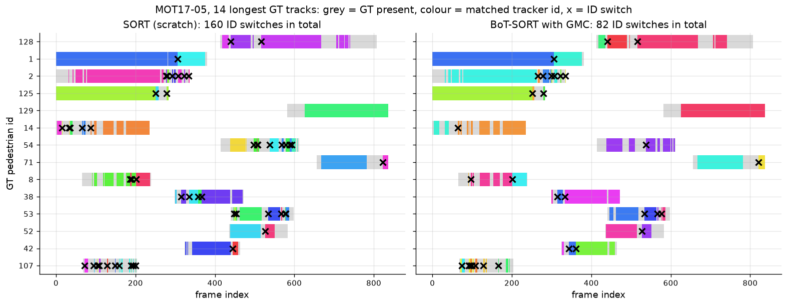

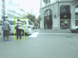

**Speed and memory.** The detector dominates the frame time; GMC (sparse optical flow + RANSAC on the CPU) and appearance features dominate the tracker time.

| Detector | Sequence (resolution, imgsz) | detector FPS (wall, incl. decode) | detector peak VRAM [MiB] | `model.track()` ByteTrack FPS | `model.track()` BoT-SORT FPS |
|---|---|---:|---:|---:|---:|
| YOLO26n | MOT17-02 (1920x1080, 1280) | 181.3 | 75.5 | 156.8 | 86.9 |
| YOLO26n | MOT17-05 (640x480, 640) | 289.4 | 92.4 | 248.5 | 132.1 |
| YOLO26s | MOT17-02 (1920x1080, 1280) | 102.2 | 158.2 | 96.9 | 45.6 |
| YOLO26s | MOT17-05 (640x480, 640) | 242.2 | 170.2 | 125.5 | 78.0 |

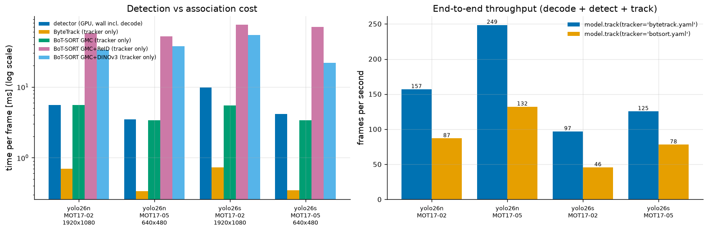

**Metric cross-check.** Our NumPy HOTA / CLEAR / Identity implementation (`scripts/motlib.py`, unit-tested in `tests/test_p06_mot_metrics.py`) agrees with TrackEval 1.3.0 on all 48 (tracker, sequence) results to 0.000 percentage points, and `model.track()` reproduces "cached detections + tracker" exactly on all 8 end-to-end runs once the cached boxes are clipped to the image.

**Appearance: DINOv3 vs a trained ReID network** (408 crops of 51 MOT17-05 pedestrians). The dedicated `yolo26n-reid` model separates identities better (ROC AUC 0.959 vs 0.935, rank-1 0.642 vs 0.564), and with BoT-SORT's default gate (`appearance_thresh` 0.8) only 0.1 % of different-person pairs pass for ReID, against 20.4 % for DINOv3: a general-purpose embedding needs its own threshold (exercise 4).

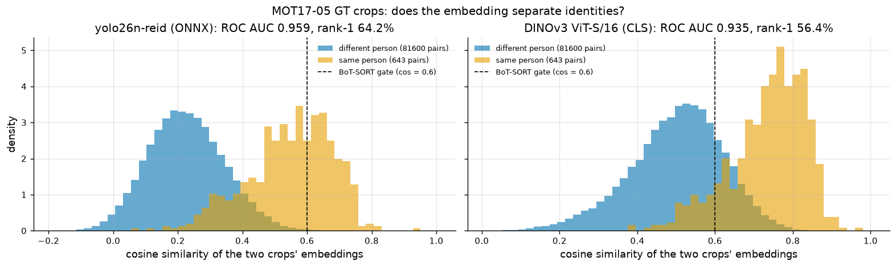

### 2. Point tracking with CoTracker3

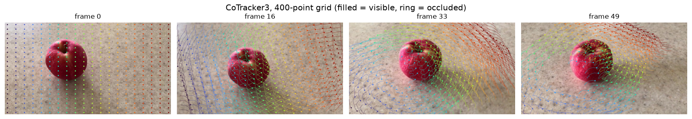

| Experiment | Measured |
|---|---|
| 20 x 20 grid on `apple.mp4` (50 frames, 1296x720), offline | 2.40 s (20.9 FPS), peak VRAM 4987 MiB; 50.0 % of points visible in every frame, 13.8 % occluded and re-found |
| Forward-backward cycle error (same grid, no GT needed) | median 5.495 px, 13.3 % of points < 2 px, 47.1 % < 5 px |
| Ego-motion vs moving people, MOT17-05 (64 frames, RANSAC homography residual) | recall 0.925 of person points flagged as moving, precision 0.267 (base rate 0.133) |
| Online vs offline model on MOT17-05 | median distance 0.881 px, 74.5 % of points < 2 px, visibility agreement 0.962 |

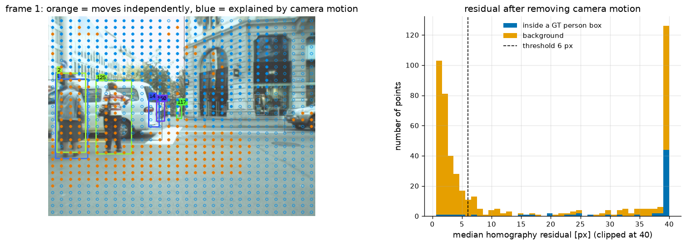

Offline vs online scaling (400 points unless noted; offline mode holds the whole clip on the GPU):

| Frames | offline FPS | offline peak VRAM [MiB] | online FPS | online peak VRAM [MiB] |
|---:|---:|---:|---:|---:|
| 16 | 26.92 | 2490.10 | 22.17 | 2490.19 |
| 32 | 21.46 | 4760.35 | 15.48 | 2529.50 |
| 48 | 22.71 | 4553.63 | 14.02 | 2529.69 |
| 64 | 22.74 | 5549.22 | 13.31 | 2529.89 |
| 96 | out of memory | out of memory | 12.71 | 2530.28 |
| 128 | out of memory | out of memory | 12.40 | 2530.67 |
| 48 frames, 1 600 points | out of memory | out of memory | 4.43 | 2888.42 |

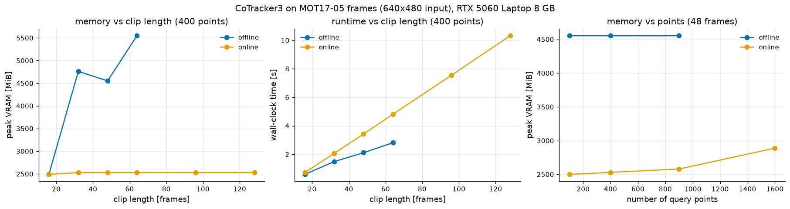

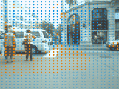 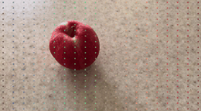

### 3. SAM 3 text-prompted tracking vs YOLO26s + tracker (MOT17-05, frames 1-100)

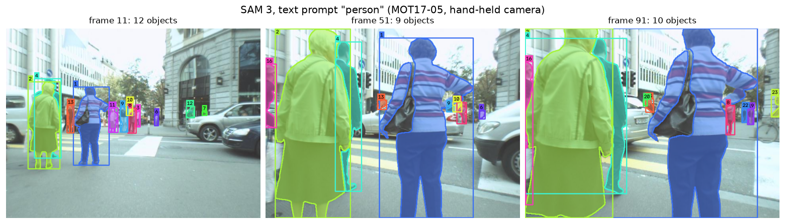

Same 100 frames, same MOT17 protocol and metric code. FPS for the YOLO26s pipelines is per-frame detection (GPU, incl. JPEG decoding) plus tracking (CPU); for SAM 3 it is the propagation loop with the tracker state kept in CPU RAM. Peak VRAM for YOLO26s is its own share (SAM 3 stays loaded in the notebook).

| Pipeline | HOTA | MOTA | IDF1 | ID switches | FP | FN | LocA | FPS | peak VRAM [MiB] |
|---|---:|---:|---:|---:|---:|---:|---:|---:|---:|
| SAM 3, text prompt "person" | **46.06** | 17.77 | **56.93** | **8** | 323 | **326** | 74.85 | 0.57 | 3771 |
| YOLO26s + ByteTrack | 41.22 | 21.53 | 50.53 | 14 | 220 | 393 | 78.43 | 224.74 | 37 |
| YOLO26s + BoT-SORT (GMC) | 42.80 | **25.03** | 52.71 | 9 | **215** | 375 | **79.04** | 133.71 | 37 |

SAM 3 keeps identities best and misses fewer people, but produces more boxes that do not reach IoU 0.5 with an annotated pedestrian, so MOTA ranks it last while HOTA and IDF1 rank it first. Its mask-derived (modal) boxes overlap the amodal GT less for well-visible people (mean IoU 0.813 vs 0.854 for BoT-SORT at visibility >= 0.8), and it is about 390x slower than the ByteTrack pipeline. Its false positives are tunable: in exercise 2 (first 50 frames) raising the new-object threshold `new_det_thresh` from 0.7 to 0.85 cut FP from 167 to 128 and raised MOTA from 19.35 to 28.44 (HOTA 50.45 -> 50.57).

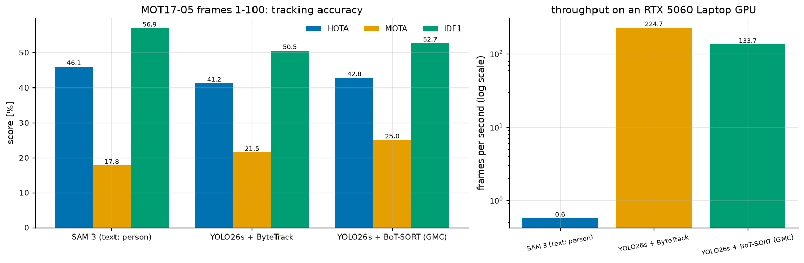

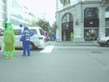

## Limitations

- **Small, in-sample evaluation.** Two MOT17 *train* sequences (1 437 frames) with private YOLO26 detections; nothing is submitted to the MOTChallenge test server, so the numbers are not comparable to the public leaderboard (which uses the provided public detections or detectors trained on MOT17). The SAM 3 comparison uses only the first 100 frames of MOT17-05.
- **Detector-limited.** The COCO-trained YOLO26 n/s detectors were not fine-tuned on MOT17; about half of the scored GT boxes are missed (CLR_FN 13 069 of 25 498 for the best pipeline), which caps MOTA and HOTA regardless of the tracker.
- **Tracker defaults, little tuning.** All Ultralytics trackers run with their 8.4.204 default configs (copies in `configs/`); exercise 1 shows that `match_thresh` / `track_buffer` alone move IDF1 on MOT17-05 between 53.34 and 58.68. Tracker FPS is single-process Python on the CPU and includes no detector time.
- **Appearance models.** `yolo26n-reid.onnx` runs through ONNX Runtime per crop and DINOv3 uses the CLS token of ViT-S/16 with BoT-SORT's default gate; neither was calibrated or fine-tuned on MOT17. With YOLO26s detections both lowered HOTA; with YOLO26n they added only 0.09 (ReID) and 0.35 (DINOv3) HOTA points, and both raised the ID-switch count.
- **CoTracker3 on 8 GB.** Offline mode ran out of memory at 96 and 128 frames (400 points) and at 1 600 points (48 frames); longer clips must use the online model. There is no point-track ground truth here (no TAP-Vid evaluation): forward-backward error and online/offline agreement are consistency checks, not accuracy. The homography-based ego-motion test confuses parallax with motion (precision 0.267).
- **SAM 3 on 8 GB.** With the tracker state on the GPU, the first attempt ran out of memory before frame 100 of this crowded sequence; the notebook keeps the state and pre-processed frames in CPU RAM. The 860 M-parameter model runs at 0.57 FPS on this GPU, far from real time. The optional `kernels` package used by `transformers` for mask NMS and hole filling is not installed; `sam3video.py` replaces those two ops with PyTorch / OpenCV equivalents (unit-tested in `tests/test_p06_sam3_postproc.py`). SAM 3 boxes are derived from modal masks, while MOT17 GT is amodal.

## Model & dataset licenses

| Component | Kind | License | Notes |
|---|---|---|---|
| [MOT17](https://motchallenge.net/data/MOT17/) (MOT17-02, MOT17-05, GT) | dataset | CC BY-NC-SA 3.0 | **non-commercial, share-alike**; downloaded on demand, never redistributed |
| [YOLO26n / YOLO26s](https://github.com/ultralytics/assets/releases/tag/v8.4.0), `yolo26n-reid.onnx` | model | AGPL-3.0 | **copyleft**; enterprise licence available from Ultralytics |
| [ultralytics](https://github.com/ultralytics/ultralytics) 8.4.204 (ByteTrack, BoT-SORT, OC-SORT implementations) | library | AGPL-3.0 | **copyleft** |
| [CoTracker3](https://github.com/facebookresearch/co-tracker) code (pinned clone `82e02e8`) and [`facebook/cotracker3`](https://huggingface.co/facebook/cotracker3) weights | code + model | CC BY-NC 4.0 | **non-commercial** |
| [SAM 3](https://huggingface.co/facebook/sam3) (`facebook/sam3`) | model | SAM License (Meta) | gated: accept the licence on Hugging Face |
| [DINOv3 ViT-S/16](https://huggingface.co/facebook/dinov3-vits16-pretrain-lvd1689m) | model | DINOv3 License (Meta) | gated: accept the licence on Hugging Face |
| [transformers](https://github.com/huggingface/transformers) 5.22.2 | library | Apache-2.0 | SAM 3 video and DINOv3 implementations |
| [trackeval](https://pypi.org/project/trackeval/) 1.3.0 | library | MIT | reference metrics for the cross-check |
| [lap](https://github.com/gatagat/lap) 0.5.14 | library | BSD-2-Clause | linear assignment for the Ultralytics trackers |
| [onnxruntime-gpu](https://github.com/microsoft/onnxruntime) 1.26.0 | library | MIT | runs the ReID encoder |

## References

**Papers**
- A. Bewley et al., *Simple Online and Realtime Tracking* (SORT), ICIP 2016. [arXiv:1602.00763](https://arxiv.org/abs/1602.00763)
- Y. Zhang et al., *ByteTrack: Multi-Object Tracking by Associating Every Detection Box*, ECCV 2022. [arXiv:2110.06864](https://arxiv.org/abs/2110.06864)
- J. Cao et al., *Observation-Centric SORT: Rethinking SORT for Robust Multi-Object Tracking*, CVPR 2023. [arXiv:2203.14360](https://arxiv.org/abs/2203.14360)
- N. Aharon, R. Orfaig, B.-Z. Bobrovsky, *BoT-SORT: Robust Associations Multi-Pedestrian Tracking*, 2022. [arXiv:2206.14651](https://arxiv.org/abs/2206.14651)
- K. Bernardin, R. Stiefelhagen, *Evaluating Multiple Object Tracking Performance: The CLEAR MOT Metrics*, EURASIP JIVP 2008. [doi:10.1155/2008/246309](https://link.springer.com/article/10.1155/2008/246309)
- E. Ristani et al., *Performance Measures and a Data Set for Multi-Target, Multi-Camera Tracking* (IDF1), ECCVW 2016. [arXiv:1609.01775](https://arxiv.org/abs/1609.01775)
- J. Luiten et al., *HOTA: A Higher Order Metric for Evaluating Multi-Object Tracking*, IJCV 2021. [arXiv:2009.07736](https://arxiv.org/abs/2009.07736)
- A. Milan et al., *MOT16: A Benchmark for Multi-Object Tracking*, 2016. [arXiv:1603.00831](https://arxiv.org/abs/1603.00831)
- P. Dendorfer et al., *MOTChallenge: A Benchmark for Single-Camera Multiple Target Tracking*, IJCV 2021. [arXiv:2010.07548](https://arxiv.org/abs/2010.07548)
- N. Karaev et al., *CoTracker3: Simpler and Better Point Tracking by Pseudo-Labelling Real Videos*, 2024. [arXiv:2410.11831](https://arxiv.org/abs/2410.11831)
- N. Carion et al., *SAM 3: Segment Anything with Concepts*, 2025. [arXiv:2511.16719](https://arxiv.org/abs/2511.16719)
- O. Siméoni et al., *DINOv3*, 2025. [arXiv:2508.10104](https://arxiv.org/abs/2508.10104)

**Code**
- Ultralytics tracking mode: [docs.ultralytics.com/modes/track](https://docs.ultralytics.com/modes/track) and [ultralytics/trackers](https://github.com/ultralytics/ultralytics/tree/main/ultralytics/trackers)
- TrackEval: [JonathonLuiten/TrackEval](https://github.com/JonathonLuiten/TrackEval) (PyPI package `trackeval` from the [kovalp/TrackEval](https://github.com/kovalp/TrackEval) fork)
- CoTracker: [facebookresearch/co-tracker](https://github.com/facebookresearch/co-tracker)
- SAM 3: [facebookresearch/sam3](https://github.com/facebookresearch/sam3) and the Hugging Face [`Sam3VideoModel`](https://huggingface.co/docs/transformers/model_doc/sam3_video) implementation
- DINOv3: [facebookresearch/dinov3](https://github.com/facebookresearch/dinov3)

