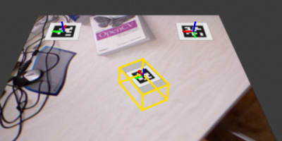
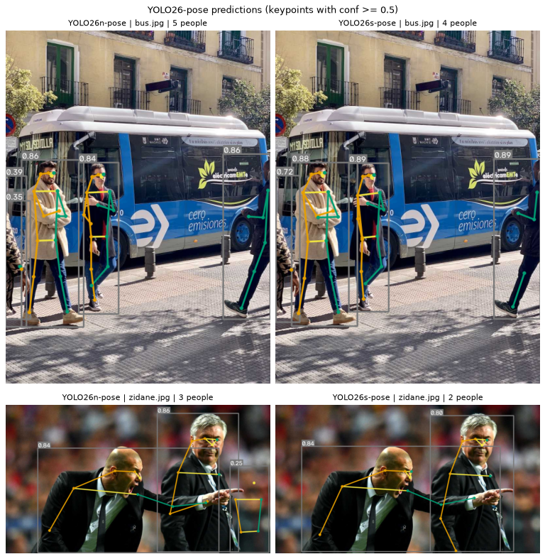
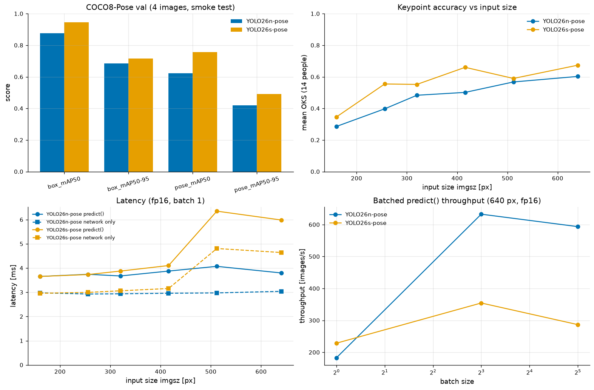
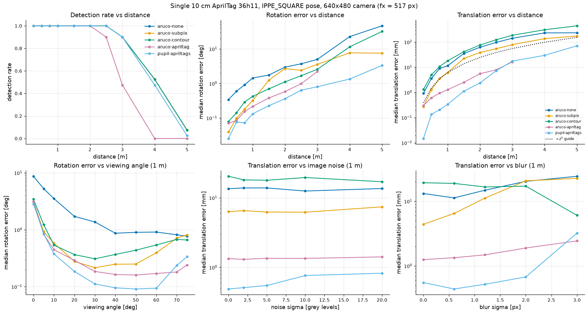
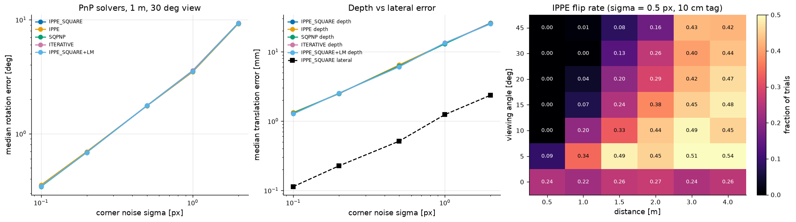
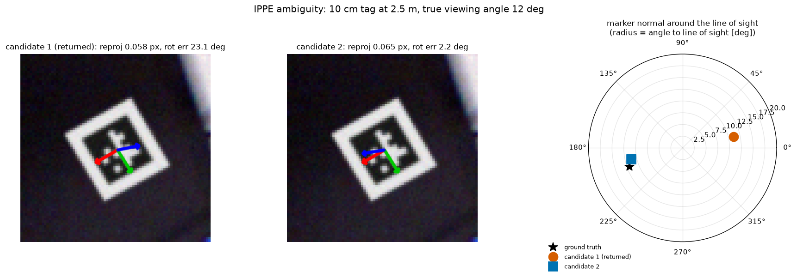
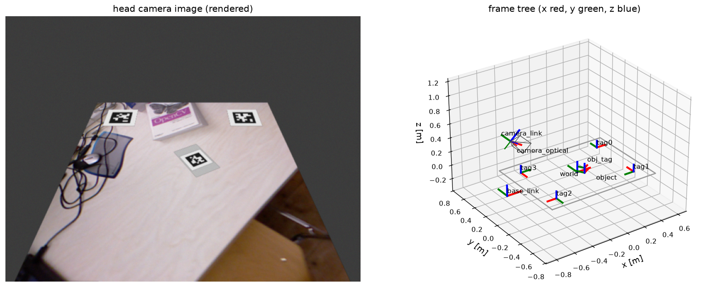
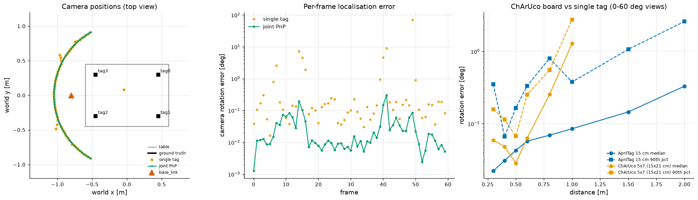
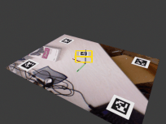

# 07 · Pose estimation: human keypoints, fiducial 6-DoF pose and coordinate frames



Two kinds of "pose" matter to a robot: **where people's joints are** (2D human keypoints) and
**where objects and the camera are in 6-DoF** (rotation + translation, here from fiducial markers).
This project builds both with current tools (Ultralytics **YOLO26-pose**, OpenCV 5 `cv2.aruco` +
`solvePnP`, the AprilTag 3 library), measures how accurate they really are with exact ground truth,
and then does the frame bookkeeping that turns a camera measurement into a grasp pose in the
robot's base frame.

| Notebook | What it covers | Runs on |
|---|---|---|
| [`01_human_keypoints.ipynb`](notebooks/01_human_keypoints.ipynb) | YOLO26n/s-pose inference, COCO-17 keypoints, OKS by hand (checked against Ultralytics), pose mAP on COCO8-Pose, accuracy / latency / VRAM vs input size, joint angles and a "hand raised" rule | GPU |
| [`02_fiducial_pose.ipynb`](notebooks/02_fiducial_pose.ipynb) | AprilTag/ArUco dictionaries, marker frame, synthetic renders with exact pose, 4 OpenCV corner refinements vs AprilTag 3, IPPE PnP, error vs distance / angle / noise / blur, PnP solver comparison, the planar ambiguity, a real photo | CPU |
| [`03_frames_and_boards.ipynb`](notebooks/03_frames_and_boards.ipynb) | $T_{ab}$ notation, rotation representations, OpenCV optical vs ROS REP-103 frames, object and grasp pose in `base_link`, camera localisation from a tag map (single tag vs joint PnP), ChArUco board vs single tag | CPU |

## What you'll learn

- The COCO-17 keypoint format, one-stage vs top-down pose estimation, **OKS** and pose **mAP**.
- How input resolution, model size and batching trade accuracy against latency and memory.
- Marker dictionaries and Hamming distance; the **marker coordinate frame** and corner order that
  `SOLVEPNP_IPPE_SQUARE` expects (and how other libraries differ).
- How to render a plane with an exact ground-truth pose (homography warp) to *measure* a pose
  pipeline instead of eyeballing it.
- Why **sub-pixel corner bias** dominates marker pose error, why depth error grows with $z^2$,
  and when IPPE's **two solutions** flip.
- Transform chains $T_{ac} = T_{ab}T_{bc}$, quaternions / axis-angle / roll-pitch-yaw, the
  `camera_link` -> `camera_optical_frame` rotation, and why joint PnP over many tags beats one tag.

## Theory primer

**Object Keypoint Similarity.** For a person with labelled keypoints ($v_i>0$), predicted
keypoints at pixel distance $d_i$ from the ground truth score

$$\mathrm{OKS} = \frac{1}{|\{i: v_i>0\}|}\sum_{i: v_i>0} \exp\!\Big(-\frac{d_i^2}{2 s^2 k_i^2}\Big),\qquad k_i = 2\sigma_i,$$

with $s^2$ the object area and $\sigma_i$ the per-joint annotation spread (eyes 0.025, hips 0.107).
Pose AP is detection AP with OKS in place of IoU; mAP50-95 averages OKS thresholds 0.50:0.05:0.95.

**Planar markers and PnP.** A marker is the plane $Z=0$ of its own frame. With
$X_\text{cam} = R X + t$ the plane maps to the image by the homography
$\lambda\,[u, v, 1]^\top = K\,[r_1\; r_2\; t]\,[X, Y, 1]^\top$. PnP recovers $(R, t)$ from the four
corners by minimising reprojection error; for coplanar points **IPPE** (Collins & Bartoli 2014)
solves this in closed form and returns two candidates. OpenCV 5 has no
`estimatePoseSingleMarkers`: use `cv2.solvePnP(obj, corners, K, dist, flags=cv2.SOLVEPNP_IPPE_SQUARE)`
with `obj = [[-L/2, L/2, 0], [L/2, L/2, 0], [L/2, -L/2, 0], [-L/2, -L/2, 0]]` (marker frame: X right,
Y up, Z out of the marker; same corner order as `ArucoDetector.detectMarkers`).

**Error scaling.** The marker's image size is $w \approx fL/z$, so a corner error $\delta$ gives
$\delta z/z \approx \sqrt{2}\,\delta/w$ and the depth error grows as $z^2\delta/(fL)$. A *systematic*
inward corner bias $\delta r$ over-estimates every range by $\sqrt{2}\,\delta r/w$; averaging frames does
not remove it.

**Planar ambiguity.** Under weak perspective, a plane tilted by $+\theta$ or $-\theta$ about the line
of sight projects to almost the same quadrilateral: the two IPPE solutions have normals mirrored
around the line of sight and nearly equal reprojection error, so noise can pick the wrong one.

**Frames.** $T_{ab}$ maps points from frame $b$ to frame $a$ ($p_a = T_{ab}p_b$); products only chain
when inner indices match. OpenCV's camera ("optical") frame is x right, y down, z forward; ROS
REP-103 body frames are x forward, y left, z up. They differ by the fixed rotation
`cvlab.geometry.R_ROS_FROM_OPENCV` (roll-pitch-yaw $(-90°, 0, -90°)$, quaternion $(-0.5, 0.5, -0.5, 0.5)$).

## How to run

```bash
make setup-07_pose_estimation   # ultralytics 8.4.204 + pupil-apriltags 1.0.4.post11 (with constraints)
make data-07_pose_estimation    # YOLO26n/s-pose weights, COCO8-Pose, TUM fr1_desk, OpenCV tutorial photo
make nb-07_pose_estimation      # executes the three notebooks headless (takes the GPU lock)
python -m pytest -q tests/test_p07_fiducial_sim.py tests/test_p07_keypoints.py

# exercise solutions (01 needs the GPU; 02 and 03 are CPU only)
flock /tmp/cv-gpu.lock python projects/07_pose_estimation/solutions/01_human_keypoints_solutions.py
python projects/07_pose_estimation/solutions/02_fiducial_pose_solutions.py
python projects/07_pose_estimation/solutions/03_frames_solutions.py
```

There is no training step: the project only runs inference and evaluation. Downloads total about
33 MB (two YOLO26 checkpoints, 0.3 MB COCO8-Pose, an 80 kB photo) plus the TUM fr1_desk sequence
shared with projects 08/09/12. The helpers live in [`scripts/`](scripts/):
`fiducial_sim.py` (renderer, detectors, PnP, frame conventions), `keypoints.py` (COCO-17, OKS) and
`table_scene.py` (the synthetic work cell); measured numbers are written to [`results/`](results/).

## Results

Hardware: NVIDIA RTX 5060 Laptop GPU (8 GB, sm_120), Intel Core Ultra 9 275HX, Ubuntu 24.04,
torch 2.11.0+cu128, OpenCV 5.0.0. Notebook 01 runs on the GPU in fp16; notebooks 02-03 are CPU only.
All timings were measured while the machine was shared with other jobs, so treat them as rough.

### Human keypoints (notebook 01)





| model | params (fused) | GFLOPs @640 | box mAP50-95 | pose mAP50 | pose mAP50-95 | mean OKS @640 | mean OKS @320 | `predict()` @640, batch 1 | images/s, batch 32 | peak VRAM batch 1 / 32 |
|---|---|---|---|---|---|---|---|---|---|---|
| YOLO26n-pose | 2.93 M | 7.57 | 0.686 | 0.623 | 0.419 | 0.603 | 0.483 | 3.80 ms | 594 | 89 / 396 MB |
| YOLO26s-pose | 10.36 M | 24.12 | 0.717 | 0.758 | 0.490 | 0.674 | 0.552 | 5.98 ms | 287 | 95 / 653 MB |

mAP is from `model.val(data="coco8-pose.yaml")` on **4 validation images (14 people)**: a smoke test
of the pipeline, not comparable to the COCO val2017 numbers Ultralytics reports. Mean OKS falls to
0.286 (n) / 0.346 (s) at a 160 px input. Batch-1 latency is mostly overhead-bound: 3.7-4.1 ms for
YOLO26n at every input size and for YOLO26s up to 416 px (6.35 / 5.98 ms at 512 / 640 px); the
compute difference shows up fully when batching.

### Fiducial pose accuracy (notebook 02)

Synthetic renders with exact ground truth: TUM fr1 camera model (640x480, $f_x = 517.3$ px, no
distortion), a 10 cm AprilTag 36h11 on real TUM desk photos, anti-aliasing + blur
($\sigma_b = 0.6$ px) + noise ($\sigma_n = 2$ grey levels), 40 random views per setting, pose from
`SOLVEPNP_IPPE_SQUARE` on each detector's corners.



| corners from | mean radial corner bias | corner RMS | 90 % detection range | median rot. error @1 m | median trans. error @1 m (depth / lateral) | median trans. error @2 m | CPU time / image |
|---|---|---|---|---|---|---|---|
| `cv2.aruco`, `CORNER_REFINE_NONE` (default) | -0.518 px | 0.751 px | 3.0 m | 1.44 deg | 11.4 mm (11.39 / 0.35) | 61.7 mm | 2.6 ms |
| `cv2.aruco`, `CORNER_REFINE_SUBPIX` | -0.256 px | 0.371 px | 3.0 m | 0.32 deg | 6.1 mm (6.12 / 0.06) | 38.3 mm | 2.4 ms |
| `cv2.aruco`, `CORNER_REFINE_CONTOUR` | -0.688 px | 0.717 px | 3.0 m | 0.42 deg | 17.9 mm (17.93 / 0.06) | 75.4 mm | 2.5 ms |
| `cv2.aruco`, `CORNER_REFINE_APRILTAG` | -0.012 px | 0.649 px | 2.5 m | 0.22 deg | 1.3 mm (0.47 / 1.17) | 5.5 mm | 22.4 ms |
| AprilTag 3 (`pupil_apriltags`, full resolution) | -0.001 px | 0.060 px | 3.0 m | 0.13 deg | 0.33 mm (0.33 / 0.03) | 2.4 mm | 11.6 ms |

`CORNER_REFINE_APRILTAG` corners carry a constant (+0.45, +0.45) px offset (a pixel-origin
convention), which shows up as lateral error. Head-on views are the worst case for rotation:
median 2.8-3.4 deg at a 0 deg viewing angle for the four refined detectors (8.7 deg without
refinement) vs 0.09-0.54 deg at 30-60 deg.



With identical noisy corners, `IPPE_SQUARE`, `IPPE`, `SQPNP`, `ITERATIVE` and IPPE + `solvePnPRefineLM`
are within a few percent of each other (median rotation error 1.75-1.76 deg at $\sigma$ = 0.5 px,
1 m), and the depth error is about ten times the lateral error. The flip rate of the planar ambiguity
reaches 0.2-0.5 for near-frontal or distant 10 cm tags:



**Real photo** (OpenCV tutorial image with its calibration file, six coplanar `DICT_6X6_250`
markers, marker size assumed 5 cm): the estimated normals agree to within 5.49 deg (median 3.30 deg)
and the rotations to within 5.88 deg after removing the 90 deg print orientations; a detector run
with the wrong dictionary (`DICT_4X4_50`) produced 1 false detection on the same photo.

### Frames, localisation and boards (notebook 03)







| experiment | result |
|---|---|
| object pose in `base_link` from one head-camera image (6 cm tag at 1.05 m) | 4.6 mm, 0.13 deg |
| camera localisation, single largest tag (IPPE), 60 frames | ATE RMSE 140.9 mm, max rotation error 70.2 deg (3 frames > 5 deg) |
| camera localisation, joint PnP over all visible map tags, 60 frames | ATE RMSE 1.3 mm, max rotation error 0.31 deg |
| 15 cm AprilTag, median rot. / trans. error at 0.4 m / 1.0 m / 2.0 m | 0.031 deg, 0.025 mm / 0.085 deg, 0.300 mm / 0.330 deg, 0.861 mm |
| 5x7 ChArUco (3 cm squares), median rot. / trans. error at 0.4 m | 0.048 deg, 0.081 mm |
| ChArUco detection rate at 0.8 m / 1.0 m / 1.5 m | 0.77 / 0.17 / 0.00 (single 15 cm tag: 1.00 at every distance up to 2 m) |

## Limitations

- **COCO8-Pose has 4 validation images.** The mAP values only show that the pipeline works; we did
  not evaluate on COCO val2017 (778 MB of images) or fine-tune.
- **The fiducial benchmark is synthetic.** Ideal pinhole camera, perfectly flat prints, uniform
  lighting, Gaussian blur/noise, no motion blur, glare, rolling shutter or print-scale errors. The
  absolute numbers are therefore optimistic; the *relative* findings (corner bias, $z^2$ scaling,
  frontal ambiguity) are the point. The one real photo has no ground truth and an assumed marker size.
- **Timings are rough.** The CPU was shared with other jobs while measuring; batch-1 YOLO latency is
  CPU/launch bound and noisy.
- **pupil-apriltags stability.** In one solution script, `pupil_apriltags` 1.0.4.post11 triggered a
  glibc heap-corruption abort (`malloc(): mismatching next->prev_size`) that only appeared when a
  specific sequence of OpenCV and AprilTag calls ran in the same process (each part alone, and the
  notebooks, ran cleanly, also under `GLIBC_TUNABLES=glibc.malloc.check=3`). After several attempts
  to isolate it, that exercise now uses OpenCV only; the notebooks fall back to OpenCV automatically
  if `pupil_apriltags` is not installed. The project also never uses the library's own pose solver
  (`estimate_tag_pose`), only its corners.
- **OpenCV 5.0.0.93 gaps.** `cv2.aruco.estimatePoseSingleMarkers`/`estimatePoseCharucoBoard` no longer
  exist (use `solvePnP` / `board.matchImagePoints`), and `cv2.calibrateHandEye` is not exposed in the
  Python bindings (only its constants are), so exercise 3 of notebook 03 implements Park-Martin
  hand-eye calibration by hand. The IPPE fix for rotations near 180 deg (OpenCV 5.1.0, not yet on PyPI)
  is missing; with exact corners we measured no error from it (max 0.000002 deg over 500 poses).
- **No ROS runtime.** ROS 2 is not part of this environment; the `static_transform_publisher` command
  printed in notebook 03 is documentation, not something we ran.

## Model & dataset licenses

| component | license | notes |
|---|---|---|
| Ultralytics `ultralytics` 8.4.204 and YOLO26n/s-pose weights | AGPL-3.0 | copyleft; commercial use needs an Ultralytics enterprise license |
| COCO8-Pose (Ultralytics packaging of 8 COCO train2017 images) | AGPL-3.0 packaging; COCO annotations CC BY 4.0; images under their Flickr licenses | |
| TUM RGB-D fr1_desk (backgrounds, table texture) | CC BY 4.0 | Sturm et al., IROS 2012 |
| OpenCV 5.0.0 (`opencv-python`), tutorial photo `singlemarkersoriginal.jpg` and `tutorial_camera_params.yml` | Apache-2.0 | photo and calibration file from the OpenCV repository |
| `pupil-apriltags` 1.0.4.post11 / AprilTag 3 C library | MIT (bindings) / BSD-2-Clause (library) | optional comparison detector |
| AprilTag 36h11, ArUco and ChArUco patterns | generated locally with `cv2.aruco` | no download |
| Ultralytics sample images `bus.jpg`, `zidane.jpg` | shipped with the AGPL-3.0 `ultralytics` package | |

## References

- Ultralytics YOLO26 pose docs: <https://docs.ultralytics.com/tasks/pose/> and code: <https://github.com/ultralytics/ultralytics>
- Lin et al., *Microsoft COCO: Common Objects in Context*, ECCV 2014; keypoint evaluation (OKS): <https://cocodataset.org/#keypoints-eval>
- Maji et al., *YOLO-Pose: Enhancing YOLO for Multi Person Pose Estimation Using Object Keypoint Similarity Loss*, CVPRW 2022: <https://arxiv.org/abs/2204.06806>
- Li et al., *Human Pose Regression with Residual Log-likelihood Estimation*, ICCV 2021: <https://arxiv.org/abs/2107.11291>
- Olson, *AprilTag: A robust and flexible visual fiducial system*, ICRA 2011; Wang & Olson, *AprilTag 2*, IROS 2016; C library: <https://github.com/AprilRobotics/apriltag>
- Garrido-Jurado et al., *Automatic generation and detection of highly reliable fiducial markers under occlusion*, Pattern Recognition 2014: <https://doi.org/10.1016/j.patcog.2014.01.005>
- Collins & Bartoli, *Infinitesimal Plane-Based Pose Estimation*, IJCV 2014: <https://doi.org/10.1007/s11263-014-0725-5>
- Terzakis & Lourakis, *A Consistently Fast and Globally Optimal Solution to the Perspective-n-Point Problem* (SQPnP), ECCV 2020: <https://doi.org/10.1007/978-3-030-58452-8_28>
- Park & Martin, *Robot Sensor Calibration: Solving AX = XB on the Euclidean Group*, IEEE T-RA 1994: <https://doi.org/10.1109/70.326576>
- OpenCV 5 ArUco / ChArUco headers: <https://github.com/opencv/opencv/tree/5.0.0/modules/objdetect/include/opencv2/objdetect>
- pupil-apriltags: <https://github.com/pupil-labs/apriltags>
- ROS REP-103 (units and coordinate conventions): <https://www.ros.org/reps/rep-0103.html>; REP-105 (mobile platform frames): <https://www.ros.org/reps/rep-0105.html>
- Sturm et al., *A Benchmark for the Evaluation of RGB-D SLAM Systems*, IROS 2012: <https://cvg.cit.tum.de/data/datasets/rgbd-dataset>
