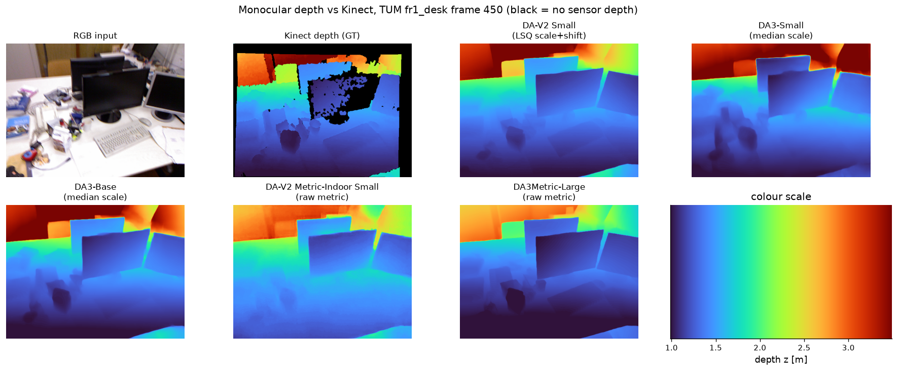
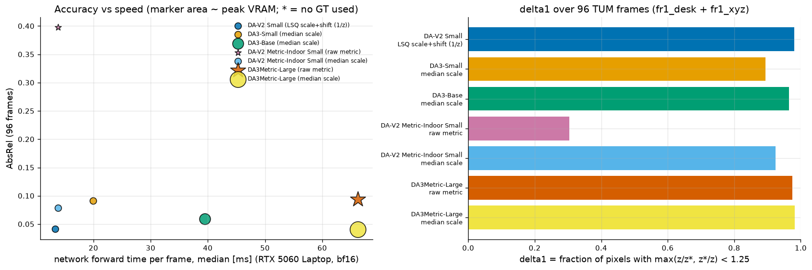
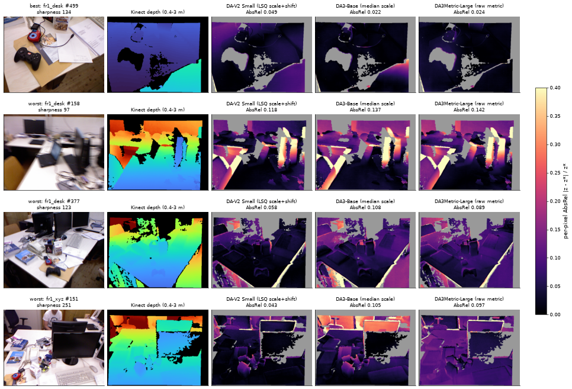
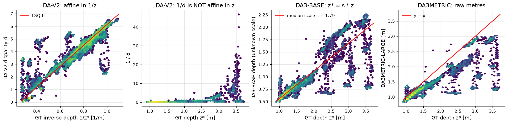
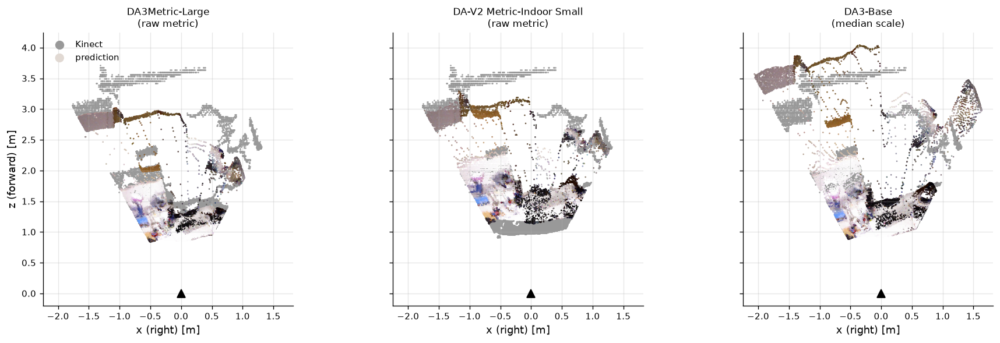
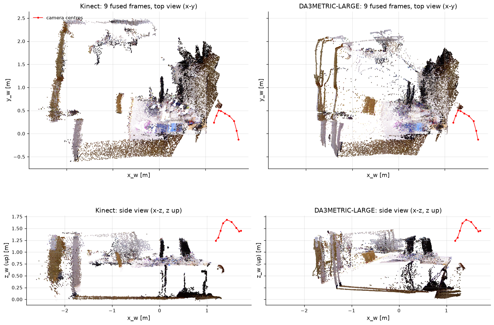

# 08 · Monocular depth estimation

This project predicts depth from a single RGB image with **Depth Anything 3** and **Depth Anything V2**, then checks the predictions against a real depth sensor (Kinect, TUM RGB-D). It covers relative vs metric depth, scale alignment in the right space, a 96-frame benchmark with latency and VRAM, failure cases, and back-projection to 3D point clouds, including multi-frame fusion with ground-truth poses.



## What you'll learn

- Why one image fixes depth only **up to scale**, and what turns it into metres: learned priors **plus the focal length**.
- The three output types you will meet in practice: **affine-invariant disparity** (DA-V2 relative), **depth up to scale** (DA3 any-view), and **metric depth** (DA3METRIC, DA-V2 Metric). How to read each one.
- How to align a prediction to ground truth (median scale; least-squares scale+shift **in the model's native space**), and the standard metrics AbsRel, RMSE and δ1.
- How to benchmark fairly: one valid-pixel mask, the same frames for every model, and CUDA-synchronised timing with peak VRAM.
- What matters for robots beyond the averages: frame-to-frame **scale stability**, error vs distance, failure modes, and the **3D artefacts** that appear after back-projection and fusion (stretched scenes, flying pixels, layered surfaces).

## Theory primer

**Scale ambiguity.** A pinhole camera maps $(X, Y, Z)$ to $u = f_x X/Z + c_x$, $v = f_y Y/Z + c_y$. Scaling the scene by $\lambda$ leaves the image unchanged, so geometry alone cannot recover absolute depth. Networks recover it from priors (typical object sizes), and that is only meaningful once the focal length is known.

| Output | Models here | Relation to true depth $Z^*$ |
|---|---|---|
| affine-invariant disparity $d$ | DA-V2 Small | $d \approx s/Z^* + t$ (unknown $s$, $t$) |
| depth up to scale $\hat Z$ | DA3-SMALL, DA3-BASE | $\hat Z \approx Z^*/s$ |
| metric depth $Z$ | DA3METRIC-LARGE, DA-V2 Metric-Indoor Small | $Z \approx Z^*$. For DA3METRIC: $Z = f_{px}\,y_{net}/300$ |

**Alignment** (fit on valid GT pixels, then score the residual):
- median scale: $s = \mathrm{median}(Z^*)/\mathrm{median}(\hat Z)$
- least squares: $(s,t) = \arg\min \sum_i (s x_i + t - y_i)^2$ with $x = d,\ y = 1/Z^*$ for disparity models (then $Z = 1/(s d + t)$), or $x = \hat Z,\ y = Z^*$ for depth models
- raw metric: no fitting. This is the only option at run time without a depth sensor.

**Metrics** over the $N$ valid pixels: $\mathrm{AbsRel} = \frac1N\sum |p-g|/g$, $\mathrm{RMSE} = \sqrt{\frac1N\sum (p-g)^2}$, and $\delta_1$ = the share of pixels with $\max(p/g, g/p) < 1.25$.

**Back-projection** (OpenCV camera frame, $z$ forward): $\mathbf X = z\,K^{-1}[u, v, 1]^\top$. World frame: $\mathbf X_w = R_{wc}\mathbf X + \mathbf t_{wc}$. A global scale error moves every point along its viewing ray, stretching the scene radially from the camera.

## How to run

All commands below were run in this repository (conda env `cv`). GPU commands hold the shared lock `/tmp/cv-gpu.lock`.

```bash
# 1. extras (transformers + the packages Depth Anything 3 imports) and the pinned DA3 clone
flock /tmp/cv-gpu.lock make setup-08_monocular_depth
bash scripts/setup_third_party.sh depth-anything-3

# 2. data + weights (TUM fr1_desk / fr1_xyz, ~0.8 GB; five checkpoints, ~2.2 GB in the HF cache)
make data-08_monocular_depth

# 3. benchmark: 5 models x 96 frames -> projects/08_monocular_depth/results/*.csv|json
flock /tmp/cv-gpu.lock python projects/08_monocular_depth/scripts/eval_tum.py

# 4. execute the three notebooks headless (49 s wall-clock for all three on the hardware below,
#    with the weights already in the HF cache)
make nb-08_monocular_depth

# 5. exercise solutions and unit tests
flock /tmp/cv-gpu.lock python projects/08_monocular_depth/solutions/solutions_01.py
flock /tmp/cv-gpu.lock python projects/08_monocular_depth/solutions/solutions_02.py
flock /tmp/cv-gpu.lock python projects/08_monocular_depth/solutions/solutions_03.py
python -m pytest -q tests/test_p08_mono_depth.py
```

| Notebook | Content |
|---|---|
| [`01_depth_models_and_alignment.ipynb`](notebooks/01_depth_models_and_alignment.ipynb) | Kinect data, scale ambiguity, the five models and their raw outputs, alignment in the right space, metrics, error maps |
| [`02_tum_benchmark.ipynb`](notebooks/02_tum_benchmark.ipynb) | 96-frame benchmark: accuracy vs speed vs VRAM, scale stability over time, error vs distance, DA3 focal-length estimates, failure cases |
| [`03_depth_to_point_clouds.ipynb`](notebooks/03_depth_to_point_clouds.ipynb) | Back-projection, cloud-to-cloud metrics, flying pixels, 9-frame fusion with mocap poses, `.ply` export |

Code: [`scripts/mono_depth.py`](scripts/mono_depth.py) (model wrappers, alignment, metrics, cloud metrics) is shared by the notebooks, the benchmark ([`scripts/eval_tum.py`](scripts/eval_tum.py), configured by [`configs/eval_tum.yaml`](configs/eval_tum.yaml)) and the [solutions](solutions/).

**Depth Anything 3 install note.** The PyPI/GitHub package metadata pins `numpy<2`, so DA3 is not pip-installed. It is imported from the pinned clone `third_party/depth-anything-3` (commit `3d835ec`), which keeps `pip check` clean. `depth_anything_3.api` imports `moviepy.editor` at import time, but only uses it for Gaussian-splat video export. moviepy 1.0.3 would downgrade a shared dependency, so `mono_depth.stub_moviepy()` registers an empty placeholder module before the import. Depth inference never touches it.

## Results

Hardware: **NVIDIA RTX 5060 Laptop GPU (8 GB, sm_120)**, Intel Core Ultra 9 275HX. Software: torch 2.11.0+cu128 and transformers 5.22.2. All models run at batch 1 with bf16 autocast, at their default input size (DA3: 504x378, DA-V2: 686x518), with outputs resized to 640x480. Data: 48 evenly spaced frames from each of TUM `fr1_desk` and `fr1_xyz` (96 frames). GT is Kinect depth with $0.1 < z < 10$ m; sensor holes are excluded. Source: [`results/tum_summary.csv`](results/tum_summary.csv) and [`results/tum_eval_meta.json`](results/tum_eval_meta.json).



**Accuracy (96 frames, both sequences).** "Uses GT" means the scale (and shift) was fitted to the sensor on every frame. That is an upper bound a robot does not get at run time.

| Model | Output | Protocol | Uses GT | AbsRel ↓ | RMSE [m] ↓ | δ1 ↑ |
|---|---|---|---|---|---|---|
| DA-V2 Small | disparity | LSQ scale+shift in 1/z | yes | 0.042 | 0.122 | 0.980 |
| DA3-Small | depth up to scale | median scale | yes | 0.091 | 0.210 | 0.894 |
| DA3-Small | depth up to scale | LSQ scale+shift | yes | 0.082 | 0.169 | 0.934 |
| DA3-Base | depth up to scale | median scale | yes | 0.059 | 0.163 | 0.965 |
| DA3-Base | depth up to scale | LSQ scale+shift | yes | 0.052 | 0.126 | 0.976 |
| DA-V2 Metric-Indoor Small | metric | **raw metres** | no | 0.398 | 0.444 | 0.304 |
| DA-V2 Metric-Indoor Small | metric | median scale | yes | 0.079 | 0.186 | 0.924 |
| **DA3Metric-Large** | metric | **raw metres** | **no** | **0.094** | **0.163** | **0.974** |
| DA3Metric-Large | metric | median scale | yes | 0.041 | 0.116 | 0.981 |

Per sequence (AbsRel, main protocol): DA3Metric-Large raw 0.084 (`fr1_desk`) and 0.103 (`fr1_xyz`); DA-V2 Metric-Indoor raw 0.459 and 0.336; DA3-Base median 0.061 and 0.057; DA-V2 Small LSQ 0.048 and 0.036.

**Cost per 640x480 frame.** Network = the forward pass alone (CUDA-synchronised hooks). End-to-end adds CPU pre-processing and resizing. Both are from 50 back-to-back calls. During the run the machine was shared with other CPU-heavy jobs (1-minute load average 8.6-12.7 on 24 cores), so the end-to-end numbers are noisy. The network times are the stable comparison.

| Model | Params [M] | Peak VRAM [MiB] | Network p50 [ms] | End-to-end p50 [ms] | End-to-end min [ms] |
|---|---|---|---|---|---|
| DA-V2 Small | 24.8 | 269 | 13.3 | 51.0 | 46.0 |
| DA3-Small | 34.3 | 279 | 20.0 | 51.0 | 41.9 |
| DA3-Base | 135.4 | 752 | 39.5 | 72.0 | 62.0 |
| DA-V2 Metric-Indoor Small | 24.8 | 270 | 13.8 | 49.5 | 38.9 |
| DA3Metric-Large | 334.2 | 1582 | 66.2 | 91.0 | 83.0 |

**Scale stability** (median protocol, per-frame fitted scale): DA3Metric-Large's scale is 1.070 ± 0.052 on `fr1_desk` and 1.100 ± 0.036 on `fr1_xyz`, so it is consistent but predicts about 7-9 % too close. DA-V2 Metric-Indoor's is 0.709 ± 0.138 and 0.749 ± 0.070 (depths about 1.34-1.41 times too large). DA3-Base's relative scale varies by 33 % and 21 % (coefficient of variation) between frames, so one calibration does not hold across a sequence.



**Alignment matters.** DA-V2 is affine only in inverse depth. DA3 depth is proportional to the true depth. DA3METRIC is close to $y = x$ but slightly compressed:



**3D: back-projection and fusion** (notebook 03, `fr1_desk` frame 450). Each depth map is back-projected with the calibrated $K$ (stride 2) and compared with the Kinect cloud after 1 cm voxel downsampling. Accuracy is the mean distance from each predicted point to the nearest Kinect point; completeness is the reverse; Chamfer is their mean; the F-score uses a 5 cm threshold.



| Setting | Model | Protocol | Accuracy [m] | Completeness [m] | Chamfer [m] | Precision@5cm | Recall@5cm | F-score@5cm |
|---|---|---|---|---|---|---|---|---|
| frame 450 | DA3Metric-Large | raw metric | 0.117 | 0.175 | 0.146 | 0.147 | 0.112 | 0.127 |
| frame 450 | DA-V2 Metric-Indoor Small | raw metric | 0.129 | 0.136 | 0.132 | 0.231 | 0.279 | 0.253 |
| frame 450 | DA3-Base | median scale (uses GT) | 0.114 | 0.064 | 0.089 | 0.588 | 0.602 | 0.595 |
| 9 fused frames | DA3Metric-Large | raw metric | 0.114 | 0.119 | 0.117 | 0.386 | 0.434 | 0.408 |

A raw AbsRel of 0.127 for DA3Metric-Large on this frame still puts only 14.7 % of its points within 5 cm of the sensor cloud. Monocular metric depth gets the room layout right, not centimetre geometry. DA-V2 Metric-Indoor happens to do well on this frame, but its 96-frame raw AbsRel is 0.398. When 9 frames (every 10th frame, 410-490) are fused with the motion-capture poses, the per-frame scale of DA3Metric-Large varies between 1.016 and 1.132. Surfaces then appear doubled, and the floor rises above $z_w = 0$:



**Exercise findings** (from the [solutions](solutions/), same hardware):

- Fitting DA-V2's scale and shift in depth space instead of inverse depth raises AbsRel on frame 450 from 0.066 to 0.239 (`solutions_01.py`).
- DA3Metric-Large's depth is proportional to the focal length you pass in. With $f = 400$ px instead of the calibrated 516.9 px, raw AbsRel rises from 0.127 to 0.321, while the median-scaled AbsRel stays at 0.063 (`solutions_01.py`).
- One median scale for the whole `fr1_desk` sequence gives DA3-Base an AbsRel of 0.302, compared with 0.061 for a per-frame scale (`solutions_02.py`). A relative model needs a scale source on every frame.
- A scale correction for DA3Metric-Large learned on `fr1_desk` ($c = 1.068$) and transferred to `fr1_xyz` lowers raw AbsRel from 0.103 to 0.056 (`solutions_02.py`).
- In the 9-frame fusion, one global scale correction (the oracle mean of the per-frame scales) raises the F-score@5cm from 0.408 to 0.693. Per-frame oracle scales raise it to 0.752 (`solutions_03.py`). So the shared scale bias matters more than the frame-to-frame jitter.

## Limitations

- **Small benchmark.** 96 frames from two `fr1` sequences of the same office, recorded with one Kinect. The numbers show how these models behave on this data, not a general ranking.
- **Imperfect ground truth.** Kinect v1 depth has holes on glossy, black and far surfaces (the monitors are mostly missing), noise that grows with distance, and misregistration at object boundaries. Errors on surfaces without sensor depth are not measured at all.
- **Distortion.** `fr1` RGB images are distorted ($k_1 = 0.26$) and were fed to the networks as recorded. The depth is registered pixel-to-pixel, so 2D metrics are consistent, but the pinhole back-projection is slightly bent near the image borders.
- **Per-frame alignment uses GT.** The "median scale" and "LSQ" rows are upper bounds. Only the raw-metric rows reflect run-time use.
- **Different input resolutions** (DA-V2 at 686x518, DA3 at 504x378, width x height). Defaults were kept, so the comparison mixes model and resolution effects. Notebook 01, Exercise 3 varies DA3's resolution.
- **Single view only.** DA3 any-view models also accept multiple frames and predict poses. Multi-view use is project 10.
- **Latency** was measured on a shared machine, at batch 1, in PyTorch eager mode with bf16. There was no TensorRT and no GPU pre-processing (project 14 covers deployment).
- **Not evaluated:** DA3-LARGE/GIANT and DA-V2 Base/Large (non-commercial licences, or downloads beyond the 2 GB budget), and DA3MONO-LARGE.

## Model & dataset licenses

| Component | License | Notes |
|---|---|---|
| Depth Anything 3 code ([ByteDance-Seed/Depth-Anything-3](https://github.com/ByteDance-Seed/Depth-Anything-3) @ `3d835ec`) | Apache-2.0 | pinned clone in `third_party/`, not redistributed |
| [DA3-SMALL](https://huggingface.co/depth-anything/DA3-SMALL), [DA3-BASE](https://huggingface.co/depth-anything/DA3-BASE), [DA3METRIC-LARGE](https://huggingface.co/depth-anything/DA3METRIC-LARGE) | Apache-2.0 | weights in the HF cache |
| [Depth-Anything-V2-Small-hf](https://huggingface.co/depth-anything/Depth-Anything-V2-Small-hf) | Apache-2.0 | |
| [Depth-Anything-V2-Metric-Indoor-Small-hf](https://huggingface.co/depth-anything/Depth-Anything-V2-Metric-Indoor-Small-hf) | **unclear** | the `-hf` repo has no license tag; the original `Depth-Anything-V2-Metric-Hypersim-Small` checkpoint repo is tagged Apache-2.0 |
| [TUM RGB-D](https://cvg.cit.tum.de/data/datasets/rgbd-dataset) (fr1_desk, fr1_xyz) | CC BY 4.0 | Sturm et al., IROS 2012; small figures in `assets/` show frames |
| transformers 5.22.2 | Apache-2.0 | DA-V2 inference |
| evo 1.38.1, plyfile 1.1.5 | **GPL-3.0** (copyleft) | imported by `depth_anything_3.api` at import time; used unmodified as libraries |
| pycolmap 4.2.1, omegaconf 2.4.0 | BSD-3-Clause | DA3 import-time dependencies |
| trimesh 5.2.0, einops 0.8.2, addict 2.4.0 | MIT | DA3 import-time dependencies |

## References

- H. Lin, S. Chen, J. H. Liew, D. Y. Chen, Z. Li, G. Shi, J. Feng, B. Kang, *Depth Anything 3: Recovering the Visual Space from Any Views*, 2025. [arXiv:2511.10647](https://arxiv.org/abs/2511.10647) · [code](https://github.com/ByteDance-Seed/Depth-Anything-3)
- L. Yang et al., *Depth Anything V2*, NeurIPS 2024. [arXiv:2406.09414](https://arxiv.org/abs/2406.09414) · [code](https://github.com/DepthAnything/Depth-Anything-V2) · [metric depth](https://github.com/DepthAnything/Depth-Anything-V2/blob/main/metric_depth/README.md)
- L. Yang et al., *Depth Anything: Unleashing the Power of Large-Scale Unlabeled Data*, CVPR 2024. [arXiv:2401.10891](https://arxiv.org/abs/2401.10891)
- R. Ranftl et al., *Towards Robust Monocular Depth Estimation: Mixing Datasets for Zero-shot Cross-dataset Transfer* (MiDaS, scale-shift-invariant alignment), TPAMI 2022. [arXiv:1907.01341](https://arxiv.org/abs/1907.01341)
- D. Eigen, C. Puhrsch, R. Fergus, *Depth Map Prediction from a Single Image using a Multi-Scale Deep Network* (AbsRel, RMSE, δ metrics), NeurIPS 2014. [arXiv:1406.2283](https://arxiv.org/abs/1406.2283)
- M. Roberts et al., *Hypersim: A Photorealistic Synthetic Dataset for Holistic Indoor Scene Understanding*, ICCV 2021. [arXiv:2011.02523](https://arxiv.org/abs/2011.02523)
- J. Sturm et al., *A Benchmark for the Evaluation of RGB-D SLAM Systems*, IROS 2012. [dataset](https://cvg.cit.tum.de/data/datasets/rgbd-dataset) · [file formats](https://cvg.cit.tum.de/data/datasets/rgbd-dataset/file_formats)
- Hugging Face `transformers` Depth Anything docs: [model_doc/depth_anything_v2](https://huggingface.co/docs/transformers/model_doc/depth_anything_v2)
