# 09 · Multi-view geometry

How a robot gets 3D structure from two or more ordinary cameras. This project starts from
the epipolar constraint and works up to a full Structure-from-Motion reconstruction: two-view
geometry on a synthetic scene and on TUM RGB-D images with motion-capture ground truth,
stereo rectification and semi-global matching on the Middlebury benchmark, learned feature
matching (DISK + LightGlue) against SIFT, and incremental SfM with COLMAP's Python bindings
on 32 photos of COLMAP's *South Building* dataset.

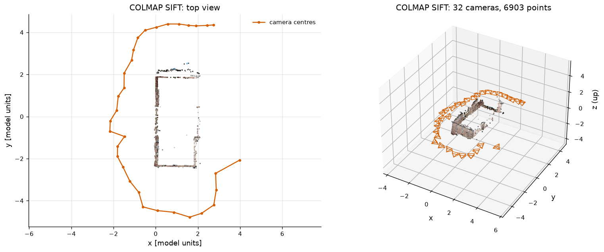

## What you'll learn

- The **epipolar constraint** $\hat x_2^\top E \hat x_1 = 0$ with $E = [t]_\times R$, the fundamental
  matrix $F = K_2^{-\top} E K_1^{-1}$, epipoles and epipolar lines.
- How to estimate $F$ and $E$: the **Hartley-normalised 8-point** algorithm written from scratch,
  the **5-point** solver inside RANSAC and MAGSAC++, and why robust estimation and refinement
  both matter.
- How an essential matrix decomposes into four poses and how the **cheirality check** in
  `cv2.recoverPose` picks the right one.
- **Triangulation** (DLT vs `cv2.triangulatePoints` vs Hartley-Sturm correction), reprojection
  error, and how depth uncertainty grows with $Z^2$ and shrinks with the baseline.
- **Stereo**: what rectification does, how to re-rectify a mis-aligned rig (calibrated
  Bouguet and uncalibrated Hartley), block matching vs **SGBM**, left-right checks, hole
  filling, the **bad-x / EPE** metrics, and disparity → metric depth → point cloud.
- **Learned matching**: DISK keypoints/descriptors + the LightGlue attention matcher vs
  SIFT + ratio test, evaluated by downstream pose accuracy (pose AUC), not match counts.
- **Incremental SfM** with the pycolmap 4.x API: feature extraction, exhaustive matching,
  geometric verification, registration by PnP, triangulation and bundle adjustment; how to
  plug any matcher into COLMAP; how to judge a reconstruction (registered images, points,
  track length, reprojection error, accuracy against a reference model).

## Theory primer

**Two views.** With camera-1 coordinates mapped to camera 2 by $X_2 = R X_1 + t$, the
vectors $X_2$, $t$ and $R X_1$ are coplanar, so

$$\hat x_2^\top E\,\hat x_1 = 0,\qquad E = [t]_\times R,\qquad x_2^\top F x_1 = 0,\qquad F = K_2^{-\top} E K_1^{-1}.$$

$E$ has 5 degrees of freedom (scale is lost) and singular values $(\sigma, \sigma, 0)$; $F$ has
7 and rank 2. $l_2 = F x_1$ is the epipolar line of $x_1$ in image 2.

**Estimation.** The 8-point algorithm solves $A f = 0$ (one row per match) by SVD and then
enforces rank 2. It needs Hartley normalisation (centroid at 0, mean distance $\sqrt2$).
The 5-point solver (Nistér) uses known $K$. Inside RANSAC the chance of an outlier-free
sample is $(1-\varepsilon)^s$, so minimal samples ($s = 5$) need far fewer iterations than
$s = 8$. $E = U\,\mathrm{diag}(1,1,0)V^\top$ gives $R \in \{UWV^\top, UW^\top V^\top\}$,
$t = \pm u_3$. Only one of the four $(R, t)$ puts the points in front of both cameras.

**Triangulation and depth error.** DLT stacks $x_i \times (P_i X) = 0$ for each view and
solves by SVD. For a rectified rig, $Z = fB/(d + d_\text{offs})$ and a disparity error
$\sigma_d$ gives

$$\sigma_Z \approx \frac{Z^2}{f B}\,\sigma_d .$$

**Semi-global matching** minimises
$E(D) = \sum_p C(p, D_p) + \sum_{q\in N_p} P_1[|D_p - D_q| = 1] + \sum_{q\in N_p} P_2[|D_p - D_q| > 1]$
by dynamic programming along several 1-D paths. **bad-x** is the percentage of pixels with
$|d - d_{gt}| > x$; **EPE** is the mean $|d - d_{gt}|$.

**Bundle adjustment** jointly refines poses, intrinsics and points:
$\min \sum_{(i,j)} \rho\big(\lVert x_{ij} - \pi(K, R_i X_j + t_i)\rVert^2\big)$.
SfM is defined up to a similarity transform, so comparisons with a reference model first
align the camera centres with Sim(3) (Umeyama).

## How to run

All commands below were run in this repository (conda env `cv`). Commands that touch the
GPU hold the shared lock `/tmp/cv-gpu.lock`.

```bash
# 1. extras: pycolmap 4.2.1 (CPU wheel) and kornia 0.9.0 (DISK + LightGlue)
flock /tmp/cv-gpu.lock make setup-09_multiview_geometry

# 2. data + weights: Middlebury MiddEval3 quarter resolution (45 MB), TUM fr1_desk,
#    South Building (419 MB zip -> 128 photos at 1024 px + reference model), DISK + LightGlue weights
make data-09_multiview_geometry

# 3. (optional) rebuild the South Building reconstructions from the command line, e.g. for
#    projects 10 and 11 -> runs/09_multiview_geometry/south_building/{sift,disk_lightglue_window8}/
#    (settings in configs/sfm_south_building.yaml; DISK + LightGlue matches pairs <= 8 images apart)
python projects/09_multiview_geometry/scripts/run_sfm.py --features sift
flock /tmp/cv-gpu.lock python projects/09_multiview_geometry/scripts/run_sfm.py --features disk_lightglue

# 4. execute the four notebooks headless
make nb-09_multiview_geometry

# 5. exercise solutions and unit tests
python projects/09_multiview_geometry/solutions/solutions_01.py
python projects/09_multiview_geometry/solutions/solutions_02.py
flock /tmp/cv-gpu.lock python projects/09_multiview_geometry/solutions/solutions_03.py
python projects/09_multiview_geometry/solutions/solutions_04.py
python -m pytest -q tests/test_p09_mvgeo.py
```

| Notebook | Content |
|---|---|
| [`01_epipolar_geometry.ipynb`](notebooks/01_epipolar_geometry.ipynb) | Synthetic two-view scene, epipolar constraint and epipoles, 8-point (raw vs normalised) vs 5-point RANSAC / MAGSAC++ under noise and outliers, the four-fold ambiguity of $E$ and cheirality, DLT triangulation, depth error vs baseline, pose AUC on 56 TUM `fr1_desk` pairs |
| [`02_stereo_rectification_sgbm.ipynb`](notebooks/02_stereo_rectification_sgbm.ipynb) | Middlebury MiddEval3 (15 training scenes, quarter resolution): vertical disparity, calibrated and uncalibrated re-rectification of a rotated camera, BM vs SGBM, LR check and hole filling, block-size sweep, disparity → depth → point cloud |
| [`03_feature_matching_lightglue.ipynb`](notebooks/03_feature_matching_lightglue.ipynb) | SIFT + ratio test vs DISK + mutual nearest neighbours vs DISK + LightGlue on TUM `fr1_desk` and South Building pairs at increasing gaps, scored by MAGSAC++ pose AUC |
| [`04_incremental_sfm_pycolmap.ipynb`](notebooks/04_incremental_sfm_pycolmap.ipynb) | Incremental SfM with pycolmap 4 on 32 South Building photos, DISK + LightGlue matches imported into COLMAP, accuracy against the reference model, look-alike facades, pairing windows over repeated runs, a sparser stress test, PLY export |

Code: [`scripts/mvgeo.py`](scripts/mvgeo.py) (8-point, Sampson distance, essential decomposition, cheirality, pose AUC, PFM/Middlebury I/O, BM/SGBM wrappers, LR check, hole filling, rectification, DISK + LightGlue wrapper, COLMAP database import, reconstruction statistics and Sim(3) comparison with the reference) is shared by the notebooks, the CLI [`scripts/run_sfm.py`](scripts/run_sfm.py), the [solutions](solutions/) and the unit tests.

## Results

Hardware: Intel Core Ultra 9 275HX CPU, **NVIDIA RTX 5060 Laptop GPU (8 GB)**, Ubuntu 24.04;
OpenCV 5.0.0, pycolmap 4.2.1 (CPU build), kornia 0.9.0, torch 2.11.0+cu128. Every number below
is copied from the executed notebooks (also saved to [`results/`](results/)). COLMAP's
multi-threaded mapping is not bit-reproducible, so re-running notebook 04 gives slightly
different SfM numbers (and, for the fragile configurations discussed below, different outcomes).

### Two-view geometry (notebook 01)

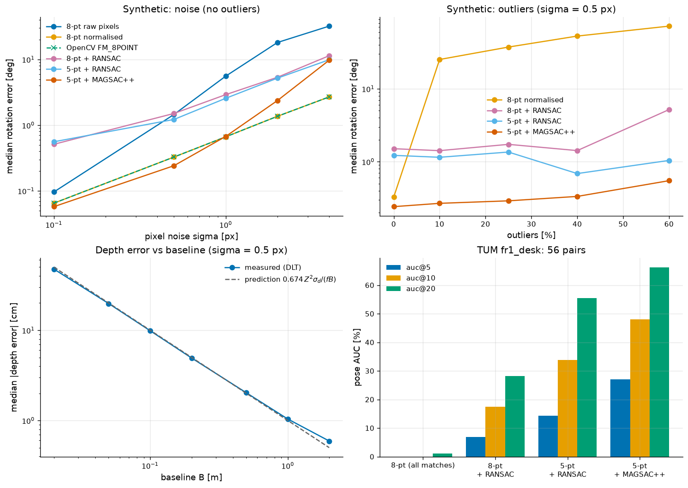

Synthetic scene, median over 50 trials of 100 correspondences (rotation / translation-direction
error in degrees):

| Estimator | rot err @ 1 px noise | t-dir err @ 1 px noise | rot err @ 25 % outliers |
|---|---:|---:|---:|
| 8-point, raw pixels | 5.563 | 9.221 | - |
| 8-point, Hartley-normalised (from scratch) | 0.664 | 1.344 | 37.323 |
| OpenCV `FM_8POINT` | 0.664 | 1.344 | - |
| 8-point + RANSAC | 2.909 | 4.899 | 1.728 |
| 5-point + RANSAC | 2.560 | 2.458 | 1.355 |
| 5-point + MAGSAC++ | 0.673 | 0.772 | 0.290 |

Depth error vs baseline ($\sigma = 0.5$ px): the median depth error falls from 0.4756 m at a
2 cm baseline to 0.0059 m at 2 m, following the $0.674\,Z^2\sigma_d/(fB)$ prediction
(0.5003 m and 0.0050 m).

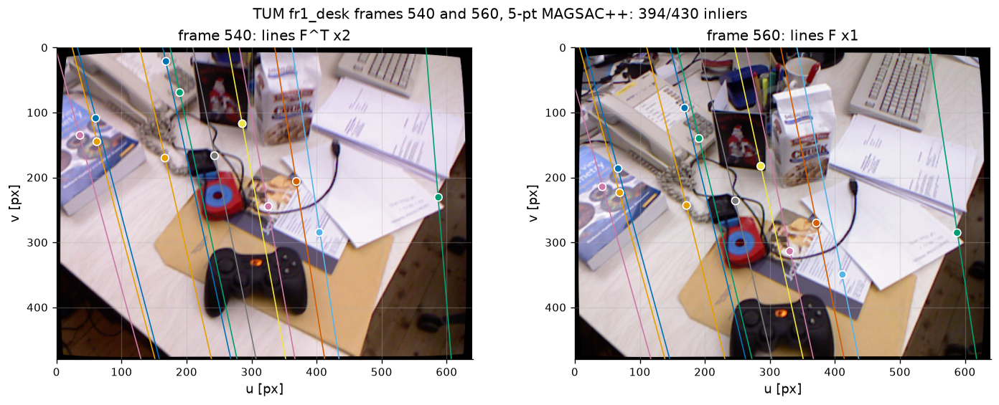

Real data, 56 TUM `fr1_desk` pairs, SIFT matches, error = max(rotation, translation direction):

| Method | AUC@5 | AUC@10 | AUC@20 | median rot err [deg] | median t err [deg] |
|---|---:|---:|---:|---:|---:|
| 8-point (all matches) | 0.000 | 0.000 | 0.012 | 7.725 | 65.308 |
| 8-point + RANSAC | 0.069 | 0.174 | 0.283 | 2.085 | 27.232 |
| 5-point + RANSAC | 0.143 | 0.339 | 0.554 | 1.213 | 6.717 |
| 5-point + MAGSAC++ | 0.270 | 0.480 | 0.662 | 0.875 | 5.336 |

### Stereo: rectification and SGBM (notebook 02)

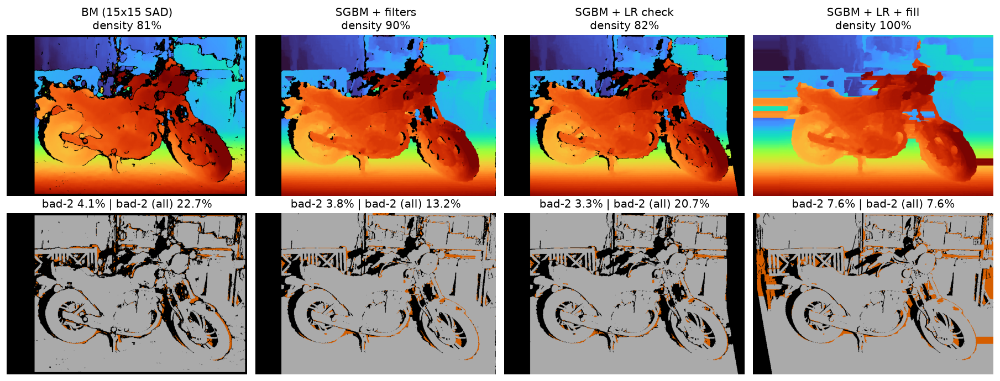

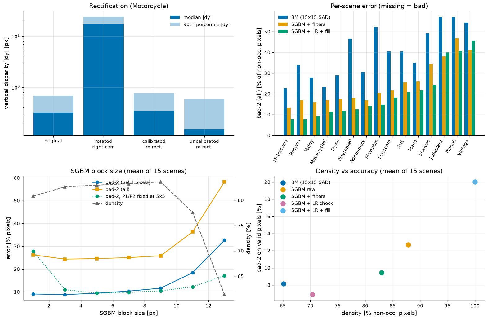

Mean over the 15 MiddEval3 training scenes (quarter resolution, CPU). bad-2 = % of
non-occluded pixels with an error above 2 px among the pixels that have an estimate;
"bad-2 (all)" counts missing pixels as errors.

| Matcher | density | bad-2 | bad-2 (all) | EPE [px] | time per pair [ms] |
|---|---:|---:|---:|---:|---:|
| BM (15x15 SAD) | 0.651 | 8.133 | 39.924 | 1.391 | 7.000 |
| SGBM raw | 0.879 | 12.703 | 23.106 | 2.115 | 10.936 |
| SGBM + filters | 0.830 | 9.440 | 24.583 | 1.465 | 13.388 |
| SGBM + LR check | 0.704 | 6.875 | 34.349 | 1.048 | 44.564 |
| SGBM + LR + fill | 1.000 | 20.018 | 20.018 | 3.200 | 44.564 |

Rectification experiment on Motorcycle (right camera rotated by about 2°):

| Pair | median \|dy\| [px] | SGBM density | depth AbsRel |
|---|---:|---:|---:|
| original (rectified by Middlebury) | 0.3156 | 0.8368 | 0.0095 |
| rotated right camera | 17.3183 | 0.2508 | 0.4145 |
| calibrated re-rectification (`stereoRectify`) | 0.3459 | 0.7878 | 0.0096 |
| uncalibrated re-rectification (from $F$) | 0.1479 | 0.8213 | n/a (no metric scale) |

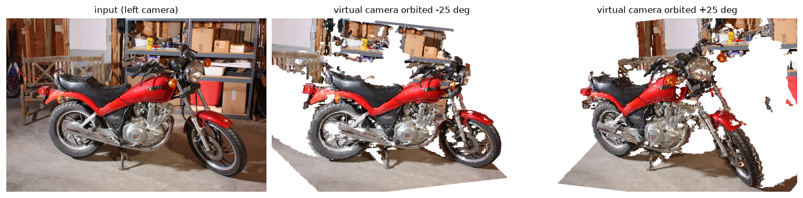

### Learned matching: DISK + LightGlue vs SIFT (notebook 03)

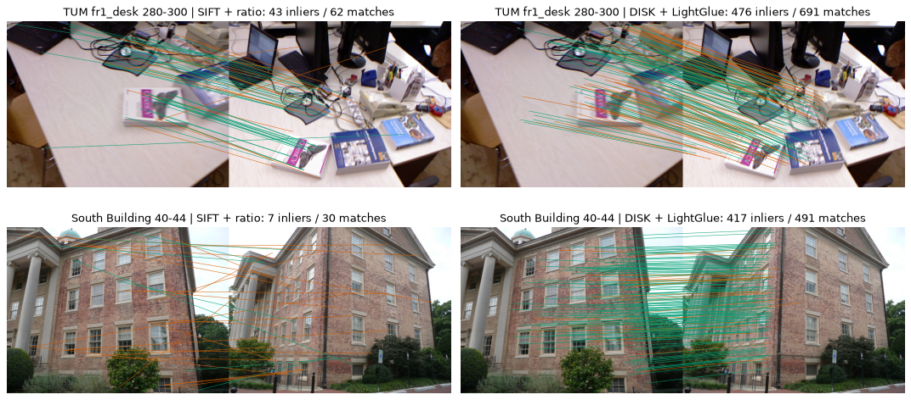

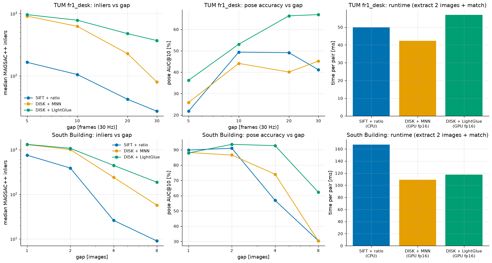

Pose AUC [%] from MAGSAC++ essential matrices over all evaluated pairs (TUM: gaps of 5-30
frames; South Building: gaps of 1-8 images). DISK/LightGlue run in fp16 on the GPU (peak
1216 MiB), SIFT on the CPU.

| Dataset | Method | AUC@5 | AUC@10 | AUC@20 | median inliers | median inlier ratio | time per pair [ms] |
|---|---|---:|---:|---:|---:|---:|---:|
| TUM fr1_desk | SIFT + ratio | 18.53 | 38.30 | 59.16 | 63.0 | 0.67 | 49.94 |
| TUM fr1_desk | DISK + MNN | 15.80 | 36.33 | 59.13 | 493.5 | 0.51 | 42.37 |
| TUM fr1_desk | DISK + LightGlue | 32.25 | 54.02 | 69.78 | 677.5 | 0.70 | 56.95 |
| South Building | SIFT + ratio | 57.51 | 66.81 | 72.91 | 130.0 | 0.71 | 167.25 |
| South Building | DISK + MNN | 55.91 | 69.20 | 76.67 | 545.0 | 0.70 | 109.18 |
| South Building | DISK + LightGlue | 77.26 | 83.87 | 87.92 | 631.0 | 0.94 | 117.40 |

### Incremental SfM with pycolmap (notebook 04)


DISK + LightGlue on all 496 pairs registers every image with a sub-pixel reprojection error,
but the model is folded: LightGlue confidently matches look-alike facades on different sides
of the building (here 392 verified inliers between two images that share no reference point).

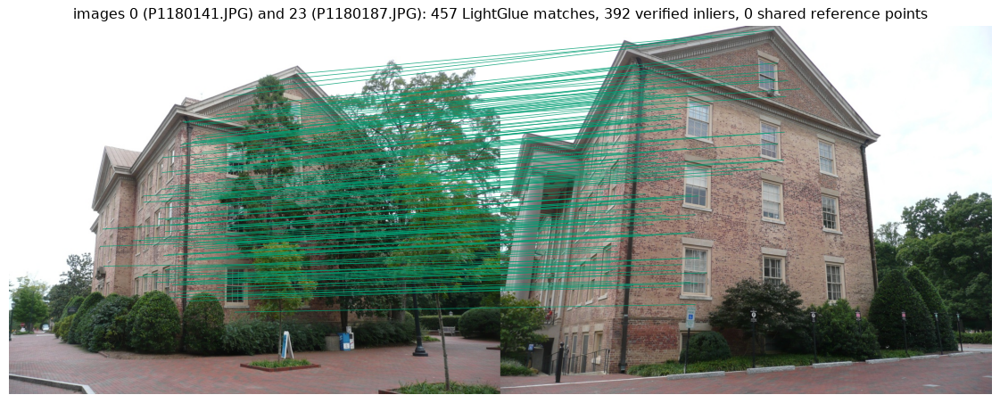

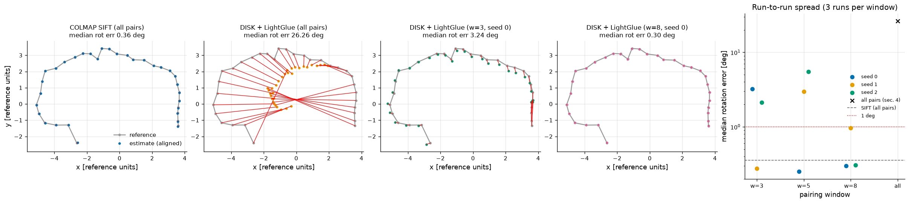

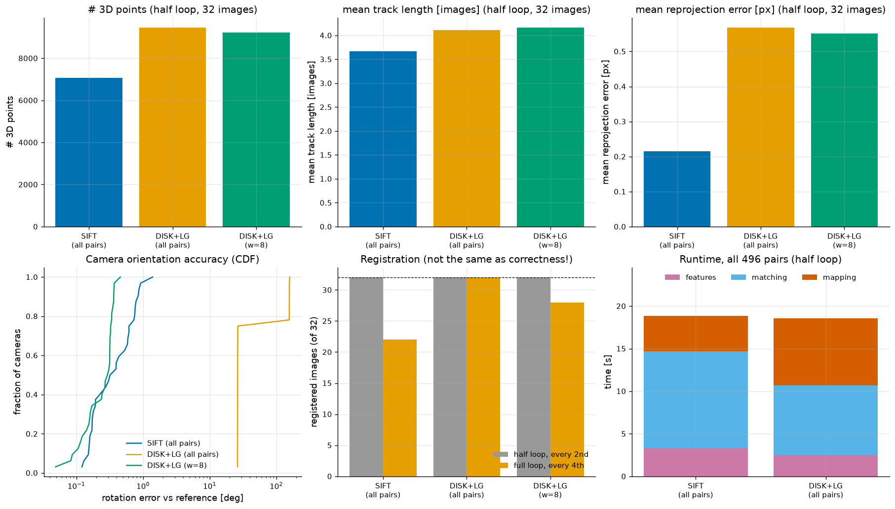

Half loop (32 images, every second of the first 64 photos, 1024x768), accuracy against the
reference model shipped with the dataset after Sim(3) alignment of the camera centres:

| Method | registered | 3D points | mean track length | reproj. err [px] | median rot err [deg] | max rot err [deg] | median centre err [% spacing] | focal err [%] |
|---|---:|---:|---:|---:|---:|---:|---:|---:|
| COLMAP SIFT (all pairs) | 32 | 7071 | 3.668 | 0.216 | 0.356 | 1.388 | 3.182 | 0.516 |
| DISK + LightGlue (all pairs) | 32 | 9446 | 4.111 | 0.568 | 26.255 | 158.978 | 524.153 | 0.169 |
| DISK + LightGlue (window $w = 8$, first run) | 32 | 9209 | 4.159 | 0.551 | 0.300 | 0.456 | 2.221 | -0.065 |

Runtime (half loop): SIFT 3.270 s features + 11.394 s exhaustive matching and verification +
4.202 s mapping (CPU); DISK + LightGlue 2.552 s features + 8.133 s matching, import and
verification + 7.905 s mapping (GPU for DISK/LightGlue, peak VRAM 1238 MiB).

Sequential pairing windows, same DISK + LightGlue matches, three runs each (seeds 0, 1, 2).
A run is OK when all 32 images are registered and the median rotation error is below 1°:

| Window $w$ | pairs | false pairs kept | runs OK | best median rot err [deg] | worst median rot err [deg] |
|---:|---:|---:|---:|---:|---:|
| 3 | 90 | 0 | 1 / 3 | 0.275 | 3.238 |
| 5 | 145 | 3 | 1 / 3 | 0.251 | 5.515 |
| 8 | 220 | 38 | 3 / 3 | 0.300 | 0.966 |

Stress test, every fourth photo of the full 128-photo loop (32 images, wider baselines, one
gap in the walk):

| Method | registered | models | median rot err [deg] | max rot err [deg] | median centre err [% spacing] |
|---|---:|---:|---:|---:|---:|
| COLMAP SIFT (all pairs) | 22 | 1 | 0.260 | 0.442 | 0.625 |
| DISK + LightGlue (all pairs) | 32 | 1 | 1.092 | 180.000 | 134.133 |
| DISK + LightGlue ($w = 3$) | 25 | 2 | 36.390 | 130.958 | 160.326 |
| DISK + LightGlue ($w = 8$) | 28 | 2 | 11.308 | 171.674 | 224.806 |

`scripts/run_sfm.py` (same settings, separate runs) produced: SIFT 32/32 images, 7026 points,
0.213 px, median rotation error 0.290°; DISK + LightGlue $w = 8$ 32/32 images, 9201 points,
0.552 px, 0.313°, peak VRAM 1238 MiB.

**Takeaways.** Normalise before the 8-point algorithm and refine after RANSAC (MAGSAC++ is the
most accurate robust estimator in every setting here). Rectification is fragile: 2° of
rotation destroys SGBM, and calibrated re-rectification restores metric depth. LightGlue
finds far more correct matches than SIFT on wide baselines, but the same strength produces
confident false matches on repeated structure, which folded an SfM model that every internal
statistic called a success. Check reconstructions against independent information, and judge
SfM configurations over several runs.

## Limitations

- **COLMAP is not deterministic here.** Even with fixed seeds, multi-threaded verification and
  mapping gave different models from identical inputs. Pairing windows of 3 and 5 succeeded in
  only one of three runs; $w = 8$ succeeded in all three runs of the final notebook execution,
  with one noticeably weaker run (median 0.97°, worst camera 3.0°). The SIFT numbers also vary
  slightly between runs (median rotation error 0.290° to 0.356° across the runs reported above).
- **No doppelganger handling.** The look-alike-facade problem is diagnosed (with the reference
  model's co-visibility) but not solved: loop-consistency checks or a learned doppelganger
  classifier are not implemented, and no DISK + LightGlue setting reconstructed the sparser
  full-loop subset correctly.
- **The South Building "reference" is itself a COLMAP model** (all 128 photos at full
  resolution), not survey-grade ground truth, so errors around 0.3° are at the limit of what
  this comparison can resolve.
- **Small scale.** SfM uses 32 images at 1024 px on one scene; Middlebury is evaluated at quarter
  resolution only; TUM poses are limited by motion blur, rolling shutter and mocap
  synchronisation (absolute AUC values stay modest for every method).
- **CPU-only pycolmap.** The `pycolmap` CPU wheel is used (the CUDA build installs the same
  module name and was not needed at this scale), so COLMAP SIFT extraction and matching run on
  the CPU.
- **Classical stereo only.** No learned stereo network is evaluated; `cv2.ximgproc` (WLS
  filter) is not part of `opencv-python` 5, so a hand-written LR check and hole filling are used.
  The jump in SGBM error at block sizes of 11 and 13 px was observed but not investigated.
- DISK keypoints lie on the integer pixel grid, the likely reason for their higher
  reprojection error in SfM (0.55-0.57 px vs 0.22 px for SIFT).

## Model & dataset licenses

| Component | Kind | License | Notes |
|---|---|---|---|
| [COLMAP / pycolmap](https://github.com/colmap/colmap) 4.2.1 | library | BSD-3-Clause | CPU wheel from PyPI |
| [kornia](https://github.com/kornia/kornia) 0.9.0 | library | Apache-2.0 | DISK and LightGlue implementations |
| [DISK](https://github.com/cvlab-epfl/disk) weights (`depth-save.pth`) | model | Apache-2.0 | downloaded by kornia |
| [LightGlue](https://github.com/cvg/LightGlue) weights for DISK (`v0.1_arxiv`) | model | Apache-2.0 | downloaded by kornia |
| [OpenCV](https://github.com/opencv/opencv) 5.0 | library | Apache-2.0 | |
| [Middlebury MiddEval3 / 2014](https://vision.middlebury.edu/stereo/data/) | dataset | permission to use and publish with citation | cite Scharstein et al., GCPR 2014 |
| [COLMAP South Building](https://colmap.github.io/datasets.html) | dataset | no license stated (research use) | photos by C. Zach; distributed with COLMAP; **license unclear** |
| [TUM RGB-D](https://cvg.cit.tum.de/data/datasets/rgbd-dataset) `fr1_desk` | dataset | CC BY 4.0 | |

## References

Papers

- R. Hartley, A. Zisserman. *Multiple View Geometry in Computer Vision*, 2nd ed., 2004. [book page](https://www.robots.ox.ac.uk/~vgg/hzbook/)
- R. Hartley. In defense of the eight-point algorithm. TPAMI 1997. [doi:10.1109/34.601246](https://doi.org/10.1109/34.601246)
- D. Nistér. An efficient solution to the five-point relative pose problem. TPAMI 2004. [doi:10.1109/TPAMI.2004.17](https://doi.org/10.1109/TPAMI.2004.17)
- R. Hartley, P. Sturm. Triangulation. CVIU 1997. [doi:10.1006/cviu.1997.0547](https://doi.org/10.1006/cviu.1997.0547)
- D. Barath, J. Noskova, M. Ivashechkin, J. Matas. MAGSAC++, a fast, reliable and accurate robust estimator. CVPR 2020. [arXiv:1912.05909](https://arxiv.org/abs/1912.05909)
- H. Hirschmüller. Stereo processing by semiglobal matching and mutual information. TPAMI 2008. [doi:10.1109/TPAMI.2007.1166](https://doi.org/10.1109/TPAMI.2007.1166)
- D. Scharstein et al. High-resolution stereo datasets with subpixel-accurate ground truth. GCPR 2014. [doi:10.1007/978-3-319-11752-2_3](https://doi.org/10.1007/978-3-319-11752-2_3)
- D. Lowe. Distinctive image features from scale-invariant keypoints. IJCV 2004. [doi:10.1023/B:VISI.0000029664.99615.94](https://doi.org/10.1023/B:VISI.0000029664.99615.94)
- M. Tyszkiewicz, P. Fua, E. Trulls. DISK: Learning local features with policy gradient. NeurIPS 2020. [arXiv:2006.13566](https://arxiv.org/abs/2006.13566)
- P. Lindenberger, P.-E. Sarlin, M. Pollefeys. LightGlue: Local feature matching at light speed. ICCV 2023. [arXiv:2306.13643](https://arxiv.org/abs/2306.13643)
- J. L. Schönberger, J.-M. Frahm. Structure-from-Motion revisited. CVPR 2016. [paper](https://openaccess.thecvf.com/content_cvpr_2016/papers/Schonberger_Structure-From-Motion_Revisited_CVPR_2016_paper.pdf)
- S. Umeyama. Least-squares estimation of transformation parameters between two point patterns. TPAMI 1991. [doi:10.1109/34.88573](https://doi.org/10.1109/34.88573)
- C. Zach, M. Klopschitz, M. Pollefeys. Disambiguating visual relations using loop constraints. CVPR 2010. [doi:10.1109/CVPR.2010.5539801](https://doi.org/10.1109/CVPR.2010.5539801)
- R. Cai et al. Doppelgangers: Learning to disambiguate images of similar structures. ICCV 2023. [arXiv:2309.02420](https://arxiv.org/abs/2309.02420)
- J. Sturm et al. A benchmark for the evaluation of RGB-D SLAM systems. IROS 2012. [doi:10.1109/IROS.2012.6385773](https://doi.org/10.1109/IROS.2012.6385773)

Code and data

- [colmap/colmap](https://github.com/colmap/colmap) and the [pycolmap documentation](https://colmap.github.io/pycolmap/index.html)
- [cvg/LightGlue](https://github.com/cvg/LightGlue), [cvlab-epfl/disk](https://github.com/cvlab-epfl/disk), [kornia/kornia](https://github.com/kornia/kornia)
- [OpenCV calib3d (5.x)](https://docs.opencv.org/5.x/d9/d0c/group__calib3d.html)
- [Middlebury stereo datasets](https://vision.middlebury.edu/stereo/data/), [COLMAP datasets](https://colmap.github.io/datasets.html), [TUM RGB-D benchmark](https://cvg.cit.tum.de/data/datasets/rgbd-dataset)
