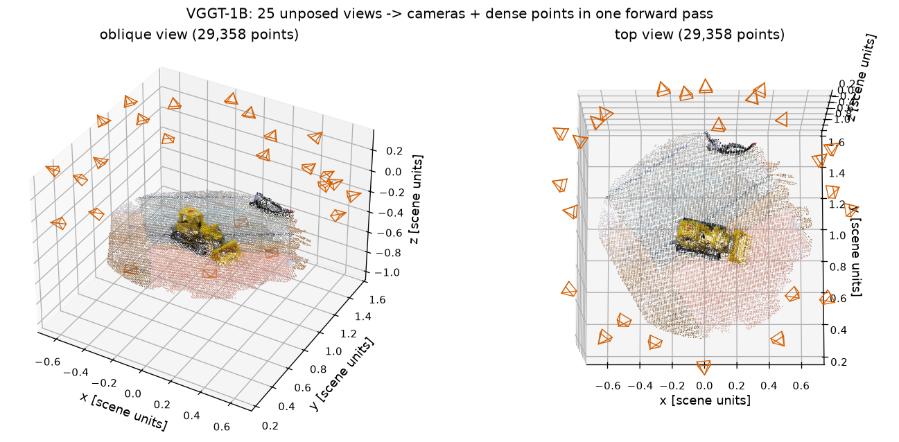
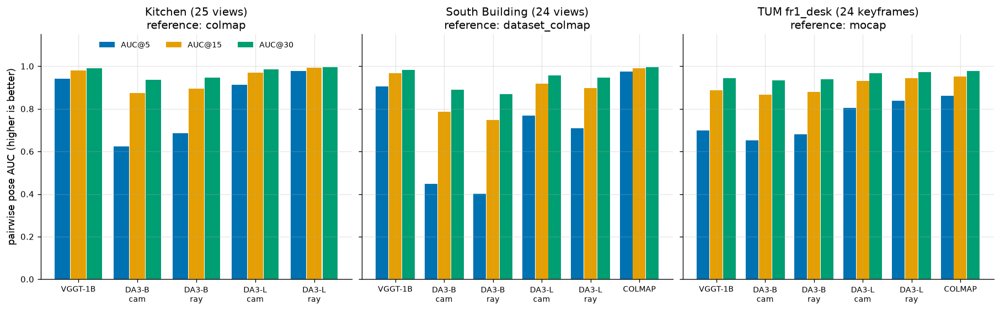
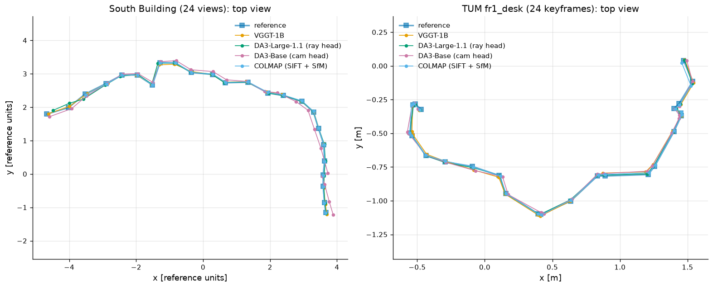
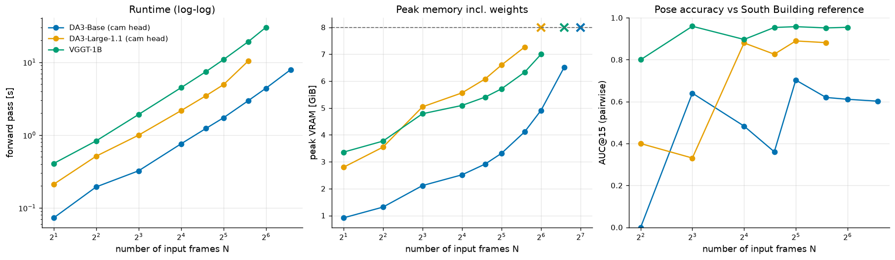
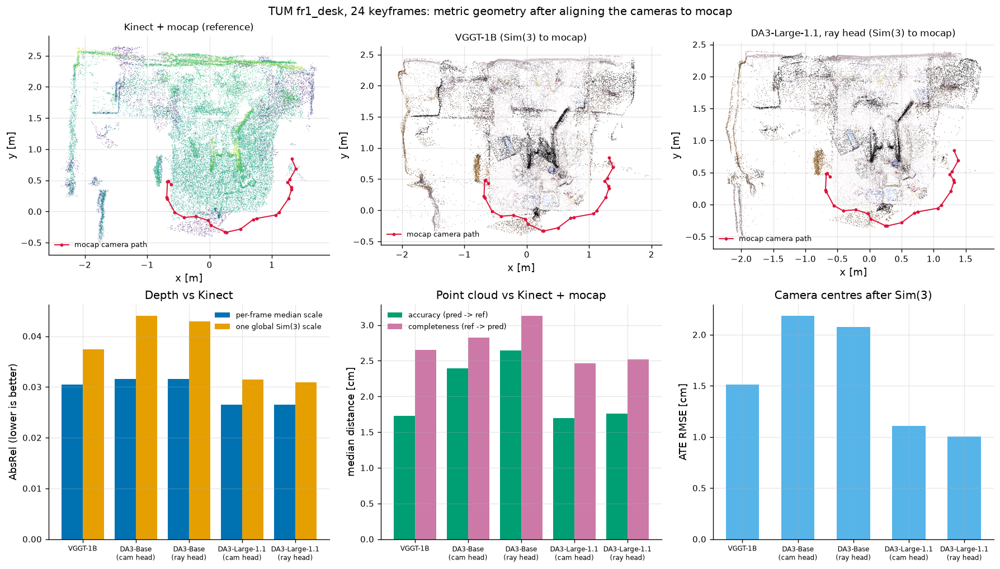
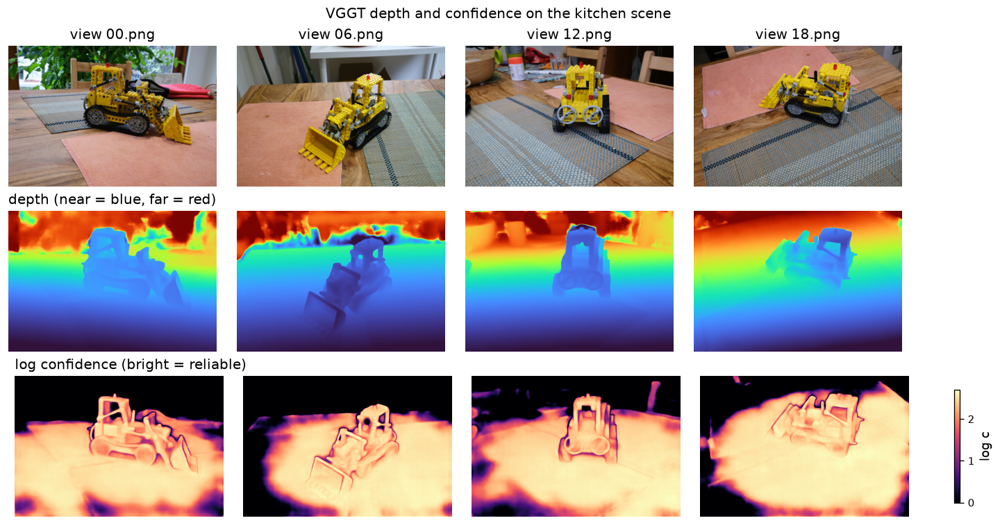
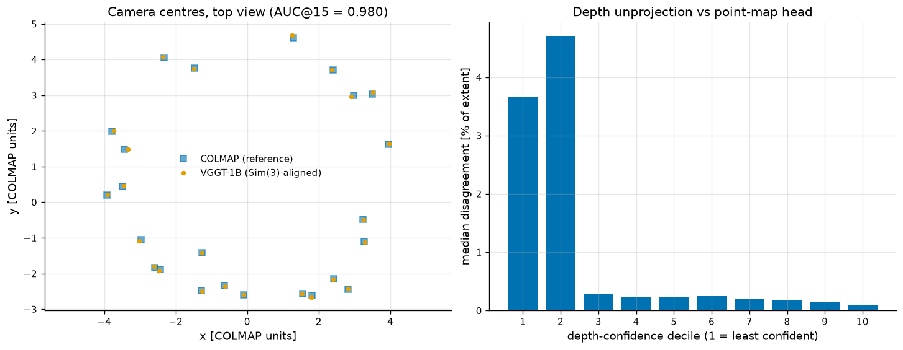

# 10 · Feed-forward 3D reconstruction (VGGT, Depth Anything 3)

Classical Structure-from-Motion (project 09) turns a set of photos into cameras and a 3D model through
feature matching, RANSAC and bundle adjustment. Feed-forward reconstructors do the same in **one
forward pass of a transformer**: give them 2-100 unposed images, get back every camera's pose and
intrinsics plus a dense depth map per view. This project runs **VGGT-1B** and **Depth Anything 3**
(DA3-Base and DA3-Large-1.1, each with its camera head and its ray head) on an 8 GB laptop GPU, and
measures their cameras against COLMAP and ground truth on three real scenes, their frame budget,
and their dense geometry in metres.



## What you'll learn

- What a feed-forward reconstructor predicts and in which conventions: OpenCV camera-from-world
  extrinsics, intrinsics decoded from a predicted field of view, depth and its confidence, point maps.
- How alternating frame-wise / global attention replaces explicit feature matching, and what it
  costs in tokens, time and memory.
- How to fit a 1.26 B-parameter model (5.0 GB fp32 checkpoint) into 8 GB: bf16 backbone, fp32 heads.
- Why reconstructions can only be compared up to a similarity transform, and how the Umeyama
  Sim(3) alignment, gauge-free pairwise metrics and AUC@5/10/15/30 handle it.
- How feed-forward models compare with COLMAP in accuracy, robustness, runtime and memory, with
  three kinds of reference: COLMAP pseudo ground truth, a dataset SfM model, and motion capture.
- How to turn an up-to-scale reconstruction into a **metric** point cloud with a known trajectory,
  and how to score it with accuracy / completeness distances against Kinect depth.

| notebook | content | runs in |
|---|---|---|
| [01_vggt_feedforward_reconstruction](notebooks/01_vggt_feedforward_reconstruction.ipynb) | VGGT-1B live on 25 kitchen photos: memory recipe, token budget, cameras, depth + confidence, depth vs point-map head, `.ply` export, check vs COLMAP | ~30 s |
| [02_pose_evaluation_vs_colmap](notebooks/02_pose_evaluation_vs_colmap.ipynb) | gauge freedom, Umeyama Sim(3), pairwise errors and AUC; DA3-Base live (camera vs ray head); all methods on all scenes | ~15 s |
| [03_scaling_and_metric_geometry](notebooks/03_scaling_and_metric_geometry.ipynb) | runtime / VRAM / accuracy vs number of frames (2-128); TUM depth in metres (two scale protocols); metric point clouds vs Kinect + mocap | ~15 s |

The heavy model runs live in `scripts/benchmark.py`, which caches every prediction in
`runs/10_feedforward_3d/preds/`; notebooks 02 and 03 load those caches.

## Theory primer

**From SfM to one forward pass.** Incremental SfM detects features, matches all image pairs,
estimates two-view geometry with RANSAC, registers images one by one (PnP) and refines everything
with bundle adjustment. A feed-forward model instead embeds every image into tokens and lets a
transformer reason over all images jointly. VGGT (CVPR 2025) cuts each image (518 px wide) into
14x14 patches embedded by DINOv2, adds one camera token and four register tokens per frame, and
alternates 24 times between *frame attention* (tokens of one image) and *global attention* (all
tokens of all images). Three heads read the result:

| head | output |
|---|---|
| camera | $g_i = [\mathbf t_i, \mathbf q_i, \text{fov}^h_i, \text{fov}^w_i]$, i.e. $T_{cw,i} = [R(\mathbf q_i) \mid \mathbf t_i]$ (OpenCV, camera-from-world, camera 0 = world) |
| depth (DPT) | depth $z_i(u, v)$ along the optical axis + confidence $c_i(u, v) = 1 + e^{x} > 1$ |
| point map (DPT) | world point $X_i(u, v)$ + confidence |

Intrinsics come from the field of view with the principal point at the image centre:
$f_x = \frac{W/2}{\tan(\text{fov}^w/2)}$, $f_y = \frac{H/2}{\tan(\text{fov}^h/2)}$.
A world point follows from depth and camera by unprojection,
$X_w = R^\top\big(z\,K^{-1}[u, v, 1]^\top - \mathbf t\big)$.

**Depth Anything 3** uses a single plain DINOv2 transformer with cross-view attention and predicts a
depth map plus a per-pixel **ray map** (origin + direction). A camera can be fitted to the rays
(*ray head*, `use_ray_pose=True`) or read from a small camera head that regresses it directly.

**Cost.** With $P = \frac{W}{14}\cdot\frac{H}{14}$ patches per frame, each global layer attends over
$T = N(P + 5)$ tokens, about $4T^2d$ FLOPs with $d = 1024$ for VGGT. Flash attention never stores
the $T\times T$ matrix, so memory grows roughly linearly in $N$ while compute grows between linearly
(per-frame work) and quadratically (global attention).

**Gauge freedom and alignment.** From images alone a reconstruction is defined up to a similarity
$X \mapsto sRX + \mathbf t$. To compare camera centres $\mathbf p_i$ with reference centres
$\mathbf r_i$ we fit $\min_{s,R,\mathbf t}\sum_i\lVert \mathbf r_i - (sR\mathbf p_i + \mathbf t)\rVert^2$
in closed form (Umeyama 1991: SVD of the cross-covariance $\Sigma = UDV^\top$,
$R = USV^\top$, $s = \mathrm{tr}(DS)/\sigma_p^2$, $\mathbf t = \boldsymbol\mu_r - sR\boldsymbol\mu_p$)
and report the absolute trajectory error (ATE, RMS of the centre residuals) and per-camera rotation
errors.

**Gauge-free pairwise metrics** (VGGT / DA3 protocol). For every pair $(i, j)$ the relative pose
$T_{ji} = T_j T_i^{-1}$ is compared with the reference: rotation error
$e_R = \angle(R^{\text{ref}\top}_{ji}R^{\text{pred}}_{ji})$ and translation-*direction* error
$e_t = \angle(\mathbf t^{\text{pred}}_{ji}, \mathbf t^{\text{ref}}_{ji})$ (scale is unknown). With
$e = \max(e_R, e_t)$ and $\text{acc}(\tau) = \Pr[e < \tau]$,
$\text{AUC}@\tau_{\max} = \frac{1}{\tau_{\max}}\sum_{k=1}^{\tau_{\max}}\text{acc}(k)$ (1-degree bins).
AUC@5 is the strict metric; AUC@30 mostly flags gross failures.

## How to run

All commands from the repository root, in the `cv` environment (RTX 5060 Laptop GPU, 8 GB).

```bash
# 1. extras (VGGT and DA3 are imported from pinned clones, not pip-installed: both pin numpy<2)
make setup-10_feedforward_3d
bash scripts/setup_third_party.sh vggt depth-anything-3

# 2. scenes + weights (idempotent): VGGT kitchen (25 PNG), COLMAP South Building (419 MB zip ->
#    128 photos at 1024 px + its reference model), 24 undistorted TUM fr1_desk keyframes, and
#    ~7.2 GB of weights in the Hugging Face cache (VGGT-1B 5.03 GB, DA3-LARGE-1.1 1.64 GB, DA3-BASE 0.54 GB)
make data-10_feedforward_3d

# 3. COLMAP (pycolmap, CPU) on exactly the images the models see -> runs/ + results/colmap_summary.csv
python projects/10_feedforward_3d/scripts/run_colmap.py

# 4. every model on every scene, then the frame-count sweep (GPU; about 2 + 7 min);
#    writes results/pose_metrics.csv, results/scaling.csv and the prediction caches
flock /tmp/cv-gpu.lock python projects/10_feedforward_3d/scripts/benchmark.py
flock /tmp/cv-gpu.lock python projects/10_feedforward_3d/scripts/benchmark.py --scaling-only  # sweep only

# 5. execute the three notebooks headless (about 2 min in total)
make nb-10_feedforward_3d

# 6. exercise solutions (01 needs the GPU; 02 and 03 run on the CPU from the caches)
flock /tmp/cv-gpu.lock python projects/10_feedforward_3d/solutions/solutions_01.py
python projects/10_feedforward_3d/solutions/solutions_02.py
python projects/10_feedforward_3d/solutions/solutions_03.py
```

Scenes, models and evaluation settings live in [`configs/ff3d.yaml`](configs/ff3d.yaml); all code
paths (runners, metrics, plotting) live in [`scripts/ff3d.py`](scripts/ff3d.py). Point clouds are
exported to `outputs/10_feedforward_3d/` (gitignored): `kitchen_vggt.ply` (confidence-filtered,
voxel-downsampled) and `tum_desk_vggt_metric.ply` (metres, mocap frame).

## Results

Measured on an **NVIDIA RTX 5060 Laptop GPU (8 GB, 7.53 GB usable, sm_120)** with torch 2.11.0+cu128
(TF32 off) and, for COLMAP, the 24-thread Intel Core Ultra 9 275HX CPU. Runtime is the network
forward pass after a warm-up (CUDA-synchronised); peak VRAM is `torch.cuda.max_memory_allocated()`
including the weights. VGGT runs with its 0.91 B-parameter aggregator stored in bf16 and fp32 heads
(2808 MiB of weights); DA3 at `process_res=504`.

### Cameras: feed-forward vs COLMAP and ground truth

Three scenes, three references: **Kitchen** (25 photos from the VGGT repository; reference = the
pycolmap model computed here, which registered 24/25 images), **South Building** (every second of
the first 48 of the 128 COLMAP dataset photos, along one side of the building; reference = the model shipped with the dataset, built from all 128
full-resolution photos) and **TUM fr1_desk** (24 sharp keyframes over 8.4 s; reference =
motion capture, trajectory diameter 2.1 m).



| scene | method | evaluated | AUC@5 | AUC@15 | AUC@30 | rot. err. med (deg) | ATE (% diam.) | ATE (cm) | runtime (s) | peak VRAM (MiB) |
|---|---|---|---|---|---|---|---|---|---|---|
| Kitchen | VGGT-1B | 24/25 | 0.941 | 0.980 | 0.990 | 0.51 | 0.59 | - | 6.61 | 5276 |
| Kitchen | DA3-Base (cam head) | 24/25 | 0.622 | 0.874 | 0.937 | 1.28 | 1.23 | - | 1.13 | 2754 |
| Kitchen | DA3-Base (ray head) | 24/25 | 0.687 | 0.895 | 0.948 | 1.23 | 1.03 | - | 1.69 | 3135 |
| Kitchen | DA3-Large-1.1 (cam head) | 24/25 | 0.912 | 0.971 | 0.985 | 0.47 | 0.36 | - | 3.13 | 5823 |
| Kitchen | DA3-Large-1.1 (ray head) | 24/25 | **0.978** | 0.993 | 0.996 | 0.28 | 0.29 | - | 3.73 | 5823 |
| South Building | VGGT-1B | 24/24 | 0.904 | 0.967 | 0.984 | 0.48 | 0.51 | - | 7.31 | 5534 |
| South Building | DA3-Base (cam head) | 24/24 | 0.449 | 0.786 | 0.891 | 1.57 | 1.55 | - | 1.22 | 2985 |
| South Building | DA3-Base (ray head) | 24/24 | 0.401 | 0.748 | 0.869 | 3.98 | 1.68 | - | 1.86 | 3280 |
| South Building | DA3-Large-1.1 (cam head) | 24/24 | 0.767 | 0.919 | 0.958 | 1.60 | 0.85 | - | 3.44 | 6226 |
| South Building | DA3-Large-1.1 (ray head) | 24/24 | 0.709 | 0.897 | 0.947 | 1.11 | 0.92 | - | 4.07 | 6226 |
| South Building | COLMAP (SIFT + SfM, CPU) | 22/24 | **0.975** | 0.992 | 0.996 | 0.42 | 0.18 | - | 13.41 | - (CPU) |
| TUM fr1_desk | VGGT-1B | 24/24 | 0.698 | 0.889 | 0.944 | 0.85 | 0.71 | 1.51 | 7.34 | 5534 |
| TUM fr1_desk | DA3-Base (cam head) | 24/24 | 0.652 | 0.867 | 0.933 | 1.19 | 1.03 | 2.19 | 1.22 | 2985 |
| TUM fr1_desk | DA3-Base (ray head) | 24/24 | 0.682 | 0.879 | 0.939 | 1.23 | 0.97 | 2.07 | 1.85 | 3280 |
| TUM fr1_desk | DA3-Large-1.1 (cam head) | 24/24 | 0.805 | 0.933 | 0.966 | 0.74 | 0.52 | 1.11 | 3.43 | 6226 |
| TUM fr1_desk | DA3-Large-1.1 (ray head) | 24/24 | 0.839 | 0.943 | 0.972 | 0.66 | 0.47 | 1.00 | 4.07 | 6226 |
| TUM fr1_desk | COLMAP (SIFT + SfM, CPU) | 24/24 | **0.862** | 0.953 | 0.977 | 0.95 | 0.62 | 1.32 | 6.62 | - (CPU) |

Source: [`results/pose_metrics.csv`](results/pose_metrics.csv) (written by `benchmark.py`,
recomputed from the caches in notebook 02). COLMAP on the kitchen is the reference itself, so it
has no row there; COLMAP runtime is SIFT + exhaustive matching + incremental SfM wall-clock.



- **No universal winner.** DA3-Large-1.1 with the ray head is best on the kitchen and TUM, VGGT is
  the best feed-forward model on South Building (AUC@5 0.904 vs 0.767 for DA3-Large). The ray head
  gains 0.03-0.07 AUC@5 over the camera head on kitchen and TUM, and loses 0.05-0.06 on South Building.
- **COLMAP is the most accurate where it succeeds** (AUC@5 0.975 on South Building, 0.862 on TUM),
  but it dropped images (1/25 on the kitchen, 2/24 on South Building) and needed 6.6-13.4 s of CPU.
  The feed-forward models always place every image.
- **Model size matters more than the pose head**: DA3-Base (135 M parameters) trails DA3-Large by
  0.15-0.32 AUC@5 on every scene.
- **In metres** (TUM, Sim(3)-aligned), the camera-centre ATE is 1.0-1.1 cm for DA3-Large, 1.3 cm for
  COLMAP, 1.5 cm for VGGT and 2.1-2.2 cm for DA3-Base.

### Frame budget on 8 GB

South Building, $N$ frames spread evenly over all 128 photos (so larger $N$ also means denser
coverage), one model load per method, out-of-memory errors caught and reported
([`results/scaling.csv`](results/scaling.csv)).



| method | largest N that fit | peak VRAM at that N (MiB) | forward at that N (s) | first OOM | VRAM per extra frame (MiB, N >= 16) | runtime exponent k (N >= 16) | AUC@15 at N = 4 / 8 / 32 |
|---|---|---|---|---|---|---|---|
| VGGT-1B | 64 | 7166 | 30.18 | 96 | 40.47 | 1.37 | 0.800 / 0.960 / 0.958 |
| DA3-Base (cam head) | 96 | 6667 | 7.93 | 128 | 51.14 | 1.31 | 0.000 / 0.640 / 0.703 |
| DA3-Large-1.1 (cam head) | 48 | 7441 | 10.43 | 64 | 54.23 | 1.42 | 0.400 / 0.331 / 0.890 |

The VRAM slope and runtime exponent come from the least-squares fits in notebook 03. Runtime grows
faster than linearly (exponent 1.3-1.4), so global attention is already a large share of the work
at a few dozen frames. **VGGT is much more robust to few, widely spaced views**: with 4-8 views
spread around the building DA3 often fails (DA3-Base AUC@15 0.000 at N = 4), while VGGT reaches
0.960 at N = 8.

### Dense geometry in metres (TUM fr1_desk)

The Sim(3) fit of the predicted cameras to motion capture gives each reconstruction a metric
scale. Depth is scored against the Kinect with a per-frame median scale (shape only) and with that
one global scale (shape + consistent scale); the fused point cloud (only pixels where the Kinect
measured depth, 1 cm voxels) is scored against the Kinect + mocap cloud.



| method | Sim(3) scale (m / unit) | AbsRel per-frame | AbsRel global | delta1 global | accuracy median (cm) | completeness median (cm) | Chamfer mean (cm) | ATE (cm) |
|---|---|---|---|---|---|---|---|---|
| VGGT-1B | 1.491 | 0.030 | 0.037 | 0.978 | 1.73 | 2.65 | 4.24 | 1.51 |
| DA3-Base (cam head) | 1.424 | 0.032 | 0.044 | 0.987 | 2.39 | 2.82 | 5.01 | 2.19 |
| DA3-Base (ray head) | 1.421 | 0.032 | 0.043 | 0.987 | 2.64 | 3.13 | 5.31 | 2.07 |
| DA3-Large-1.1 (cam head) | 1.217 | 0.026 | 0.031 | 0.988 | 1.70 | 2.46 | 4.01 | 1.11 |
| DA3-Large-1.1 (ray head) | 1.216 | 0.026 | 0.031 | 0.988 | 1.76 | 2.52 | 4.10 | 1.00 |

Depth and camera translations share one scale to within a few percent (AbsRel rises only from
0.026-0.032 per frame to 0.031-0.044 with the global scale). After alignment the predicted surfaces
lie a median 1.7-1.8 cm (VGGT, DA3-Large) to 2.4-2.6 cm (DA3-Base) from the Kinect + mocap surface.

### VGGT on the kitchen (notebook 01)





25 views at 518x350 px: forward 6.67 s, peak 5276 MiB (2808 MiB weights); predicted horizontal FoV
52.12 deg vs 51.44 deg from COLMAP's bundle adjustment. The depth-unprojection and point-map routes
agree to 0.23 % of the trajectory diameter (median), with the disagreement concentrated in the
lowest-confidence 20 % of pixels. The confidence-filtered cloud (top 50 % of the pixels by confidence, voxels of 0.5 % of the
scene size) has 30,904 points. In the exercise solutions, running every head in bf16 as well saves 537 MiB of
weights (peak 4490 vs 5276 MiB) and moves the camera rotations by a median 0.088 deg (AUC@5 0.9225
vs 0.9413).

## Limitations

- **Small, specific scenes.** Three scenes of 24-25 views are a tutorial-scale comparison, not a
  benchmark; rankings flip between them, so do not generalise from one row.
- **The kitchen reference is a pseudo ground truth and not bit-reproducible.** pycolmap runs
  multi-threaded: a second run of `run_colmap.py` gave 1835 instead of 1862 kitchen points (and
  6.2 s instead of 9.15 s). Scored against that second model, VGGT's kitchen AUC@5 is 0.926 instead
  of 0.941 and DA3-Large (ray head) 0.960 instead of 0.978. Differences below about 0.02 AUC@5 on the
  kitchen are within the noise of the reference; the reported numbers use the first model, which the
  benchmark and notebooks were run against.
- **DA3 ray-head poses are not deterministic**: the live re-run in notebook 02 gave AUC@5 0.683 for
  DA3-Base (ray head) on the kitchen vs 0.687 in the cached benchmark run. The camera head is deterministic.
- **VGGT is not run in its official precision.** The official recipe keeps fp32 weights under bf16
  autocast (about 5 GB of weights alone); here the aggregator is stored in bf16 and the heads stay fp32.
  The all-bf16 variant is measured in the solutions; an fp32 reference was not run on the GPU.
- **Frame budget**: VGGT-1B out of memory at 96 frames (518x392), DA3-Large-1.1 at 64 and DA3-Base at
  128 (504x378). Larger sets need chunking with overlapping frames or a lower resolution.
- **Weights download exception**: VGGT-1B is a 5.03 GB fp32 checkpoint (no smaller official
  variant), above the repository's 2 GB per-download guideline.
- **Not run**: MapAnything (its package pins `opencv-python-headless==4.10.0.84`, which conflicts with
  OpenCV 5 in this environment), pi3 (optional; its requirements pin torch 2.5.1 / numpy 1.26 and it
  was skipped), VGGT-1B-Commercial and VGGT-Omega (gated, no access), DA3-Giant / DA3-Nested (5.4-6.8 GB
  checkpoints). To try VGGT-1B-Commercial once access is granted, point `models.vggt.repo` in
  `configs/ff3d.yaml` to `facebook/VGGT-1B-Commercial` (same architecture; not tested here).
- **DA3 import**: `depth_anything_3.api` imports `moviepy.editor` at import time (only for
  Gaussian-splat videos). moviepy 1.0.3 would downgrade shared packages, so `scripts/ff3d.py`
  registers an empty stub module instead; the splat-video export of DA3 is therefore unavailable.
- **TUM reference noise**: the reference cloud is Kinect depth (holes at dark, shiny and near
  surfaces) fused with mocap poses, so a few centimetres of point-cloud error is partly the reference's
  own. $\delta_1$ saturates at 0.98-0.99 and hardly separates the methods.

## Model & dataset licenses

| component | kind | license | notes |
|---|---|---|---|
| [VGGT-1B](https://huggingface.co/facebook/VGGT-1B) weights | model | CC BY-NC 4.0 | **non-commercial** |
| [VGGT code](https://github.com/facebookresearch/vggt) @a288dd0 | code | VGGT License v1 (custom) | pinned clone in gitignored `third_party/`, imported from source |
| [DA3-BASE](https://huggingface.co/depth-anything/DA3-BASE) weights | model | Apache-2.0 | |
| [DA3-LARGE-1.1](https://huggingface.co/depth-anything/DA3-LARGE-1.1) weights | model | treated as CC BY-NC 4.0 | **non-commercial**: the model card metadata says Apache-2.0, the DA3 README model table says CC BY-NC 4.0 |
| [Depth Anything 3 code](https://github.com/ByteDance-Seed/Depth-Anything-3) @3d835ec | code | Apache-2.0 | pinned clone in gitignored `third_party/` |
| [pycolmap / COLMAP](https://github.com/colmap/colmap) 4.2.1 | library | BSD-3-Clause | |
| [evo](https://github.com/MichaelGrupp/evo) 1.38.1, [plyfile](https://github.com/dranjan/python-plyfile) 1.1.5 | library | GPL-3.0 | **copyleft**; import-time dependencies of `depth_anything_3.api`, used unmodified |
| einops, safetensors, omegaconf, addict, trimesh, imageio | library | MIT / Apache-2.0 / BSD | import-time dependencies of VGGT and DA3 |
| Kitchen images ([VGGT repo examples](https://github.com/facebookresearch/vggt/tree/a288dd0f14786c93483e45524328726ab7b1b4ce/examples/kitchen)) | dataset | unclear (shipped in the VGGT repository; the scene matches the Mip-NeRF 360 *kitchen*) | **unclear**; downloaded locally, not redistributed (only figures in `assets/`) |
| [South Building](https://colmap.github.io/datasets.html) (COLMAP) | dataset | unclear (research use) | **unclear**; downloaded locally, not redistributed |
| [TUM RGB-D fr1_desk](https://cvg.cit.tum.de/data/datasets/rgbd-dataset) | dataset | CC BY 4.0 | attribution: Sturm et al., IROS 2012 |

## References

- J. Wang, M. Chen, N. Karaev, A. Vedaldi, C. Rupprecht, D. Novotny. *VGGT: Visual Geometry Grounded
  Transformer.* CVPR 2025. [arXiv:2503.11651](https://arxiv.org/abs/2503.11651) ·
  [github.com/facebookresearch/vggt](https://github.com/facebookresearch/vggt)
- H. Lin et al. *Depth Anything 3: Recovering the Visual Space from Any Views.* 2025.
  [arXiv:2511.10647](https://arxiv.org/abs/2511.10647) ·
  [github.com/ByteDance-Seed/Depth-Anything-3](https://github.com/ByteDance-Seed/Depth-Anything-3)
- J. L. Schönberger, J.-M. Frahm. *Structure-from-Motion Revisited.* CVPR 2016.
  [paper](https://openaccess.thecvf.com/content_cvpr_2016/html/Schonberger_Structure-From-Motion_Revisited_CVPR_2016_paper.html) ·
  [github.com/colmap/colmap](https://github.com/colmap/colmap)
- S. Umeyama. *Least-squares estimation of transformation parameters between two point patterns.*
  IEEE TPAMI 13(4), 1991. [doi:10.1109/34.88573](https://doi.org/10.1109/34.88573)
- J. Sturm, N. Engelhard, F. Endres, W. Burgard, D. Cremers. *A Benchmark for the Evaluation of RGB-D
  SLAM Systems.* IROS 2012. [dataset](https://cvg.cit.tum.de/data/datasets/rgbd-dataset)
- M. Oquab et al. *DINOv2: Learning Robust Visual Features without Supervision.* TMLR 2024.
  [arXiv:2304.07193](https://arxiv.org/abs/2304.07193)
- R. Ranftl, A. Bochkovskiy, V. Koltun. *Vision Transformers for Dense Prediction (DPT).* ICCV 2021.
  [arXiv:2103.13413](https://arxiv.org/abs/2103.13413)
- T. Dao. *FlashAttention-2.* 2023. [arXiv:2307.08691](https://arxiv.org/abs/2307.08691)
- S. Wang, V. Leroy, Y. Cabon, B. Chidlovskii, J. Revaud. *DUSt3R: Geometric 3D Vision Made Easy.*
  CVPR 2024. [arXiv:2312.14132](https://arxiv.org/abs/2312.14132)
- Y. Wang et al. *pi^3: Scalable Permutation-Equivariant Visual Geometry Learning.* 2025.
  [arXiv:2507.13347](https://arxiv.org/abs/2507.13347) (not run)
- N. Keetha et al. *MapAnything: Universal Feed-Forward Metric 3D Reconstruction.* 2025.
  [arXiv:2509.13414](https://arxiv.org/abs/2509.13414) (not run)
- J. T. Barron et al. *Mip-NeRF 360.* CVPR 2022. [arXiv:2111.12077](https://arxiv.org/abs/2111.12077)
  (source of the kitchen scene)
