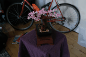
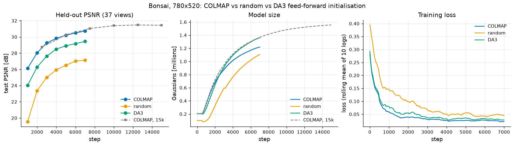
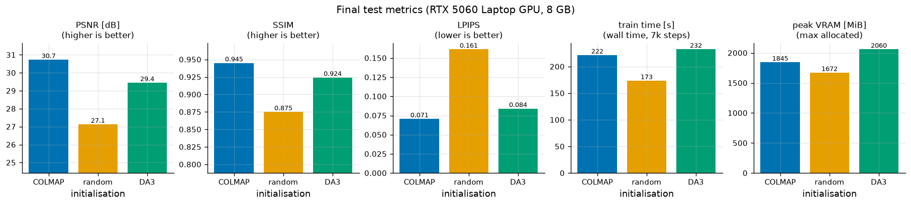
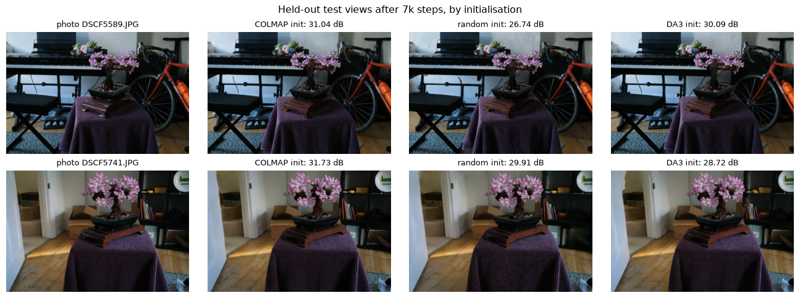
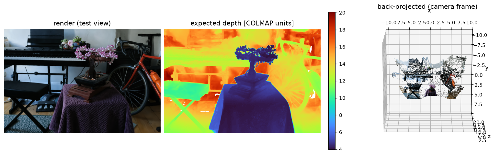
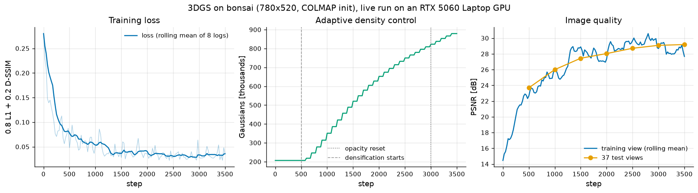
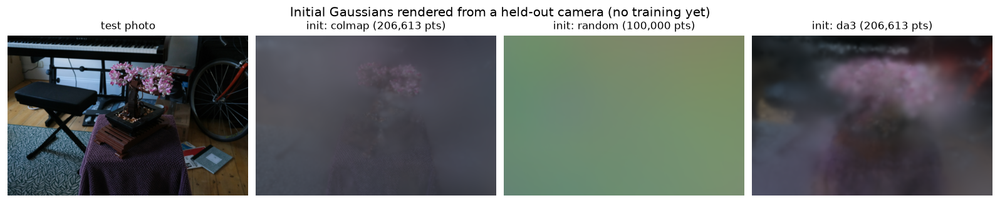
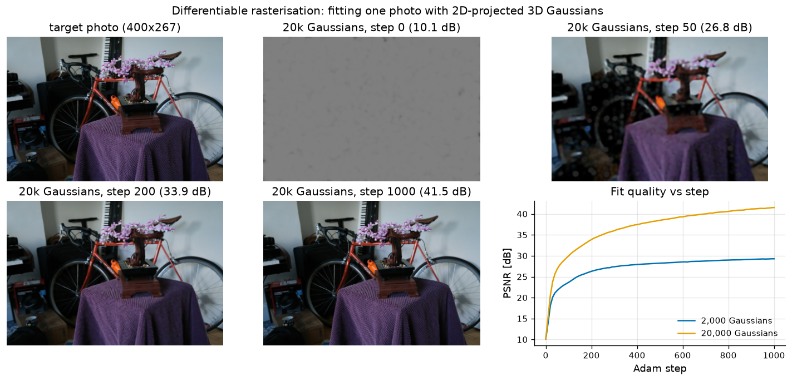
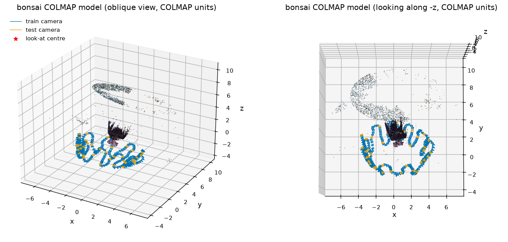

# 11 · Gaussian splatting (gsplat, COLMAP vs random vs feed-forward initialisation)

3D Gaussian Splatting (3DGS) represents a scene as a million or so anisotropic 3D Gaussians and
renders it by projecting each one to a 2D ellipse and alpha-compositing the ellipses front to back.
Every step is differentiable, so the Gaussians are fitted to posed photos by gradient descent, and
the trained model renders new viewpoints at around a hundred frames per second on a laptop GPU. For
robotics this gives photorealistic digital twins for simulation, dense depth from any viewpoint and
a compact map that can be re-rendered for localisation.

This project builds a compact trainer on [gsplat](https://github.com/nerfstudio-project/gsplat)'s
public API, trains it on the Mip-NeRF 360 **bonsai** scene on an 8 GB laptop GPU, and compares three
ways to initialise the Gaussians: COLMAP sparse points, uniform random points, and a **feed-forward**
point map predicted by Depth Anything 3 from unposed images.



## What you'll learn

- The 3DGS parameterisation (mean, log-scale, quaternion, logit-opacity, spherical-harmonic colour)
  and why $\Sigma = R S S^\top R^\top$ keeps every Gaussian valid under plain Adam.
- EWA splatting (the projected 2D covariance) and front-to-back alpha compositing, each
  re-implemented in numpy and checked against gsplat's CUDA kernels.
- The 3DGS training loop: L1 + D-SSIM loss, SH degree schedule, adaptive density control (clone,
  split, prune, opacity reset).
- COLMAP conventions with the official `pycolmap` (`cam_from_world` = gsplat `viewmats`, intrinsics
  rescaled to the training resolution) and the standard novel-view evaluation protocol
  (every 8th image held out; PSNR / SSIM / LPIPS).
- What initialisation buys you: SfM points vs random points vs a Depth Anything 3 point map that is
  Sim(3)-aligned to the COLMAP cameras (Umeyama).
- How to get dense depth and point clouds out of a splat model, how to export the standard `.ply`,
  and how to train on **your own phone capture**.

| notebook | content | runs in |
|---|---|---|
| [01_splatting_fundamentals](notebooks/01_splatting_fundamentals.ipynb) | one 3D Gaussian, EWA projection vs gsplat vs Monte Carlo, compositing in numpy vs gsplat, SH colour, fitting a photo with 2k / 20k Gaussians | ~10 s |
| [02_scene_and_training](notebooks/02_scene_and_training.ipynb) | COLMAP model with pycolmap, cameras + sparse points, DA3 point map and its alignment, the three initialisations rendered at step 0, a live 3,500-step training run with curves | ~2 min |
| [03_init_comparison_and_novel_views](notebooks/03_init_comparison_and_novel_views.ipynb) | the 7k-step runs for the three initialisations (+ a 15k reference), held-out views, per-view PSNR, rendered depth -> point cloud, orbit GIF, `.ply` check, own-capture path | ~20 s |

`scripts/splatkit.py` holds the reusable pieces (COLMAP loader, initialisations, trainer, evaluation,
PLY export, camera paths); `scripts/train.py` is the command-line trainer, and the notebooks load its
results from `results/*.json` and its checkpoints from `runs/11_gaussian_splatting/`.

## Theory primer

**Representation.** Each Gaussian $i$ has a mean $\boldsymbol\mu_i\in\mathbb R^3$, a covariance
$\Sigma_i = R(\mathbf q_i)\,S_i S_i^\top R(\mathbf q_i)^\top$ with $S_i = \operatorname{diag}(\mathbf s_i)$, an
opacity $o_i\in(0,1)$ and spherical-harmonic (SH) colour coefficients up to degree 3 (48 numbers),
so its colour can depend on the viewing direction $\mathbf d$:
$\mathbf c_i(\mathbf d) = \max\!\big(0, \tfrac12 + \sum_{\ell\le 3}\sum_m k_{i,\ell m} Y_{\ell m}(\mathbf d)\big)$.
The optimiser works on unconstrained raw values: $\log\mathbf s$, an unnormalised $\mathbf q$ and
$\operatorname{logit} o$.

**Projection (EWA splatting).** With the world-to-camera rotation $W$ and the mean in camera
coordinates $(x, y, z)$, the image-space covariance is the first-order approximation

$$\Sigma^{2D} = J W \Sigma W^\top J^\top,\qquad J = \begin{bmatrix} f_x/z & 0 & -f_x x/z^2 \\ 0 & f_y/z & -f_y y/z^2 \end{bmatrix}.$$

**Compositing.** For a pixel, the Gaussians overlapping its 16x16 tile are sorted by depth and

$$C = \sum_i \mathbf c_i\,\alpha_i\,T_i,\qquad \alpha_i = o_i\,e^{-\frac12\mathbf d_i^\top(\Sigma^{2D}_i)^{-1}\mathbf d_i},\qquad T_i = \prod_{j<i}(1-\alpha_j),$$

with $\mathbf d_i$ the pixel offset from the projected mean. The same weights give the expected depth
$\hat D = \sum_i z_i\alpha_i T_i / \sum_i \alpha_i T_i$.

**Training.** One random training view per step, loss
$\mathcal L = 0.8\,\lVert \hat I - I\rVert_1 + 0.2\,(1-\mathrm{SSIM}(\hat I, I))$, Adam per parameter group,
SH degree raised by one every 1000 steps, position learning rate decaying exponentially to 1%.
**Adaptive density control** (gsplat `DefaultStrategy`, every 100 steps from step 500 to 15000):
Gaussians with a large accumulated view-space positional gradient ($> 2\cdot10^{-4}$) are cloned
(small ones) or split (large ones); nearly transparent ($o<0.005$) or oversized ones are pruned; every
3000 steps all opacities are clamped to 0.01 so floaters must earn their opacity back.

**Initialisation.** Gaussians start isotropic with a radius equal to the mean distance to their three
nearest neighbours. The centres come from (a) COLMAP's triangulated points, (b) uniform random points
in a cube of half-size 3x the scene scale, or (c) a Depth Anything 3 point map: DA3 predicts depth and
camera poses for 32 *unposed* views in one forward pass; the predicted camera centres are aligned to
the COLMAP centres with the closed-form similarity (Umeyama)
$\min_{s,R,\mathbf t}\sum_i\lVert\mathbf c_i^{\text{COLMAP}} - (sR\,\mathbf c_i^{\text{DA3}} + \mathbf t)\rVert^2$,
and the confident back-projected pixels are mapped with the same $(s, R, \mathbf t)$.

**Evaluation.** $\mathrm{PSNR} = 10\log_{10}(1/\mathrm{MSE})$ for images in $[0, 1]$, SSIM
(11x11 Gaussian window) and LPIPS (AlexNet features, lower is better), averaged over the held-out
views. Training time excludes the periodic evaluation passes.

## How to run

All commands from the repository root, in the `cv` environment (RTX 5060 Laptop GPU, 8 GB).

```bash
# 1. extras: gsplat 1.5.3, torchmetrics, pycolmap and the import-time dependencies of Depth Anything 3.
#    gsplat JIT-compiles its CUDA extension on first use (see "gsplat on torch 2.11" below).
make setup-11_gaussian_splatting
bash scripts/setup_third_party.sh depth-anything-3

# 2. data + weights (idempotent): Mip-NeRF 360 bonsai from the Hugging Face mirror (pinned revision,
#    292 photos + sparse/0, ~373 MB) and a 780x520 copy of the photos in images_4/; DA3-BASE
#    (Hugging Face cache) and torchvision's AlexNet for LPIPS (weights/torch_hub)
make data-11_gaussian_splatting

# 3. feed-forward initialisation: DA3-BASE on 32 unposed training views -> Sim(3)-aligned point map
#    (runs/11_gaussian_splatting/da3_init/bonsai_da3.npz + results/da3_init.json; ~2 s of inference)
flock /tmp/cv-gpu.lock python projects/11_gaussian_splatting/scripts/make_da3_init.py

# 4. the initialisation study (7k steps each, about 3-4 min per run) and a 15k-step reference
#    (about 10 min). Each run writes results/<name>.json, runs/11_gaussian_splatting/<name>/ckpt.pt
#    and the standard 3DGS PLY outputs/11_gaussian_splatting/<name>.ply (250-350 MiB, gitignored)
flock /tmp/cv-gpu.lock python projects/11_gaussian_splatting/scripts/train.py --init colmap --steps 7000 --name colmap_7k
flock /tmp/cv-gpu.lock python projects/11_gaussian_splatting/scripts/train.py --init random --steps 7000 --name random_7k
flock /tmp/cv-gpu.lock python projects/11_gaussian_splatting/scripts/train.py --init da3 --steps 7000 --name da3_7k
flock /tmp/cv-gpu.lock python projects/11_gaussian_splatting/scripts/train.py --init colmap --steps 15000 --eval-every 2500 --name colmap_15k

# 5. the "own capture" path on 49 of the bonsai photos (SfM on the CPU, ~40 s), then 3k steps
python projects/11_gaussian_splatting/scripts/sfm_from_images.py --images data/mipnerf360/bonsai/images_4 --every 6 --out data/bonsai_sfm_demo
flock /tmp/cv-gpu.lock python projects/11_gaussian_splatting/scripts/train.py --scene-dir data/bonsai_sfm_demo --images images --init colmap --steps 3000 --name sfm_demo_3k

# 6. execute the three notebooks headless (2 min 12 s in total here)
make nb-11_gaussian_splatting

# 7. exercise solutions (GPU; figures and the fused point cloud go to outputs/11_gaussian_splatting/solutions/)
flock /tmp/cv-gpu.lock python projects/11_gaussian_splatting/solutions/ex01_fundamentals.py
flock /tmp/cv-gpu.lock python projects/11_gaussian_splatting/solutions/ex02_training.py
flock /tmp/cv-gpu.lock python projects/11_gaussian_splatting/solutions/ex03_novel_views.py
```

The trained `.ply` files use the layout of the original 3DGS code (`x y z`, `f_dc_*`, 45 `f_rest_*`,
`opacity` as a logit, `scale_*` as logs, `rot_*` as a wxyz quaternion; 236 bytes per Gaussian), so
they open in web viewers such as [SuperSplat](https://superspl.at/editor) or
[antimatter15/splat](https://antimatter15.com/splat/).

### Your own phone capture

1. Walk slowly around the object or room and record a video (or take 50-150 sharp photos), keeping
   lots of overlap between neighbouring views and avoiding motion blur, moving objects and pure
   rotations on the spot.
2. Run SfM with the official pycolmap (SIFT, matching, incremental mapping, undistortion to a
   PINHOLE camera; CPU). For a video, keep every N-th frame; `--matcher sequential` is much faster
   than exhaustive matching for long videos:

   ```bash
   python projects/11_gaussian_splatting/scripts/sfm_from_images.py --video path/to/clip.mp4 --every 10 --out data/my_scene
   # or a folder of photos:
   python projects/11_gaussian_splatting/scripts/sfm_from_images.py --images path/to/photos --out data/my_scene
   ```

   Check `data/my_scene/sfm_summary.json`: most frames should be registered and the mean
   reprojection error should be around 1 px or less.
3. Train on the undistorted images:

   ```bash
   flock /tmp/cv-gpu.lock python projects/11_gaussian_splatting/scripts/train.py --scene-dir data/my_scene --images images --init colmap --steps 7000 --name my_scene_7k
   ```

   For larger scenes or higher resolutions on 8 GB, add `--packed` (less VRAM) and/or lower
   `--max-gaussians`; resize the photos with `--max-side` in step 2.

Step 2 with `--images` was run here on every 6th bonsai photo (section 7 of notebook 03). The
`--video` branch was checked only on a 146-frame clip assembled from consecutive bonsai photos, not
on a real phone video (see Limitations).

### gsplat on torch 2.11 (no prebuilt wheel)

gsplat 1.5.3 has no wheel for torch 2.11 / CUDA 12.8, so its CUDA extension is compiled on first use
(54 s on this machine) and cached in `~/.cache/torch_extensions/<py-torch-cuda>/gsplat_cuda/`. The build needs
nvcc 12.8 and the CUDA development headers inside the env (the full `cuda-toolkit` metapackage did not
solve from the NVIDIA channel here, so the compiler set was installed on its own):

```bash
conda install -n cv -c nvidia/label/cuda-12.8.1 -c defaults cuda-nvcc=12.8 cuda-cudart-dev=12.8 cuda-cccl=12.8 libcublas-dev libcusparse-dev libcusolver-dev libcurand-dev cuda-nvrtc-dev=12.8 cuda-profiler-api=12.8
```

plus the toolkit headers on the host compiler's search path. `scripts/splatkit.py` sets
`CPATH=$CONDA_PREFIX/targets/x86_64-linux/include` and `LIBRARY_PATH=$CONDA_PREFIX/lib` before gsplat is
used; when you import gsplat yourself, export the two variables first. The cache is rebuilt whenever
the compile flags change (for example when `TORCH_CUDA_ARCH_LIST` is set in one shell and not in
another), so keep the environment consistent. An explicit build for sm_120:

```bash
export CUDA_HOME=$CONDA_PREFIX TORCH_CUDA_ARCH_LIST=12.0
export CPATH=$CONDA_PREFIX/targets/x86_64-linux/include LIBRARY_PATH=$CONDA_PREFIX/lib
flock /tmp/cv-gpu.lock python -c "from gsplat.cuda._backend import _C"
```

Running a project script afterwards in a shell *without* these exports rebuilt the cache once more
(again 54 s), because the generated compile flags differ; both builds work.

## Results

All numbers below are measured on an **NVIDIA RTX 5060 Laptop GPU (8 GB, sm_120)**, torch 2.11.0+cu128,
gsplat 1.5.3, bonsai at 780x520, 255 training / 37 test views (every 8th image held out).

### Initialisation study (notebook 03)

| run | initial points | final Gaussians | test PSNR [dB] | SSIM | LPIPS (alex) | train time [s] | peak VRAM [MiB] | render [FPS] | PLY [MiB] |
|---|---:|---:|---:|---:|---:|---:|---:|---:|---:|
| COLMAP points, 7k steps | 206,613 | 1,218,190 | 30.73 | 0.9451 | 0.0706 | 222 | 1845 | 118 | 274.2 |
| random points, 7k steps | 100,000 | 1,102,785 | 27.13 | 0.8751 | 0.1614 | 173 | 1672 | 145 | 248.2 |
| DA3 point map, 7k steps | 206,613 | 1,360,050 | 29.45 | 0.9243 | 0.0841 | 232 | 2060 | 103 | 306.1 |
| COLMAP points, 15k steps | 206,613 | 1,555,965 | 31.44 | 0.9416 | 0.0656 | 621 | 2351 | 82 | 350.2 |
| own capture (49 photos, own SfM), 3k steps | 12,868 | 540,877 | 21.70 | 0.7517 | 0.2883 | 42 | 826 | 260 | 121.7 |

Initial points are the SfM points (COLMAP), 100k uniform points in a cube of half-size 3x the scene
scale (random), or the DA3 point map subsampled to the SfM point count. All runs use the same cameras,
hyper-parameters and seed. Render speed is one 780x520 frame of the final model, timed with CUDA
synchronisation. Training time excludes the evaluation passes. The own-capture row is not comparable
with the others: 42 training / 7 test views of its own SfM model, and 3k steps.







- **COLMAP points win** at 7k steps (30.73 dB / 0.9451 / 0.0706). The
  **DA3 feed-forward point map** reaches 27.13 dB (-3.60 dB) and
  **random points** 29.45 dB (-1.28 dB); the random run is behind
  at every evaluation step.
- The DA3 run still trains with the **COLMAP poses**; only its initial points come from DA3
  (DA3-BASE, 32 unposed views at 504x336, 2.1 s inference, 3079 MiB
  peak VRAM). After the Sim(3) alignment its camera centres are within
  2.56% of the scene scale of COLMAP's (RMSE) and its rotations within
  1.49 deg (median; max 3.97 deg).
- The DA3 run ends with more Gaussians (1,102,785 vs 1,218,190), so it
  needs more VRAM and renders slower than the COLMAP run.
- 15k steps add +0.71 dB PSNR and -0.0050 LPIPS
  over 7k but change SSIM by -0.0035, at 2.8x
  the training time. Peak VRAM never exceeds 2351 MiB.
- Run-to-run noise: training `da3_7k` twice from the same inputs gave 29.58 dB and
  27.13 dB (gsplat's backward pass uses atomic adds, so 3DGS training is not
  bit-reproducible). Differences of about 0.1 dB are noise.

### Rendered depth, novel views and the exported PLY (notebook 03)



Rendering RGB + expected depth from a held-out camera and back-projecting the pixels with
accumulated opacity > 0.5 gives 101,057 points from one 780x520 render
(stride 2). The 60-frame orbit at the top of this page uses poses that are not in the dataset and
renders at 123 FPS (8.14 ms/frame at 780x520).
Reading `colmap_7k.ply` back reproduces the checkpoint exactly (max difference 0.0e+00 for the
positions, 0.0e+00 for the opacity logits).

### Live training run (notebook 02)



3,500 steps from the COLMAP points inside the notebook: 879,174 Gaussians, test PSNR
29.18 dB, SSIM 0.9272, LPIPS 0.0960, 84.6 s, peak VRAM
1362 MiB.



### Fundamentals (notebook 01)

| check / experiment | result |
|---|---|
| EWA 2D covariance, numpy vs gsplat kernel | max relative difference 5.4e-07 |
| front-to-back compositing, numpy vs gsplat rasteriser | max abs difference 1.3e-07 (RGB), 1.5e-07 (alpha) |
| fit one 400x267 photo, 2,000 Gaussians, 1000 Adam steps | 29.29 dB PSNR, 1.3 s, 10 MiB peak VRAM |
| fit one 400x267 photo, 20,000 Gaussians, 1000 Adam steps | 41.53 dB PSNR, 1.7 s, 15 MiB peak VRAM |



### Own-capture path

`sfm_from_images.py` on every 6th bonsai photo (49 images, 780x520, none of the dataset's COLMAP
data used) registered 49 / 49 images with 12,868 points
and a mean reprojection error of 0.304 px in
37 s on the CPU; 3k training steps then gave 21.70 dB on
its 7 test views. Incremental mapping is multi-threaded and not deterministic, so a re-run of the
same command can register a different number of images and points.



## Limitations

- **One scene, reduced resolution, short schedules.** Everything is measured on bonsai (indoor,
  object-centred) at 780x520, 4x below the full 3118x2078 COLMAP camera, with 7k and 15k steps. The
  3DGS paper evaluates indoor Mip-NeRF 360 scenes at 2x downscaling after 30k steps, and papers
  differ in the LPIPS backbone (AlexNet here), so the numbers here are not comparable with published
  tables. Larger outdoor scenes would need `--packed`, a Gaussian cap or a lower resolution on 8 GB.
- **The feed-forward run is not pose-free.** `da3_7k` takes only its initial points from Depth
  Anything 3; it trains with the COLMAP cameras, and the DA3 points are put into the COLMAP frame
  with a Sim(3) fitted to the COLMAP camera centres of the same 32 views. Training with DA3's own
  poses (a fully SfM-free pipeline) was not tested. DA3's confidence filter also drops most of the far
  background, so its point map covers the room behind the bonsai only sparsely.
- **Random initialisation depends on its box.** The cube of half-size 3x the scene scale follows
  gsplat's default; a tighter or looser box changes the result.
- **Not bit-reproducible.** gsplat's backward pass uses atomic adds, so two identical training runs
  differ by about 0.1 dB (29.58 vs 29.45 dB for `da3_7k`), and pycolmap's multi-threaded incremental
  mapping is not deterministic either.
- **Interpolation, not extrapolation.** The 1-in-8 split holds out views that lie between training
  views on the same capture loop. Novel viewpoints far from the capture (the orbit GIF, a robot
  driving somewhere new) are visibly worse than the test PSNR suggests.
- **Depth has no metric scale.** COLMAP and therefore the splat model and its rendered depth are in
  arbitrary units; robotics use needs a scale from a known distance, a fiducial (project 07) or metric
  depth (project 08).
- **Plain 3DGS only.** No anti-aliased rasterisation, exposure compensation, camera-pose refinement,
  MCMC densification or compression; the trainer uses gsplat's `DefaultStrategy` with its default
  thresholds. The exported PLYs are 120-350 MiB (236 bytes per Gaussian) and stay in the gitignored
  `outputs/`.
- **Own-capture path.** It was run on 49 photos of the same bonsai scene, not on a phone. The
  `--video` branch was only checked on a 146-frame, 10 fps clip assembled from consecutive bonsai
  photos: with `--matcher sequential`, every 3rd frame registered 48 / 49 frames (8,870 points,
  0.272 px) but every 6th frame only 14 / 25 (1,095 points), so keep enough overlap between the
  sampled frames.
- **gsplat build.** gsplat 1.5.3 has no wheel for torch 2.11, so its CUDA extension is JIT-compiled;
  a change in compile flags (for example `TORCH_CUDA_ARCH_LIST` set in one shell but not another)
  triggers a rebuild, which fails without the CUDA headers on `CPATH` (see "How to run").

## Model & dataset licenses

| component | kind | license | notes |
|---|---|---|---|
| [gsplat](https://github.com/nerfstudio-project/gsplat) 1.5.3 | library | Apache-2.0 | CUDA extension JIT-compiled locally |
| [pycolmap / COLMAP](https://github.com/colmap/colmap) 4.2.1 | library | BSD-3-Clause | official bindings (CPU wheel) |
| [torchmetrics](https://github.com/Lightning-AI/torchmetrics) 1.9.0 | library | Apache-2.0 | PSNR, SSIM and LPIPS |
| LPIPS linear calibration weights (bundled in torchmetrics, from [PerceptualSimilarity](https://github.com/richzhang/PerceptualSimilarity)) | model | BSD-2-Clause | |
| [torchvision AlexNet](https://pytorch.org/vision/stable/models/generated/torchvision.models.alexnet.html) ImageNet weights | model | BSD-3-Clause (torchvision); trained on ImageNet | ImageNet's terms restrict the images to non-commercial research; the weights' status is commonly treated as **unclear** |
| [DA3-BASE](https://huggingface.co/depth-anything/DA3-BASE) weights | model | Apache-2.0 | |
| [Depth Anything 3 code](https://github.com/ByteDance-Seed/Depth-Anything-3) @3d835ec | code | Apache-2.0 | pinned clone in gitignored `third_party/`, imported from source |
| [evo](https://github.com/MichaelGrupp/evo) 1.38.1, [plyfile](https://github.com/dranjan/python-plyfile) 1.1.5 | library | GPL-3.0 | **copyleft**; import-time dependencies of `depth_anything_3.api`, used unmodified |
| jaxtyping, rich, ninja, einops, safetensors, omegaconf, addict, trimesh, imageio | library | MIT / Apache-2.0 / BSD | gsplat and DA3 dependencies |
| [Mip-NeRF 360](https://jonbarron.info/mipnerf360/) bonsai (via the [nvs-bench/mipnerf360](https://huggingface.co/datasets/nvs-bench/mipnerf360) mirror) | dataset | **unclear**: the mirror's card says MIT; the original release states no license | downloaded locally, not redistributed (only renders and figures in `assets/`); cite Barron et al. 2022 |

## References

- B. Kerbl, G. Kopanas, T. Leimkühler, G. Drettakis. *3D Gaussian Splatting for Real-Time Radiance
  Field Rendering.* SIGGRAPH (ACM TOG) 2023. [arXiv:2308.04079](https://arxiv.org/abs/2308.04079) ·
  [github.com/graphdeco-inria/gaussian-splatting](https://github.com/graphdeco-inria/gaussian-splatting)
- V. Ye, R. Li, J. Kerr, M. Turkulainen, B. Yi, Z. Pan, O. Seiskari, J. Ye, J. Hu, M. Tancik,
  A. Kanazawa. *gsplat: An Open-Source Library for Gaussian Splatting.* 2024.
  [arXiv:2409.06765](https://arxiv.org/abs/2409.06765) ·
  [github.com/nerfstudio-project/gsplat](https://github.com/nerfstudio-project/gsplat)
- M. Zwicker, H. Pfister, J. van Baar, M. Gross. *EWA Splatting.* IEEE TVCG 8(3), 2002.
  [doi:10.1109/TVCG.2002.1021576](https://doi.org/10.1109/TVCG.2002.1021576)
- J. T. Barron, B. Mildenhall, D. Verbin, P. P. Srinivasan, P. Hedman. *Mip-NeRF 360: Unbounded
  Anti-Aliased Neural Radiance Fields.* CVPR 2022. [arXiv:2111.12077](https://arxiv.org/abs/2111.12077) ·
  [project page](https://jonbarron.info/mipnerf360/)
- H. Lin et al. *Depth Anything 3: Recovering the Visual Space from Any Views.* 2025.
  [arXiv:2511.10647](https://arxiv.org/abs/2511.10647) ·
  [github.com/ByteDance-Seed/Depth-Anything-3](https://github.com/ByteDance-Seed/Depth-Anything-3)
- J. L. Schönberger, J.-M. Frahm. *Structure-from-Motion Revisited.* CVPR 2016.
  [paper](https://openaccess.thecvf.com/content_cvpr_2016/html/Schonberger_Structure-From-Motion_Revisited_CVPR_2016_paper.html) ·
  [github.com/colmap/colmap](https://github.com/colmap/colmap)
- S. Umeyama. *Least-squares estimation of transformation parameters between two point patterns.*
  IEEE TPAMI 13(4), 1991. [doi:10.1109/34.88573](https://doi.org/10.1109/34.88573)
- Z. Wang, A. C. Bovik, H. R. Sheikh, E. P. Simoncelli. *Image Quality Assessment: From Error
  Visibility to Structural Similarity.* IEEE TIP 13(4), 2004. [doi:10.1109/TIP.2003.819861](https://doi.org/10.1109/TIP.2003.819861)
- R. Zhang, P. Isola, A. A. Efros, E. Shechtman, O. Wang. *The Unreasonable Effectiveness of Deep
  Features as a Perceptual Metric (LPIPS).* CVPR 2018. [arXiv:1801.03924](https://arxiv.org/abs/1801.03924)
