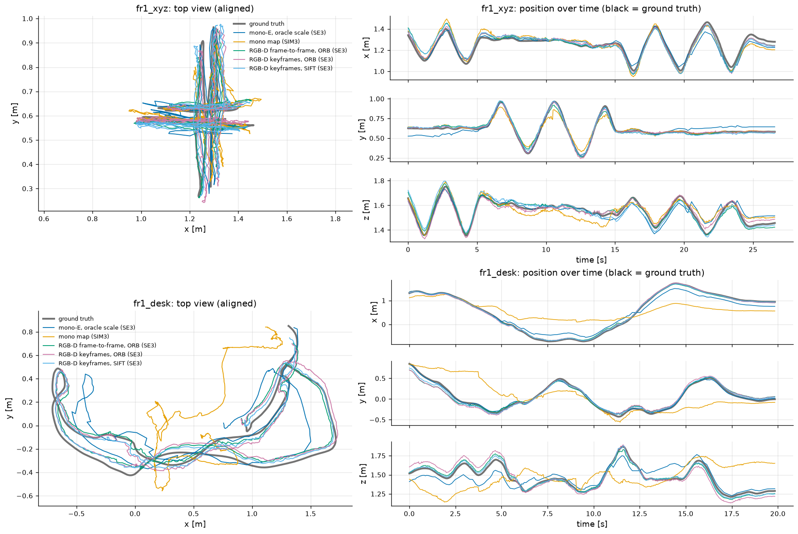
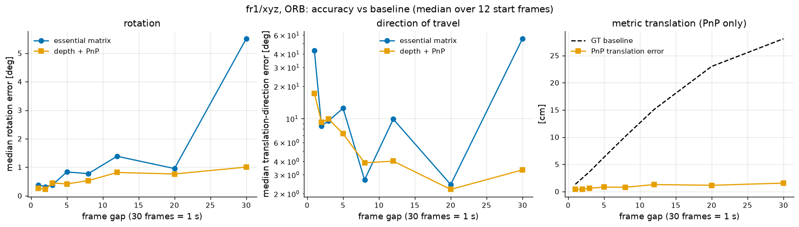
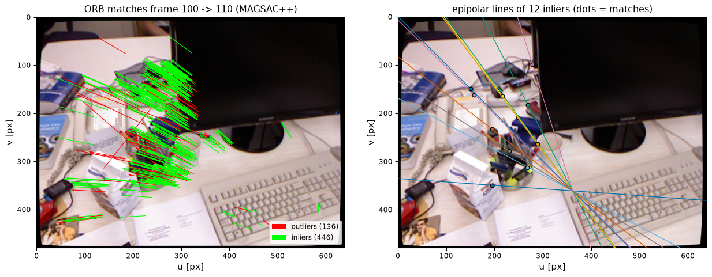
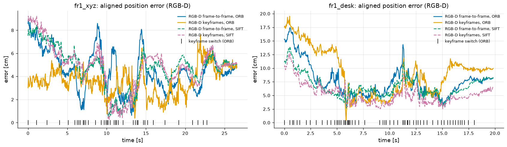
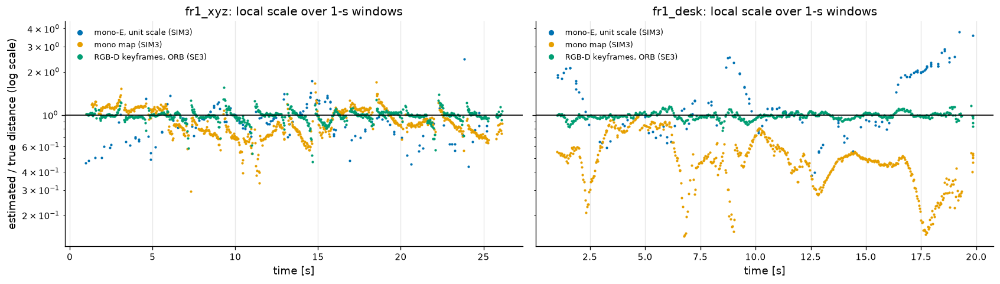
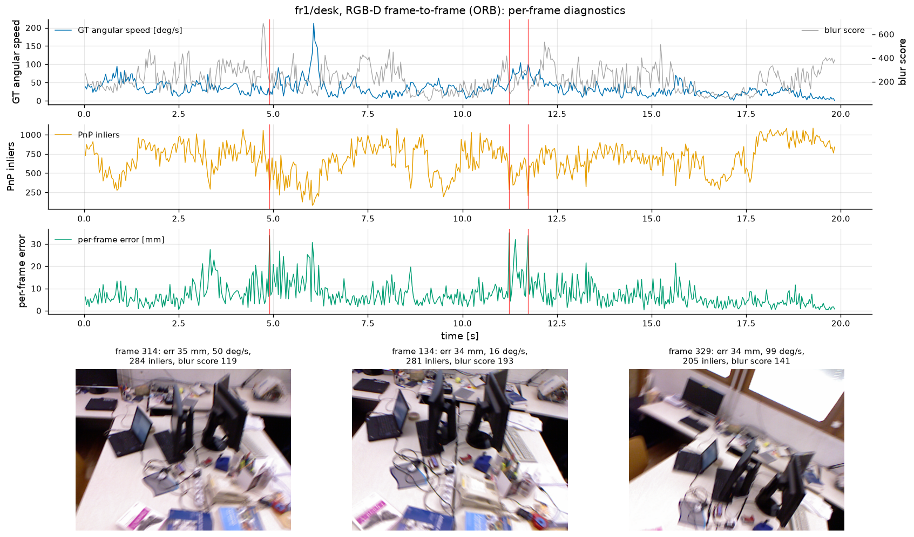
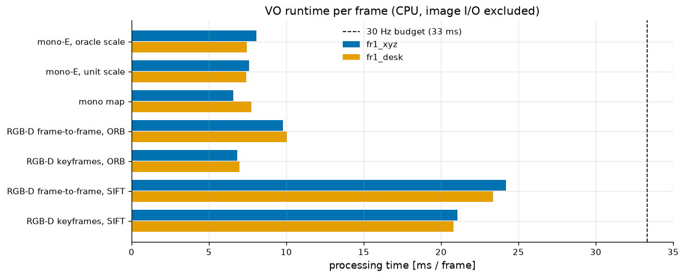

# 12 · Visual odometry

Feature-based visual odometry (VO) built from OpenCV primitives and evaluated against motion-capture ground truth on two TUM RGB-D sequences. The project implements monocular **2D-2D** VO (essential matrix), **RGB-D 3D-2D** VO (depth + PnP, frame-to-frame and keyframe-based) and a small **monocular map** (triangulation + PnP). It scores them with ATE and RPE (cross-checked against `evo`) and takes apart drift, scale and failure cases on a fast hand-held sequence. Everything runs on the CPU, and no learned model is used.



## What you'll learn

- Why TUM **fr1** images must be undistorted, and how to undistort only the keypoints (and look depth up at the raw pixel).
- ORB vs SIFT features, Lowe's ratio test, and what the front end costs per frame.
- The **epipolar constraint** $\hat x_2^\top E \hat x_1 = 0$, Nistér's 5-point solver inside RANSAC / MAGSAC++, `recoverPose`'s cheirality check, and why **monocular translation has no scale**.
- **PnP** (EPnP-RANSAC + Levenberg-Marquardt) on depth-back-projected keypoints for metric motion, and how much baseline each method needs.
- How relative motions are **chained** into a trajectory and why the errors accumulate (**drift**). Also frame-to-frame vs **keyframe** tracking.
- Monocular **scale drift**: the relative-scale trick, rotation-compensated (translational) parallax, and why real systems need bundle adjustment.
- Trajectory evaluation done right: Umeyama **SE(3) / Sim(3)** alignment, **ATE** RMSE, **RPE** per second, drift in % of distance, coverage, and the same numbers from `evo`.
- How to diagnose failures frame by frame (angular speed, PnP inliers, blur proxy).

## Theory primer

**Camera and distortion.** Pinhole projection $u = f_x X/Z + c_x$, $v = f_y Y/Z + c_y$. The fr1 RGB camera adds Brown-Conrady distortion ($k_1 = 0.2624$, $k_2 = -0.9531$, $p_1 = -0.0054$, $p_2 = 0.0026$, $k_3 = 1.1633$). Keypoints are detected on the raw image and mapped to ideal pinhole pixels with `cv2.undistortPoints(..., P=K)` (20 fixed-point iterations) before any geometry.

**Monocular 2D-2D.** For normalised matches $\hat x = K^{-1}(u, v, 1)^\top$ and motion $X_2 = R X_1 + t$:
$$\hat x_2^\top E\, \hat x_1 = 0, \qquad E = [t]_\times R .$$
$E$ has 5 DoF (rotation + direction of $t$), so $\lVert t \rVert$ is unobservable. `cv2.findEssentialMat` (5-point + RANSAC or MAGSAC++) and `cv2.recoverPose` (picks the one of four $(R, \pm t)$ pairs with the points in front of both cameras) give $R$ and a unit $t$.

**RGB-D 3D-2D.** With depth $z$ (Kinect, registered to RGB, `value / 5000` m) a keypoint becomes $X_r = z\,K^{-1}(u, v, 1)^\top$ in the reference camera. PnP finds the current pose:
$$\min_{R,t} \sum_i \rho\left(\lVert \pi\left(K (R X_{r,i} + t)\right) - x_{c,i} \rVert^2\right)$$
(`cv2.solvePnPRansac` with EPnP, 3 px threshold, then `cv2.solvePnPRefineLM`). The scale comes from the sensor.

**Chaining and drift.** With $T_{cr}$ mapping reference-frame points into the current camera, the new pose is $T_{wc} = T_{wr}\,T_{cr}^{-1}$. Frame-to-frame VO composes one noisy estimate per frame. A keyframe tracker keeps matching against the same reference until it has fewer than 150 PnP inliers, so it composes far fewer estimates. Each frame, though, inherits its keyframe's error.

**Monocular map.** Initialise from $E$ (baseline length 1), triangulate, track with PnP, and triangulate new points at keyframes. Keyframes are triggered by *translational* parallax: image motion after removing rotation with $H_\infty = K R K^{-1}$. New points are rescaled to the existing map with $s = \mathrm{median}(z_\text{map} / z_\text{tri})$ (relative scale). Without bundle adjustment the scale still **drifts**.

**Evaluation.** Umeyama alignment $(s, R, t) = \arg\min \sum_i \lVert g_i - (s R p_i + t) \rVert^2$, with $s = 1$ (SE(3)) for metric pipelines and free $s$ (Sim(3)) for monocular ones.
- **ATE** = RMSE of the aligned position errors.
- **RPE** over $\Delta = 1$ s: $E_i = (Q_i^{-1} Q_{i+\Delta})^{-1}(P_i^{-1} P_{i+\Delta})$ (ground truth $Q$, estimate $P$), reported as translational RMSE [cm] and rotational RMSE [deg].
- **Drift** = RPE translation / mean distance travelled per second.
- **Coverage** = fraction of frames with a pose. The mono-E pipelines output keyframes only.

## How to run

All commands below were run in this repository (conda env `cv`). The project is CPU-only: no weights, no GPU work. The notebooks still hold the shared GPU lock, because the setup cell prints the device summary.

```bash
# 1. extras: evo 1.38.1 (GPL-3.0, used only for evaluation); everything else is in base.txt
make setup-12_visual_odometry

# 2. data: TUM RGB-D fr1/xyz (~0.45 GB) and fr1/desk (~0.34 GB) into data/tum/ (idempotent)
make data-12_visual_odometry

# 3. one VO run from the command line -> runs/12_visual_odometry/<seq>_<method>_<feature>.txt (TUM format)
#    methods: rgbd-f2f, rgbd-kf, mono-gt (oracle scale), mono-unit, mono-map
python projects/12_visual_odometry/scripts/run_vo.py --sequence fr1_xyz --method rgbd-kf
python projects/12_visual_odometry/scripts/run_vo.py --sequence fr1_desk --method mono-unit --feature sift

# 4. independent check with the evo CLI (prints APE rmse 0.037909 m, identical to run_vo.py)
evo_ape tum data/tum/fr1_xyz/rgbd_dataset_freiburg1_xyz/groundtruth.txt runs/12_visual_odometry/fr1_xyz_rgbd-kf_orb.txt -a

# 5. execute both notebooks headless (writes results/*.json|csv and assets/12_visual_odometry/*.png)
make nb-12_visual_odometry

# 6. exercise solutions (run from the repository root) and the CPU unit tests
python projects/12_visual_odometry/solutions/ex1_1_ransac_vs_magsac.py
python projects/12_visual_odometry/solutions/ex1_2_ignore_distortion.py
python projects/12_visual_odometry/solutions/ex1_3_ratio_test.py
python projects/12_visual_odometry/solutions/ex2_1_klt_frontend.py
python projects/12_visual_odometry/solutions/ex2_2_keyframe_threshold.py
python projects/12_visual_odometry/solutions/ex2_3_feature_budget.py
python -m pytest -q tests/test_p12_visual_odometry.py
```

| Notebook | Content |
|---|---|
| [`01_two_view_motion.ipynb`](notebooks/01_two_view_motion.ipynb) | TUM data and distortion, ORB vs SIFT, essential matrix (RANSAC vs MAGSAC++) with epipolar lines, depth + PnP, accuracy vs baseline, chaining three pipelines on fr1/xyz, ATE/RPE with the `evo` cross-check |
| [`02_rgbd_vo_drift_failures.ipynb`](notebooks/02_rgbd_vo_drift_failures.ipynb) | Motion profiles, 7 pipelines x 2 sequences, keyframes vs frame-to-frame, monocular scale drift, per-frame failure diagnosis on fr1/desk, runtime, summary |

Code: [`scripts/vo.py`](scripts/vo.py) (front end, essential matrix, PnP, triangulation, the three pipeline types, ATE/RPE/`evo` evaluation) is shared by the notebooks, the CLI [`scripts/run_vo.py`](scripts/run_vo.py), the [solutions](solutions/) and the unit tests. The tests use [`scripts/synthetic.py`](scripts/synthetic.py), a ray-cast RGB-D sequence inside a textured box with exact depth and poses.

## Results

Hardware: Intel Core Ultra 9 275HX (OpenCV 5.0.0 using 24 threads). The machine also has an NVIDIA RTX 5060 Laptop GPU (8 GB), but this project does not use it (no CUDA work, so no VRAM). Ground truth is the TUM motion-capture trajectory. Each run starts at the first ground-truth pose. Metric pipelines are SE(3)-aligned, monocular ones Sim(3)-aligned. `ms/frame` is the mean processing time per input frame (detection, matching, undistortion, depth lookup, pose), excluding reading the RGB PNG. The CPU was shared with other jobs during the runs, so timings vary between executions. Every ATE was recomputed with `evo` and agreed (asserted in notebook 02). Source: [`results/vo_metrics.csv`](results/vo_metrics.csv) / [`.json`](results/vo_metrics.json).

| Sequence | Pipeline | Align | ATE [cm] | RPE 1 s [cm] | RPE 1 s [deg] | Drift [%] | Coverage [%] | Keyframes | ms/frame |
|---|---|---|---|---|---|---|---|---|---|
| fr1/xyz | mono-E, oracle scale | SE3 | 6.41 | 4.45 | 2.53 | 14.75 | 22.53 | 177 | 8.08 |
| fr1/xyz | mono-E, unit scale | SIM3 | 6.52 | 7.60 | 2.53 | 25.22 | 22.53 | 177 | 7.61 |
| fr1/xyz | mono map | SIM3 | 7.72 | 8.49 | 3.92 | 28.18 | 99.11 | 72 | 6.58 |
| fr1/xyz | RGB-D frame-to-frame, ORB | SE3 | 4.82 | 3.20 | 1.67 | 10.61 | 100.00 | 790 | 9.78 |
| fr1/xyz | RGB-D keyframes, ORB | SE3 | 3.79 | 2.23 | 1.32 | 7.41 | 100.00 | 39 | 6.81 |
| fr1/xyz | RGB-D frame-to-frame, SIFT | SE3 | 5.09 | 2.09 | 1.15 | 6.93 | 100.00 | 790 | 24.19 |
| fr1/xyz | RGB-D keyframes, SIFT | SE3 | 5.17 | 2.17 | 1.26 | 7.21 | 100.00 | 118 | 21.06 |
| fr1/desk | mono-E, oracle scale | SE3 | 19.14 | 11.96 | 5.44 | 25.48 | 27.57 | 157 | 7.46 |
| fr1/desk | mono-E, unit scale | SIM3 | 39.79 | 24.83 | 5.44 | 52.91 | 27.57 | 157 | 7.42 |
| fr1/desk | mono map | SIM3 | 69.91 | 37.79 | 20.75 | 80.51 | 99.13 | 91 | 7.74 |
| fr1/desk | RGB-D frame-to-frame, ORB | SE3 | 8.18 | 4.05 | 2.56 | 8.64 | 100.00 | 573 | 10.05 |
| fr1/desk | RGB-D keyframes, ORB | SE3 | 10.11 | 4.22 | 2.26 | 8.99 | 100.00 | 62 | 6.99 |
| fr1/desk | RGB-D frame-to-frame, SIFT | SE3 | 7.01 | 3.27 | 2.01 | 6.96 | 100.00 | 573 | 23.34 |
| fr1/desk | RGB-D keyframes, SIFT | SE3 | 5.59 | 2.89 | 1.82 | 6.16 | 100.00 | 185 | 20.82 |

Sequence facts (ground truth at the associated frames): fr1/xyz has 790 frames over 26.57 s with a mean speed of 0.30 m/s and a mean rotation rate of 17.29 deg/s. fr1/desk has 573 frames over 19.84 s, 0.47 m/s and 34.00 deg/s (smoothed peak 152.27 deg/s).

**Two-view geometry** (notebook 01, fr1/xyz frames 100 → 110, 13.9 cm and 4.30 deg of true motion). MAGSAC++ recovers the rotation to 0.588 deg and the translation *direction* to 2.428 deg, but $\lVert t \rVert$ is always 1. Depth + PnP gives a metric translation of 0.137 m (truth 0.139 m), a 0.751 cm error. Across 12 start frames, the essential matrix's direction error is 43.27 deg (median) at a 1-frame gap and 55.45 deg at a 30-frame gap. By then the median number of ratio-test matches has dropped from 1332 to 184.5. PnP's metric translation error stays between 0.39 and 1.55 cm at all gaps.





**Keyframes vs frame-to-frame (RGB-D).** Keyframes helped ORB on fr1/xyz (3.79 vs 4.82 cm ATE with 39 instead of 790 compositions) and SIFT on fr1/desk (5.59 vs 7.01 cm), but hurt ORB on fr1/desk (10.11 vs 8.18 cm). The keyframe-threshold sweep (exercise 2) shows how sensitive this is: on fr1/desk the ATE varies between 6.24 and 11.37 cm over thresholds of 50-400 inliers, and not monotonically.



**Monocular scale.** With unit-length keyframe steps plus a single Sim(3) scale, fr1/xyz comes out almost as good as the oracle (6.52 vs 6.41 cm). Keyframes are triggered at a fixed 20 px parallax over a desk at nearly constant depth, so steps are similar in length. On fr1/desk this breaks (39.79 vs 19.14 cm). The monocular map tracks 99 % of the frames on both sequences. On fr1/xyz its local scale over 1-s windows stays between 0.68 and 1.14 (10th-90th percentile, ATE 7.72 cm). On fr1/desk it fails: the local scale wanders between 0.25 and 0.82 (median 0.49; part of that offset comes from the least-squares Sim(3) fit shrinking a wrongly shaped trajectory), and the rotation drifts by 20.75 deg per second.



**Failure cases** (fr1/desk, RGB-D frame-to-frame, ORB). The per-frame error correlates with the angular speed (Spearman 0.34) and with few PnP inliers (-0.44). The variance-of-Laplacian blur score shows no correlation (-0.01), because it mixes blur with texture. The worst frame (314) has a 35.0 mm single-frame error at 50.1 deg/s, and all three worst frames are visibly smeared by motion blur, so the weak correlation reflects the proxy rather than an absence of blur.



**Runtime.** In this execution every pipeline stayed within the 33 ms budget of a 30 Hz camera. The ORB-based pipelines took 6.58-10.05 ms per frame and the SIFT-based ones 20.82-24.19 ms. Detection is the largest single cost: 4.1 ms for 2000 ORB keypoints vs 20.2 ms for SIFT on one 640x480 frame (notebook 01).



**Exercise findings** (from the [solutions](solutions/), same machine):

- MAGSAC++ vs plain RANSAC on 50 pairs with a 10-frame gap: median rotation error 0.658 vs 1.334 deg and direction error 3.908 vs 9.244 deg. MAGSAC++ failed on 2 of the 50 pairs, RANSAC on none (`ex1_1`).
- Skipping undistortion on fr1/xyz (RGB-D frame-to-frame) *lowers* the ATE (4.407 vs 4.824 cm) but raises the RPE (3.561 vs 3.198 cm and 2.084 vs 1.670 deg per second), so judging by one metric is risky (`ex1_2`).
- A KLT optical-flow front end with forward-backward check has a lower RPE than ORB matching on both sequences (2.38 vs 3.20 cm on fr1/xyz, 3.46 vs 4.05 cm on fr1/desk). Its ATE is higher on fr1/xyz (6.35 vs 4.82 cm) and lower on fr1/desk (7.77 vs 8.18 cm) (`ex2_1`).
- ORB feature budget on fr1/desk (keyframe tracker): 250 features lose track on 18 frames (ATE 13.58 cm). 1000 features gave the lowest ATE (5.36 cm), lower than 2000 (10.11 cm) (`ex2_3`).

## Limitations

- **No bundle adjustment, no loop closure, no relocalisation.** This is odometry, so the errors only accumulate. The monocular map fails on fr1/desk (69.91 cm Sim(3) ATE), and real monocular systems (ORB-SLAM, DSO) add local bundle adjustment for this reason.
- **Tuned and tested on the same data.** Thresholds (ratio test, 3 px PnP threshold, 150-inlier keyframe rule, parallax limits, depth-edge filter) were chosen by hand on these two sequences. There is no held-out sequence, and exercises 2 and 3 show that ATE differences of a few centimetres between pipelines are within the sensitivity to such parameters.
- **Monocular map, development note.** An earlier version triangulated new points directly with the PnP baseline and seeded re-initialisations with the last keyframe step. Its map scale collapsed on fr1/xyz (17.14 cm ATE). The relative-scale rescaling, translational parallax and depth-seeded re-initialisation in `vo.py` fixed fr1/xyz (7.72 cm) but not fr1/desk.
- **Mono-E pipelines output keyframe poses only** (22.53 % / 27.57 % coverage), so their ATE/RPE are computed over fewer poses than the RGB-D runs. The oracle-scale variant copies step lengths from ground truth and is an illustration, not a usable method.
- **Short indoor sequences** (26.6 s and 19.8 s) of one Kinect v1 in one office. KITTI (outdoor, driving) was not used: the full odometry image set is login-gated and far larger than the 2 GB download budget.
- **Single runs, shared CPU.** Each pipeline runs once per sequence (deterministic given the seeds). Timings come from one run on a machine shared with other jobs.

## Model & dataset licenses

| Component | Kind | License | Notes |
|---|---|---|---|
| [TUM RGB-D benchmark](https://cvg.cit.tum.de/data/datasets/rgbd-dataset) (fr1/xyz, fr1/desk) | dataset | CC BY 4.0 | cite Sturm et al., IROS 2012 |
| [OpenCV](https://github.com/opencv/opencv) 5.0 (ORB, SIFT, findEssentialMat/USAC, solvePnPRansac, LK flow) | library | Apache-2.0 | SIFT's patent expired in 2020; it is part of the main OpenCV package |
| [evo](https://github.com/MichaelGrupp/evo) 1.38.1 | library | **GPL-3.0** (copyleft) | used only as an evaluation tool / test dependency, not in the VO code path |
| NumPy, SciPy, pandas, matplotlib | library | BSD-3-Clause / matplotlib license | core stack |

No learned models or weights are used.

## References

- D. Scaramuzza, F. Fraundorfer. *Visual Odometry: Part I - The First 30 Years and Fundamentals.* IEEE RAM 2011. [doi:10.1109/MRA.2011.943233](https://doi.org/10.1109/MRA.2011.943233). *Part II - Matching, Robustness, Optimization, and Applications.* IEEE RAM 2012. [doi:10.1109/MRA.2012.2182810](https://doi.org/10.1109/MRA.2012.2182810)
- D. Nistér. *An efficient solution to the five-point relative pose problem.* TPAMI 2004. [doi:10.1109/TPAMI.2004.17](https://doi.org/10.1109/TPAMI.2004.17)
- D. Barath, J. Noskova, M. Ivashechkin, J. Matas. *MAGSAC++, a fast, reliable and accurate robust estimator.* CVPR 2020. [arXiv:1912.05909](https://arxiv.org/abs/1912.05909)
- V. Lepetit, F. Moreno-Noguer, P. Fua. *EPnP: An Accurate O(n) Solution to the PnP Problem.* IJCV 2009. [doi:10.1007/s11263-008-0152-6](https://doi.org/10.1007/s11263-008-0152-6)
- E. Rublee, V. Rabaud, K. Konolige, G. Bradski. *ORB: An efficient alternative to SIFT or SURF.* ICCV 2011. [doi:10.1109/ICCV.2011.6126544](https://doi.org/10.1109/ICCV.2011.6126544)
- D. G. Lowe. *Distinctive Image Features from Scale-Invariant Keypoints.* IJCV 2004. [doi:10.1023/B:VISI.0000029664.99615.94](https://doi.org/10.1023/B:VISI.0000029664.99615.94)
- J. Shi, C. Tomasi. *Good Features to Track.* CVPR 1994. [doi:10.1109/CVPR.1994.323794](https://doi.org/10.1109/CVPR.1994.323794)
- S. Umeyama. *Least-squares estimation of transformation parameters between two point patterns.* TPAMI 1991. [doi:10.1109/34.88573](https://doi.org/10.1109/34.88573)
- J. Sturm, N. Engelhard, F. Endres, W. Burgard, D. Cremers. *A Benchmark for the Evaluation of RGB-D SLAM Systems.* IROS 2012. [doi:10.1109/IROS.2012.6385773](https://doi.org/10.1109/IROS.2012.6385773), [dataset](https://cvg.cit.tum.de/data/datasets/rgbd-dataset)
- C. Kerl, J. Sturm, D. Cremers. *Robust Odometry Estimation for RGB-D Cameras.* ICRA 2013. [doi:10.1109/ICRA.2013.6631104](https://doi.org/10.1109/ICRA.2013.6631104)
- Z. Zhang, D. Scaramuzza. *A Tutorial on Quantitative Trajectory Evaluation for Visual(-Inertial) Odometry.* IROS 2018. [doi:10.1109/IROS.2018.8593941](https://doi.org/10.1109/IROS.2018.8593941), [rpg_trajectory_evaluation](https://github.com/uzh-rpg/rpg_trajectory_evaluation)
- R. Mur-Artal, J. D. Tardós. *ORB-SLAM2: an Open-Source SLAM System for Monocular, Stereo and RGB-D Cameras.* T-RO 2017. [arXiv:1610.06475](https://arxiv.org/abs/1610.06475), [code](https://github.com/raulmur/ORB_SLAM2)
- M. Grupp. *evo: Python package for the evaluation of odometry and SLAM.* [github.com/MichaelGrupp/evo](https://github.com/MichaelGrupp/evo)
