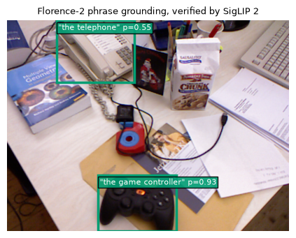
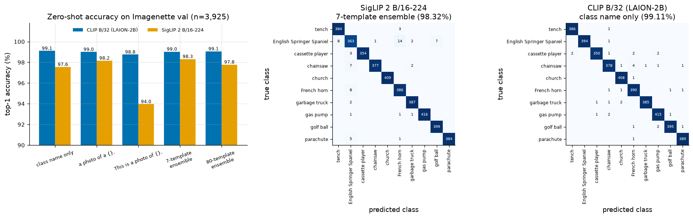
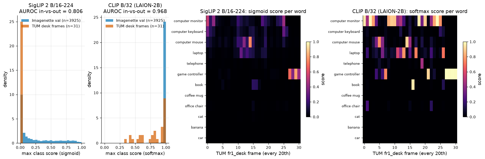
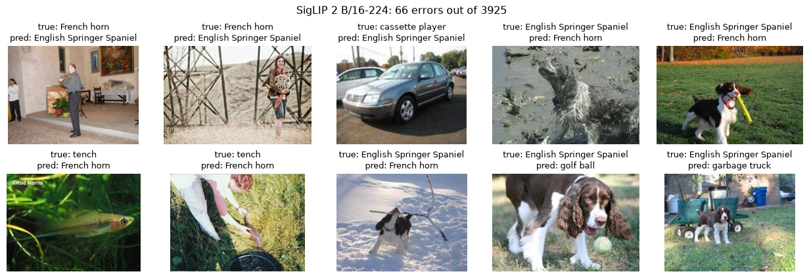
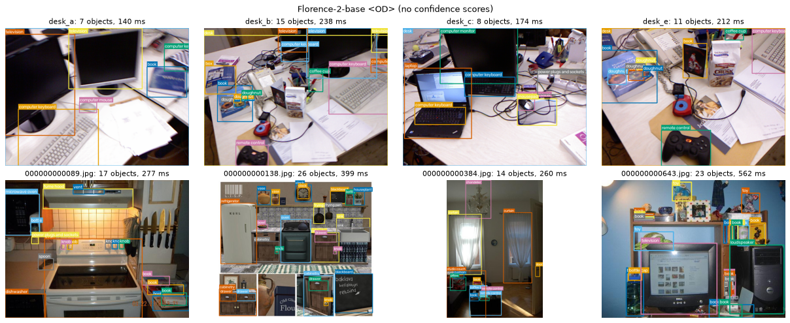
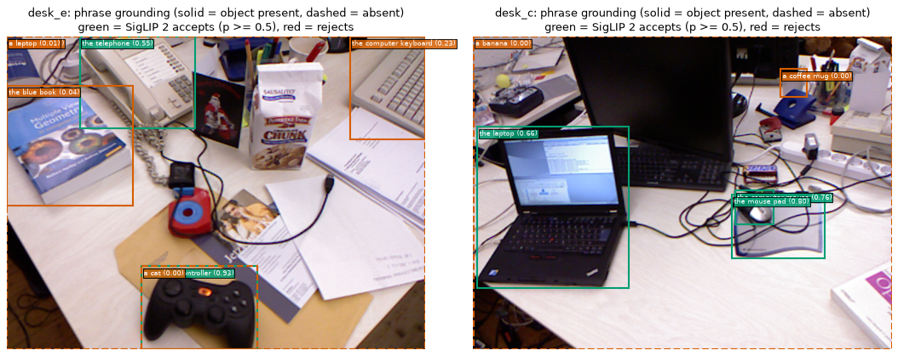
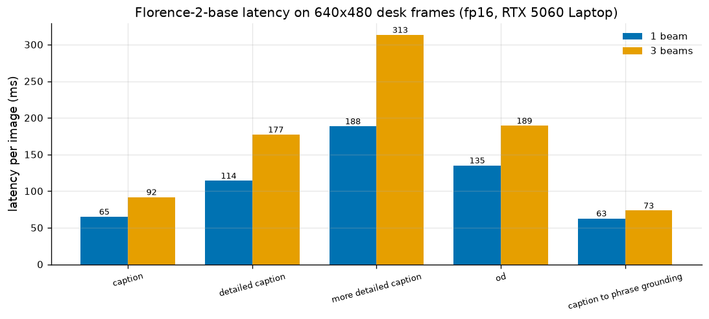
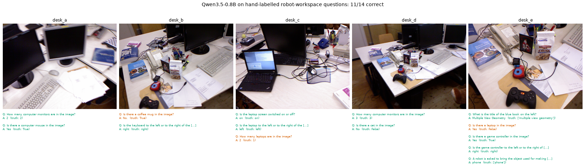
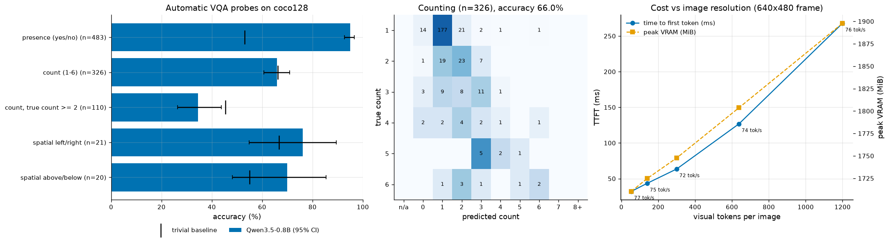
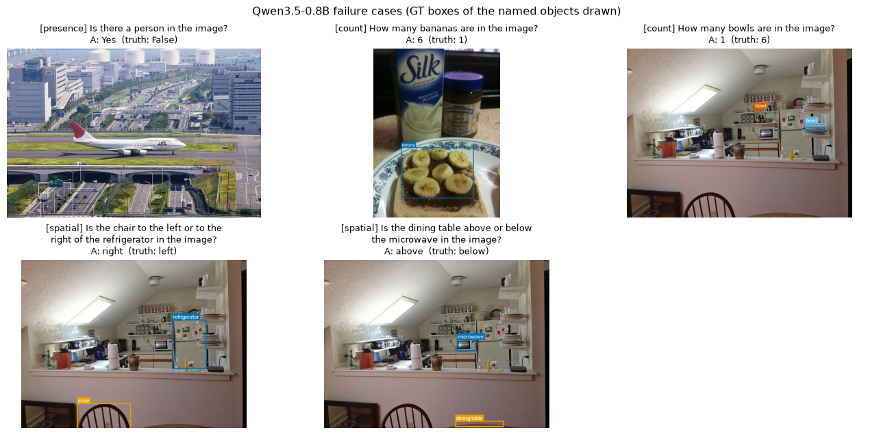

# 13 · Vision-language models: zero-shot recognition, grounding and VQA for robots

A robot that can be told *"bring me the game controller"* needs perception that understands
language. This project builds that up in three steps, entirely on an 8 GB laptop GPU and
with models that load natively in `transformers` / `open_clip` (no remote code):

| notebook | model(s) | what it does |
|---|---|---|
| [`01_zero_shot_classification`](notebooks/01_zero_shot_classification.ipynb) | **SigLIP 2** B/16 vs **CLIP** B/32 | zero-shot classification on Imagenette, prompt ensembling, softmax vs sigmoid scores, open-set rejection and multi-label tagging of robot-desk frames |
| [`02_florence2_caption_detect_ground`](notebooks/02_florence2_caption_detect_ground.ipynb) | **Florence-2-base** (+ SigLIP 2) | captions, open-vocabulary detection and phrase grounding from one seq2seq model, location tokens decoded by hand, grounding verified with SigLIP 2 |
| [`03_small_vlm_vqa`](notebooks/03_small_vlm_vqa.ipynb) | **Qwen3.5-0.8B** | visual question answering on robot-workspace frames, latency/VRAM vs visual tokens, 850 auto-generated probes (hallucination, counting, spatial relations) and a failure analysis |



## What you'll learn

- How contrastive dual encoders (CLIP, SigLIP) map images and text into one embedding space, and how to turn class names into a zero-shot classifier with prompt templates and prompt ensembling.
- Why SigLIP's **sigmoid** scores behave differently from CLIP's **softmax** scores, and why this matters for a robot that mostly sees objects outside its label list (open-set rejection, multi-label tagging). Also why you must measure this instead of trusting the textbook argument.
- How Florence-2 serialises boxes as quantised **location tokens**, so one encoder-decoder can caption, detect and ground phrases. Also how to evaluate a detector that has no confidence scores.
- Why phrase grounding is not detection (it always returns a box), and how to verify a grounded box with a dual encoder.
- How a VLM turns an image into tokens, what **prefill** and **decode** cost, and how the visual-token budget sets latency and memory.
- How to test a VLM cheaply and honestly: auto-generated questions from detection labels, trivial baselines, Wilson confidence intervals and a failure gallery.

## Theory primer

**Dual encoders.** An image encoder $f$ and a text encoder $g$ produce unit vectors
$\mathbf{x}=f(I)/\lVert f(I)\rVert$ and $\mathbf{y}=g(T)/\lVert g(T)\rVert$. CLIP is trained with a
batch softmax (InfoNCE): each image must pick its caption among the $N$ captions of the batch,

$$\mathcal{L}_\text{CLIP} = -\tfrac{1}{2N}\textstyle\sum_i\Big[\log\frac{e^{t\,\mathbf{x}_i^\top\mathbf{y}_i}}{\sum_j e^{t\,\mathbf{x}_i^\top\mathbf{y}_j}} + \log\frac{e^{t\,\mathbf{x}_i^\top\mathbf{y}_i}}{\sum_j e^{t\,\mathbf{x}_j^\top\mathbf{y}_i}}\Big].$$

SigLIP treats every pair as an independent binary problem with a learned bias $b$ ($z_{ij}=\pm1$):

$$\mathcal{L}_\text{SigLIP} = -\tfrac{1}{N}\textstyle\sum_{i,j}\log\sigma\big(z_{ij}(t\,\mathbf{x}_i^\top\mathbf{y}_j+b)\big).$$

**Zero-shot classification.** Each class weight $\mathbf{w}_c$ is the renormalised mean of the
embeddings of its prompts ("a photo of a {class}.", ...). The prediction is
$\arg\max_c \mathbf{x}^\top\mathbf{w}_c$. CLIP's scores $\operatorname{softmax}_c(t\,\mathbf{x}^\top\mathbf{w}_c)$
always sum to 1, while SigLIP's $\sigma(t\,\mathbf{x}^\top\mathbf{w}_c+b)$ can all be low ("none of these")
or several can be high (multi-label).

**Florence-2.** A DaViT image encoder (768 x 768 input, 577 visual tokens) and a BART-style
encoder-decoder generate text for a task prompt (`<OD>` becomes "Locate the objects with
category name in the image."). Coordinates are 1,000 extra tokens: $k=\lfloor 1000\,x/W\rfloor$,
decoded as $\hat{x}=\lfloor (k+0.5)\,W/1000\rfloor$. A box is four such tokens after its label.

**VLMs.** The image is resized to multiples of 32 px within a pixel budget. A ViT with
16 px patches and a 2 x 2 merger produces $N_\text{vis}=(H/32)(W/32)$ tokens (300 for 640 x 480).
They replace `<|image_pad|>` placeholders in the chat template. *Prefill* (vision encoder + all
prompt tokens) sets the time to first token. *Decode* emits one token per step and is
memory-bound. Qwen3.5-0.8B has 24 decoder layers: 18 Gated DeltaNet linear-attention layers with a
fixed-size state and 6 full-attention layers. Only the 6 full-attention layers keep a KV cache:
$2\cdot 6\cdot 2_\text{kv heads}\cdot 256_\text{head dim}\cdot 2\,\text{B} = 12$ KiB per token.

**Evaluating answers.** For a probe set of size $n$ with accuracy $\hat p$ we report the 95% Wilson
interval $\big(\hat p + \tfrac{z^2}{2n} \pm z\sqrt{\hat p(1-\hat p)/n + \tfrac{z^2}{4n^2}}\big)/(1 + \tfrac{z^2}{n})$ with
$z=1.96$, next to a trivial baseline (majority answer, always "1"). POPE-style presence questions
also give the **yes-ratio** and the hallucination rate $P(\text{"yes"}\mid\text{object absent})$.

## How to run

```bash
# 1. extra packages (transformers, open_clip_torch, timm; installed with the torch constraints)
make setup-13_vision_language
# 2. data + pinned checkpoints (Imagenette-160, TUM fr1_desk, coco128; about 4.0 GB of weights)
make data-13_vision_language
# 3. VQA probe benchmark for notebook 03 (850 questions, 92 s of inference here)
#    -> results/vqa_probes.csv + results/vqa_probes_summary.json
python projects/13_vision_language/scripts/eval_vqa_probes.py
# 4. execute the three notebooks headless on the GPU lock (about 2.5 minutes of execution in total here)
make nb-13_vision_language
# 5. exercise solutions (GPU)
python projects/13_vision_language/solutions/ex01_zero_shot.py   # about 2.5 min
python projects/13_vision_language/solutions/ex02_florence2.py   # about 1 min, OCR figure -> outputs/13_vision_language/
python projects/13_vision_language/solutions/ex03_small_vlm.py   # about 1.5 min (+1 min for the low-res probe run on first use)
```

Checkpoint revisions are pinned in [`configs/models.yaml`](configs/models.yaml). The
hand-labelled desk questions are in [`configs/desk_questions.yaml`](configs/desk_questions.yaml).
Shared code (model wrappers, prompt ensembling, label normalisation, probe generation, answer
parsing, Wilson intervals) is in [`scripts/vl_common.py`](scripts/vl_common.py) and unit-tested on
the CPU in `tests/test_p13_vl_common.py` (`pytest -q tests/test_p13_vl_common.py`).

## Results

All numbers were measured in this repo on an **NVIDIA RTX 5060 Laptop GPU (8 GB, sm_120)** with an
Intel Core Ultra 9 275HX, torch 2.11.0+cu128 and transformers 5.22.2 (fp16 for SigLIP 2, CLIP and
Florence-2, bf16 for Qwen3.5-0.8B). They are copied from the notebook outputs and
[`results/`](results/). Accuracy numbers are deterministic. Latency and throughput change from
run to run on this shared laptop (see [Limitations](#limitations)).

### 1. Zero-shot classification and open-set scores (notebook 01)





| model | best prompt | top-1 (best prompt) | top-1 (class name only) | top-1 (80-template ensemble) | AUROC Imagenette vs desk | params (M) | image encoder img/s (bs 64) | end-to-end img/s | peak VRAM (MiB) |
|---|---|---|---|---|---|---|---|---|---|
| CLIP B/32 (LAION-2B) | class name only | 99.11% | 99.11% | 99.06% | 0.968 | 151.3 | 1,873 | 40 | 371 |
| SigLIP 2 B/16-224 | 7-template ensemble | 98.32% | 97.55% | 97.78% | 0.806 | 375.2 | 382 | 33 | 980 |

Imagenette validation split, 3,925 images, 10 classes. AUROC uses the max class score to separate
Imagenette images from 31 TUM `fr1_desk` frames.

- Both models are excellent zero-shot classifiers on this easy 10-class set, and **the prompt matters as much as the model**: SigLIP 2 ranges from 93.96% ("This is a photo of {}.", the template from its model card) to 98.32% (7-template ensemble).
- **Pre-processing is part of the model.** SigLIP 2 prompts tokenised with `padding="longest"` instead of `padding="max_length", max_length=64` drop to 10.19% top-1 (chance), with no error message.
- **The textbook softmax-vs-sigmoid argument did not hold here.** CLIP's max-softmax separates in-distribution images from desk frames better (AUROC 0.968) than SigLIP 2's max-sigmoid (0.806). SigLIP 2's absolute probabilities are low even on correct Imagenette images (median max score 0.091).



### 2. Florence-2: captions, detection and phrase grounding (notebook 02)







| metric (Florence-2-base, fp16) | value |
|---|---|
| `<OD>` precision@0.5 on coco128 (label-normalised, 1,119 predictions) | 0.466 |
| `<OD>` recall@0.5 on coco128 (929 GT boxes) | 0.561 |
| `<OD>` predictions whose label is outside the COCO vocabulary | 347 |
| `<OD>` mean latency on coco128, 3 beams (ms) | 218 |
| grounding: absent phrases that still got a box | 4 / 4 |
| grounding: absent phrases rejected by SigLIP 2 ($p < 0.5$) | 4 / 4 |
| grounding: present phrases accepted by SigLIP 2 ($p \geq 0.5$) | 5 / 8 |
| latency per 640 x 480 desk frame, greedy / 3 beams (ms): `<CAPTION>` | 65 / 92 |
| `<DETAILED_CAPTION>` | 114 / 177 |
| `<MORE_DETAILED_CAPTION>` | 188 / 313 |
| `<OD>` | 135 / 189 |
| `<CAPTION_TO_PHRASE_GROUNDING>` | 63 / 73 |
| weights on GPU (MiB) | 452 |
| peak VRAM, `<OD>` on coco128 (MiB) | 628 |
| peak VRAM, Florence-2 + SigLIP 2 loaded, 3 beams (MiB) | 1356 |

- Decoding the `<loc_k>` tokens by hand reproduces the processor's boxes exactly (0.0 px difference).
- `<OD>` has no confidence scores, so there is no PR curve or AP. Some COCO classes are almost never found (dining table 0/13, handbag 2/19, traffic light 2/14).
- Grounding always returns a box, even for "a banana" on a desk without one. SigLIP 2 verification removes all absent phrases but also 3 of 8 correct ones.

### 3. A small VLM for robot-workspace VQA (notebook 03)







| metric (Qwen3.5-0.8B, bf16, greedy, thinking off) | value | baseline |
|---|---|---|
| hand-labelled desk questions correct | 11 / 14 | |
| presence accuracy, POPE-style (n=483) | 95.0% (95% CI 92.7-96.6%) | 53.0% (majority answer) |
| hallucination rate, "yes" on random absent objects | 0.4% | |
| yes-ratio | 42.4% | truth 47.0% |
| count accuracy, counts 1-6 (n=326) | 66.0% | 66.3% (always "1") |
| count accuracy, true count >= 2 (n=110) | 34.5% | 45.5% (always "2") |
| spatial left/right (n=21) | 76.2% (95% CI 54.9-89.4%) | 66.7% (majority) |
| spatial above/below (n=20) | 70.0% (95% CI 48.1-85.5%) | 55.0% (majority) |
| TTFT at 54 / 140 / 300 / 638 / 1,200 visual tokens (ms) | 32 / 43 / 64 / 127 / 268 | |
| decode speed at 300 visual tokens (tok/s) | 72.2 | |
| 64-token answer at 300 visual tokens (s) | 0.94 | |
| weights on GPU (MiB) | 1656 | |
| peak VRAM at 300 / 1,200 visual tokens (MiB) | 1748 / 1898 | |
| probe benchmark: mean latency per question (s) | 0.104 | |

- Presence questions are the model's strength, and it is conservative (it says "yes" less often than it should).
- **Counting is no better than a constant answer**, and spatial relations beat their baselines only within overlapping confidence intervals at these sample sizes.
- Free-form generation can degenerate. Asked for graspable objects on `desk_b`, the model repeated "mouse" until the token limit. A robot must parse and validate VLM output before acting on it.

### Exercise results (solution scripts)

| exercise | result |
|---|---|
| 01-1 descriptive class names for the two weakest classes | SigLIP 2: 98.32% -> 99.57% overall (English Springer Spaniel 91.90% -> 100%); CLIP: 99.11% -> 98.68% (worse) |
| 01-2 k-shot logistic regression on frozen embeddings (mean of 3 draws) | SigLIP 2 beats its zero-shot accuracy from k=2 (98.87%, 16-shot 99.44%); CLIP stays below its zero-shot 99.11% even at k=16 (98.52%) |
| 01-3 max-score threshold at 5% false rejections on Imagenette | CLIP softmax (threshold 0.9869) rejects 76.35% of 613 desk frames; SigLIP 2 sigmoid (threshold rounds to 0.0000) rejects none |
| 02-1 `<OCR_WITH_REGION>` on `desk_e` | full frame: "Multise View", "Geometry", "CHUNK"; 3x crop of the grounded book: "Geometry" only |
| 02-2 `<OD>` on coco128, greedy vs 3 beams | precision 0.471 vs 0.466, recall 0.571 vs 0.561, mean latency 136.7 vs 191.2 ms |
| 02-3 "where is X?" (ground -> verify -> back-project with TUM depth) | game controller: SigLIP 2 p=0.933, X_cam = (-0.024, 0.154, 0.496) m (the 9 x 9 depth window is a hole, so the median depth of the central half of the box is used); "a banana": p=0.000, rejected |
| 03-1 direct vs step-by-step counting (40 probes, count >= 2) | 42.5% vs 45.0% accuracy; step-by-step costs 66 tokens and 0.93 s per answer |
| 03-2 75 visual tokens instead of native resolution (850 probes) | mean visual tokens 272.9 -> 68.4, latency 0.104 -> 0.070 s/question; presence 95.0% -> 93.8%, count 66.0% -> 63.8%, spatial 73.2% -> 63.4% |
| 03-3 adversarial (co-occurring) absent objects vs random ones (n=256 each) | hallucination rate 9.4% vs 0.4%; most hallucinated: chair (6), cup (4) |

## Limitations

- **Small, easy or optimistic test sets.** Imagenette has 10 distinct classes, so ~99% zero-shot accuracy does not transfer to fine-grained or robot-specific categories. coco128 (128 images) is part of COCO train2017 and therefore of Florence-2's training data. The spatial probes have only 21 and 20 questions, the desk QA only 14 and the open-set test 31 frames, so the confidence intervals are wide.
- **No confidence scores from Florence-2.** We report precision/recall at IoU 0.5, not AP. Matching uses a hand-made label-normalisation table; correct free-text labels outside COCO ("desk", "lamp") count as false positives.
- **COCO labels are not ground truth for VQA.** Some probe "failures" are label issues (banana slices labelled as one banana, unlabelled people). Answer parsing takes the first yes/no word, number or relation word; an unparseable answer counts as wrong.
- **Latency and throughput vary between runs** on this laptop, which shares its CPU and power budget with other jobs. Over the runs on the same day: Qwen3.5-0.8B decode speed at 300 visual tokens measured 39.2, 51.9, 80.1 and 72.2 tok/s (4 runs; TTFT stayed between 64 and 72 ms); Florence-2 `<OD>` with 3 beams on coco128 averaged 158.5, 158.6, 159.4, 191.2, 217.8 and 234.1 ms (6 runs, notebook and solution); end-to-end Imagenette throughput (CPU JPEG decoding included) was 278, 182, 153 and 33 img/s for SigLIP 2 and 404, 227, 231 and 40 img/s for CLIP. The model-only encoder throughput at batch 64 was stable (382 and 1,873 img/s in the final run). Treat single latency numbers as indicative.
- **One model size each.** We use Qwen3.5-0.8B (1.6 GB download) because it is a natively multimodal model under the 2 GB download guideline. Qwen3-VL-2B-Instruct (4.3 GB) and Florence-2-large were not evaluated; larger models may do better on counting and spatial questions, but we did not measure it. CLIP B/32 vs SigLIP 2 B/16 differ in patch size, data and loss, so their comparison is not a controlled study of the loss.
- **SigLIP 2 probabilities need calibration.** Its sigmoid scores were low on the 160 px Imagenette images and on 640 x 480 desk frames, so a fixed threshold of 0.5 rarely fires. A deployed tagger needs thresholds tuned per word on its own camera.
- **Depth holes.** The TUM Kinect depth has holes on dark objects (the black game controller), which the 3D back-projection in exercise 02-3 has to work around.
- Not covered: video or multi-image VLM input, quantisation (all models run in fp16/bf16), and an on-robot closed loop (see project 15).

## Model & dataset licenses

| component | kind | license | notes |
|---|---|---|---|
| [google/siglip2-base-patch16-224](https://huggingface.co/google/siglip2-base-patch16-224) | model | Apache-2.0 | |
| [laion/CLIP-ViT-B-32-laion2B-s34B-b79K](https://huggingface.co/laion/CLIP-ViT-B-32-laion2B-s34B-b79K) | model | MIT | trained on LAION-2B (web data) |
| [florence-community/Florence-2-base](https://huggingface.co/florence-community/Florence-2-base) | model | MIT | native transformers port of microsoft/Florence-2-base |
| [Qwen/Qwen3.5-0.8B](https://huggingface.co/Qwen/Qwen3.5-0.8B) | model | Apache-2.0 | |
| [Imagenette](https://github.com/fastai/imagenette) (160 px) | dataset | Apache-2.0 (fast.ai) | images are an ImageNet subset: ImageNet terms of access (non-commercial research) |
| [TUM RGB-D](https://cvg.cit.tum.de/data/datasets/rgbd-dataset) `fr1_desk` | dataset | CC BY 4.0 | |
| [Ultralytics coco128](https://github.com/ultralytics/assets/releases/download/v0.0.0/coco128.zip) | dataset | GPL-3.0 (LICENSE file in the Ultralytics zip) | copyleft packaging; COCO annotations CC BY 4.0, images under their Flickr licenses |
| [transformers](https://github.com/huggingface/transformers) 5.22.2 | library | Apache-2.0 | |
| [open_clip_torch](https://github.com/mlfoundations/open_clip) 4.2.1 | library | MIT | |
| [timm](https://github.com/huggingface/pytorch-image-models) 1.0.31 | library | Apache-2.0 | dependency of open_clip |

## References

- A. Radford et al., *Learning Transferable Visual Models From Natural Language Supervision* (CLIP), ICML 2021. [arXiv:2103.00020](https://arxiv.org/abs/2103.00020)
- X. Zhai et al., *Sigmoid Loss for Language Image Pre-Training* (SigLIP), ICCV 2023. [arXiv:2303.15343](https://arxiv.org/abs/2303.15343)
- M. Tschannen et al., *SigLIP 2: Multilingual Vision-Language Encoders with Improved Semantic Understanding, Localization, and Dense Features*, 2025. [arXiv:2502.14786](https://arxiv.org/abs/2502.14786)
- M. Cherti et al., *Reproducible scaling laws for contrastive language-image learning* (OpenCLIP), CVPR 2023. [arXiv:2212.07143](https://arxiv.org/abs/2212.07143)
- C. Schuhmann et al., *LAION-5B: An open large-scale dataset for training next generation image-text models*, NeurIPS 2022. [arXiv:2210.08402](https://arxiv.org/abs/2210.08402)
- B. Xiao et al., *Florence-2: Advancing a Unified Representation for a Variety of Vision Tasks*, CVPR 2024. [arXiv:2311.06242](https://arxiv.org/abs/2311.06242)
- M. Ding et al., *DaViT: Dual Attention Vision Transformers*, ECCV 2022. [arXiv:2204.03645](https://arxiv.org/abs/2204.03645)
- S. Yang, J. Kautz, A. Hatamizadeh, *Gated Delta Networks: Improving Mamba2 with Delta Rule*, ICLR 2025. [arXiv:2412.06464](https://arxiv.org/abs/2412.06464)
- S. Bai et al. (Qwen Team), *Qwen3-VL Technical Report*, 2025. [arXiv:2511.21631](https://arxiv.org/abs/2511.21631), (Qwen3.5-0.8B itself is documented in its [model card](https://huggingface.co/Qwen/Qwen3.5-0.8B): 24 layers laid out as 6 x (3 x Gated DeltaNet + 1 x gated attention))
- Y. Li et al., *Evaluating Object Hallucination in Large Vision-Language Models* (POPE), EMNLP 2023. [arXiv:2305.10355](https://arxiv.org/abs/2305.10355)
- E. B. Wilson, *Probable Inference, the Law of Succession, and Statistical Inference*, JASA 1927. [doi:10.1080/01621459.1927.10502953](https://doi.org/10.1080/01621459.1927.10502953)
- J. Sturm et al., *A Benchmark for the Evaluation of RGB-D SLAM Systems* (TUM RGB-D), IROS 2012. [dataset page](https://cvg.cit.tum.de/data/datasets/rgbd-dataset)
- Code: [open_clip](https://github.com/mlfoundations/open_clip), [transformers SigLIP 2 docs](https://huggingface.co/docs/transformers/main/en/model_doc/siglip2), [transformers Florence-2 docs](https://huggingface.co/docs/transformers/main/en/model_doc/florence2)
