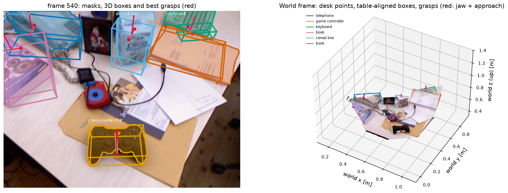
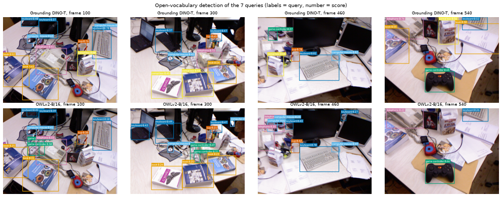
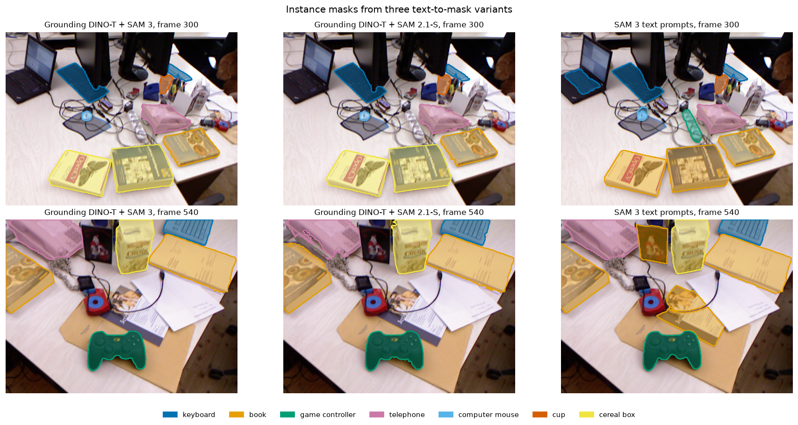
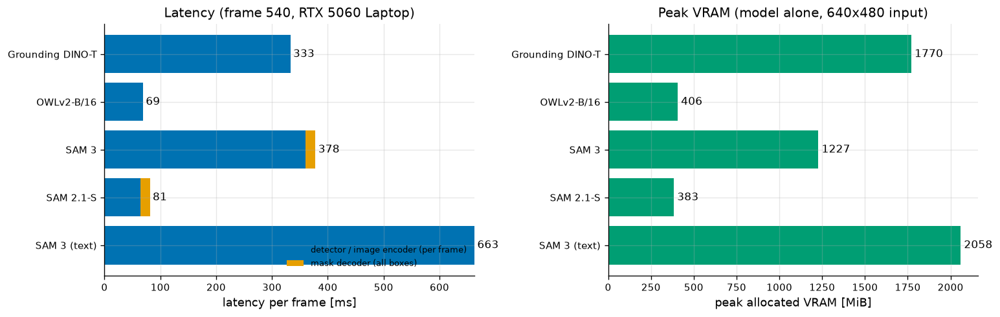
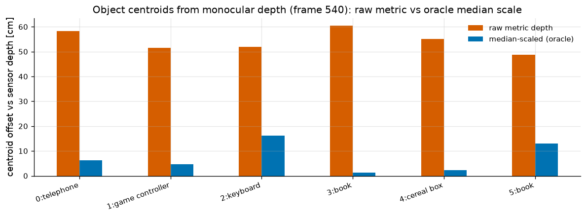
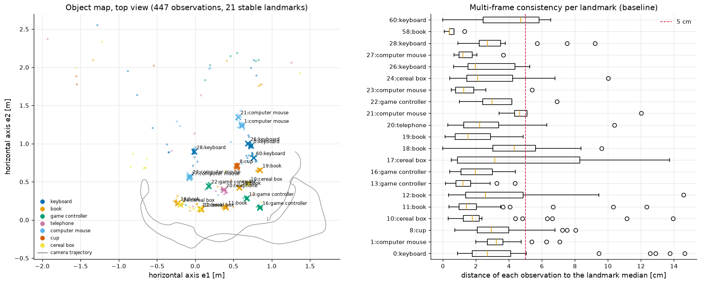
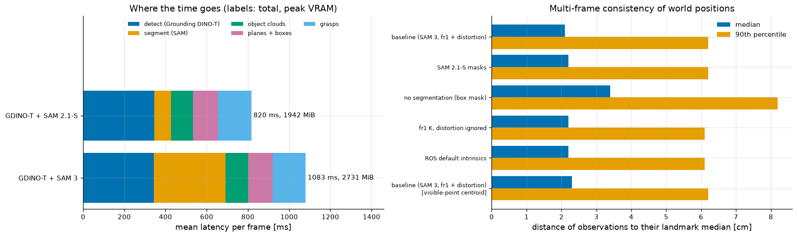

# 15 · Robotics capstone: open-vocabulary RGB-D perception for grasping

A robot is told *"pick up the game controller"*. This project builds the perception that
turns that sentence into a gripper pose, on recorded RGB-D frames of a cluttered office desk
(TUM RGB-D `fr1/desk`), and measures how accurate and how fast each stage is:

```
text query ─► Grounding DINO-T / OWLv2 ─► 2D boxes ─► SAM 3 / SAM 2.1-S ─► instance masks
                                                                               │ + sensor depth
world-frame grasp ◄─ T_wc ◄─ top-down antipodal grasp ◄─ 3D box ◄─ support plane ◄─ object cloud
```



| notebook | content |
|---|---|
| [`01_text_to_masks`](notebooks/01_text_to_masks.ipynb) | Grounding DINO-T vs OWLv2-B/16, SAM 3 vs SAM 2.1-S box prompts, SAM 3 text prompts; agreement, latency, VRAM |
| [`02_masks_to_grasps`](notebooks/02_masks_to_grasps.ipynb) | lens distortion and ray lookup tables, object-cloud cleaning, RANSAC support plane, PCA vs gravity-aligned boxes, grasp synthesis, camera → world frames, monocular metric depth vs sensor depth |
| [`03_sequence_object_map`](notebooks/03_sequence_object_map.ipynb) | full pipeline on 72 frames, object map, multi-frame consistency as an accuracy metric, ablations (mask source, camera model), per-stage latency, rerun recording |
| [`ros2/`](ros2/README.md) | optional ROS 2 Jazzy node (`vision_msgs/Detection3DArray` + `PoseStamped`) |

## What you'll learn

- How open-vocabulary detectors ground text (caption fusion in Grounding DINO vs per-query
  embedding scores in OWLv2), and how they fail on loosely named objects.
- How promptable segmentation splits into an expensive image encoder and a cheap per-prompt
  decoder, and what SAM 3's text prompts change.
- How to back-project raw pixels exactly through a distorted lens, and how to clean an
  object's point cloud (erosion, median/MAD depth gate, statistical outlier removal).
- Why a PCA box of a partial view misleads, and how a RANSAC support plane gives a
  gravity-aligned box that sits on the table.
- How a simple top-down parallel-jaw grasp planner works (width, flatness, collision and
  antipodal checks) and how to chain $T_{wg} = T_{wc}\,T_{cg}$.
- How to measure 3D accuracy without labels (multi-frame consistency against a known camera
  trajectory), and which design choices actually move that number.
- Where the time and memory go in an open-vocabulary perception stack on an 8 GB laptop GPU.

## Theory primer

**Open-vocabulary detection.** Grounding DINO puts every query into one caption
(`"keyboard. book. cup."`), fuses text and image features in all encoder and decoder layers, and
keeps a box when its largest token similarity satisfies $\max_t \sigma(\ell_t) > 0.35$. The tokens
above 0.25 form the returned phrase. OWLv2 predicts one box and one embedding $e_i$ per image
patch and scores each query embedding $t_j$ on its own, $s_{ij} = \sigma\big((e_i^\top t_j + b_i)\,a_i\big)$.

**Promptable segmentation.** SAM-style models encode the image once (SAM 3: a 1008² ViT,
SAM 2.1-S: a 1024² Hiera-S). A light two-way-transformer decoder then turns each prompt (here a box)
into a mask and a predicted IoU. SAM 3 also accepts a noun phrase and returns every matching
instance (*promptable concept segmentation*), with a presence head that suppresses absent concepts.

**Back-projection.** Pixel $(u,v)$ with depth $z$ maps to $X = z\,[x_n, y_n, 1]^\top$, where
$(x_n, y_n) = \mathrm{undistort}\big((u-c_x)/f_x, (v-c_y)/f_y\big)$. The fr1 RGB lens has
$k_1=0.262$, $k_2=-0.953$, $k_3=1.163$. The inverse has no closed form, so the ray of every raw
pixel is solved once (`cv2.undistortPoints`) and stored in a 480×640×2 lookup table. Images and
masks are never resampled.

**Cloud cleaning.** Erode the mask by 3 px, which removes registration errors and mixed
"flying" pixels at depth edges. Then keep $|z - \tilde z| < \max(3\cdot 1.4826\,\mathrm{MAD}(z),\ 5\ \mathrm{cm})$,
a robust gate against background seen through mask leaks. Finally apply statistical outlier
removal (16-NN, 2σ) and a 5 mm voxel grid.

**Support plane and box.** Fit $\mathbf n^\top\mathbf p + d = 0$ with RANSAC on a ring of pixels
around the object (1 cm threshold, 256 hypotheses), then refit with least squares. With
inlier ratio $w$ the success probability is $1-(1-w^3)^N$. The box axis $z$ is the plane
normal. The footprint is the minimum-area rectangle of the points projected onto the plane
(rotating calipers on the convex hull). The height is the 98th percentile of
$h(\mathbf p) = \mathbf n^\top\mathbf p + d$, and the box is extruded down to the plane, because
the camera never sees the bottom.

**Grasps.** Gripper frame: $z$ is the approach (straight down onto the table) and $x$ is the
closing direction. Candidates use both in-plane box axes as closing directions and 5 offsets
along the other axis. A candidate is rejected if the opening $w + 2\,\mathrm{cm}$ exceeds the
85 mm stroke, if the object is lower than 12 mm, or if more than 8 scene points fall inside the
closing finger volumes. The score is
$0.4\,(1-\text{opening}/\text{stroke}) + 0.3\,\text{centring} + 0.3\,\overline{|\mathbf n_i^\top\mathbf x|}$,
where the last term is the antipodal alignment of the contact normals. World frame:
$T_{wg} = T_{wc}\,T_{cg}$, with $T_{wc}$ the motion-capture pose interpolated (lerp + SLERP) at
the depth timestamp.

**Multi-frame consistency** (the accuracy metric). The objects are static and the camera pose
is known, so every frame's world-frame estimate of an object should coincide. Observations are
associated greedily into landmarks (same label, closer than 15 cm to the landmark's running
median, at most one per frame). For landmarks seen in at least 5 frames, the error is the distance
of each observation to the landmark median. A bias shared by all frames is invisible to this
metric.

## How to run

All commands below were run on this machine, from the repository root, with the `cv` env
active. SAM 3 is gated: accept the SAM License on <https://huggingface.co/facebook/sam3> and
run `hf auth login` once.

```bash
make setup-15_robotics_capstone        # transformers 5.22.2, rerun-sdk 0.42.0 (+ check_env)
make data-15_robotics_capstone         # TUM fr1/desk (344 MB) + 5 checkpoints in the HF cache (idempotent)
make nb-15_robotics_capstone           # executes the 3 notebooks headless under the GPU lock
python -m pytest -q tests/test_p15_grasp3d.py tests/test_p15_capstone.py   # CPU unit tests
```

Exercise solutions (notebook 03's solutions are CPU-only and reuse the mask cache that notebook
03 writes to `runs/15_robotics_capstone/`):

```bash
flock /tmp/cv-gpu.lock python projects/15_robotics_capstone/solutions/nb01_solutions.py
flock /tmp/cv-gpu.lock python projects/15_robotics_capstone/solutions/nb02_solutions.py
python projects/15_robotics_capstone/solutions/nb03_solutions.py
```

Notebook 03 also writes a [rerun](https://rerun.io) recording to
`outputs/15_robotics_capstone/capstone_fr1_desk.rrd` (26.0 MiB, 72 frames: camera pose,
RGB, depth, segmentation, object clouds, oriented boxes, grasp arrows, landmarks). Open it with
the Rerun Viewer 0.42 desktop app; `.rrd` files are not compatible across Rerun versions. The
viewer renders through the GPU in a window and cannot render a recording to an image headless,
so it was not opened on the headless build machine. Every figure here is a static matplotlib
render of the same data.

The optional ROS 2 node is documented in [`ros2/README.md`](ros2/README.md).

## Results

Hardware: **NVIDIA RTX 5060 Laptop GPU (8 GB, sm_120)** for the models and an Intel Core Ultra 9
275HX for the NumPy/SciPy geometry. PyTorch 2.11 (CUDA 12.8) and transformers 5.22.2. All
numbers below are copied from the executed notebooks and from
[`results/`](results/). The machine was shared with other jobs while the notebooks ran, so
latencies are indicative, especially the CPU stages.

### 1. Text → boxes → masks (notebook 01)




Latency is the mean of 5 CUDA-synchronised calls on frame 540, including the `transformers`
pre- and post-processing. For the segmenters it is the encoder plus all 6 box decodes. Peak VRAM
is the model alone.

| model | role | precision | params [M] | latency [ms] | peak VRAM [MiB] | objects / instances (4 frames) |
|---|---|---|---|---|---|---|
| Grounding DINO-T | text → boxes | fp32 | 172.3 | 332.9 | 1770 | 29 |
| OWLv2-B/16 | text → boxes | fp16 | 155.0 | 69.0 | 406 | 36 |
| SAM 3 | box → mask | bf16 | 458.3 | 377.9 | 1227 | 29 |
| SAM 2.1-S | box → mask | bf16 | 38.5 | 81.4 | 383 | 29 |
| SAM 3 (text) | text → masks | bf16 | 840.4 | 662.7 | 2058 | 41 |

- Detector agreement (same label, IoU ≥ 0.5) over 4 frames: 19 of 29 Grounding DINO boxes are
  confirmed by OWLv2, and 19 of OWLv2's 36. Grounding DINO's single caption makes related
  phrases bleed into each other (two books in frame 300 come out as *cereal box*). OWLv2 returns
  more low-score duplicates and never finds the rusk box behind the loose name *cereal box*.
- SAM 3 vs SAM 2.1-S on the same 29 boxes: median mask IoU 0.970, with 1 box below 0.8.
  SAM 3 text prompts return 41 instances (25 matched by the cascade), including extra books and
  some new false positives.



### 2. One frame in 3D (notebook 02)

Frame 540 uses Grounding DINO-T + SAM 3, sensor depth, and the fr1 camera model with distortion.
The lens distortion moves raw pixels by up to 24.3 px (median 4.6 px). The six local support
planes agree within 2.2° except next to the phone (9.6°), and their median normal is 0.6° from the
motion-capture world $z$ axis.

| object | det. score | cloud points | box L × W × H [cm] | centroid, world [m] | best grasp width [cm] | grasp score |
|---|---|---|---|---|---|---|
| 0:telephone | 0.76 | 1163 | 24.6 × 13.7 × 8.8 | 0.413, 0.334, 0.820 | 4.6 | 0.46 |
| 1:game controller | 0.65 | 570 | 13.9 × 8.1 × 6.8 | 0.857, 0.136, 0.807 | 4.2 | 0.46 |
| 2:keyboard | 0.52 | 256 | 14.0 × 6.2 × 3.4 | 0.815, 0.763, 0.795 | 3.0 | 0.46 |
| 3:book | 0.55 | 1482 | 28.5 × 14.1 × 4.1 | 0.452, 0.164, 0.794 | 4.0 | 0.27 |
| 4:cereal box | 0.56 | 835 | 11.6 × 6.0 × 15.1 | 0.710, 0.428, 0.860 | 3.8 | 0.68 |
| 5:book | 0.38 | 2480 | 26.5 × 22.1 × 1.8 | 0.842, 0.637, 0.766 | - | no feasible grasp |

The best grasp on the phone is at 9.3° from vertical in the world frame, and the
camera → world → camera round trip is exact to 3.3e-16. Notebook 02 also shows PCA boxes tilted
by up to 13.3° against the desk. The upright rusk box shows the height problem clearly: its
smallest PCA extent is 7.2 cm, while its table-aligned box is 15.1 cm tall.

**Monocular metric depth vs the Kinect** (Depth Anything V2 Metric-Indoor-Small, frame 540, valid
sensor pixels):

| depth | AbsRel | RMSE [m] | δ1 | latency [ms] | peak VRAM [MiB] |
|---|---|---|---|---|---|
| DA-V2 Metric-Indoor-S, raw | 0.804 | 0.509 | 0.079 | 40.2 | 386 |
| DA-V2, median-scaled (oracle, ×0.536) | 0.088 | 0.166 | 0.906 | same | same |



The monocular model puts this close-range desk about 1.9× too far (median scale 0.536). Raw
metric depth therefore moves object centroids by 48.7-60.5 cm. Even with an oracle per-frame
scale, they move by 1.2-16.2 cm.

### 3. Over the sequence: object map, consistency, latency (notebook 03)

72 frames (every 8th frame of `fr1/desk`, 19.8 s, camera path 9.3 m at up to 1.17 m/s) gave 467
detections, 447 of them with a 3D box. These form 65 landmarks; the 21 seen in at least 5 frames
hold 85.5 % of the observations.



**Accuracy (multi-frame consistency of world positions; lower is better).** All variants use the
same detections:

| variant | position | stable landmarks | obs. in stable landmarks [%] | median error [cm] | p90 error [cm] | within 5 cm [%] |
|---|---|---|---|---|---|---|
| baseline (SAM 3, fr1 + distortion) | box centre | 21 | 85.5 | 2.1 | 6.2 | 85.3 |
| SAM 2.1-S masks | box centre | 21 | 86.4 | 2.2 | 6.2 | 83.9 |
| no segmentation (box mask) | box centre | 20 | 84.3 | 3.4 | 8.2 | 68.9 |
| fr1 K, distortion ignored | box centre | 20 | 85.7 | 2.2 | 6.1 | 85.4 |
| ROS default intrinsics | box centre | 20 | 85.9 | 2.2 | 6.1 | 85.9 |
| baseline (SAM 3, fr1 + distortion) | visible-point centroid | 19 | 85.0 | 2.3 | 6.2 | 85.5 |

**Latency and VRAM of the full pipeline** (mean / median / 90th percentile per frame over 72
frames, after one warm-up frame):

| pipeline | stage | mean [ms] | median [ms] | p90 [ms] |
|---|---|---|---|---|
| GDINO-T + SAM 3 | detect (Grounding DINO-T) | 343.1 | 336.7 | 371.6 |
| GDINO-T + SAM 3 | segment (SAM) | 348.9 | 352.4 | 368.6 |
| GDINO-T + SAM 3 | object clouds | 109.3 | 94.6 | 193.8 |
| GDINO-T + SAM 3 | planes + boxes | 118.7 | 125.3 | 172.4 |
| GDINO-T + SAM 3 | grasps | 160.3 | 161.5 | 252.6 |
| GDINO-T + SAM 3 | total | 1082.8 | 1102.0 | 1305.9 |
| GDINO-T + SAM 2.1-S | detect (Grounding DINO-T) | 346.5 | 337.8 | 374.6 |
| GDINO-T + SAM 2.1-S | segment (SAM) | 80.0 | 82.5 | 89.2 |
| GDINO-T + SAM 2.1-S | object clouds | 107.9 | 93.0 | 187.7 |
| GDINO-T + SAM 2.1-S | planes + boxes | 119.9 | 124.7 | 176.5 |
| GDINO-T + SAM 2.1-S | grasps | 162.7 | 163.5 | 257.0 |
| GDINO-T + SAM 2.1-S | total | 819.7 | 827.7 | 1001.0 |

Peak VRAM of the whole pipeline: **2731 MiB** with SAM 3, **1942 MiB** with SAM 2.1-S (Grounding DINO-T resident).



Summary:

- 3D positions are repeatable to **2.1 cm median and 6.2 cm at the 90th percentile** while the
  camera moves fast. That is marginal for an open-loop grasp with 1 cm clearance per finger, so a
  real robot should re-detect during the approach.
- **Segmentation matters, the choice of segmenter does not**: without masks the error grows to
  3.4 / 8.2 cm. SAM 2.1-S matches SAM 3 at a fraction of the latency and VRAM.
- **Calibration is not the bottleneck at this accuracy level.** Ignoring the distortion or using
  the ROS default intrinsics changes the error by at most 0.1 cm.
- The map has duplicates (one keyboard split into two landmarks 5.4 cm apart) and label errors
  (books labelled *cereal box*). It needs tracking and label voting before a robot can rely on it.

Exercise answers (from the solution scripts): a 140 mm gripper raises the feasible candidates
on frame 540 but leaves the flat document stack ungraspable. Without erosion and the depth gate,
the book's box grows from 28.5 to 36.3 cm and the game controller's from 8.1 to 11.9 cm wide.
SAM 3 masks are more stable than SAM 2.1-S under ±10 px box jitter (mean IoU 0.994 vs 0.975,
minimum 0.959 vs 0.671). Using the RGB timestamp instead of the depth timestamp for the pose
moves the camera by 0.5 cm (median) and barely changes the consistency.

## Limitations

- **No 3D ground truth.** TUM fr1/desk has camera poses but no object annotations. Accuracy is
  measured as multi-frame consistency, which cannot see a bias shared by all frames: a constant
  depth scale error, for example, or a wrong camera-to-mocap calibration. 2D detection quality is
  measured only as agreement between models.
- **Open-vocabulary labels are unreliable** for loosely named objects. Grounding DINO labels books
  *cereal box* when that phrase is in the caption, and SAM 3 text prompts label a photo frame and
  printed paper as *book*. The confidence thresholds (0.35 / 0.25 / 0.2 / 0.5) were set by hand on
  these frames.
- **Heuristic grasps.** The planner is geometric (top-down only, parallel jaw, no force closure,
  friction or learned quality). It accepts some questionable grasps on partial clouds: the
  cut-off keyboard at the image border, and the edge of a partially visible book. The grasps were never
  executed on a robot. Learned 6-DoF grasp detectors (Contact-GraspNet, AnyGrasp) are the next
  step.
- **Gravity from the support plane** assumes objects rest on a roughly horizontal surface. Without
  a plane fit (an object at the image border, or a cluttered ring) the code falls back to a PCA
  box and proposes no grasp.
- **Speed.** 0.82 s (SAM 2.1-S) to 1.08 s (SAM 3) per frame on average, on the laptop GPU plus
  single-threaded NumPy. That is fine for "look, then grasp", too slow for closed-loop servoing. Grounding DINO-T runs in fp32 in the
  pure-PyTorch `transformers` implementation. The CPU geometry was not optimised.
- **Monocular metric depth** (Depth Anything V2 Metric-Indoor-S) is off by a factor of about 1.9
  on this scene and is not usable for grasping without an external scale.
- **Rerun**: the `.rrd` recording could not be rendered to images on the headless machine, so the
  README figures are matplotlib renders.
- The ROS 2 node was tested only against replayed TUM frames, not a live camera (see
  [`ros2/README.md`](ros2/README.md)).

## Model & dataset licenses

| component | license | notes |
|---|---|---|
| [Grounding DINO-T](https://huggingface.co/IDEA-Research/grounding-dino-tiny) | Apache-2.0 | revision `a2bb814` |
| [OWLv2-B/16 ensemble](https://huggingface.co/google/owlv2-base-patch16-ensemble) | Apache-2.0 | revision `cfd3195` |
| [SAM 3](https://huggingface.co/facebook/sam3) | **SAM License** (Meta, custom) | gated; not an OSI license, read its use restrictions before redistributing outputs or weights; revision `3c879f3` |
| [SAM 2.1 Hiera-S](https://huggingface.co/facebook/sam2.1-hiera-small) | Apache-2.0 | revision `ee5bba1` |
| [Depth Anything V2 Metric-Indoor-Small](https://huggingface.co/depth-anything/Depth-Anything-V2-Metric-Indoor-Small-hf) | Apache-2.0 (Small only, per the [upstream README](https://github.com/DepthAnything/Depth-Anything-V2)) | Base/Large are CC BY-NC 4.0 and are **not** used; revision `8078d68` |
| [TUM RGB-D fr1/desk](https://cvg.cit.tum.de/data/datasets/rgbd-dataset) | CC BY 4.0 | cite Sturm et al. 2012 |
| [transformers](https://github.com/huggingface/transformers) 5.22.2 | Apache-2.0 | |
| [rerun-sdk](https://github.com/rerun-io/rerun) 0.42.0 | MIT OR Apache-2.0 | pulls in pyarrow (Apache-2.0) |
| ROS 2 Jazzy, `vision_msgs` | Apache-2.0 | optional node only |

## References

- S. Liu et al., *Grounding DINO: Marrying DINO with Grounded Pre-Training for Open-Set Object
  Detection*, ECCV 2024. [arXiv:2303.05499](https://arxiv.org/abs/2303.05499) ·
  [code](https://github.com/IDEA-Research/GroundingDINO)
- M. Minderer, A. Gritsenko, N. Houlsby, *Scaling Open-Vocabulary Object Detection* (OWLv2),
  NeurIPS 2023. [arXiv:2306.09683](https://arxiv.org/abs/2306.09683)
- N. Carion et al., *SAM 3: Segment Anything with Concepts*, 2025.
  [arXiv:2511.16719](https://arxiv.org/abs/2511.16719) ·
  [code](https://github.com/facebookresearch/sam3)
- N. Ravi et al., *SAM 2: Segment Anything in Images and Videos*, 2024.
  [arXiv:2408.00714](https://arxiv.org/abs/2408.00714) ·
  [code](https://github.com/facebookresearch/sam2)
- L. Yang et al., *Depth Anything V2*, NeurIPS 2024.
  [arXiv:2406.09414](https://arxiv.org/abs/2406.09414) ·
  [code](https://github.com/DepthAnything/Depth-Anything-V2)
- J. Sturm et al., *A Benchmark for the Evaluation of RGB-D SLAM Systems*, IROS 2012.
  [dataset](https://cvg.cit.tum.de/data/datasets/rgbd-dataset) ·
  [file formats and intrinsics](https://cvg.cit.tum.de/data/datasets/rgbd-dataset/file_formats)
- A. ten Pas, M. Gualtieri, K. Saenko, R. Platt, *Grasp Pose Detection in Point Clouds*, IJRR 2017.
  [arXiv:1706.09911](https://arxiv.org/abs/1706.09911)
- J. Mahler et al., *Dex-Net 2.0*, RSS 2017. [arXiv:1703.09312](https://arxiv.org/abs/1703.09312)
- M. Sundermeyer et al., *Contact-GraspNet*, ICRA 2021.
  [arXiv:2103.14127](https://arxiv.org/abs/2103.14127)
- H.-S. Fang et al., *AnyGrasp*, T-RO 2023. [arXiv:2212.08333](https://arxiv.org/abs/2212.08333)
- M. A. Fischler, R. C. Bolles, *Random Sample Consensus*, CACM 1981.
  [doi:10.1145/358669.358692](https://doi.org/10.1145/358669.358692)
- G. Toussaint, *Solving Geometric Problems with the Rotating Calipers*, MELECON 1983.
- Rerun: [docs](https://rerun.io/docs) · [code](https://github.com/rerun-io/rerun) ·
  ROS 2 [`vision_msgs`](https://github.com/ros-perception/vision_msgs)
